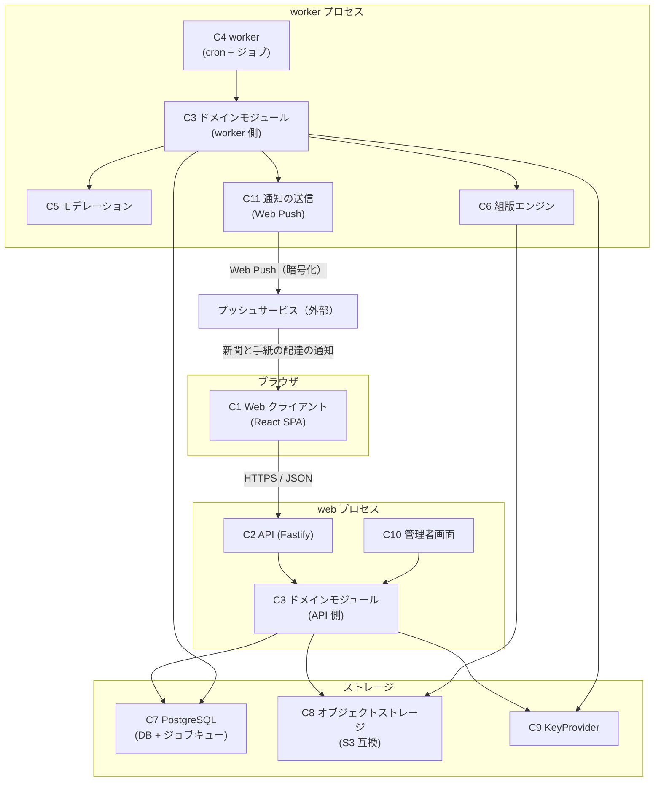

# システムアーキテクチャと技術選定

- 状態: 草案
- 日付: 2026-11-19
- 根拠: `.ai/brief.md`・`.ai/requirements.md`・`.ai/features.md`・ADR-0001〜0012
- チケット: YGO-003

---

## §1 方針

夕暮ヶ丘三丁目のシステム構成は次の 2 つの原則に従う。

1. **1 コードベース・2 プロセス** [explicit]（ADR-0008）: コードは 1 つのリポジトリのモジュール構造で管理し、動かすプロセスは `web`（API・クライアント配信）と `worker`（cron ジョブ実行）の 2 つに分ける。API・DB・バッチの責務を分離しながら（NFR-051）、必要以上に複雑にしない（NFR-055）。

2. **即時性を持ち込まない** [explicit]（P-1）: WebSocket・サーバー送信イベント・リアルタイム経路は作らない。配達は 1 日 2 回の配達回でのみ行う（新聞は定時、手紙は午前・午後の時間帯の中の受取人ごとの時刻、ADR-0035）。プッシュ通知は、worker が配達回ごとに送る新聞の通知（公開のあと）と手紙の通知（受取人の手紙の時刻のあと）だけ（OQ-002・OQ-042 → 決定、ADR-0025・ADR-0035）。

---

## §2 構成要素と責務

### 動かす要素

| ID | 要素 | 責務 | 動くプロセス | 関係する F- / ADR |
|----|------|------|------------|------------------|
| C1 | Web クライアント | React の SPA。全画面を提供する。配達完了の通知を受けるサービスワーカーを持つ（ADR-0025）。架空の街の地図（全住民で共有する 1 枚の白黒の SVG。印は付けない、OQ-054 の暫定）をクライアントの静的なファイルとして同じオリジンから配り、`` で出す（ADR-0028・ADR-0037） | ブラウザ | F-01〜F-19 / ADR-0025, ADR-0028, ADR-0037 |
| C2 | API（Fastify） | 認証・認可（メールアドレス＋パスワード・サーバー側のセッション・複数の端末可。ADR-0018・ADR-0019 → `security.md` §3）、入力の検証（2,000 字・1,000 字・1 日 20 通と 5 件・ブロック）、保留状態で保存。**配達はしない** [explicit] | web | F-02〜F-09 / ADR-0004, ADR-0005 |
| C3 | ドメインモジュール | 居住者と住所 / 手紙 / 郵便受け / 掲示板 / 住所録 / 新聞 / モデレーション / 配達 の 8 サブモジュール [inferred] | web / worker（共有） | F-01〜F-16 / ADR-0001〜0007 |
| C4 | worker | JST の cron スケジュールとジョブの実行（締め切り・モデレーション・組版・配達・配達の通知 J15（新聞と手紙）・休眠判定・画像加工）[explicit]（ADR-0004、通知は ADR-0025・ADR-0035） | worker | F-05, F-06, F-08, F-11, F-16 |
| C5 | モデレーション | ルール表と分類器インターフェース。LLM は `ok` / `review` / `block` を返すだけ（ADR-0005）。クローズドな手紙はルール表だけで照合し、手紙の経路には LLM の分類器を渡さない（ADR-0026）。テスト環境ではモックを使う。外部 LLM サービスは**秘書の暫定の選定**で Anthropic API の `claude-haiku-5-5`（構造化出力で 3 つのラベルに限る。本番のアダプタは承認のあとに作る。ADR-0031。確定は OQ-047） | worker | F-08 / ADR-0005, ADR-0026, ADR-0031 |
| C6 | 組版エンジン | テンプレートに従い TSX を静的 HTML に描き、決定的な紙面を生成する（ADR-0007・ADR-0011） | worker | F-06 / ADR-0011 |
| C7 | PostgreSQL | 正本データ・ジョブのキュー・`delivery_runs` [explicit]（ADR-0010） | — | 全体 / ADR-0010 |
| C8 | オブジェクトストレージ | S3 互換 API。画像・組版済み紙面の保存。ローカルではファイルアダプタを使う [assumed] | — | F-06, F-11 |
| C9 | KeyProvider | 手紙保存時の暗号化に使う対称鍵の提供（ADR-0006）。ローカルでは偽の鍵を使う | web / worker（共有） | F-04 / ADR-0006 |
| C10 | 管理者画面 | 通報・保留コンテンツ・異議申し立ての処理。使えるのはモデレーターのロールだけ（ADR-0020 で決定、`security.md` §4） | web | F-08, F-14 |
| C11 | 通知の送信 | 配達の通知（「新聞が配達されました！」「手紙が配達されました！（N通）」、ADR-0035）を Web Push（VAPID）で送るアダプタ。送り先の検査（ADR-0025 の D6）を通してから送る。テストではモックのプッシュ送信を使う | worker | F-05 / ADR-0025 |

### 作らない要素

| 要素 | 理由 |
|------|------|
| 対話的な地図・地図のジオデータ・外部の地図サービス | 地図は静的な画像で、C1 の静的なファイルだけで足りる（OQ-005 → 決定、ADR-0028）。地図のための API・DB の表も作らない |
| 年齢確認 | 年齢制限・特別な制限を置かないため要らない（OQ-004 → 決定、ADR-0027）。恋愛のための年齢確認は要らない（OQ-001 → 決定、ADR-0024）|
| 広告・折込チラシ | このフェーズの範囲外（F-20）|
| Redis 等の別のブローカ | PostgreSQL のキューで代替（ADR-0010）|
| WebSocket・リアルタイム経路 | P-1 に反するため作らない |

---

## §3 構成図

---

## §4 データの流れ

1. **手紙の投稿**: C2 API が入力を検証し（上限 2,000 字）、C9 KeyProvider の鍵で本文を暗号化して「保留（pending）」状態で C7 PostgreSQL に保存する。次の配達回の ID を紐づける。（ADR-0006）

2. **掲示板の投稿**: C2 API が入力を検証し（上限 1,000 字）、「審査待ち（awaiting_review）」状態で C7 に保存する。

3. **締め切り処理（01:00 / 14:00 JST）**: C4 worker が対象レコードを固め、`delivery_runs`（配達回 ID: `YYYY-MM-DD-morning` / `YYYY-MM-DD-evening`）を作成する。（ADR-0004）

4. **モデレーション（02:00 / 15:00 JST に開始し配達前に完了）**: C5 がルール表と LLM 分類器（テスト環境ではモック）で公開コンテンツを審査する [inferred]。クローズドな手紙も審査するが、本文は LLM に渡さず、C5 のルール表だけで照合する（OQ-003 → 決定、ADR-0026）。手紙の本文の復号は worker の中だけで行い、平文を DB・ログ・ジョブのペイロードに書かない。審査が間に合わないコンテンツは届けない。（ADR-0005・ADR-0026）

5. **組版（02:00〜05:00 / 15:00〜16:30 JST）**: C6 組版エンジンがテンプレートに従い TSX を静的 HTML に描き C8 に保存する。失敗した場合は「休刊」とし、その配達回は紙面を届けず、郵便受けには休刊の印と手紙だけが届く。（ADR-0007・ADR-0011・ADR-0035）

6. **配達（公開 07:00 / 17:00 JST）**: C4 worker が `delivery_runs` を参照し、配達回・宛先・項目の組で一意な制約（PostgreSQL の UNIQUE 制約）により冪等に配達する。
   新聞は全住民に、手紙は宛先に、準備（J4）で `mailbox_items` を作り、見える時刻 `visible_at` を書く（新聞は 07:00 / 17:00、手紙は受取人ごとの枠の時刻。午前 08:00〜11:50・午後 18:00〜20:50）。
   公開（J5）で状態を確定する。時刻に間に合わなければ次の便に丸ごと持ち越す。掲示板の投稿はこの時点で「掲載（published）」になる。（ADR-0004・ADR-0035）
   公開のあと、C4 worker の J15 が C11 を通して、購読のある住民へ「新聞が配達されました！」を 1 回送る（休刊の回も、郵便受けには休刊の印が届くので送る。ADR-0035 の D11）。
   手紙の枠の時刻を過ぎると、その枠に手紙がある住民へ「手紙が配達されました！（N通）」を 1 回送る。（ADR-0025・ADR-0035）

7. **閲覧**: C2 API は配達済み（配達回が `done`）で、かつ `visible_at` を過ぎた項目のみを郵便受け・バックナンバーとして返す（ADR-0035）。

8. **住所録**: 本人だけが読み書きできる。相手が引っ越しても自動では更新しない（ADR-0003）。

---

## §5 機能ごとの置き場所

| 機能 | API が受けること | worker がやること | 保存先 |
|------|----------------|-----------------|--------|
| F-01 架空の住所 | 住所候補の表示（使われたことのない住所だけ、ADR-0023）、住所選択 | —（休眠判定・住所再割り当ては F-16、段階 3） | C7 residents / addresses |
| F-02 アカウント | 登録・認証・削除 | — | C7 residents |
| F-03 郵便受け | 配達済み一覧の返却・削除 | — | C7 mailbox |
| F-04 個人宛の手紙 | 検証・暗号化して「保留」で保存 | 配達バッチ（割り当て・配達） | C7 letters / mailbox |
| F-05 朝便・夕便の定時配達 | 通知の購読の登録・削除（ADR-0025）。郵便受けは `visible_at` を過ぎた項目だけを返す（ADR-0035） | 締め切り処理・delivery_runs 作成・配達実行（手紙の枠の時刻を決める）・新聞と手紙の配達の通知（J15、C11。ADR-0035） | C7 delivery_runs / mailbox / push_subscriptions / delivery_notifications |
| F-06 朝刊・夕刊（組版） | バックナンバー閲覧 | 組版バッチ（収集・組版・保存・休刊判定）。全住民に届ける（FR-106、ADR-0035） | C7 newspapers / C8 |
| F-07 町内掲示板（テキスト） | 投稿受付（審査待ちで保存） | モデレーション後、配達時に掲載 | C7 board_posts |
| F-08 非同期モデレーション | 通報・ブロックの受付 | モデレーションバッチ | C7 moderation_queue / block_list |
| F-09 住所録 | 追加・削除・検索・メモ編集 | — | C7 address_book |
| F-11 画像添付と加工 | 画像アップロード受付（段階 2） | 加工バッチ（段階 2） | C8 |
| F-16 引っ越し・転送・空き家 | 引っ越し申請（段階 3） | 転送処理・休眠判定と休眠の通知・長期不在の退去・住所再割り当て（段階 3、ADR-0023） | C7 addresses / residents |
| F-19 架空の街の地図 | —（API なし。C1 の静的なファイル、ADR-0028） | — | —（DB なし。画像はレポジトリの中のクライアントの静的なファイル） |

---

## §6 技術選定の要約

詳細と選定理由は各 ADR を参照。

| 項目 | 選択 | ADR |
|------|------|-----|
| 言語・ランタイム | TypeScript（Node.js LTS）[explicit] | ADR-0009 |
| API | Fastify + JSON Schema バリデーション [explicit] | ADR-0009 |
| クライアント | React + Vite（SPA）[explicit] | ADR-0009 |
| DB | PostgreSQL [explicit] | ADR-0010 |
| ジョブキュー | PostgreSQL の上のキュー（pg-boss 相当）+ JST の cron [explicit] | ADR-0010 |
| 組版 | TSX → 静的 HTML（スナップショットテストで冪等性確認）[explicit] | ADR-0011 |
| 画像加工 | libvips 系ライブラリ（段階 2、`[assumed]`） | — |
| テスト | Vitest（`check.sh` へのつなぎはコードができてから）[assumed] | — |
| ホスティング（想定） | コンテナ 2 本（web / worker）・マネージド PostgreSQL・オブジェクトストレージ・鍵管理。事業者・IaC の道具・費用は `environment.md` で定義。**デプロイはしない** [explicit]（NFR-071） | — |

---

## §7 横断の事項

| 事項 | 方針 | 詳細 |
|------|------|------|
| JST 固定 | すべてのスケジュールは JST 基準。タイムゾーン拡張は OQ-034（持ち越し） | `api.md` |
| 秘密の管理 | 認証情報・鍵は環境変数または KeyProvider 経由。コードに含めない（NFR-016） | `security.md` |
| ログ | 個人特定できない形で保持（NFR-009）。保持期間は `db.md` で定義 | `db.md` |
| 認証 | メールアドレス＋パスワード（OQ-028 → 決定、ADR-0018）| `security.md` |
| 複数デバイス | 複数の端末でセッションを持てる（OQ-036 → 決定、ADR-0019） | `security.md` |

---

## §8 仮置きの一覧

| OQ ID | アーキテクチャで仮に置いたこと | 回答で変わる箇所 |
|-------|------------------------------|----------------|
| OQ-054 | 地図に印（知り合いの家・自分の住所・登録のときの候補）を付けない（全住民で共有する 1 枚の白黒の画像、ADR-0037 の D3） | 付ける → 住所と画像の上の位置の対応が要り、共有する画像の上に住民ごとの印を重ねる仕組みが要る（持つ場所と、地図の API を持つかは答えのあとに決める） |
| OQ-055 | 仮置きなし。ゲーム風の地図は作らない（ADR-0037 の D4、持ち越し） | 作る → C1 の地図の出し方（`` の 1 枚の画像、ADR-0028 の D5）と、API・DB を持たないこと（ADR-0028 の D3）を見直す |
| OQ-045 | 仮置きなし。F-17 は作らない（段階 3、止まる）。商店・団体のアカウントを作る経路は運用者の CLI だけ（ADR-0029、C10 には足さない） | 答えで、商店・団体として発信する主体の認証（C2）と C3 の権限の規則表の主体が決まる。実在の企業なら F-20 との境も |
| OQ-051 | 新聞の紙面は ADR-0007 のまま（全住民に同じ紙面を、掲示板の投稿から C6 がテンプレートで組む。住民の興味は集めず、外のニュースは取り込まず、LLM を使わない） | 住民ごとの紙面 → C6 の入力と `newspapers` の持ち方が変わる。興味を集める → C3 と C7 に新しい表。外のニュース → worker から外部のサービスへの経路（送り先の検査）。LLM で加工 → C6 に LLM のアダプタ（ADR-0007 の決定と食い違う） |
| OQ-052 | C5 の本番のルール表に手紙に当てる項目を置かない（テストは偽の規則）・止めた手紙は人が見ない（送った人には「届けられませんでした」とだけ見せる）・年齢は集めない（C2 に年齢確認を加えない、ADR-0027） | 手紙で止める内容が決まる → C5 のルール表に手紙の項目が加わる。止めた手紙を見てよい → C10 と C3 の権限の規則に、止めた手紙を見る経路が加わる。年齢で変える → C2 に年齢の確認（外部の確認なら外部のサービスへの経路）、C3 の権限の規則と C5 のルール表に年齢の条件が加わる |
| OQ-053 | 仮置きなし。違法な物の取引の場にしないための守りは別のチケットで設計する（持ち越し） | C5 のルール表に項目が加わりうる（手紙に当てるかは OQ-052 の答えによる） |

OQ-001（恋愛マッチングの年齢条件）は 2026-11-19 のマスターの答えで決定した（恋愛のカテゴリを設けない、ADR-0024）。仮置きから外した。

OQ-002（配達完了後の通知）は 2026-11-19 のマスターの答えで決定した（通知あり・郵便の件数を含む、ADR-0025）。仮置きから外し、C11 と J15 を足した。

OQ-042（通知で数える「郵便」と通知の中身）は 2026-11-19 のマスターの答えで決定した（新聞は全住民に定時に届けて通知し、手紙は午前・午後のランダムな時刻に届けて件数を通知する、ADR-0035）。仮置きから外し、§4 の 6・7 と C11 を直した。新聞の中身は OQ-051 として仮置きに足した。

OQ-003（クローズドな手紙のモデレーション範囲）は 2026-11-19 のマスターの答えで決定した（対象とする・LLM には渡さない・厳格なアクセス制御、ADR-0026）。仮置きから外し、残りを OQ-043 にした。

OQ-043（手紙で止める内容と、モデレーターが手紙を見てよい場面）は 2026-11-19 のマスターの答えで決定した（通報された手紙はモデレーターが条件付きで 1 通だけ確かめてよい・住民を守る制限は住民が自分で外せる設定にしない、ADR-0036）。仮置きから外した。C10 と C3 の通報された手紙を見る経路は決定になった。残りを OQ-052・OQ-053 として仮置きに足した。

OQ-004（未成年の利用ポリシー）は 2026-11-19 のマスターの答えで決定した（年齢制限なし・特別な制限なし、ADR-0027）。仮置きから外した。C2 に年齢確認は加えない。

OQ-005（架空の街の地図）は 2026-11-19 のマスターの答えで決定した（静的な画像として実装し、開発の初期段階で行う、ADR-0028）。仮置きから外し、C1 に静的な地図を足した。API・DB・ジオデータは加えない。残りを OQ-044 にした（のちに決定）。

OQ-044（地図の上で住所の場所を示すか）は 2026-11-19 のマスターの答えで決定した（全住民で共有する 1 枚の画像・白黒・ゲーム風は今は作らない、ADR-0037）。仮置きから外し、C1 の地図を白黒の共有の SVG にした。
残りを OQ-054（印、要回答）として仮置きに足し、OQ-055（ゲーム風の地図、持ち越し）を足した。

OQ-006（商店・団体のアカウントの主体）は 2026-11-19 のマスターの答えで決定した（管理者が作る、ADR-0029）。仮置きから外した。作る経路は運用者の CLI で、管理者画面（C10）に開設機能は加えない。残りを OQ-045 にした。

OQ-007（新規登録の方式）は 2026-11-19 のマスターの答えで決定した（開放式、ADR-0030）。仮置きから外した。C2・C3 に招待トークンの管理は加えない。
メールの確認が済まない登録が住所を押さえる期限は OQ-046（持ち越し）。

OQ-008（外部 LLM のサービスと費用）は 2026-11-19 のマスターの答えで決定した（費用の見積もりはロードマップに含め、サービスの選定は秘書に任せる（暫定）、ADR-0031）。仮置きから外した。
C5 の外部 LLM は暫定で Anthropic API の `claude-haiku-5-5`。本番のアダプタはデプロイと契約の承認のあとに作り、それまではモックで動かす。費用の見積もりは `roadmap.md` §9.1。
暫定の選定の確定と費用の上限は OQ-047（持ち越し）。

OQ-041（共有を禁止する「連絡先」と禁止の範囲）は 2026-11-19 のマスターの答えで決定した（街の外の連絡先だけ・禁止はマッチングの中だけで、掲示板・手紙には及ばない、ADR-0034）。仮置きから外した。
C5 のルール表に FR-101 を理由にした項目は加えない（ほかの理由で個人情報を止める項目を置くかは、この決定の範囲の外）。マッチングの中での守り方の細部は OQ-050（持ち越し）。

---

## §9 他の文書への変更提案

これらは **別のチケット** で行う。

1. **OQ-029 の扱いを「持ち越し」→「決定」に変更**: 想定規模（住民 1 万人・ピーク同時接続数百・1 配達回の手紙は最大約 20 万通）を ADR-0012 に記録したため、`open-questions.md` の OQ-029 の扱いを「持ち越し → 決定（ADR-0012）」に更新する。

2. **ADR-0007 の「組版エンジンは別途 ADR に記録する」を ADR-0011 に結びつける**: ADR-0007 の影響欄に「→ ADR-0011 参照」を追記する。
