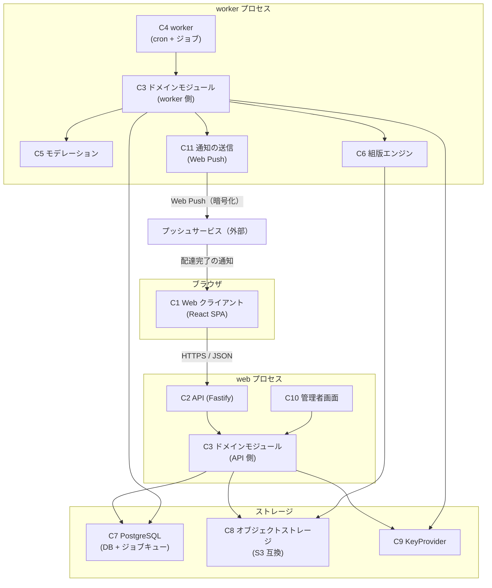

# システムアーキテクチャと技術選定

- 状態: 草案
- 日付: 2026-11-19
- 根拠: `.ai/brief.md`・`.ai/requirements.md`・`.ai/features.md`・ADR-0001〜0012
- チケット: YGO-003

---

## §1 方針

夕暮ヶ丘三丁目のシステム構成は次の 2 つの原則に従う。

1. **1 コードベース・2 プロセス** [explicit]（ADR-0008）: コードは 1 つのリポジトリのモジュール構造で管理し、動かすプロセスは `web`（API・クライアント配信）と `worker`（cron ジョブ実行）の 2 つに分ける。API・DB・バッチの責務を分離しながら（NFR-051）、必要以上に複雑にしない（NFR-055）。

2. **即時性を持ち込まない** [explicit]（P-1）: WebSocket・サーバー送信イベント・リアルタイム経路は作らない。配達は定時にのみ行う。プッシュ通知は、配達回の公開のあとに worker が 1 回送る配達完了の通知だけ（OQ-002 → 決定、ADR-0025）。

---

## §2 構成要素と責務

### 動かす要素

| ID | 要素 | 責務 | 動くプロセス | 関係する F- / ADR |
|----|------|------|------------|------------------|
| C1 | Web クライアント | React の SPA。全画面を提供する。配達完了の通知を受けるサービスワーカーを持つ（ADR-0025） | ブラウザ | F-01〜F-18 / ADR-0025 |
| C2 | API（Fastify） | 認証・認可（メールアドレス＋パスワード・サーバー側のセッション・複数の端末可。ADR-0018・ADR-0019 → `security.md` §3）、入力の検証（2,000 字・1,000 字・1 日 20 通と 5 件・ブロック）、保留状態で保存。**配達はしない** [explicit] | web | F-02〜F-09 / ADR-0004, ADR-0005 |
| C3 | ドメインモジュール | 居住者と住所 / 手紙 / 郵便受け / 掲示板 / 住所録 / 新聞 / モデレーション / 配達 の 8 サブモジュール [inferred] | web / worker（共有） | F-01〜F-16 / ADR-0001〜0007 |
| C4 | worker | JST の cron スケジュールとジョブの実行（締め切り・モデレーション・組版・配達・配達完了の通知 J15・休眠判定・画像加工）[explicit]（ADR-0004、通知は ADR-0025） | worker | F-05, F-06, F-08, F-11, F-16 |
| C5 | モデレーション | ルール表と分類器インターフェース。LLM は `ok` / `review` / `block` を返すだけ（ADR-0005）。クローズドな手紙はルール表だけで照合し、手紙の経路には LLM の分類器を渡さない（ADR-0026）。テスト環境ではモックを使う。外部 LLM サービスは**仮置き（OQ-008 の回答待ち）** | worker | F-08 / ADR-0005, ADR-0026 |
| C6 | 組版エンジン | テンプレートに従い TSX を静的 HTML に描き、決定的な紙面を生成する（ADR-0007・ADR-0011） | worker | F-06 / ADR-0011 |
| C7 | PostgreSQL | 正本データ・ジョブのキュー・`delivery_runs` [explicit]（ADR-0010） | — | 全体 / ADR-0010 |
| C8 | オブジェクトストレージ | S3 互換 API。画像・組版済み紙面の保存。ローカルではファイルアダプタを使う [assumed] | — | F-06, F-11 |
| C9 | KeyProvider | 手紙保存時の暗号化に使う対称鍵の提供（ADR-0006）。ローカルでは偽の鍵を使う | web / worker（共有） | F-04 / ADR-0006 |
| C10 | 管理者画面 | 通報・保留コンテンツ・異議申し立ての処理。使えるのはモデレーターのロールだけ（ADR-0020 で決定、`security.md` §4） | web | F-08, F-14 |
| C11 | 通知の送信 | 配達完了の通知を Web Push（VAPID）で送るアダプタ。送り先の検査（ADR-0025 の D6）を通してから送る。テストではモックのプッシュ送信を使う | worker | F-05 / ADR-0025 |

### 作らない要素

| 要素 | 理由 |
|------|------|
| 地図 | 仮置き（OQ-005 の回答待ち）。要件 ID なし |
| 年齢確認 | 仮置き（OQ-004 の回答待ち）。恋愛のための年齢確認は要らない（OQ-001 → 決定、ADR-0024）|
| 広告・折込チラシ | このフェーズの範囲外（F-20）|
| Redis 等の別のブローカ | PostgreSQL のキューで代替（ADR-0010）|
| WebSocket・リアルタイム経路 | P-1 に反するため作らない |

---

## §3 構成図

---

## §4 データの流れ

1. **手紙の投稿**: C2 API が入力を検証し（上限 2,000 字）、C9 KeyProvider の鍵で本文を暗号化して「保留（pending）」状態で C7 PostgreSQL に保存する。次の配達回の ID を紐づける。（ADR-0006）

2. **掲示板の投稿**: C2 API が入力を検証し（上限 1,000 字）、「審査待ち（awaiting_review）」状態で C7 に保存する。

3. **締め切り処理（01:00 / 14:00 JST）**: C4 worker が対象レコードを固め、`delivery_runs`（配達回 ID: `YYYY-MM-DD-morning` / `YYYY-MM-DD-evening`）を作成する。（ADR-0004）

4. **モデレーション（02:00 / 15:00 JST に開始し配達前に完了）**: C5 がルール表と LLM 分類器（テスト環境ではモック）で公開コンテンツを審査する [inferred]。クローズドな手紙も審査するが、本文は LLM に渡さず、C5 のルール表だけで照合する（OQ-003 → 決定、ADR-0026）。手紙の本文の復号は worker の中だけで行い、平文を DB・ログ・ジョブのペイロードに書かない。審査が間に合わないコンテンツは届けない。（ADR-0005・ADR-0026）

5. **組版（02:00〜05:00 / 15:00〜16:30 JST）**: C6 組版エンジンがテンプレートに従い TSX を静的 HTML に描き C8 に保存する。失敗した場合は「休刊」とし、その配達回は手紙のみを届ける。（ADR-0007・ADR-0011）

6. **配達（07:00 / 17:00 JST）**: C4 worker が `delivery_runs` を参照し、配達回・宛先・項目の組で一意な制約（PostgreSQL の UNIQUE 制約）により冪等に配達する。時刻に間に合わなければ次の便に丸ごと持ち越す。掲示板の投稿はこの時点で「掲載（published）」になる。（ADR-0004）
   公開のあと、C4 worker の J15 が C11 を通して、購読のある住民へ配達完了の通知（郵便の件数を含む）を 1 回送る。（ADR-0025）

7. **閲覧**: C2 API は配達済み（delivered）の項目のみを郵便受け・バックナンバーとして返す。

8. **住所録**: 本人だけが読み書きできる。相手が引っ越しても自動では更新しない（ADR-0003）。

---

## §5 機能ごとの置き場所

| 機能 | API が受けること | worker がやること | 保存先 |
|------|----------------|-----------------|--------|
| F-01 架空の住所 | 住所候補の表示（使われたことのない住所だけ、ADR-0023）、住所選択 | —（休眠判定・住所再割り当ては F-16、段階 3） | C7 residents / addresses |
| F-02 アカウント | 登録・認証・削除 | — | C7 residents |
| F-03 郵便受け | 配達済み一覧の返却・削除 | — | C7 mailbox |
| F-04 個人宛の手紙 | 検証・暗号化して「保留」で保存 | 配達バッチ（割り当て・配達） | C7 letters / mailbox |
| F-05 朝便・夕便の定時配達 | 通知の購読の登録・削除（ADR-0025） | 締め切り処理・delivery_runs 作成・配達実行・配達完了の通知（J15、C11） | C7 delivery_runs / mailbox / push_subscriptions / delivery_notifications |
| F-06 朝刊・夕刊（組版） | バックナンバー閲覧 | 組版バッチ（収集・組版・保存・休刊判定） | C7 newspapers / C8 |
| F-07 町内掲示板（テキスト） | 投稿受付（審査待ちで保存） | モデレーション後、配達時に掲載 | C7 board_posts |
| F-08 非同期モデレーション | 通報・ブロックの受付 | モデレーションバッチ | C7 moderation_queue / block_list |
| F-09 住所録 | 追加・削除・検索・メモ編集 | — | C7 address_book |
| F-11 画像添付と加工 | 画像アップロード受付（段階 2） | 加工バッチ（段階 2） | C8 |
| F-16 引っ越し・転送・空き家 | 引っ越し申請（段階 3） | 転送処理・休眠判定と休眠の通知・長期不在の退去・住所再割り当て（段階 3、ADR-0023） | C7 addresses / residents |

---

## §6 技術選定の要約

詳細と選定理由は各 ADR を参照。

| 項目 | 選択 | ADR |
|------|------|-----|
| 言語・ランタイム | TypeScript（Node.js LTS）[explicit] | ADR-0009 |
| API | Fastify + JSON Schema バリデーション [explicit] | ADR-0009 |
| クライアント | React + Vite（SPA）[explicit] | ADR-0009 |
| DB | PostgreSQL [explicit] | ADR-0010 |
| ジョブキュー | PostgreSQL の上のキュー（pg-boss 相当）+ JST の cron [explicit] | ADR-0010 |
| 組版 | TSX → 静的 HTML（スナップショットテストで冪等性確認）[explicit] | ADR-0011 |
| 画像加工 | libvips 系ライブラリ（段階 2、`[assumed]`） | — |
| テスト | Vitest（`check.sh` へのつなぎはコードができてから）[assumed] | — |
| ホスティング（想定） | コンテナ 2 本（web / worker）・マネージド PostgreSQL・オブジェクトストレージ・鍵管理。事業者・IaC の道具・費用は `environment.md` で定義。**デプロイはしない** [explicit]（NFR-071） | — |

---

## §7 横断の事項

| 事項 | 方針 | 詳細 |
|------|------|------|
| JST 固定 | すべてのスケジュールは JST 基準。タイムゾーン拡張は OQ-034（持ち越し） | `api.md` |
| 秘密の管理 | 認証情報・鍵は環境変数または KeyProvider 経由。コードに含めない（NFR-016） | `security.md` |
| ログ | 個人特定できない形で保持（NFR-009）。保持期間は `db.md` で定義 | `db.md` |
| 認証 | メールアドレス＋パスワード（OQ-028 → 決定、ADR-0018）| `security.md` |
| 複数デバイス | 複数の端末でセッションを持てる（OQ-036 → 決定、ADR-0019） | `security.md` |

---

## §8 仮置きの一覧

| OQ ID | アーキテクチャで仮に置いたこと | 回答で変わる箇所 |
|-------|------------------------------|----------------|
| OQ-004 | 年齢制限なし・特別な制限なし（暫定） | 未成年制限あり → 生年月日確認の仕組みが C2 に加わる可能性がある |
| OQ-005 | 地図機能は作らない | 実装する → 地図コンポーネント（C1 拡張）と住所のジオデータが C7 に加わる |
| OQ-006 | 商店・団体アカウントは住民と同じ方法で作成できると仮置き（段階 3 以降） | 管理者設定式 → 管理者画面（C10）に開設機能を追加 |
| OQ-007 | 新規登録は開放式 | 招待制 → 招待トークン管理が C2 / C3 に加わる |
| OQ-008 | モデレーション（C5）は外部 LLM なしのモックで動かす | LLM サービス採用 → C5 のアダプタ実装が確定する。費用見積もりは `environment.md` へ |
| OQ-041 | 連絡先の共有の禁止（FR-101）はマッチングの中だけ（登録と提案に連絡先の欄を設けない） | 手紙・掲示板に及ぶ → C5 のルール表に項目が加わる。クローズドな手紙に及ぶなら、手紙に当てる項目として OQ-043 と合わせて決める（手紙はルール表だけ、ADR-0026）。「連絡先」に街の住所も含むなら FR-067・ADR-0024 の D2・成立後に相手へ手紙を出す方法（提案に街の住所を載せるか）・C-06（roadmap.md）が変わる |
| OQ-042 | 配達完了の通知（J15）は手紙だけを数え、0 通の住民には送らない。中身は便と件数だけ | 新聞も数える・0 通でも送る → J15 の数え方と送る相手が変わる。中身を足す → C11 に渡す中身と `security.md` §7 の T-17 が変わる |
| OQ-043 | C5 の本番のルール表に手紙に当てる項目を置かない（テストは偽の規則）・止めた手紙は人が見ない（送った人には「届けられませんでした」とだけ見せる）・通報された手紙はモデレーターが 1 通だけ確かめる（YGO-007 からの暫定） | 手紙で止める内容が決まる → C5 のルール表に手紙の項目が加わる。止めた手紙を見てよい → C10 と C3 の権限の規則に、止めた手紙を見る経路が加わる。通報された手紙を読ませない → C10 と C3 から通報された手紙を見る経路がなくなる |

OQ-001（恋愛マッチングの年齢条件）は 2026-11-19 のマスターの答えで決定した（恋愛のカテゴリを設けない、ADR-0024）。仮置きから外した。

OQ-002（配達完了後の通知）は 2026-11-19 のマスターの答えで決定した（通知あり・郵便の件数を含む、ADR-0025）。仮置きから外し、C11 と J15 を足した。

OQ-003（クローズドな手紙のモデレーション範囲）は 2026-11-19 のマスターの答えで決定した（対象とする・LLM には渡さない・厳格なアクセス制御、ADR-0026）。仮置きから外し、残りを OQ-043 にした。

---

## §9 他の文書への変更提案

これらは **別のチケット** で行う。

1. **OQ-029 の扱いを「持ち越し」→「決定」に変更**: 想定規模（住民 1 万人・ピーク同時接続数百・1 配達回の手紙は最大約 20 万通）を ADR-0012 に記録したため、`open-questions.md` の OQ-029 の扱いを「持ち越し → 決定（ADR-0012）」に更新する。

2. **ADR-0007 の「組版エンジンは別途 ADR に記録する」を ADR-0011 に結びつける**: ADR-0007 の影響欄に「→ ADR-0011 参照」を追記する。
