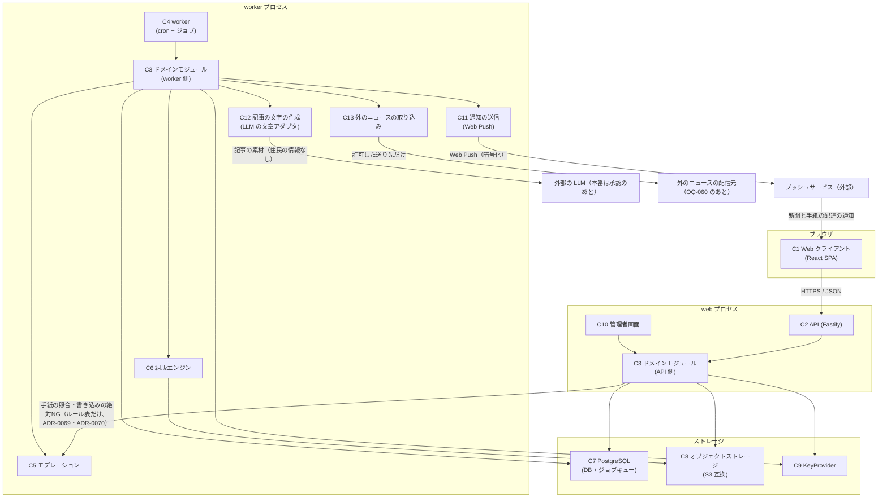

# システムアーキテクチャと技術選定

- 状態: 草案
- 日付: 2026-11-19
- 根拠: `.ai/brief.md`・`.ai/requirements.md`・`.ai/features.md`・ADR-0001〜0012
- チケット: YGO-003

---

## §1 方針

夕暮ヶ丘三丁目のシステム構成は次の 2 つの原則に従う。

1. **1 コードベース・2 プロセス** [explicit]（ADR-0008）: コードは 1 つのリポジトリのモジュール構造で管理し、動かすプロセスは `web`（API・クライアント配信）と `worker`（cron ジョブ実行）の 2 つに分ける。API・DB・バッチの責務を分離しながら（NFR-051）、必要以上に複雑にしない（NFR-055）。

2. **即時性を持ち込まない** [explicit]（P-1）: WebSocket・サーバー送信イベント・リアルタイム経路は作らない。配達は 1 日 2 回の配達回でのみ行う（新聞は定時、手紙は午前・午後の時間帯の中の受取人ごとの時刻、ADR-0035）。プッシュ通知は、worker が配達回ごとに送る新聞の通知（公開のあと）と手紙の通知（受取人の手紙の時刻のあと）だけ（OQ-002・OQ-042 → 決定、ADR-0076・ADR-0035）。

---

## §2 構成要素と責務

### 動かす要素

| ID | 要素 | 責務 | 動くプロセス | 関係する F- / ADR |
|----|------|------|------------|------------------|
| C1 | Web クライアント | React の SPA。全画面を提供する。配達完了の通知を受けるサービスワーカーを持つ（ADR-0076）。架空の街の地図（全住民で共有する 1 枚の白黒の SVG。土台はバイト単位で同じ）をクライアントの静的なファイルとして同じオリジンから配り、`` で出す（ADR-0083・ADR-0061）。その上に印の層（自分の家・登録のときの候補・知り合いの家。印を付けるのは住所録のすべてのエントリで、`acquainted` を読まず印を変えない、ADR-0051。手紙を出せる知り合いの定義は ADR-0065）と、入居の層（街のすべての家の空き家・入居を白黒の 2 つの形で示す。登録の画面とログインした住民の地図の画面の両方、ADR-0084 の D8・D10）を重ね、自分の家を窓の中心に置く。登録の画面では、候補の印か空き家の印を押して（キーボードでも。空き家の印は層ごとに 1 つの Tab の止まり場所と矢印キー）住所を選べ、候補の一覧からも選べる（一覧と地図の選択は 1 つの状態で、候補でない空き家を選んだときは一覧のそばに選んだ住所を出す。押す処理は React のハンドラで登録の画面の候補の印と空き家の印だけに付け、印の層に文字列のイベント属性を入れない。ほかの印と土台は押しても何も起きない。登録が 409 なら選択を外し、候補と入居の一覧を取り直す、ADR-0084 の D7・D8、ADR-0083 の D1 (a)）。住所から位置を求めるのは C1 の静的な配置の定義と計算で、C1 の静的なファイルに号までの住所の一覧を持たない。地図の画面が呼ぶ API は `GET /api/v1/me`・`GET /api/v1/addresses/candidates`・`GET /api/v1/address-book`・`GET /api/v1/addresses/occupancy` の 4 つだけ（登録の画面は候補と入居の 2 つ。ADR-0084 の D4・D5）。掲示板の画面では、投稿のときに「この投稿を見た人から手紙を受け取る」（オープン）を選べ、自分の投稿のオープンをあとから切り替えられる。オープンの掲載中の投稿には、住所録に足す導線を出す（投稿の ID で足し、投稿者の住所は出さない。投稿から足したエントリは住所なしで示し、そのエントリ宛ての手紙はエントリの ID で送る。ADR-0065 の D11・D12）。どの入力欄（手紙・掲示板・ニックネームと自己紹介・住所録のメモと検索・通報の理由など）も絵文字を受け付けない（ADR-0070 の D2）。投函の 422 には、`letter_needs_review` なら確認を頼むか（y / n）のポップアップを、`letter_rejected` なら送れないことの決まった文面を出し、ほかの書き込みの 422 `content_rejected` には書けないことの決まった文面を出す。どれも当たった規則を出さない（ADR-0069・ADR-0070）。登録の画面は年齢と誕生日（月日）を必須で入れさせ、誕生日の入力に「この町での誕生日です（本当の日でなくてかまいません）」と示し、送る前に「年齢と誕生日はあとから変えられません」と示して確かめる（ADR-0073 の D5） | ブラウザ | F-01〜F-19 / ADR-0076, ADR-0083, ADR-0061, ADR-0084, ADR-0051, ADR-0069, ADR-0070, ADR-0073 |
| C2 | API（Fastify） | 認証・認可（メールアドレス＋パスワード・サーバー側のセッション・複数の端末可。ADR-0080・ADR-0081 → `security.md` §3）、入力の検証（2,000 字・1,000 字・1 日 20 通と 5 件・住所録の追加の 1 日 20 件と相互にならない追加の停止（429 `add_suspended`、ADR-0066）・ブロック・手紙の宛先が知り合いか（互いの追加か、オープンの掲載中の投稿から足したエントリ宛て。互いの追加の組は住所録の行の `source` で分け、住所を入れた行と住所を見せない行を組にしない。ブロックは見ない、ADR-0065 の D2・D7・D15））、投稿者が届いた手紙から差出人を住所を見せずに足し返すこと（`mailbox_item_id`、ADR-0065 の D15）、保留状態で保存。掲示板の投稿のオープンの切り替え（`PATCH /api/v1/board/posts/{id}`。投稿者だけ、ほかは 404、ADR-0065 の D11）。全ての書き込みと検索語に絵文字があれば 400（ADR-0070 の D2）。手紙のほかの書き込み（掲示板の投稿・ニックネームと自己紹介・住所録のメモ・通報の理由）は、書いたときに C5 のルール表の `reject` の段に当て、当たれば保存せずに 422 `content_rejected`（ADR-0070 の D3）。認証なしで呼べる経路は住所の候補・入居の一覧（`GET /api/v1/addresses/occupancy`。住所と `occupied` だけを返し、呼んだ人で応答を変えない、ADR-0084 の D10・D15）・登録・ログイン・興味の一覧（`api.md` §4）。登録の住所は提示した候補かどうかを確かめず、住所のプールにない住所は 400、C3 が割り当てられないとした住所は 409（ADR-0082 の D3）。手紙は投函のときに C5 のルール表の手紙の項目に 2 段で当て、`reject` の段に当たったら保存せずに 422 `letter_rejected`、`review` の段だけに当たったら保存せずに送った人に確認を頼むかを聞く（ADR-0069）。登録の `age` と `birthday`（`MM-DD`、暦にある月日だけ。2/29 は許す）を検証し、`PATCH /me` の `age`・`birthday` は 400 で何も変えない。今の年齢は誕生日の回数で読むときに計算する（ADR-0073 の D1〜D5）。**配達はしない** [explicit] | web | F-02〜F-09 / ADR-0004, ADR-0005, ADR-0069, ADR-0070, ADR-0065, ADR-0066, ADR-0073 |
| C3 | ドメインモジュール | 居住者と住所 / 手紙 / 郵便受け / 掲示板 / 住所録 / 新聞 / モデレーション / 配達 の 8 サブモジュール [inferred]。絵文字の検査（形式の確認の一部。全ての入力で同じ関数）と `reject` の段の照合は、モデレーションのサブモジュールに 1 つずつ置き、各サブモジュールが書き込みのときに呼ぶ `[assumed]`。手紙のサブモジュールは、ルール表の 2 段（`reject` を先に、次に `review`）の照合の順番を持つ（ADR-0069 の D10・D13・ADR-0070 の D2・D3）。居住者と住所のサブモジュールは、住所のプールの静的な定義（街のすべての住所の番・号。候補の提示と入居の一覧が同じ集合を使う）と、`addresses.status` から入居（`active`・`dormant`）と空き家（行がない・`vacant_*`）を読む規則を持つ `[assumed]`（ADR-0084 の D13・D15）。登録の住所の割り当ては、その段階で候補になる住所（MVP では `addresses` に行のない住所）だけを受け、行のある住所と `address_text` の一意制約で負けた登録を同じ 409 にする `[assumed]`（ADR-0082 の D3・ADR-0062 の D3） | web / worker（共有） | F-01〜F-16・F-19 / ADR-0001〜0007, ADR-0069, ADR-0070, ADR-0082, ADR-0084 |
| C4 | worker | JST の cron スケジュールとジョブの実行（締め切り・モデレーション・外のニュースの取り込み J17・記事の文字 J16・組版・配達・配達の通知 J15（新聞と手紙）・休眠判定・画像加工）[explicit]（ADR-0004、通知は ADR-0076・ADR-0035） | worker | F-05, F-06, F-08, F-11, F-16 |
| C5 | モデレーション | ルール表と分類器インターフェース。LLM は `ok` / `review` / `block` を返すだけ（ADR-0005）。クローズドな手紙はルール表だけで照合し、手紙の経路には LLM の分類器を渡さない（ADR-0072）。手紙の照合は送るときに web（C2）が行う。手紙に当てる項目はスパム・外部リンク・成人向けの言葉・本当の情報（本当の居住地・本当の年齢・街の外の連絡先）で、各項目は段（`reject` / `review`）を持つ（ADR-0069）。`reject` の段の規則は、手紙のほかの全ての書き込みにも書いたときに当てる（ADR-0070 の D3）。web にはルール表だけを渡し、LLM の分類器は渡さない。テスト環境ではモックを使う。外部 LLM サービスは**秘書の暫定の選定**で Anthropic API の `claude-haiku-5-5`（構造化出力で 3 つのラベルに限る。本番のアダプタは承認のあとに作る。ADR-0031。確定は OQ-047） | worker（ルール表は web / worker で共有） | F-08 / ADR-0005, ADR-0072, ADR-0031, ADR-0069, ADR-0070 |
| C6 | 組版エンジン | テンプレートに従い TSX を静的 HTML に描き、決定的な紙面を生成する（ADR-0007・ADR-0011）。`newspaper_articles` に保存した記事の文字から、版（共通の版・興味の版）ごとに組み、LLM は呼ばない（ADR-0055 の D7。ADR-0039 を置き換え）。投稿の本文は書き換えずに投稿の枠に入れ、LLM の文は枠の外に置き、印は描かない。投稿の記事は LLM の見出しだけでまとめはない（ADR-0054）。組 1・2 の住民ごとの版（組 1・2 と一緒に作る、OQ-070）の朝刊には、その日が誕生日の知り合いのニックネーム・年齢・住所を、テンプレートの決まった文の誕生日の欄に組む（記事の枠の外。LLM に渡さない、ADR-0074 の D9） | worker | F-06 / ADR-0011, ADR-0054, ADR-0055, ADR-0074 |
| C7 | PostgreSQL | 正本データ・ジョブのキュー・`delivery_runs` [explicit]（ADR-0010）。掲示板の投稿のオープン（`board_posts.accepts_letters`、ADR-0065 の D11）と、投稿から足した住所録のエントリと、届いた手紙から差出人を足したエントリ（`address_book.source`・`board_post_id`・`source_letter_id`。住所を持たない、ADR-0065 の D7・D12・D15）と、住所録のエントリを数えた時刻（`address_book.counted_at`、ADR-0066 の D5）を持つ。段階 2 で、過去の新聞の検索から推し量った興味の ID（`inferred_interests`、検索語は持たない、ADR-0045）を足す | — | 全体 / ADR-0010, ADR-0065, ADR-0066 |
| C8 | オブジェクトストレージ | S3 互換 API。画像・組版済み紙面の保存。アップロードした元の画像は加工（J13）が終わるか失敗した時点で消し、取りこぼしは 24 時間を過ぎたあとの次の J14 が消す（最長でアップロードから約 48 時間）（ADR-0074 の D5、段階 2）。ローカルではファイルアダプタを使う [assumed] | — | F-06, F-11 |
| C9 | KeyProvider | 手紙保存時の暗号化に使う対称鍵の提供（ADR-0006）。ローカルでは偽の鍵を使う | web / worker（共有） | F-04 / ADR-0006 |
| C10 | 管理者画面 | 通報・保留コンテンツ（送った人が確認を頼んだ確認待ちの手紙を含む、ADR-0069）・異議申し立ての処理。使えるのはモデレーターのロールだけ（ADR-0020 で決定、`security.md` §4） | web | F-08, F-14 |
| C11 | 通知の送信 | 配達の通知（「新聞が配達されました！」「手紙が配達されました！（N通）」、ADR-0035）を Web Push（VAPID）で送るアダプタ。送り先の検査（ADR-0076 の D6）を通してから送る。テストではモックのプッシュ送信を使う | worker | F-05 / ADR-0076 |
| C12 | 記事の文字の作成（LLM の文章アダプタ） | J16 が素材（承認済みの投稿・取り込んだ外のニュース）ごとに記事の文字を作るアダプタ（外のニュースは見出しと記事の文、投稿は見出しだけ）。渡すもの・出力の検査・決まった形への切り替えは ADR-0055 の D8。テストではモック。本番のアダプタは承認のあとに作り、モデルは OQ-062 | worker | F-06 / ADR-0054, ADR-0055 |
| C13 | 外のニュースの取り込み | J17 が実在の外のニュースを取り込むアダプタ。送り先は許可した一覧だけ（`https`・リダイレクトに従わない）。取り込んだ記事はルール表に当てる。テストと M5 は偽の記事（`EXAMPLE_NEWS_DO_NOT_USE`）のアダプタ。本番のアダプタは OQ-060 のあと | worker | F-06 / ADR-0039 |

### 作らない要素

| 要素 | 理由 |
|------|------|
| 地図の拡大・移動・検索・地図のジオデータ・外部の地図サービス | 地図は静的な画像で、C1 の静的なファイルだけで足りる（OQ-005 → 決定、ADR-0083）。押せるのは登録の画面の候補の印と空き家の印だけ（OQ-080・OQ-089 → 決定、ADR-0083 の D1 (a)）。DB の地図の表・座標を返す経路も作らない。地図のための API は入居の一覧だけ（ADR-0083 の D3） |
| 年齢確認 | 年齢は住民が設定した値をそのまま使い、確かめない（OQ-052 → 決定、ADR-0041。登録に年齢制限を置かないことは ADR-0027）。外部の年齢確認のサービスへの経路は作らない。恋愛のための年齢確認は要らない（OQ-001 → 決定、ADR-0024）|
| 広告・折込チラシ | このフェーズの範囲外（F-20）。運営の入居者募集の広告（FR-123）は除く。段階 3 から C6 の紙面に載せる（ADR-0050 の D5、OQ-083 → 決定。細部は OQ-084）|
| Redis 等の別のブローカ | PostgreSQL のキューで代替（ADR-0010）|
| WebSocket・リアルタイム経路 | P-1 に反するため作らない |

---

## §3 構成図

---

## §4 データの流れ

1. **手紙の投稿**: C2 API が入力を検証し（上限 2,000 字）、宛先が送る人の知り合いかを C7 の住所録・居住記録・掲示板の投稿のオープンから確かめ（知り合いでなければ保存せずに 422 `not_acquainted`、ADR-0065）、暗号化の前に C5 のルール表の手紙の項目に当てる（LLM は使わない）。当たらなければ、C9 KeyProvider の鍵で本文を暗号化して「保留（pending）」状態で C7 PostgreSQL に保存し、次の配達回の ID を紐づける。
   本文に絵文字があれば、知り合いの確認の前に保存せずに 400 を返す。`reject` の段に当たったら保存せずに 422 `letter_rejected` を返す（確認に回さない）。
   `review` の段だけに当たったら保存せずに 422 `letter_needs_review` を返し、送った人が確認を頼んだ（y）ときだけ「確認待ち（held）」で保存する。確認待ちの手紙はモデレーターが C10 で確かめ、承認なら次の配達回に入る。（ADR-0006・ADR-0069）

2. **掲示板の投稿**: C2 API が入力を検証し（上限 1,000 字・絵文字があれば 400）、C5 のルール表の `reject` の段に当て（当たれば保存せずに 422 `content_rejected`、ADR-0070 の D3）、当たらなければ「審査待ち（awaiting_review）」状態で C7 に保存する。投稿者が選んだオープン（`accepts_letters`）も保存し、オープンは掲載（published）になってから効く（ADR-0065 の D11）。

3. **締め切り処理（01:00 / 14:00 JST）**: C4 worker が対象レコードを固め、`delivery_runs`（配達回 ID: `YYYY-MM-DD-morning` / `YYYY-MM-DD-evening`）を作成する。（ADR-0004）

4. **モデレーション（02:00 / 15:00 JST に開始し配達前に完了）**: C5 がルール表と LLM 分類器（テスト環境ではモック）で公開コンテンツを審査する [inferred]。クローズドな手紙は、1 の投函のときにすでに照合してあるので、worker では審査しない（OQ-052 → 決定、ADR-0069。本文は LLM に渡さない、ADR-0072）。審査が間に合わないコンテンツは届けない。（ADR-0005・ADR-0072・ADR-0069）

5. **取り込み・記事の文字・組版（01:00〜05:00 / 14:00〜16:30 JST）**（ADR-0039、M5 から）:
   (a) 締め切りの時刻（01:00 / 14:00）に、C4 worker の J17 が C13 を通して外のニュースを取り込み、ルール表に当てて `external_news_items` に保存する（本番の配信元は OQ-060 のあと）。
   (b) 審査（J2）が終わるか打ち切られたあと、J16 が C12 を通して、承認済みの投稿と取り込んだ外のニュースから素材ごとに見出しと記事の文字を作り、検査して `newspaper_articles` に保存する。
   LLM の失敗・検査に外れた出力・記事の打ち切り（04:30 / 16:15）のときは、記事を決まった形（素材の題と本文そのまま）にする。
   (c) J16 が終わるか記事の打ち切りのあと、C6 組版エンジンが保存した文字から、版（共通の版・興味の版）ごとにテンプレートで TSX を静的 HTML に描き C8 に保存する。LLM は呼ばない。
   組版に失敗した場合は「休刊」とし、その配達回は紙面を届けず、郵便受けには休刊の印と手紙だけが届く。LLM の失敗では休刊にしない。（ADR-0007・ADR-0011・ADR-0035・ADR-0039）

6. **配達（公開 07:00 / 17:00 JST）**: C4 worker が `delivery_runs` を参照し、配達回・宛先・項目の組で一意な制約（PostgreSQL の UNIQUE 制約）により冪等に配達する。
   新聞は全住民に（住民ごとに組（暫定は全員が知り合い 0 の組）と版を 1 つ選ぶ、ADR-0039 の D2・D3）、手紙は宛先に、準備（J4）で `mailbox_items` を作り、見える時刻 `visible_at` を書く（新聞は 07:00 / 17:00、手紙は受取人ごとの枠の時刻。午前 08:00〜11:50・午後 18:00〜20:50）。
   公開（J5）で状態を確定する。時刻に間に合わなければ次の便に丸ごと持ち越す。掲示板の投稿はこの時点で「掲載（published）」になる。（ADR-0004・ADR-0035）
   公開のあと、C4 worker の J15 が C11 を通して、購読のある住民へ「新聞が配達されました！」を 1 回送る（休刊の回も、郵便受けには休刊の印が届くので送る。ADR-0035 の D11）。
   手紙の枠の時刻を過ぎると、その枠に手紙がある住民へ「手紙が配達されました！（N通）」を 1 回送る。（ADR-0076・ADR-0035）

7. **閲覧**: C2 API は配達済み（配達回が `done`）で、かつ `visible_at` を過ぎた項目のみを郵便受け・バックナンバーとして返す（ADR-0035）。

8. **住所録**: 本人だけが読み書きできる。相手が引っ越しても自動では更新しない（ADR-0003）。

---

## §5 機能ごとの置き場所

| 機能 | API が受けること | worker がやること | 保存先 |
|------|----------------|-----------------|--------|
| F-01 架空の住所 | 住所候補の表示（使われたことのない住所だけ、ADR-0062）、住所選択（候補か地図の空き家の印から。割り当てられない住所は 409、ADR-0082 の D3） | —（休眠判定・住所再割り当ては F-16、段階 3） | C7 residents / addresses |
| F-02 アカウント | 登録（任意で興味を選ぶ、ADR-0039）・認証・削除 | — | C7 residents / resident_interests |
| F-03 郵便受け | 配達済み一覧の返却・削除 | — | C7 mailbox |
| F-04 個人宛の手紙 | 検証・ルール表の照合（当たれば 422、確認を頼まれたら「確認待ち」、ADR-0069）・暗号化して「保留」で保存 | 配達バッチ（割り当て・配達）。手紙の照合はしない | C7 letters / mailbox |
| F-05 朝便・夕便の定時配達 | 通知の購読の登録・削除（ADR-0076）。郵便受けは `visible_at` を過ぎた項目だけを返す（ADR-0035） | 締め切り処理・delivery_runs 作成・配達実行（手紙の枠の時刻を決める）・新聞と手紙の配達の通知（J15、C11。ADR-0035） | C7 delivery_runs / mailbox / push_subscriptions / delivery_notifications |
| F-06 朝刊・夕刊（組版） | 自分の郵便受けに届いた版の閲覧（ほかの版は 404）・興味の一覧・自分の興味の設定（ADR-0039） | 外のニュースの取り込み（J17、C13）・記事の文字（J16、C12）・版ごとの組版（J3、C6。保存・休刊判定）。全住民に、組と興味で選んだ版を 1 つずつ届ける（FR-106・FR-108、ADR-0035・ADR-0039） | C7 newspapers / newspaper_editions / newspaper_articles / external_news_items / interest_categories / resident_interests / inferred_interests（段階 2、ADR-0045） / C8 |
| F-07 町内掲示板（テキスト） | 投稿受付（絵文字の検査と `reject` の段の照合のあと、審査待ちで保存。ADR-0070） | モデレーション後、配達時に掲載 | C7 board_posts |
| F-08 非同期モデレーション | 通報（理由に絵文字の検査と `reject` の段の照合、ADR-0070）・ブロックの受付、確認待ちの手紙のモデレーターの確認（承認・却下、ADR-0069） | モデレーションバッチ（掲示板の投稿だけ） | C7 moderation_queue / moderation_actions / block_list |
| F-09 住所録 | 追加・削除・検索・メモ編集（メモと検索語に絵文字の検査、メモに `reject` の段の照合、ADR-0070） | — | C7 address_book |
| F-11 画像添付と加工 | 画像アップロード受付（段階 2） | 加工バッチ（段階 2） | C8 |
| F-12 新聞バックナンバー | 自分に届いた版の閲覧と検索（段階 2）。検索語を興味の一覧にメモリの中で照合し、当たった興味の ID だけを書く（ADR-0045） | J14 が最後に当たってから 30 日を過ぎた推し量った興味を消す | C7 newspaper_editions / newspaper_articles / interest_categories / inferred_interests |
| F-16 引っ越し・転送・空き家 | 引っ越し申請（段階 3） | 転送処理・休眠判定と休眠の通知・住所再割り当て（段階 3、ADR-0062）。長期不在の退去は OQ-088 の答えで作るときだけ | C7 addresses / residents |
| F-19 架空の街の地図 | 入居の一覧（`GET /api/v1/addresses/occupancy`、認証なし。住所のプールの定義と `addresses.status` から要求のときの状態を読む、ADR-0083 の D3・ADR-0084 の D13〜D15）。画像は C1 の静的なファイル。印の住所は既存の `me`・候補・住所録の応答を使う（ADR-0084 の D5） | — | C7 addresses（読むだけ。地図の表は持たない。画像と配置の定義はレポジトリの中のクライアントの静的なファイル） |

---

## §6 技術選定の要約

詳細と選定理由は各 ADR を参照。

| 項目 | 選択 | ADR |
|------|------|-----|
| 言語・ランタイム | TypeScript（Node.js LTS）[explicit] | ADR-0009 |
| API | Fastify + JSON Schema バリデーション [explicit] | ADR-0009 |
| クライアント | React + Vite（SPA）[explicit] | ADR-0009 |
| DB | PostgreSQL [explicit] | ADR-0010 |
| ジョブキュー | PostgreSQL の上のキュー（pg-boss 相当）+ JST の cron [explicit] | ADR-0010 |
| 組版 | TSX → 静的 HTML（スナップショットテストで冪等性確認）[explicit] | ADR-0011 |
| 記事の文字 | 外部 LLM（モデルは OQ-062、テストはモック）。保存した文字から組む | ADR-0039 |
| 画像加工 | libvips 系ライブラリ（段階 2、`[assumed]`） | — |
| テスト | Vitest。`check.sh` が使い捨ての PostgreSQL（Unix ソケットだけ）を起こして動かす（コードができてから、`environment.md` §4）。終わったら起こしたものを片付ける（ADR-0068）[assumed] | ADR-0052・ADR-0068 |
| 開発環境 | 手元に入れた PostgreSQL と、web・worker・Vite の開発サーバーのふつうのプロセス。コンテナは要らない（`environment.md` §3）[assumed] | ADR-0052 |
| ホスティング（想定） | コンテナ（web 2・worker 1〜2）・マネージド PostgreSQL・オブジェクトストレージ・鍵管理・秘密管理（大きさは `environment.md` §6）。IaC は OpenTofu で設計だけ（`environment.md` §7）。事業者は選ばない（OQ-085、持ち越し）。費用は量と式だけ（`environment.md` §9）。**デプロイはしない** [explicit]（NFR-071） | ADR-0052 |

---

## §7 横断の事項

| 事項 | 方針 | 詳細 |
|------|------|------|
| JST 固定 | すべてのスケジュールは JST 基準。タイムゾーン拡張は OQ-034（持ち越し） | `api.md` |
| 秘密の管理 | 認証情報・鍵は環境変数または KeyProvider 経由。コードと IaC の状態に含めない（NFR-016）。プロセスごとの変数の一覧と鍵の入れ替えの手順は `environment.md` §8 | `security.md`・`environment.md` |
| ログ | 個人特定できない形で保持（NFR-009）。保持期間は `db.md` で定義 | `db.md` |
| 認証 | メールアドレス＋パスワード（OQ-028 → 決定、ADR-0080）| `security.md` |
| 複数デバイス | 複数の端末でセッションを持てる（OQ-036 → 決定、ADR-0081） | `security.md` |

---

## §8 仮置きの一覧

| OQ ID | アーキテクチャで仮に置いたこと | 回答で変わる箇所 |
|-------|------------------------------|----------------|
| OQ-088 | 仮置きなし。休眠を空き家にするか・その閾値・転送中の旧住所の表示は決めない（段階 3 の F-16 の前に聞く、持ち越し）。休眠は入居で、C4 は休眠から空き家に移すジョブを持たない（ADR-0060 の D3）。MVP では休眠と転送が起きない | 決めると、C3 の入居の読み方（ADR-0084 の D13）と、C4 の休眠判定のジョブ（閾値と、空き家に移す J9 を作るか、段階 3）が変わる。C2 の入居の一覧の応答の形は変わらない |
| OQ-082 | 仮置きなし。マッチング・商店・団体との手紙と、転送のときの知り合いは決めない（どれも MVP の外、持ち越し） | 決めると、C2 の知り合いの判定にマッチングの成立・商店の担当者・転送中の居住記録の扱い（掲示板の投稿から足したエントリを含む）が加わりうる |
| OQ-055 | 仮置きなし。ゲーム風の地図は作らない（ADR-0061 の D4、持ち越し） | 作る → C1 の地図の出し方（`` の 1 枚の画像、ADR-0083 の D5）と、地図の API を入居の一覧だけにし DB の地図の表を持たないこと（ADR-0083 の D3）を見直す |
| OQ-084 | 仮置きなし。架空の店・張り紙・広告の細部は決めず、作らない（持ち越し、S3-2 の前に秘書が ADR で決める。広告の中身はマスターに聞く） | 決めると、C1 の地図・住所録・掲示板の画面に架空の店と張り紙の出し方、C7 に架空の店と区画の持ち方、C6 に広告の枠・頻度・版が決まる。架空の店には発信の経路・担当者のアカウントを持たせない（ADR-0050 の D3） |
| OQ-068 | 仮置きなし。契約・利用料・ランクの仕組みは作らない（持ち越し、マスターが決める）。LP・問い合わせ・資料はアプリの外で、作らない | ランクが決まる → C3 の権限の規則に商店のランクで出せるものの規則、C6 に商店の記事の頻度と大きさが加わる。問い合わせで受ける情報を持つなら、その置き場を決める |
| OQ-069 | 仮置きなし。商店の担当者の経路は作らない。商店のアカウントを作る経路は運用者の CLI だけ（ADR-0067・ADR-0043、C10 には足さない） | 決めると、担当者のログイン（C2）、C3 の権限の規則表の主体、商店の区画と実在の情報（C7）、地図の商店（C1）、新聞への載せ方（C6・C12）が決まる |
| OQ-057 | 仮置きなし。コミュニティを作る経路はまだ作らない（持ち越し、S3-2 の前に秘書が ADR で決める）。作る経路は住民の API で、運用者の CLI・C10 の経路は置かない（ADR-0038 の D2） | 決めると、C3 の権限の規則表にコミュニティを作る・発信する規則と上限が加わり、コミュニティが住所を持つなら C7 の住所の割り当てが変わる |
| OQ-070 | 仮置きなし。組 1・2 と誕生日の欄は作らず、全住民を知り合い 0 の組として扱う（版は共通の版と興味の版だけ、ADR-0074 の D1） | 作る時期が決まる → J3 が C7 の住所録・居住記録・ブロックから知り合いの記事の件数と、朝刊ではその日が誕生日の知り合いの人数を数えて組を計算し、C6 が住民ごとの版（`acquaintance:<resident_id>`）を組み、朝刊に誕生日の欄を置く。C6 の版の数と C8 の保存が組 1・2 の住民の数で増える（ADR-0074 の D4・D7・D9）。知り合いの側の同意（投稿や誕生日の欄に載ることを断れるか）が要るなら、C7 に断りを持つ仕組みが加わる |
| OQ-060 | 仮置きなし。C13 の本番のアダプタは作らず、偽の記事のアダプタだけ（持ち越し） | 配信元が決まる → C13 の許可した送り先・認証情報（worker だけ）・保持期間が決まる |
| OQ-073 | C6 は C12 が書いた文に「AI が書いた文」の印を描かない（ADR-0054 の D1。持ち越し、本番の文章アダプタを作る前に規約を確かめる） | 規約が示すことを求める → C6 のテンプレートに印が加わる（`newspaper_articles.written_by` で見分ける）。C12 が書く範囲は変わらない |
| OQ-062 | 仮置きなし。C12 はモックの文章アダプタで作る（持ち越し、M5 の前に秘書が ADR で決める） | C12 の本番のアダプタのモデル・プロンプト、興味の一覧のシード |
| OQ-053 | 仮置きなし。違法な物の取引の場にしないための守りは別のチケットで設計する（持ち越し） | C5 のルール表に項目が加わりうる（手紙に足すなら、送るときの照合に乗せる、ADR-0069） |
| OQ-078 | 仮置きなし。年齢の属性で変わる表示は作らない（ADR-0073 の D6、持ち越し） | 決めると、C1 の画面に年齢の属性の表示が加わる。C3 の権限の規則と C5 のルール表には年齢の条件を加えない（ADR-0057） |
| OQ-065 | 仮置きなし。テストは偽の規則で作る（持ち越し、M4 の前に決める） | C5 のルール表の手紙の項目（連絡先と外部リンクの形を含む）の中身と置き場、C2 の 422（`letter_needs_review`・`letter_rejected`・`content_rejected`）の流量の制限の値と文面が決まる |
| OQ-075 | 仮置きなし。住所録の追加による探りのほかの不審な挙動への対処は作らない（持ち越し、M4 の前に秘書が ADR で決める。住所録の追加は ADR-0066 で決めた）。今ある守り（C5 の照合・送信の上限・C2 の流量の制限と相互にならない追加の停止・通報・ブロック）は全員に同じに効く | 決めると、C2 の流量の制限か worker のジョブに不審な挙動を見る処理が加わり、C10 にモデレーターへの知らせが加わりうる。年齢の条件は持たせない（ADR-0057 の D3） |
| OQ-085 | 仮置きなし。本番の事業者を選ばず、IaC は OpenTofu の設計だけ（ADR-0052 の D5、持ち越し） | 決まると、C7 のマネージド PostgreSQL・C8 のオブジェクトストレージ・C9 の鍵管理と秘密管理の具体のサービスと、`environment.md` §6・§7 のモジュールのプロバイダが決まる。コンポーネントは変わらない |

OQ-001（恋愛マッチングの年齢条件）は 2026-11-19 のマスターの答えで決定した（恋愛のカテゴリを設けない、ADR-0024）。仮置きから外した。

OQ-002（配達完了後の通知）は 2026-11-19 のマスターの答えで決定した（通知あり・郵便の件数を含む、ADR-0076）。仮置きから外し、C11 と J15 を足した。

OQ-042（通知で数える「郵便」と通知の中身）は 2026-11-19 のマスターの答えで決定した（新聞は全住民に定時に届けて通知し、手紙は午前・午後のランダムな時刻に届けて件数を通知する、ADR-0035）。仮置きから外し、§4 の 6・7 と C11 を直した。新聞の中身は OQ-051 として仮置きに足した（のちに決定）。

OQ-051（知り合いが少なくても成り立つ新聞の中身）は 2026-11-20 のマスターの答えで決定した（一人 1 枚にせず組ごとの版・知り合い 0 の組は興味で分ける・興味は登録とあとからの設定で集める・素材は街の中と外のニュース・記事の文字は LLM、組版はサーバー、ADR-0039）。仮置きから外した。
C6 は保存した文字から版ごとに組み、C12（記事の文字）と C13（外のニュースの取り込み）を足した。どちらも worker だけで、テストではモック。残りを OQ-058〜OQ-062 として仮置きに足した。
OQ-058 は 2026-11-20 に決定した（ADR-0074）。MVP は全住民を知り合い 0 の組とし、コンポーネントは変えない。組 1・2 は J3 と C6 が住民ごとの版として組むと決めたが、作る時期は OQ-070（持ち越し）。
元の画像は C8 に残さない（段階 2）。地図の知り合いの定義を新聞にそろえるかを OQ-071（要回答）として仮置きに足した（のちに決定）。
OQ-059 は 2026-11-20 に決定した（ADR-0045）。仮置きから外した。段階 2（S2-3）で、C2 が自分に届いた過去の新聞の検索の検索語を、メモリの中だけで興味の一覧に照合し、当たった興味の ID だけを C7 の `inferred_interests` に書く。
検索語は C7・C8・ログ・ジョブのペイロードに残さず、C12（LLM）にも渡さない。J4 は選んだ興味と推し量った興味を合わせて版を選び、J14・J7 が `inferred_interests` を消す。MVP のコンポーネントは変えない。止められるかを OQ-072（要回答）として仮置きに足した（のちに決定、次の行）。
OQ-072 は 2026-11-21 に決定した（ADR-0053。住民は推し量ることを止められない）。仮置きから外した。C1 に止める設定の画面を、C2 に止める経路・推し量りを切る検索の引数・住民ごとの例外の分岐を、C7 に止めたことを持つ列や表を作らない。照合と書き込みは C2 の検索の要求の処理の一部のまま。コンポーネントは変わらない。
OQ-061 は 2026-11-20 に決定した（ADR-0046）。仮置きから外した。C6 のテンプレートは、住民の掲示板の投稿の本文（`board_posts.body`）を書き換えずに投稿の枠に入れ、C12 が書いた見出しは枠の外に新聞の文として置き、「AI が書いた文」の印は描かない。
C12 が書くのは生成部分（外のニュースの見出しと記事・投稿の記事の見出し）だけ。コンポーネントは変えない。規約が印を求めるかを OQ-073（持ち越し）として、住民の投稿の見出しとまとめを C12 が書いてよいかを OQ-074（要回答）として仮置きに足した（のちに決定、次の行）。
OQ-074 は 2026-11-21 に決定した（ADR-0054。投稿の記事は C12 が見出しだけを書き、まとめは書かない）。仮置きから外した。C12 は投稿の素材に見出しだけを返し、ほかの出力は保存しない。C7 の `newspaper_articles` の投稿の行は `body` が NULL。C6 は見出しを投稿の枠の外に置き、枠には `board_posts.body` だけを入れる。コンポーネントは変わらない。

OQ-003（クローズドな手紙のモデレーション範囲）は 2026-11-19 のマスターの答えで決定した（対象とする・LLM には渡さない・厳格なアクセス制御、ADR-0072）。仮置きから外し、残りを OQ-043 にした。

OQ-043（手紙で止める内容と、モデレーターが手紙を見てよい場面）は 2026-11-19 のマスターの答えで決定した（通報された手紙はモデレーターが条件付きで 1 通だけ確かめてよい・住民を守る制限は住民が自分で外せる設定にしない、ADR-0078）。仮置きから外した。C10 と C3 の通報された手紙を見る経路は決定になった。残りを OQ-052・OQ-053 として仮置きに足した。

OQ-004（未成年の利用ポリシー）は 2026-11-19 のマスターの答えで決定した（年齢制限なし・特別な制限なし、ADR-0027）。仮置きから外した。C2 に年齢確認は加えない。

OQ-052（手紙で止める内容・止めた手紙の閲覧と、年齢や設定で守り方を変えるか）は 2026-11-20 のマスターの答えで決定した（ADR-0069・ADR-0041）。仮置きから外した。
手紙の照合は worker（J2）から C2 の投函に移り、C5 のルール表に手紙の項目（スパム・外部リンク・成人向けの言葉）が加わった。C10 と C3 の権限の規則に、確認待ちの手紙を 1 通ずつ確かめる経路が加わった。
年齢は住民の設定をそのまま使い、C2 に年齢確認は加えない。残りを OQ-063・OQ-064（要回答）と OQ-065（持ち越し）として仮置きに足した。
OQ-063 は 2026-11-20 に決定した（年齢による違いは作らない、ADR-0057）。仮置きから外した。C3 の権限の規則と C5 のルール表に年齢の条件を持たせず、年齢の区切りも置かない。コンポーネントは変えない。
詐欺と事件の防止は全員に同じ共通のルールで行い、不審な挙動への対処の中身を OQ-075（持ち越し）として仮置きに足した。
OQ-076 は 2026-11-21 に決定した（照合を絶対NGと疑いの 2 段に分け、疑いだけ確認に回す。手紙の本文に絵文字を入れられない、ADR-0069・ADR-0057）。仮置きから外した。
C5 のルール表の手紙の項目が段を持ち、C2 は `reject` の段に当たった手紙を保存せずに 422 `letter_rejected` を返す。C10 と C3 の確認待ちの手紙の経路は `review` の段からだけ。コンポーネントは変えない。
OQ-087 は 2026-11-22 に決定した（絶対NGと絵文字の入力不可を全ての書き込みに当て、本当の情報に街の外の連絡先と自分から書くことを含める、ADR-0069・ADR-0070・ADR-0071）。仮置きから外した。
C1 のどの入力欄も絵文字を受け付けず、C2 は全ての書き込みと検索語の絵文字に 400、手紙のほかの書き込みが `reject` の段に当たれば 422 `content_rejected` を返す。C5 の `real_info` が街の外の連絡先を扱う。C7 の表と列は変わらない。コンポーネントは変えない。
OQ-064 は 2026-11-20 に、OQ-077 は 2026-11-21 に決定した（年齢と誕生日は登録で必須・変えられない・年齢は誕生日に進む・年齢は本人から手紙を受け取った住民にだけ見せる・誕生日は知り合いの紙面にだけ載せる、ADR-0073・ADR-0074）。仮置きから外した。
C2 の登録が `age` と `birthday` を必須で受け取り、`GET /me` が今の年齢と誕生日を、見せる条件を満たす `GET /profiles/{address}` が今の年齢だけを返す（条件は C2 が C7 の郵便受け・手紙・居住記録・ブロックから求める）。C7 の `residents` に年齢の 2 列と誕生日の 2 列が加わり、C1 の登録の画面が「あとから変えられません」と示す。
年齢は C2 が読むときに時計のアダプタで計算し、worker のジョブは増えない。C3 の権限の規則と C5 のルール表には年齢の条件を加えない（ADR-0057）。C10・C12 には年齢と誕生日を渡さない。
C6 が年齢と誕生日を使うのは、組 1・2 の住民ごとの版の誕生日の欄だけ（決まった文、ADR-0074 の D9）で、組 1・2 と一緒に作る（OQ-070）。MVP の C6 には渡さない。年齢の属性で何の表示が変わるかは OQ-078（持ち越し）。

OQ-005（架空の街の地図）は 2026-11-19 のマスターの答えで決定した（静的な画像として実装し、開発の初期段階で行う、ADR-0083）。仮置きから外し、C1 に静的な地図を足した。DB の地図の表・ジオデータは加えない（地図のための API は入居の一覧だけ、ADR-0083 の D3）。残りを OQ-044 にした（のちに決定）。

OQ-044（地図の上で住所の場所を示すか）は 2026-11-19 のマスターの答えで決定した（全住民で共有する 1 枚の画像・白黒・ゲーム風は今は作らない、ADR-0061）。仮置きから外し、C1 の地図を白黒の共有の SVG にした。
残りを OQ-054（印、要回答）として仮置きに足し、OQ-055（ゲーム風の地図、持ち越し）を足した。

OQ-054（地図の印をいつ・どう付けるか）は 2026-11-20 のマスターの答えで決定した（自分の家・登録のときの候補・知り合い（自分の住所録に入れた住民）の家に印を付け、自分の家を中心に置く、ADR-0084）。仮置きから外した。
C1 に、土台の上に重ねる印の層と、住所から位置を求める静的な配置の定義と計算を足した。C2 に印のための経路は加えず、C7 に地図の表は加えない。残りを OQ-066（空き家・入居の表示の範囲と相手の同意、要回答。のちに決定）として仮置きに足した。

OQ-066 は 2026-11-20 のマスターの答えで決定した（手紙は知り合いにだけ出せ、知り合いは互いに住所録に入れた住民（既定）か、掲示板で相手がオープンにした住民。足されたことは相手に知らせない、ADR-0065。掲示板の経路の中身はのちに OQ-081 で決定）。仮置きから外した。
C2 の手紙の投函に、宛先が知り合いかの確認（ブロックは見ない。知り合いでなければ 422 `not_acquainted`）が加わり、C2 の住所録の応答に `acquainted` と追加の 1 日 20 件が加わった。C7 に知り合いのための表と列は足さない（知り合いは住所録と居住記録から求める）。1 日 20 件の数えのために `address_book_daily_counts` を足した（消しても減らない。住所を変える更新も数える、ADR-0065 の D4・`db.md` §2）。
C1 の地図の印は今までどおり住所録のすべてのエントリに付ける（OQ-071 の暫定 (i)。答えは地図に触れていない。のちに決定、次の行）。コンポーネントは足さない。残りを OQ-079〜OQ-082 として仮置きに足した（OQ-079 はのちに決定、下の行。OQ-080 ものちに決定、2026-11-21、ADR-0084 の D7。空き家の印も OQ-089 → 決定、2026-11-22、ADR-0084 の D7・ADR-0082 の D3。OQ-081 ものちに決定、下の行）。
OQ-071 は 2026-11-20 のマスターの答えで決定した（地図は (a) 自分の住所録に入れた住民のまま、新聞・手紙と「知り合い」の定義を分ける、ADR-0051）。仮置きから外した。
C1 の印の層は住所録の応答の住所だけを使い、`acquainted` を読まない。印の有無・形・見出し・代替テキストは `acquainted` で変わらない（ADR-0051 の D3）。C2・C7 は変わらない。
OQ-079 は 2026-11-21 のマスターの答えで決定した（街のすべての家の空き家・入居を全員にいつでも見せる。休眠は空き家にしない、ADR-0083・ADR-0084）。仮置きから外した。
C2 に認証なしの入居の一覧（`GET /api/v1/addresses/occupancy`）を足し、C3 に住所のプールの静的な定義と入居の読み方を置き、C1 に入居の層を足した。C7 は `addresses` を読むだけで、表と列は足さない。
`GET /profiles/{address}` の 404 と、手紙の 422 `not_acquainted`・住所録の同じ 201 は変えない（ADR-0084 の D16）。コンポーネントは足さない。休眠を空き家にする判定と転送中の旧住所の表示を OQ-088（持ち越し）として仮置きに足した。
OQ-081 は 2026-11-21 のマスターの答えで決定した（掲示板のオープンは投稿ごと。見た人から投稿者へだけ出せ、オープンにした時点で許したことになる。探りは上限と自動の停止で抑える、ADR-0065・ADR-0066）。仮置きから外した。
C1 の掲示板の画面にオープンの選択と切り替え・投稿の ID で住所録に足す導線を足した（投稿者の住所は出さない）。C2 に `PATCH /api/v1/board/posts/{id}`（`accepts_letters` だけ）を足し、知り合いの判定に掲示板の経路（ADR-0065 の D7）を、住所録の追加と住所を変える更新に相互にならない追加の停止（429 `add_suspended`、ADR-0066）を足した。
C7 に `board_posts.accepts_letters`・`address_book.source`・`address_book.board_post_id`（投稿の物理削除で NULL にし、行は残す）・`address_book.source_letter_id`・`address_book.counted_at`・`letter_recipients.route`・`letter_recipients.board_post_id` を足し、`address_book_daily_counts` を 7 日分持つ（C4 の J14 が消す条件を変えた）。コンポーネントは足さない。

OQ-006（商店・団体のアカウントの主体）は 2026-11-19 のマスターの答えで決定した（管理者が作る、ADR-0029）。仮置きから外した。作る経路は運用者の CLI で、管理者画面（C10）に開設機能は加えない。残りを OQ-045 にした（のちに決定）。

OQ-045（商店・団体は誰か、作ったあと誰が発信するか）は 2026-11-20 のマスターの答えで決定した（商店は実在の企業・個人のお店を目指す・コミュニティは住民が趣味などで作り、作ることに制約を置く、ADR-0038）。仮置きから外した。
商店の発信とコミュニティの発信は、掲示板の投稿と同じく C5 で配達の前に審査する。残りを OQ-056（実在の店の迎え方、要回答。のちに決定）と OQ-057（コミュニティの制約の中身、持ち越し）として仮置きに足した。

OQ-056（実在の店の迎え方）は 2026-11-20 のマスターの答えで決定した（契約と利用料はメモだけ・架空の店を置いてよい・空いた区画に金額を載せない入居者募集の張り紙・発信はお店の担当者・出せるものは広さと料金のランクで変え折込チラシが最高・商店は実在の情報を出してよい、ADR-0043）。仮置きから外した。
MVP にはコンポーネントを足さない。商店のアカウントを作る経路は運用者の CLI のままで、商店の発信は C5 で配達の前に審査する。LP・問い合わせ・資料はアプリの外に置く。残りを OQ-067（要回答。のちに決定）と OQ-068・OQ-069（持ち越し）として仮置きに足した。

OQ-067（架空の店と入居者募集の張り紙をいつ・どう出すか）は 2026-11-20 のマスターの答えで決定した（段階 3 から作り MVP には作らない・架空の店には「入居者募集」の張り紙を出して架空と示す・架空の店は発信せず新聞に載らない・新聞に運営の入居者募集の広告を出す、ADR-0050）。仮置きから外した。
MVP のコンポーネントは変えない。段階 3 では、架空の店に発信の経路（C2・運用者の CLI）も担当者のアカウントも持たせず、C6・C12 の素材に架空の店を入れない。広告は C6 の紙面に載せ、表示数・クリック数を持たない（FR-085）。
残りを OQ-083（広告をいつから出すか、要回答。のちに決定、次の行）と OQ-084（細部、持ち越し）として仮置きに足した。
OQ-083 は 2026-11-21 のマスターの答え「a」で決定した（広告は段階 3（S3-2）から出し、MVP の C6 に広告の枠を置かない、ADR-0050 の D5）。仮置きから外した。M5 の C6 の紙面のテンプレートと C12 に渡す素材に広告は入らない。MVP のコンポーネントは変わらない。

OQ-007（新規登録の方式）は 2026-11-19 のマスターの答えで決定した（開放式、ADR-0030）。仮置きから外した。C2・C3 に招待トークンの管理は加えない。
メールの確認が済まない登録が住所を押さえる期限は OQ-046（持ち越し）。

OQ-008（外部 LLM のサービスと費用）は 2026-11-19 のマスターの答えで決定した（費用の見積もりはロードマップに含め、サービスの選定は秘書に任せる（暫定）、ADR-0031）。仮置きから外した。
C5 の外部 LLM は暫定で Anthropic API の `claude-haiku-5-5`。本番のアダプタはデプロイと契約の承認のあとに作り、それまではモックで動かす。費用の見積もりは `roadmap.md` §9.1。
暫定の選定の確定と費用の上限は OQ-047（持ち越し）。

OQ-041（共有を禁止する「連絡先」と禁止の範囲）は 2026-11-19 のマスターの答えで決定した（街の外の連絡先だけ）。禁止の範囲は OQ-087（2026-11-22）で全ての書き込みに決まった（ADR-0071）。仮置きから外した。
C5 のルール表の `real_info` が街の外の連絡先を止める（ADR-0069 の D12）。マッチングの中での守り方の細部は OQ-050（持ち越し）。

---

## §9 他の文書への変更提案

これらは **別のチケット** で行う。

1. **OQ-029 の扱いを「持ち越し」→「決定」に変更**: 想定規模（住民 1 万人・ピーク同時接続数百・1 配達回の手紙は最大約 20 万通）を ADR-0012 に記録したため、`open-questions.md` の OQ-029 の扱いを「持ち越し → 決定（ADR-0012）」に更新する。

2. **ADR-0007 の「組版エンジンは別途 ADR に記録する」を ADR-0011 に結びつける**: ADR-0007 の影響欄に「→ ADR-0011 参照」を追記する。
