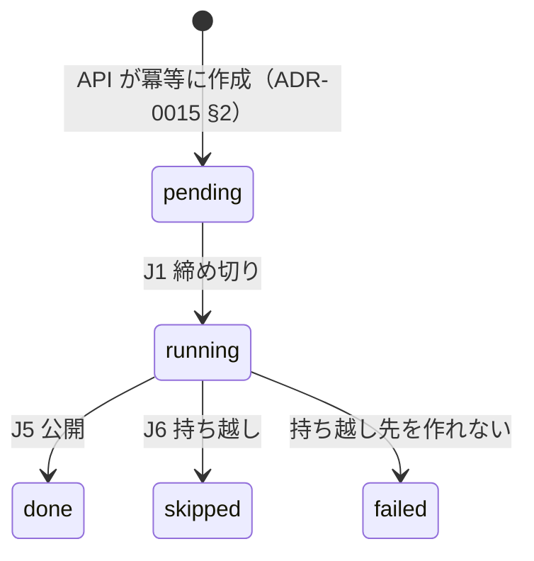

# 非同期処理の設計

- 状態: 草案
- 日付: 2026-11-19
- チケット: YGO-006
- 根拠: `.ai/brief.md`・`.ai/requirements.md`・`.ai/architecture.md`・`.ai/db.md`・`.ai/api.md`
- 関連 ADR: 0002・0004・0005・0006・0007・0008・0010・0011・0012・0013・0014・0015・0016・0017・0025・0026・0035

---

## §1 原則

1. **非同期処理はすべて worker で動かす** [explicit]（ADR-0008）: cron スケジュールとジョブの
   実行は `worker` プロセスのみが担う。`web` プロセスはジョブを積むだけで、実行しない。

2. **キューは PostgreSQL の上の pg-boss 相当** [explicit]（ADR-0010）: Redis 等の別ブローカは
   使わない。トランザクションの中でジョブを積めるため、保存とキューの不整合が起きない。

3. **ジョブのペイロードは ID だけ** [inferred]（db.md §1 原則 6）: 本文など大きなデータは
   含めない。再実行のとき古いペイロードが使われるリスクを避けるため。

4. **冪等性は 3 つの仕組みで守る** [inferred]:
   - DB の一意制約（`mailbox_items` の UNIQUE・`newspapers` の UNIQUE）
   - 条件付きの状態更新（`UPDATE … WHERE state = <前の状態>`）
   - 決まった名前のキー（`singletonKey = <キュー名>:<run_id>`）
   
   ジョブが必ず 1 回しか動かないことには頼らず、少なくとも 1 回は動くことを前提にする。

5. **時刻は JST 固定、夏時間なし** [inferred]（OQ-034）: すべてのスケジュール計算は JST 基準。
   タイムゾーンの追加は OQ-034 の回答待ち。

6. **LLM は審査のラベルを返すだけ** [explicit]（ADR-0005）: `ok` / `review` / `block` の
   いずれかを返す。公開可否の最終判断はルール表との突合で決める。
   クローズドな手紙の本文は LLM に渡さず、ルール表だけで照合する [inferred]（OQ-003 → 決定、ADR-0026）。

7. **即時の配達や通知はしない** [explicit]（P-1）: 配達回の外で住民に物を届けない。
   新聞は定時（07:00 / 17:00）に全住民へ、手紙は午前（08:00〜12:00）・午後（18:00〜21:00）の時間帯の中の受取人ごとの時刻に届ける（OQ-042 → 決定、ADR-0035）。
   配達の通知（OQ-002・OQ-042 → 決定、ADR-0025・ADR-0035）は、新聞の通知を J5 の公開のあとに、手紙の通知を受取人の手紙の枠の時刻のあとに、
   J15 が配達回ごと・購読ごとに 1 回ずつ送る。手紙が届くたびには送らない。それぞれの時刻から 30 分を過ぎたら送らず、`skipped` の便では送らない。休刊の回も新聞の通知は送る（郵便受けには休刊の印が届く。ADR-0035 の D11）。

---

## §2 ジョブの一覧

すべてのジョブは `worker` プロセスで動かす。

| ID | キュー名 | きっかけ | 入力 | 出力 |
|----|---------|---------|------|------|
| J0 | `delivery.tick` | 定時（5 分ごと）[assumed] | なし | J1〜J6 を必要に応じて積む。公開済みの配達回の手紙の枠の時刻を過ぎたら、枠ごとに J15（`kind = letter`）を積む（ADR-0035） |
| J1 | `delivery.close` | 01:00 / 14:00 JST 以降、J0 が判断 | `run_id` | 配達回を `running` にする。手紙を `pending` → `scheduled`。`moderation_queue` に投稿と手紙の行を入れる |
| J2 | `moderation.review` | 02:00 / 15:00 JST 以降、J0 が判断 | `run_id` | ラベルと判定。投稿を `approved` / `rejected` にする。手紙はルール表だけで照合し、当たれば `blocked` にする（LLM は使わない、ADR-0026） |
| J3 | `newspaper.typeset` | J2 完了か打ち切り後、J0 が判断（締め切りは 05:00 / 16:30）| `run_id` | 静的 HTML と `newspapers` の行。間に合わなければ休刊 |
| J4 | `delivery.prepare` | `newspapers` の行ができた後、J0 が判断 | `run_id` | 見せる前の `mailbox_items`（新聞は全住民・手紙は宛先、行ごとに `visible_at`）。宛先ごとの振り分け |
| J5 | `delivery.publish` | 07:00 / 17:00 JST、J0 が判断 | `run_id` | 配達回を `done` に。手紙と投稿の最終状態を確定。新聞の通知（J15、`kind = newspaper`）を積む（休刊の回も） |
| J6 | `delivery.carry_over` | 配達時刻から 15 分過ぎても公開できない場合、J0 が判断 [assumed] | `run_id` | 配達回を `skipped` に。中身を次の便へ移す |
| J7 | `account.erase` | キュー（API が退去を受けたのと同じトランザクションで積む） | `resident_id` | ADR-0013 の表に従い消去 |
| J8 | `newspaper.retypeset` | キュー（J7 から・投稿削除から） | `newspaper_id` | 紙面の差し替え |
| J9 | `account.expire` | 毎日（段階 3、配達窓を外した時間帯）[assumed] | なし | `vacant_expired` から 12 か月たった住民の J7 を積む |
| J10 | `address.dormancy` | 毎日（段階 3、配達窓を外した時間帯）[assumed] | なし | `active` → `dormant` への遷移と休眠通知の積み込み |
| J11 | `address.forwarding_expire` | 毎日（段階 3、配達窓を外した時間帯）[assumed] | なし | 転送期限切れの旧住所を `vacant_forwarded` に |
| J12 | `notify.dormancy` | キュー（段階 3、J10 が積む） | `address_id` | 休眠通知を 1 通送る（テスト環境はモックかローカルの SMTP、本番のサービスはマスターの事前承認を得て選ぶ。ADR-0033） |
| J13 | `image.process` | キュー（段階 2。J0 も滞留分を拾い直す） | `image_id` | 新聞写真風に加工した画像 |
| J14 | `retention.purge` | 毎日（配達窓を外した時間帯）[assumed] | なし | ADR-0013 の保持期間を過ぎたものを削除 |
| J15 | `notify.delivery` | キュー（新聞は J5 が公開と同じトランザクションで、手紙は J0 が枠の時刻を過ぎてから積む。`singletonKey` は §5） | `{run_id, kind, slot}` | 購読のある住民へ「新聞が配達されました！」か「手紙が配達されました！（N通）」を 1 回送る（ADR-0025・ADR-0035） |
| — | `erasure.replay` | 手動（リストアの後） | なし | 消したはずのデータを `erasure_log` を元に消し直す |

**毎日のジョブのスケジュール（J9〜J11・J14）**: 配達回の窓（01:00〜12:30 JST と 14:00〜21:30 JST。手紙の時間帯の終わりと手紙の通知の期限を含む、ADR-0035）
を避けて置く [assumed]。例: 12:30 JST、23:00 JST など。

**段階**: J9〜J12 は段階 3（F-16）で作る（ADR-0023、`roadmap.md` §6）。MVP で作るのは J0〜J8・J14・J15・`erasure.replay`（J15 は M3、`roadmap.md` §4）。
J13 は段階 2（F-11）。

**今の段階で設計しない処理**（理由を添える）:

| 処理 | 理由 |
|------|------|
| マッチング | 段階 3（F-18）。アルゴリズム（FR-066）とカテゴリの分け方（FR-069）が未確定。恋愛のカテゴリは設けない（ADR-0024） |
| 広告・折込チラシ | FR-090 はこのフェーズの範囲外（F-20）|

---

## §3 配達回の流れ（ADR-0016・ADR-0017 の具体化）

### 時刻表（JST）

ADR-0004 の表を拡張する。

| イベント | 朝便 | 夕便 | 出典 |
|----------|------|------|------|
| 締め切り開始 | 01:00 | 14:00 | ADR-0004 |
| 審査開始 | 02:00 | 15:00 | ADR-0004 |
| 審査の打ち切り | 04:00 | 16:00 | [assumed] |
| 組版の締め切り | 05:00 | 16:30 | ADR-0004 |
| 公開（新聞の配達・新聞の通知）| 07:00 | 17:00 | ADR-0004・ADR-0035 |
| 公開の打ち切り | 07:15 | 17:15 | [assumed] |
| 手紙の配達（10 分刻みの枠の始まり）| 08:00〜11:50 | 18:00〜20:50 | ADR-0035 の D8 [assumed] |
| 手紙の時間帯の終わり（送った人に「配達済み」と見せる時刻）| 12:00 | 21:00 | ADR-0035 の D10 |
| 手紙の通知の期限の最後 | 12:20 | 21:20 | ADR-0035 の D11（最後の枠から 30 分） |

審査の打ち切りと公開の打ち切りの時刻は仮置き。確認が取れたら ADR-0004 を更新する。

**手紙の枠**（ADR-0035 の D9）: 枠は 10 分刻みで、朝便は 24 枠（08:00〜11:50）、夕便は 18 枠（18:00〜20:50）。
受取人の枠の番号は `SHA-256(run_id + ":" + resident_id)` を整数として枠の数で割った余り。同じ配達回の、同じ受取人の手紙はすべて同じ枠になる。
決定的なので J4 をやり直しても変わらない。持ち越した手紙は移し先の配達回の J4 で枠を決め直す。

### `delivery_runs.status` の状態と遷移

| 状態 | 意味 |
|------|------|
| `pending` | 受付中。手紙と投稿を受け付けている |
| `running` | 締め切り済み。審査・組版・準備の最中 |
| `done` | 公開完了 |
| `skipped` | 次の便に持ち越した |
| `failed` | 持ち越し先も作れない。運用者の対応が必要 |



### 工程が済んだかどうかの見分け方

| 工程 | 見分け方 | カラム |
|------|---------|--------|
| 締め切り | その配達回に `letters.state = 'pending'` の行が残っていない | `letters.state` |
| 審査 | `moderation_queue.processed_at` が NULL の行が残っていない | `moderation_queue.processed_at` |
| 組版 | `newspapers` の行がある | `newspapers.delivery_run_id` |
| 準備 | 現状のカラムでは判断できない（§9 に変更提案を書く） | — |

### J0 の動き（見回りジョブ）

J0 は 5 分ごとに `delivery_runs` を `run_id` の昇順に調べる。

1. 各配達回について次の工程を 1 つだけ特定する。
2. `singletonKey = '<キュー名>:<run_id>'` で積む。同じキーのジョブがキューに残っていれば積まない。
3. 前の配達回が `done` または `skipped` になるまで、後の配達回の J5（公開）を積まない。
4. `done` の配達回のうち、手紙の通知の期限がまだ来ていないもの（最後の枠から 30 分以内）について、時刻を過ぎて 30 分以内の枠ごとに J15（`kind = letter`）を積む（ADR-0035 の D11）。

```
J0 の判断ロジック（概略）:
  for each run in delivery_runs ORDER BY run_id:
    if run.status = 'pending' and now >= close_time(run):
      enqueue J1 with singletonKey
    elif run.status = 'running':
      if moderation not started and now >= review_start_time(run):
        enqueue J2 with singletonKey
      elif moderation done or now >= review_cutoff(run):
        if newspapers row not exists and now < typeset_deadline(run):
          enqueue J3 with singletonKey
        elif newspapers row not exists and now >= typeset_deadline(run):
          enqueue J3 (holiday) with singletonKey
        elif newspapers row exists and prepare not done:
          enqueue J4 with singletonKey
        elif prepare done and now >= publish_time(run) and prev runs all done:
          enqueue J5 with singletonKey
        elif now >= carry_over_cutoff(run):
          enqueue J6 with singletonKey
    elif run.status = 'done':
      for each slot in letter_slots(run):          -- 08:00〜11:50 / 18:00〜20:50 の 10 分ごと
        if slot <= now < slot + 30 min:
          enqueue J15 {run_id, kind: 'letter', slot} with singletonKey
```

---

## §4 処理ごとの詳細

### J1 — 締め切り（`delivery.close`）

**きっかけ**: 朝便は 01:00 JST、夕便は 14:00 JST 以降。J0 が `singletonKey` で積む。

**入力**: `run_id`（例: `2026-11-19-morning`）

**出力**:
- `delivery_runs.status` を `pending` → `running` に更新
- 対象配達回の手紙を `state = 'scheduled'` に更新
- 対象配達回の掲示板投稿を `moderation_queue` に登録
- 対象配達回の `scheduled` の手紙（J5・J6 で持ち越されてきたものを含む）を `moderation_queue` に `content_kind = 'letter'` で登録（ADR-0026）。入れるのは ID だけで、本文は入れない。この行は M4（J2 を作る段階）から入れる（`roadmap.md` §4）

**冪等性**:
- `delivery_runs` の行は `INSERT … ON CONFLICT DO NOTHING` で作る（API が作ってなければここで作る）
- `UPDATE delivery_runs SET status='running' WHERE run_id=$1 AND status='pending'`（1 行だけ動く）
- 手紙の更新は `UPDATE … WHERE delivery_run_id=$1 AND state='pending'`
- `moderation_queue` への挿入は `ON CONFLICT DO NOTHING`（§9 に UNIQUE 制約の追加を提案）
- 1,000 件ずつのトランザクションに分けて処理し、途中で止まっても再開できる

**ADR-0015 §2 の締め切りのロック手順**:

API が手紙を書くとき、`delivery_runs` の行を `FOR SHARE` でロックしながら書く。J1 は
`UPDATE … SET status='running'` を実行する前に、その配達回の `FOR SHARE` ロックが
すべて外れるのを待つ（`FOR UPDATE`）。これにより、締め切り後に手紙が混ざり込まない。

具体的な順序:
```
BEGIN;
  UPDATE delivery_runs SET status='running', started_at=now()
    WHERE run_id=$1 AND status='pending';  -- この行に排他ロックを取る
  -- FOR SHARE を持つ API トランザクションがすべて終わるまでここで待つ
  -- ...手紙・投稿の更新...
COMMIT;
```

**失敗とやり直し**:
- 途中で止まっても、`delivery_runs.status` が `running` のまま残る
- J0 が次の見回りで J2 を積む。J1 の残り作業（手紙の `scheduled` への更新）は
  J1 を再実行するか、J2・J3 が必要な行を参照するときに当然 `pending` のものは無視される
- やり直しで `delivery_runs` の `INSERT` は `ON CONFLICT DO NOTHING` なので重複しない
- 締め切りが遅れても、API は `nextDeliveryRun(now)` で次の配達回に書くので混入しない [inferred]

---

### J2 — 審査（`moderation.review`）

**きっかけ**: 朝便は 02:00 JST、夕便は 15:00 JST 以降。J0 が `singletonKey` で積む。

**入力**: `run_id`

**出力**:
- `moderation_queue` の各行にラベル（`llm_label`）と判定（`policy_decision`）を記録
- `board_posts.status` を `approved` / `rejected` に更新
- 手紙の行には判定（`policy_decision`）と、当たったときの規則の ID（`matched_rule_id`）・ルール表の版（`rule_version`）だけを記録し、当たった手紙を `letters.state = 'blocked'` に更新

**対象**: 掲示板の投稿と、クローズドな手紙（OQ-003 → 決定、ADR-0026）

**投稿の判定の順序**（ADR-0005）:
1. ルール表を先に当てる（即座に `blocked` → `rejected`）
2. ルール表で決まらなければ LLM がラベルを付ける
3. LLM のラベルをルール表と突き合わせて `approved` / `rejected` を決める

**手紙の判定**（ADR-0026）:
1. 手紙の経路には LLM の分類器のアダプタを渡さない。`llm_label` は常に NULL（DB の CHECK 制約、db.md §2）
2. worker の中で本文を復号し、ルール表のうち手紙に当てる項目だけで照合する。平文はメモリの中だけに置き、DB・ログ・ジョブのペイロード・例外のメッセージに書かない
3. 当たらない → `policy_decision = 'approved'`（J4 が配達の準備をする）。当たった → `policy_decision = 'blocked'`・`letters.state = 'blocked'`（配達しない）
4. 人の審査の段はない。手紙の行は管理用の審査キューに出さない（api.md §7 F-08）
5. 本番のルール表には手紙に当てる項目を置かない（OQ-052 の暫定）ので、本番ではすべての手紙が `approved` になる。止める経路はテスト用の偽の規則で確かめる

**冪等性**:
- `moderation_queue.llm_label` がすでに記録済みなら LLM を呼び直さない（費用の二重払いを避ける）
- ラベル・判定・投稿の状態は 1 つのトランザクションで書く
- `UPDATE board_posts SET status=… WHERE id=$1 AND status='awaiting_review'`
- 手紙は `UPDATE letters SET state='blocked' WHERE id=$1 AND state='scheduled'` と判定の記録を 1 つのトランザクションで書く。`policy_decision` が記録済みの行は照合し直さない

**失敗とやり直し**:
- LLM が失敗したら、打ち切り時刻（04:00 / 16:00 JST）まで指数バックオフで再試行
- 打ち切りまでに決まらなかった投稿と `llm_label = 'review'` の投稿は `awaiting_review` のまま
  次の配達回に持ち越す（`delivery_run_id` を次の便に変更）
- `review` の投稿と打ち切りまでに決まらなかった投稿は、モデレーターが人の審査で `approved` / `rejected` にする
  （security.md §5.2 の 3、ロールは ADR-0020 で決定・OQ-031）。人の審査が済むまで J2 は公開しない側に倒し、
  `awaiting_review` のまま持ち越す
- 打ち切りまでに判定できなかった手紙（復号の失敗・worker の停止など）は届けない。J2 は判定を書かずに残すだけで、手紙を動かさない。
  J4 は判定が `approved` の手紙だけを準備する。J4 が準備しなかった `scheduled` の手紙は、J5 が公開のトランザクションの中で次の配達回に移す（J5 が公開できなければ J6 が移す）。
  J2 が止まっていても、打ち切りのあとに動かなくても、手紙は J5 か J6 のどちらかで次の便に移る（ADR-0026 の D3）
- J2 は打ち切りのあとも動き続けることがあり、J4 の準備が済んだあとに手紙の `approved` を書くことがある。
  J5 が移すかどうかは判定の有無ではなく「J4 が準備したか」で決めるので、この手紙も J4 が準備していなければ次の便に移り、
  移し先の配達回で審査し直される（判定の行は配達回ごと）。J4 のあとで `blocked` を書いた手紙は `state = 'blocked'` なので移らず、配達されない
- テストではモックの LLM を使う（ADR-0005）。手紙の経路のテストでは、呼ばれたら失敗するモックの LLM を差し込む

---

### J3 — 組版（`newspaper.typeset`）

**きっかけ**: J2 完了（`moderation_queue` に `processed_at = NULL` の行がない）または
審査打ち切り（04:00 / 16:00 JST）後。J0 が判断し `singletonKey` で積む。

**入力**: `run_id`

**出力**:
- 静的 HTML をオブジェクトストレージに保存
- `newspapers` に行を挿入

**入力データ**: `board_posts.status = 'approved'` かつ
`board_posts.delivery_run_id = run_id` の投稿を `(created_at, id)` の順で並べる

**冪等性**:
- 保存キーは `newspapers/<run_id>/<コンテンツのハッシュ>.html` [assumed]。
  同じ内容なら同じキーになるため、上書きしても安全
- 手順は「描く → オブジェクトストレージに置く → `newspapers` に INSERT」の順
- `UNIQUE(delivery_run_id)` があるため、紙面は 1 配達回に 1 つだけ
- 遅れて動いた組版は一意制約に当たって何もせずに終わる（`ON CONFLICT DO NOTHING`）

**休刊の扱い**（ADR-0007）:
- 組版の締め切り（05:00 / 16:30 JST）までに `newspapers` の行ができなければ、
  J0 が `is_holiday = true` の行を `ON CONFLICT DO NOTHING` で入れて休刊にする
- 投稿が 0 件でも、空のときのテンプレートで組む [assumed]
- 休刊の回でも、承認済みの投稿は次の配達回で掲示板として届ける [assumed]

**失敗とやり直し**:
- 失敗したら組版の締め切り前に pg-boss の `retryBackoff` で再試行
- 締め切り後はホリデー行を挿入（J0 が担う）
- 再試行で描いた結果のキーがオブジェクトストレージに存在すれば `newspapers` の INSERT だけ実行

---

### J4 — 準備（`delivery.prepare`）

**きっかけ**: `newspapers` の行ができた後。J0 が判断し `singletonKey` で積む。

**入力**: `run_id`

**出力**:
- `mailbox_items` に「見せる前の」行を事前に書く
- 宛先ごとの振り分け結果（通常・転送・差し戻し・抑止）を反映
- 各行に `visible_at` を書く（ADR-0035 の D10）

**新聞**（ADR-0035 の D1・D2、FR-106）:
- その配達回の紙面（`newspapers` の行。休刊の行を含む）を、J4 の時点で住んでいる全住民（`tenancies.is_current = true`）に `kind = 'newspaper'` で 1 行ずつ作る。手紙があるかにかかわらない
- `visible_at` は、その便の公開の時刻（朝便 07:00・夕便 17:00 JST）

**手紙の `visible_at`**（ADR-0035 の D8・D9）:
- 受取人（転送なら新住所の住民）の枠を §3 の「手紙の枠」で決め、その枠の始まりの時刻を `visible_at` に書く。同じ配達回の同じ受取人の手紙は同じ時刻
- 時刻はハッシュで決まるので、やり直しでも同じ値になる（`ON CONFLICT DO NOTHING` で書き直さない）

**対象の手紙**（ADR-0026）:
- M4 から（J2 がある段階）: その配達回の `scheduled` の手紙のうち、`moderation_queue` のその配達回の行の判定が `approved` のものだけ。
  `blocked` の手紙と、準備の時点で判定のない手紙（J2 が打ち切りまでに判定できなかったもの）には `mailbox_items` を作らない。
  J4 が準備しなかった `scheduled` の手紙（準備のあとで `approved` が書かれたものを含む）は J5 が次の便へ移す
- M3（J2 がない段階、`roadmap.md` §4）: 判定を見ず、その配達回の `scheduled` の手紙をすべて準備する。判定の条件は M4 で足す

**宛先の振り分け**（db.md §3 の表）:
- `tenancies.is_current = true` → 通常配達（そのまま `mailbox_items` を作る）
- 転送期間 6 か月以内（ADR-0002）→ 新住所の住民に `mailbox_items` を作る
- 転送期限切れ・空き家 → `letters.state = 'returned'` にして `mailbox_items` を作らない
- 受取人が送信者をブロック → `letters.state = 'suppressed'` にして `mailbox_items` を作らない

**冪等性**:
- `mailbox_items` は `ON CONFLICT DO NOTHING` で挿入する（`UNIQUE` 制約で重複を弾く）
- 宛先ごとに keyset ページングで区切って処理する。途中で止まってもやり直せる
- ブロックは準備の時点の状態で判断する（配達時刻より前に変わった場合は J5 で再確認）

**失敗とやり直し**:
- 失敗したら `ON CONFLICT DO NOTHING` で安全に再実行できる
- 準備完了かどうかは現状のカラムでは判断できないため、§9 に `delivery_runs.prepared_at` の
  追加を提案する（J0 が「準備完了」を判断するときに使う）

---

### J5 — 公開（`delivery.publish`）

**きっかけ**: 朝便は 07:00 JST、夕便は 17:00 JST。J0 が判断し `singletonKey` で積む。
前の配達回（古い `run_id`）が `done` または `skipped` になるまで積まない。

**入力**: `run_id`

**出力**:
- `delivery_runs.status` を `running` → `done` に更新
- `letters` と宛先の最終状態を更新
- `board_posts.status` を `published` に更新

公開の時刻に見えるようになるのは新聞と掲示板だけ。手紙の状態（`delivered` など）もこの時点で確定するが、受取人に見えるのは `mailbox_items.visible_at` を過ぎてから（ADR-0035 の D10）。

**1 つのトランザクションで行うこと**:
1. J4 が準備しなかった手紙を次の便へ移す（ADR-0026 の D3）: この配達回の `state = 'scheduled'` の手紙のうち、
   この配達回の `mailbox_items` がないもの（J4 が準備していないもの）を、次の受付中の配達回に移す
   （J6 の 1・2 と同じく、次の配達回を `FOR UPDATE` で取るか `INSERT … ON CONFLICT DO NOTHING` で作り、`delivery_run_id` を変え、`scheduled` のまま）。
   - 判定の有無では決めない。J4 のあとで J2 が `approved` を書いた手紙も、準備されていなければ移す
   - `blocked`・`returned`・`suppressed` の手紙は `state` が `scheduled` でないので移さない
   - 2 の削除より先に行う（退去で `mailbox_items` を消された手紙を、準備されなかった手紙と取り違えないため）
   - M3 では J4 が `scheduled` の手紙をすべて準備するので、移る手紙はない
   - 移した手紙の `moderation_queue` の行を、移し先の配達回で `ON CONFLICT DO NOTHING` で入れる（移し先の J1 がすでに動いていても審査に乗る）
2. 退去などで状態が変わった（無効になった）`mailbox_items` の行を削除する
3. 手紙の `state` を `delivered` / `suppressed` / `returned` / `blocked` に確定させる。確定の対象は J4 が準備した手紙
   （1 の時点でこの配達回の `mailbox_items` があった手紙は `delivered`、J4 か J2 が `returned`・`suppressed`・`blocked` にした手紙はその状態のまま）だけで、
   1 で移した手紙は対象にしない。`delivered` にした宛先の `letter_recipients.delivered_at` には、受取人の `mailbox_items.visible_at`（枠の時刻）を書く（ADR-0035）
4. `board_posts.status` を `published` に・`published_at` を記録する
5. `delivery_runs.status` を `done` にする
6. 紙面が休刊（`newspapers.is_holiday = true`）かにかかわらず、新聞の通知の J15 を `{run_id, kind: 'newspaper'}`・`singletonKey = notify.delivery:<run_id>:newspaper` で積む（ADR-0025・ADR-0035 の D11）。
   手紙の通知は J5 では積まない（枠の時刻のあとに J0 が積む）

**冪等性**:
- `UPDATE delivery_runs SET status='done' WHERE run_id=$1 AND status='running'`
  2 回目に動いたとき `status = 'running'` でないので何もしない（J15 も積み直さない）
- 準備されなかった手紙の移動は `UPDATE letters SET delivery_run_id=<次の便> WHERE delivery_run_id=$1 AND state='scheduled' AND NOT EXISTS (この手紙のこの配達回の mailbox_items の行)`。
  公開と同じトランザクションなので、失敗すれば移動も戻り、やり直しで同じ手紙を移す。移したあとの 2 回目は対象が 0 行になる。
  移し先の `moderation_queue` の行は `ON CONFLICT DO NOTHING`（§9 の 4 の UNIQUE 制約）で重複しない

**失敗とやり直し**:
- 1 つのトランザクションなので、全体が成功か全体が失敗かのどちらか
- 失敗したら pg-boss が再実行する。公開の打ち切り（07:15 / 17:15 JST）まで
- 打ち切りまでに成功しなければ J6（持ち越し）を J0 が積む

---

### J6 — 持ち越し（`delivery.carry_over`）

**きっかけ**: 公開の打ち切り（07:15 / 17:15 JST）後も `done` にならない場合。
J0 が判断し `singletonKey` で積む。

**入力**: `run_id`

**出力**:
- 配達回を `skipped` に
- 手紙と投稿を次の受付中の配達回に移す
- 見せる前の `mailbox_items` を削除

**1 つのトランザクションで行うこと**:
1. 次の受付中の配達回を `FOR UPDATE` で取る（なければ `INSERT … ON CONFLICT DO NOTHING` で作る）
2. `letters.delivery_run_id` を次の便に変更（`state = 'scheduled'` のままにする）。判定の有無にかかわらず `scheduled` の手紙をすべて移し、
   M4 からは、移した手紙の `moderation_queue` の行を移し先の配達回で `ON CONFLICT DO NOTHING` で入れる（判定は配達回ごとなので、移し先で照合し直す）
3. `board_posts.delivery_run_id` を次の便に変更（`status = 'awaiting_review'` のままにする）
4. この配達回の `mailbox_items`（まだ公開前のもの）を削除する
5. `delivery_runs.status` を `skipped` にする

**冪等性**:
- `UPDATE delivery_runs SET status='skipped' WHERE run_id=$1 AND status='running'`
  2 回目は何もしない

**その他の扱い**:
- スキップした配達回の紙面は配らない。バックナンバーにも出さない（ADR-0007）[inferred]
- 移した手紙は `scheduled` のまま。移し先の配達回の J2 で照合し直す（状態遷移は増えない。ADR-0026）
- `blocked` の手紙は移さない（`state = 'scheduled'` のものだけを移す）
- 何便分も止まっていたときは、古い配達回から順に持ち越す

**失敗とやり直し**:
- トランザクションなので全体が冪等に再実行できる
- `delivery_runs.status = 'failed'` になるのは、持ち越し先を作れない（DB の制約違反等）場合のみ

---

### J7 — 退去（`account.erase`）

**きっかけ**: キュー。API が `DELETE /me` を受けたのと同じトランザクションで積む（ADR-0015 §4）。

**入力**: `resident_id`

**出力**: ADR-0013 の表に従い消去処理を実行する

**処理の順序**（各項目は独立したトランザクション）:
1. 未配達の手紙（`state = 'pending' / 'scheduled'`）を `returned` にする
2. 掲示板投稿（掲載前）を `deleted` に変更・`body` を消去し、同じトランザクションで J8 を積む
3. 掲示板投稿（掲載済み）を `deleted` に変更・`body` を消去し、同じトランザクションで J8 を積む
4. 住所録（所有するもの）を削除する
5. ブロック（blocker / blocked）を削除する
6. 通知の購読（`push_subscriptions`）と送った記録（`delivery_notifications`）を削除する（ADR-0013・ADR-0025。退去の受付でセッションと一緒に消えていれば何もしない）
7. `addresses.status` を `vacant_deleted` に変更する
8. `residents` を物理削除し、`erasure_log` に記録する（最後に行う）

**冪等性**:
- 各ステップは `WHERE resident_id=$1` と `WHERE status=<前の状態>` を組み合わせた
  条件付き UPDATE なので、2 回実行しても安全
- 最後の物理削除は `DELETE FROM residents WHERE id=$1`。なければ何もしない

**失敗とやり直し**:
- 途中で止まっても、`residents.deleted_at` が付いているため API は `404` を返す
- J7 を再実行すると残りの項目を処理する（処理済みの項目は条件に合わないため何もしない）
- `residents` の削除が最後なので、途中で止まっても再起動で再開できる

---

### J8 — 組み直し（`newspaper.retypeset`）

**きっかけ**: キュー。J7 から（投稿が削除されたとき）・掲示板投稿の手動削除から。
J7 は同一トランザクションで積む。

**入力**: `newspaper_id`

**出力**: 紙面を差し替える

**手順**:
1. `newspapers` の行を `FOR UPDATE` で取る
2. `newspaper_items` から削除対象の素材行を外す
3. 残った素材で描き直す
4. 描いた結果のコンテンツハッシュが前と同じなら何もしない
5. ハッシュが変わった場合、オブジェクトストレージに上書き保存し `newspapers.storage_url` を更新

**冪等性**:
- `FOR UPDATE` で 1 ジョブずつ直列化する
- 同じ紙面に複数の J8 が積まれたとき、2 回目は `storage_url` がすでに更新済みの状態で描くため
  正しい結果になる

**その他**:
- 古いファイル（前の `storage_url`）は J14 が消す
- 休刊フラグがついた紙面は組み直しても休刊のままにする

---

### J9 — 長期不在の退去（`account.expire`）

**きっかけ**: 毎日（配達窓を外した時間帯）[assumed]

**入力**: なし

**出力**: `addresses.status = 'vacant_expired'` になってから 12 か月以上経過した住民の J7 を積む

**冪等性**:
- `SELECT resident_id FROM tenancies JOIN addresses WHERE status='vacant_expired' AND vacated_at < now()-interval '12 months'`
- 1 件ずつ J7 を `ON CONFLICT DO NOTHING` で積む
- 重複して積まれても J7 が冪等なため問題ない

---

### J10 — 休眠の判定（`address.dormancy`）

**きっかけ**: 毎日（配達窓を外した時間帯）[assumed]

**入力**: なし

**出力**:
- `active` かつ 12 か月ログインなしの住民の住所を `dormant` に遷移
- `dormant` かつ 30 日応答なし（`dormancy_notified_at` から 30 日）の住所を `vacant_expired` に遷移
- `dormant` への遷移時に J12 を積む

**冪等性**:
- 条件付きの UPDATE（`WHERE status='active' AND last_login_at < now()-interval '12 months'`）
- 通知の積み込みは同じトランザクションで行う（`dormancy_notified_at` の更新と J12 の enqueue）
- J12 は「少なくとも 1 回」送られる。まれに 2 通届く可能性がある（後述 J12 参照）

---

### J11 — 転送の期限（`address.forwarding_expire`）

**きっかけ**: 毎日（段階 3、配達窓を外した時間帯）[assumed]

**入力**: なし

**出力**: 転送期限（`forwarding_expires_at < now()`）を過ぎた住所を `vacant_forwarded` に変更

**冪等性**:
- `UPDATE addresses SET status='vacant_forwarded' WHERE status='active' AND forwarding_expires_at < now()`

---

### J12 — 休眠の通知（`notify.dormancy`）

**きっかけ**: キュー（段階 3、J10 が積む）

**入力**: `address_id`

**出力**: 通知を 1 通送る（本番のメール送信サービスはマスターの事前承認を得て選ぶ。ADR-0033、OQ-049。テストではモックのメール）

**冪等性**:
- 通知の手段（メール等）は外部サービスを呼ぶため、完全な冪等性は保証できない
- `addresses.dormancy_notified_at` を更新してから通知を送る順序にすると、
  DB 更新後に通知が失敗した場合は再試行で 2 通送られることがある
- この「まれに 2 通届く」ことは仕様として許容し、文書に残す [assumed]

---

### J13 — 画像の加工（`image.process`）

**きっかけ**: キュー（段階 2。API が画像アップロードと同じトランザクションで積む）。
J0 も `state = 'pending'` の滞留分を拾い直す [assumed]。

**入力**: `image_id`

**出力**: 新聞写真風に加工した画像を `images.processed_url` に記録

**冪等性**:
- `UPDATE images SET state='processing' WHERE id=$1 AND state='pending'`
- 加工後に `state = 'processed'` に更新
- 加工が完了していれば 2 回目のジョブは `state='pending'` でないため何もしない

**その他**:
- 組版（J3）までに加工が終わらなかった画像は紙面に載せない [assumed]（OQ-026）

---

### J14 — 保持期間による削除（`retention.purge`）

**きっかけ**: 毎日（配達窓を外した時間帯）[assumed]

**入力**: なし

**出力**: ADR-0013 の保持期間を過ぎた行を削除する

**対象**:

| テーブル | 条件 |
|----------|------|
| `delivery_notifications` | 指している配達回の `delivery_runs.finished_at < now() - interval '30 days'`（ADR-0025）。`created_at` ではなく配達回の `finished_at` で決めるので、消す配達回を指す通知の記録はすべて同じ回で消える。同じジョブの中で `delivery_runs` より先に消す |
| `delivery_runs` | `finished_at < now() - interval '30 days'` |
| `moderation_queue` | `processed_at < now() - interval '1 year'` |
| `moderation_actions` | `created_at < now() - interval '1 year'` |
| `reports` | `closed_at < now() - interval '1 year'` |
| `tenancies`（退去済み）| `ended_at < now() - interval '1 year'` かつ対応する resident が削除済み |
| `erasure_log` | `erased_at < now() - interval '60 days'` |
| オブジェクトストレージ（古い組版 HTML）| J8 で差し替えた前のファイル |

**冪等性**:
- 小さく区切った DELETE（1,000 件ずつ）で処理する。何度動いても安全

---

### J15 — 配達の通知（新聞・手紙）（`notify.delivery`）

**きっかけ**: キュー（ADR-0025・ADR-0035 の D11）。
- 新聞の通知: J5 が公開と同じトランザクションで `singletonKey = notify.delivery:<run_id>:newspaper` で積む。休刊の回も積む
- 手紙の通知: J0 が、`done` の配達回の枠の時刻を過ぎてから 30 分の間、枠ごとに `singletonKey = notify.delivery:<run_id>:letter:<HHMM>` で積む

**入力**: `{run_id, kind, slot}`（`kind` は `newspaper` / `letter`。`slot` は手紙の枠の始まりの時刻で、新聞では空）

**出力**: 購読のある住民へ、新聞か手紙の配達の通知を Web Push で 1 回送る（C11。テストではモックのプッシュ送信）

| 項目 | 新聞（`kind = newspaper`） | 手紙（`kind = letter`） |
|---|---|---|
| 送る条件 | `delivery_runs.status = 'done'` の配達回（休刊の回を含む）。`skipped` の便では送らない | `delivery_runs.status = 'done'` の配達回で、枠の時刻を過ぎたとき。`skipped` の便では送らない（持ち越した手紙は移し先の便で数える） |
| 送る住民 | その配達回の `mailbox_items` に `kind = 'newspaper'` の行がある住民（J4 の時点の全住民） | その配達回の `mailbox_items` に `kind = 'letter'` で `visible_at = slot` の行がある住民。0 通の住民には送らない |
| 中身 | 「新聞が配達されました！」。件数なし | 「手紙が配達されました！（N通）」。N はその住民のその配達回の手紙の `mailbox_items` の数 |
| 期限 | 公開（`delivery_runs.finished_at`）から 30 分 | 枠の時刻から 30 分 |

どちらも差出人・本文・住所は載せない（ADR-0035 の D4）。Web Push の TTL はどちらも 30 分。

| 項目 | 内容 |
|---|---|
| 送る相手 | 有効なセッション（`invalidated_at IS NULL` かつ有効期限内）に結んだ購読（`push_subscriptions`）。期限切れのセッションの購読は送る前に消す |
| 冪等性 | `delivery_notifications` に `UNIQUE(delivery_run_id, push_subscription_id, kind)` で `ON CONFLICT DO NOTHING` で入れ、`sent_at` が NULL のものだけ送る。J0 が同じ枠を何度積んでも、1 つの購読に手紙の通知は配達回ごとに 1 通まで。送ったあと `sent_at` を入れる前に落ちると、まれに 2 通届く。J12 と同じく許容する [assumed] |
| 失敗 | プッシュサービスが 404・410 を返したら、その購読（と `delivery_notifications` の行）を消す。ほかの失敗は期限まで再試行する |
| 送り先の検査 | 送る前にも `endpoint` を ADR-0025 の D6 で検査する（名前解決のあとのプライベート・ループバック・リンクローカルの宛先は送らない） |
| 処理の単位 | keyset で 1,000 件ずつ |
| 配達との関係 | J15 が失敗しても配達回の状態（`done`）に影響しない |

---

## §5 pg-boss の設定 [assumed]

worker が 2 台あっても実行は 1 回分になる。`singletonKey` と DB の条件による。

| ジョブ | `retryLimit` | `retryBackoff` | `expireInSeconds` | `singletonKey` |
|--------|-------------|---------------|-------------------|---------------|
| J0 `delivery.tick` | 0 | — | 300 | `'tick'` |
| J1 `delivery.close` | 3 | true（指数）| 3600 | `'delivery.close:<run_id>'` |
| J2 `moderation.review` | 5 | true | 7200 | `'moderation.review:<run_id>'` |
| J3 `newspaper.typeset` | 3 | true | 7200 | `'newspaper.typeset:<run_id>'` |
| J4 `delivery.prepare` | 5 | true | 7200 | `'delivery.prepare:<run_id>'` |
| J5 `delivery.publish` | 5 | true | 1800 | `'delivery.publish:<run_id>'` |
| J6 `delivery.carry_over` | 2 | false | 1800 | `'delivery.carry_over:<run_id>'` |
| J7 `account.erase` | 10 | true | 86400 | — |
| J8 `newspaper.retypeset` | 5 | true | 3600 | — |
| J9 `account.expire` | 3 | true | 3600 | `'account.expire:<date>'` |
| J10 `address.dormancy` | 3 | true | 3600 | `'address.dormancy:<date>'` |
| J11 `address.forwarding_expire` | 3 | true | 3600 | `'forwarding.expire:<date>'` |
| J12 `notify.dormancy` | 3 | true | 3600 | — |
| J13 `image.process` | 3 | true | 3600 | — |
| J14 `retention.purge` | 3 | true | 7200 | `'retention.purge:<date>'` |
| J15 `notify.delivery` | 5 | true | 1800 | `'notify.delivery:<run_id>:newspaper'`・`'notify.delivery:<run_id>:letter:<HHMM>'` |

**時間のかかる工程**（J2・J3・J4）: `pg_try_advisory_lock` で実行する worker を 1 台にする。
ロックが取れなかった worker は何もせずに終わる。

---

## §6 失敗・遅れ・止まったときの一覧

| 事態 | 何が起きるか | 住民に何が見えるか | 記録 |
|------|------------|-----------------|------|
| 締め切りの遅れ | 配達回が `running` にならない。手紙は `pending` のまま。次の J0 で再試行 | 「次の便で届く」と見えるまま（表示は変わらない） | pg-boss のジョブ履歴 |
| 審査が間に合わない | 打ち切り時刻に未審査の投稿と、判定できなかった手紙は次の便に持ち越し（ADR-0026） | 投稿が「掲載待ち」のまま継続。手紙は「次の便で届く」と見えるまま | `moderation_queue` の未処理行 |
| 組版の失敗 | 締め切りまでに直せなければ休刊行を挿入 | その配達回は紙面は届かず、休刊の印と手紙が届く。新聞の通知は送る | `newspapers.is_holiday = true` |
| 準備が間に合わない | 公開の打ち切りまでに準備完了しなければ J6 で持ち越し | 配達なし（次の便で届く） | `delivery_runs.status = 'skipped'` |
| 公開の失敗 | 再試行。打ち切りまでに成功しなければ J6 で持ち越し | 配達なし（次の便で届く） | pg-boss のジョブ履歴 |
| worker が何便分も止まった | 再起動後、J0 が古い配達回から順に持ち越しを実行 | 複数便分が次の 1 便で届く（件数が多い） | 操作ログ |
| 配達の通知の失敗 | J15 が期限（新聞は公開から・手紙は枠の時刻から 30 分）まで再試行。期限を過ぎたら送らない。404・410 の購読は消す | 通知が届かないことがある。郵便受けは通常どおり（配達回は `done` のまま） | `delivery_notifications.sent_at` が NULL の行・pg-boss のジョブ履歴 |
| リストアした | `erasure_log` を再生し、削除済みデータを再削除。`erasure.replay` で実行 | 通常通り（データの整合性が回復後は影響なし） | `erasure_log`・操作ログ |

---

## §7 監視とテスト

### 監視

NFR-027（可用性）・NFR-074（障害通知）に合わせる。

| 監視項目 | 閾値の目安 | アラートの飛び先 |
|---------|-----------|----------------|
| J1 が 01:15 / 14:15 JST までに完了しない | — | `environment.md` で定義 |
| J2 が審査打ち切り前に処理できていない投稿数 | 0 以外 | 同上 |
| J3 が 05:30 / 17:00 JST までに完了しない（休刊含む）| — | 同上 |
| J5 が公開時刻から 10 分以上遅延 | — | 同上 |
| 手紙の枠の J15 が枠の時刻から 10 分以上積まれない（ADR-0035） | — | 同上 |
| J7 が 24 時間以内に完了しない | — | 同上 |
| pg-boss のジョブが `failed` 状態に積み上がる | 閾値は environment.md で定義 | 同上 |

アラートの通知先（Slack / PagerDuty 等）は `environment.md` で定義する。

### テスト

コードができてから `check.sh` から動かす。次のケースを最低限カバーする。

| ケース | 確認内容 |
|--------|---------|
| 冪等性（2 回実行）| 同じジョブを 2 回動かしても郵便受けに重複がないこと。`mailbox_items` の UNIQUE 違反が出ないこと |
| API の `FOR SHARE` と締め切りの競合 | 締め切り処理の最中に API が `pending` の手紙を書こうとしたとき、次の便に振り分けられること |
| 途中停止と再開 | ジョブの実行を途中で止め（プロセス kill）、再起動したとき残りの処理が正しく完了すること |
| 休刊 | 組版の締め切りまでに J3 が完了しないとき `is_holiday = true` の行が入ること |
| 持ち越し | 公開の打ち切りまでに J5 が完了しないとき `delivery_runs.status = 'skipped'` になり、次の便に移ること |
| 公開と退去の競合 | J5 の実行中に J7 が動いたとき、退去済み住民の `mailbox_items` が削除されること |
| モックの LLM が失敗 | LLM のモックが全件エラーを返したとき、打ち切り後に投稿が次の便に持ち越されること |
| 通知の重複と期限 | J15 を 2 回動かしてもモックのプッシュ送信が受ける通知が増えないこと。公開の前・`skipped` の便・枠の時刻の前・それぞれの時刻から 30 分のあとには送らないこと。休刊の回にも新聞の通知を送ること（`roadmap.md` A-15） |
| 手紙の時刻 | 手紙の `mailbox_items` は `visible_at`（午前 08:00〜11:50・午後 18:00〜20:50 の 10 分刻み）を過ぎるまで郵便受けに出ないこと。J4 を 2 回動かしても `visible_at` が変わらないこと。同じ配達回の同じ受取人の手紙が同じ時刻になること。新聞は手紙の有無にかかわらず全住民に 07:00 / 17:00 に出ること（ADR-0035、`roadmap.md` A-02） |

---

## §8 未確定事項

以下は Open Questions または設計上まだ決めきれない事項。

| 項目 | 参照 | 現在の仮の扱い |
|------|------|--------------|
| 外部の LLM サービス | OQ-008（決定）・OQ-047 | 秘書の暫定の選定で Anthropic API の `claude-haiku-5-5`（ADR-0031）。J2 から 1 件ずつ同期で呼び、Batch API は使わない（審査の打ち切りまでに終わる保証がない）。本番のアダプタは承認のあとに作り、テストではモックを使う（ADR-0005・NFR-065）。確定と費用の上限は OQ-047（持ち越し） |
| 手紙で止める内容と、止めた手紙の閲覧（J2） | OQ-043（決定）・OQ-052・OQ-053 | 本番のルール表に手紙に当てる項目を置かない（テストは偽の規則）・止めた手紙は人が見ない（送った人には「届けられませんでした」とだけ見せる）。手紙を審査すること・LLM に渡さないことは決定（OQ-003、ADR-0026）。通報された手紙をモデレーターが確かめることも決定（OQ-043、ADR-0036。J2 は関わらない）。止める内容と止めた手紙の閲覧・年齢で変えるかは OQ-052（要回答）、違法な物の取引の守りは OQ-053（持ち越し、別のチケット） |
| 通知の手段（J12） | OQ-039（決定）・OQ-049 | アウトボックス形式で保留（J12 は段階 3）。テスト環境はモックかローカルの SMTP（ADR-0033）。本番のメール送信サービスはマスターの事前承認を得て選び、進め方と費用の上限は OQ-049（持ち越し） |
| 新聞の中身（J3） | OQ-051 | ADR-0007 のまま。全住民に同じ紙面を、承認済みの掲示板の投稿からテンプレートで組む（住民の興味は集めず、外のニュースは取り込まず、LLM を使わない）。新聞を全住民に届けることと通知は決定（OQ-042、ADR-0035） |
| 画像の加工（J13） | OQ-026 | 段階 2 として仮置き |
| マッチング | FR-066・FR-069・OQ-050 | 段階 3 で、アルゴリズムの ADR を書いてから設計する。恋愛のカテゴリは設けない（OQ-001 → 決定、ADR-0024）。提案に街の外の連絡先を載せない（FR-101。禁止はマッチングの中だけ、OQ-041 → 決定、ADR-0034）。自由記述の欄の扱いと、成立後に最初の手紙を出す方法は OQ-050（持ち越し、アルゴリズムの ADR で決める） |
| `delivery_runs` の保持期間 | OQ-030 / ADR-0013 | ADR-0013 は「30 日で消す」としているが、`mailbox_items` と `newspapers` が外部キーで参照しているため、外部キーの扱いを確定させる必要がある。`delivery_notifications` も外部キーで参照するが、J14 が配達回の `finished_at` で先に消すので削除を止めない（ADR-0025） |
| 宛先の一部だけが差し戻しになったときの `letters.state` | — | 全宛先が確定するまで状態を保留。設計は別チケットで |
| `mailbox_items.kind = 'board_post'` の使い道 | — | 掲示板の投稿を郵便受けに入れるかどうかが未確定 |

---

## §9 他の文書への変更提案（別チケット）

**db.md**:
1. `delivery_runs` に `prepared_at`（J4 の完了時刻）を追加する。J0 が「準備完了」を
   判断するために必要（§3 の工程判断）
2. `delivery_runs` に `carried_over_to`（持ち越し先の `run_id`）を追加する。
   どの便に持ち越したかを追跡するため
3. `letter_recipients` に振り分け結果（`routing_kind: forwarded / returned / suppressed / normal`）
   と実際に届けた住民の `resident_id` を追加する
4. `moderation_queue` に `UNIQUE(content_kind, content_id, delivery_run_id)` を追加する。
   J1 の `ON CONFLICT DO NOTHING` を安全にするため
5. `delivery_runs` の保持期間を見直す（`mailbox_items`・`newspapers` からの外部キー参照の問題を解決するまで未確定。
   `delivery_notifications` からの参照は、J14 が配達回の `finished_at` で先に消すことで解決済み）

**api.md**:
1. 郵便受けとバックナンバーは `delivery_runs.status = 'done'` の配達回だけを返すと
   明記する（現在は「配達済み」とのみ書いてある）。郵便受けは、さらに `mailbox_items.visible_at` を過ぎた項目だけを返す（ADR-0035。api.md §7 F-03 に書いた）
2. `image.process` を、API が画像アップロードと同じトランザクションで積むジョブの一覧に
   追加する（段階 2）

**architecture.md §4**:
- 審査が終わってから組版を始める、と工程の順番を明記する（現在は「02:00〜05:00 組版」と
  書いてあり審査との順序が不明確）

**ADR-0010**:
- worker が 2 台あって cron が両方で起動しても安全（`singletonKey` と DB の条件による）と
  明記する

---

## §10 FR / NFR との対応表

| FR / NFR | 対応する設計 |
|----------|------------|
| FR-021 | §3 配達時刻表（ADR-0004）|
| FR-022 | §4 J1（締め切り処理）|
| FR-023 | §4 J5（公開）|
| FR-024 | §3 時刻表・§4 J0 |
| FR-025 | §1 冪等性・§4 各ジョブの「冪等性」項目 |
| FR-026 | §4 J6（持ち越し）|
| FR-027 | §3 時刻表 |
| FR-028 | §3 J0・§4 J5・J15（新聞と手紙の配達の通知、ADR-0025・ADR-0035）|
| FR-029 | §4 J6（持ち越し）|
| FR-030 | §4 J5（公開完了後に郵便受けに出る。手紙は `visible_at` を過ぎてから、ADR-0035）|
| FR-033 | §4 J3（組版）|
| FR-034 | §4 J3（組版の時間帯）|
| FR-035 | §4 J3（`newspapers` の行の UNIQUE）|
| FR-036 | §4 J3（コンテンツのハッシュによる保存）|
| FR-037 | §4 J3（決定的な組版、ADR-0007）|
| FR-049 | §4 J7（退去処理）|
| FR-071 | §4 J9（長期不在）|
| FR-072 | §4 J10（休眠の判定）|
| FR-073 | §4 J11（転送の期限）|
| FR-075 | §4 J11 |
| FR-076 | §4 J2（モデレーション）|
| FR-077 | §4 J2（審査キュー）|
| FR-078 | §4 J1・J2・J4・J5・J6（手紙はルール表だけで審査、ADR-0026。止める内容は §8 OQ-052）|
| FR-079 | §4 J2（LLM の役割、ADR-0005）|
| FR-080 | §4 J2（配達前に完了）|
| FR-081 | §4 J2（人の審査はモデレーター、ADR-0020）|
| FR-093 | §4 J7（退去処理、ADR-0013）|
| FR-097 | §4 J14（保持期間による削除）|
| FR-102 | §4 J15（有効なセッションの購読だけに送る、ADR-0025）|
| FR-105 | §3 時刻表と手紙の枠・§4 J4（手紙の `visible_at`、ADR-0035）|
| FR-106 | §4 J4（新聞を全住民に）・J3（紙面の中身は §8 OQ-051）|
| NFR-021 | §1 冪等性・§4 J1・J4・J5 |
| NFR-022 | §4 J3（組版の冪等性）|
| NFR-023 | §4 J2（配達前モデレーション完了）|
| NFR-024 | §4 各ジョブのライフサイクル |
| NFR-027 | §7 監視 |
| NFR-028 | §4 J6（持ち越し）|
| NFR-029 | §4 J3（休刊フラグ）|
| NFR-030 | §4 J3（失敗時は休刊）|
| NFR-033 | §4 J7（退去の消去）|
| NFR-034 | §4 J14（保持期間）|
| NFR-035 | §4 J7（erasure_log）|
| NFR-038 | §4 J2（LLM がラベルだけ返す）|
| NFR-039 | §4 J2（ルール表との突合）|
| NFR-062 | §4 各ジョブの「冪等性」項目 |
| NFR-065 | §5（pg-boss の設定）|
| NFR-074 | §7 監視・アラート |
