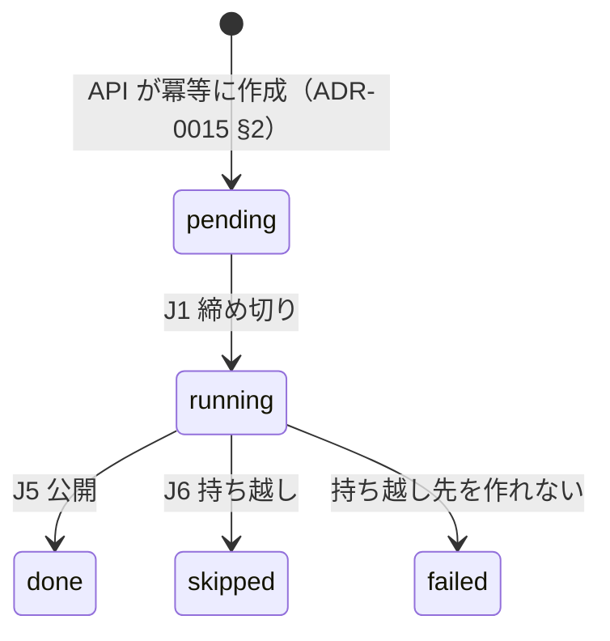

# 非同期処理の設計

- 状態: 草案
- 日付: 2026-11-19
- チケット: YGO-006
- 根拠: `.ai/brief.md`・`.ai/requirements.md`・`.ai/architecture.md`・`.ai/db.md`・`.ai/api.md`
- 関連 ADR: 0002・0004・0005・0006・0007・0008・0010・0011・0012・0014・0015・0016・0017・0035・0039・0070・0072・0076・0085

---

## §1 原則

1. **非同期処理はすべて worker で動かす** [explicit]（ADR-0008）: cron スケジュールとジョブの
   実行は `worker` プロセスのみが担う。`web` プロセスはジョブを積むだけで、実行しない。

2. **キューは PostgreSQL の上の pg-boss 相当** [explicit]（ADR-0010）: Redis 等の別ブローカは
   使わない。トランザクションの中でジョブを積めるため、保存とキューの不整合が起きない。

3. **ジョブのペイロードは ID だけ** [inferred]（db.md §1 原則 6）: 本文など大きなデータは
   含めない。再実行のとき古いペイロードが使われるリスクを避けるため。

4. **冪等性は 3 つの仕組みで守る** [inferred]:
   - DB の一意制約（`mailbox_items` の UNIQUE・`newspapers` の UNIQUE）
   - 条件付きの状態更新（`UPDATE … WHERE state = <前の状態>`）
   - 決まった名前のキー（`singletonKey = <キュー名>:<run_id>`）
   
   ジョブが必ず 1 回しか動かないことには頼らず、少なくとも 1 回は動くことを前提にする。

5. **時刻は JST 固定、夏時間なし** [inferred]（OQ-034）: すべてのスケジュール計算は JST 基準。
   タイムゾーンの追加は OQ-034 の回答待ち。

6. **LLM は審査のラベルを返すだけ** [explicit]（ADR-0005）: `ok` / `review` / `block` の
   いずれかを返す。公開可否の最終判断はルール表との突合で決める。
   クローズドな手紙の本文は LLM に渡さず、ルール表だけで照合する [inferred]（OQ-003 → 決定、ADR-0072）。
   手紙の照合は投函のときに API が行い、worker は手紙を照合しない [inferred]（OQ-052 → 決定、ADR-0069）。
   新聞の LLM（J16）は記事の文字を作るだけで、公開してよいかは決めない。出力は保存し、組版（J3・J8）は保存した文字から決定的に行う（OQ-051 → 決定、ADR-0039）。

7. **即時の配達や通知はしない** [explicit]（P-1）: 配達回の外で住民に物を届けない。
   新聞は定時（07:00 / 17:00）に全住民へ、手紙は午前（08:00〜12:00）・午後（18:00〜21:00）の時間帯の中の受取人ごとの時刻に届ける（OQ-042 → 決定、ADR-0035）。
   配達の通知（OQ-002・OQ-042 → 決定、ADR-0076・ADR-0035）は、新聞の通知を J5 の公開のあとに、手紙の通知を受取人の手紙の枠の時刻のあとに、
   J15 が配達回ごと・購読ごとに 1 回ずつ送る。手紙が届くたびには送らない。それぞれの時刻から 30 分を過ぎたら送らず、`skipped` の便では送らない。休刊の回も新聞の通知は送る（郵便受けには休刊の印が届く。ADR-0035 の D11）。

---

## §2 ジョブの一覧

すべてのジョブは `worker` プロセスで動かす。

| ID | キュー名 | きっかけ | 入力 | 出力 |
|----|---------|---------|------|------|
| J0 | `delivery.tick` | 定時（5 分ごと）[assumed] | なし | J1〜J6 を必要に応じて積む。公開済みの配達回の手紙の枠の時刻を過ぎたら、枠ごとに J15（`kind = letter`）を積む（ADR-0035） |
| J1 | `delivery.close` | 01:00 / 14:00 JST 以降、J0 が判断 | `run_id` | 配達回を `running` にする。手紙を `pending` → `scheduled`。`moderation_queue` に投稿の行を入れる（手紙の行は入れない、ADR-0069） |
| J2 | `moderation.review` | 02:00 / 15:00 JST 以降、J0 が判断 | `run_id` | ラベルと判定。投稿を `approved` / `rejected` にする。手紙は扱わない（投函のときに API が照合する、ADR-0069） |
| J3 | `newspaper.typeset` | J16 完了か記事の打ち切り（04:30 / 16:15）[assumed] 後、J0 が判断（締め切りは 05:00 / 16:30）。M3・M4 は J2 完了か打ち切り後 | `run_id` | 版ごとの静的 HTML と、`newspapers`・`newspaper_editions` の行（ADR-0039）。間に合わなければ休刊 |
| J4 | `delivery.prepare` | `newspapers` の行ができた後、J0 が判断 | `run_id` | 見せる前の `mailbox_items`（新聞は全住民に版を 1 つずつ・手紙は宛先、行ごとに `visible_at`）。宛先ごとの振り分け。終わりに `prepared_at` を書く |
| J5 | `delivery.publish` | 07:00 / 17:00 JST、J0 が判断 | `run_id` | 配達回を `done` に（`finished_at` を書く）。手紙と投稿の最終状態を確定。新聞の通知（J15、`kind = newspaper`）を積む（休刊の回も） |
| J6 | `delivery.carry_over` | 配達時刻から 15 分過ぎても公開できない場合、J0 が判断 [assumed] | `run_id` | 配達回を `skipped` に（`finished_at` を書く）。中身を次の便へ移す |
| J7 | `account.erase` | キュー（API が退去を受けたのと同じトランザクションで積む） | `resident_id` | ADR-0085 の表に従い消去 |
| J8 | `newspaper.retypeset` | キュー（J7 から・投稿削除から） | `newspaper_id` | 紙面の差し替え |
| J9 | `account.expire` | 毎日（段階 3、配達窓を外した時間帯）[assumed]。OQ-088 の答えで `vacant_expired` への遷移を作るときだけ作る（ADR-0060 の D3） | なし | `vacant_expired` から 12 か月たった住民の J7 を積む |
| J10 | `address.dormancy` | 毎日（段階 3、配達窓を外した時間帯）[assumed] | なし | `active` → `dormant` への遷移と休眠通知の積み込み |
| J11 | `address.forwarding_expire` | 毎日（段階 3、配達窓を外した時間帯）[assumed] | なし | 転送期限切れの旧住所を `vacant_forwarded` に |
| J12 | `notify.dormancy` | キュー（段階 3、J10 が積む） | `address_id` | 休眠通知を 1 通送る（テスト環境はモックかローカルの SMTP、本番のサービスはマスターの事前承認を得て選ぶ。ADR-0033） |
| J13 | `image.process` | キュー（段階 2。J0 も滞留分を拾い直す） | `image_id` | 新聞写真風に加工した画像 |
| J14 | `retention.purge` | 毎日（配達窓を外した時間帯）[assumed] | なし | ADR-0085 の保持期間を過ぎたものを削除 |
| J15 | `notify.delivery` | キュー（新聞は J5 が公開と同じトランザクションで、手紙は J0 が枠の時刻を過ぎてから積む。`singletonKey` は §5） | `{run_id, kind, slot}` | 購読のある住民へ「新聞が配達されました！」か「手紙が配達されました！（N通）」を 1 回送る（ADR-0076・ADR-0035） |
| J16 | `newspaper.write` | J2 と J17 が終わる（J17 は失敗か取り込みの打ち切りでもよい）か審査の打ち切り後、J0 が判断（M5 から） | `run_id` | 素材（承認済みの投稿・その回の J17 が取り込んだ外のニュース）ごとの見出しと記事の文字（`newspaper_articles`、ADR-0055 の D7） |
| J17 | `news.fetch` | 01:00 / 14:00 JST 以降、取り込みの打ち切り（04:00 / 16:00）まで、J0 が判断（M5 から） | `run_id` | 取り込んだ外のニュース（`external_news_items`、`delivery_run_id = run_id`、ADR-0039 の D6）。本番のアダプタは OQ-060 のあと |
| — | `erasure.replay` | 手動（リストアの後） | なし | 消したはずのデータを `erasure_log` を元に消し直す |
| — | `keys.reencrypt` | 手動（運用者の CLI。鍵の新しい版を全プロセスに配り、暗号化の版を切り替えたあと。配達の窓が閉じた直後に始める [assumed]） | `{kind: 'letter' \| 'email', from_version}` | 版 `from_version` で暗号化した手紙の本文（AAD は同じ手紙の ID）かメールアドレスの暗号化した値を、1,000 件ずつのトランザクションで今の版に暗号化し直す。残った行から続けられる（冪等）。平文を DB・ログ・ペイロードに書かない（ADR-0021・ADR-0052 の D8、手順は `environment.md` §8.3） |

**毎日のジョブのスケジュール（J9〜J11・J14。J9 は作るときだけ）**: 配達回の窓（01:00〜12:30 JST と 14:00〜21:30 JST。手紙の時間帯の終わりと手紙の通知の期限を含む、ADR-0035）
を避けて置く [assumed]。例: 12:30 JST、23:00 JST など。

**段階**: J10〜J12 は段階 3（F-16）で作る。J9 は OQ-088 の答えで `vacant_expired` への遷移を作るときだけ、その遷移と同じ変更で作る（ADR-0062 の D1・D2、ADR-0060 の D3、`roadmap.md` §6）。MVP で作るのは J0〜J8・J14・J15・J16・J17・`erasure.replay`・`keys.reencrypt`（J15 は M3、J16・J17 は M5、`keys.reencrypt` は M6、`roadmap.md` §4）。
J13 は段階 2（F-11）。

**今の段階で設計しない処理**（理由を添える）:

| 処理 | 理由 |
|------|------|
| マッチング | 段階 3（F-18）。アルゴリズム（FR-066）とカテゴリの分け方（FR-069）が未確定。恋愛のカテゴリは設けない（ADR-0024） |
| 広告・折込チラシ | FR-090 はこのフェーズの範囲外（F-20）。運営の入居者募集の広告（FR-123）は除く。段階 3 から C6 の紙面に載せる（ADR-0050 の D5、OQ-083 → 決定。細部は OQ-084）|

---

## §3 配達回の流れ（ADR-0016・ADR-0017 の具体化）

### 時刻表（JST）

ADR-0004 の表を拡張する。

| イベント | 朝便 | 夕便 | 出典 |
|----------|------|------|------|
| 締め切り開始 | 01:00 | 14:00 | ADR-0004 |
| 審査開始 | 02:00 | 15:00 | ADR-0004 |
| 外のニュースの取り込み（J17、M5 から） | 01:00 | 14:00 | ADR-0039 |
| 審査の打ち切り・外のニュースの取り込みの打ち切り（J17、M5 から） | 04:00 | 16:00 | [assumed]（取り込みの打ち切りは ADR-0039 の D6） |
| 記事の打ち切り（J16、M5 から） | 04:30 | 16:15 | ADR-0055 の D8 [assumed] |
| 組版の締め切り | 05:00 | 16:30 | ADR-0004 |
| 公開（新聞の配達・新聞の通知）| 07:00 | 17:00 | ADR-0004・ADR-0035 |
| 公開の打ち切り | 07:15 | 17:15 | [assumed] |
| 手紙の配達（10 分刻みの枠の始まり）| 08:00〜11:50 | 18:00〜20:50 | ADR-0035 の D8 [assumed] |
| 手紙の時間帯の終わり（送った人に「配達済み」と見せる時刻）| 12:00 | 21:00 | ADR-0035 の D10 |
| 手紙の通知の期限の最後 | 12:20 | 21:20 | ADR-0035 の D11（最後の枠から 30 分） |

審査の打ち切りと公開の打ち切りの時刻は仮置き。確定したら ADR-0004 を置き換える ADR に書く。

**手紙の枠**（ADR-0035 の D9）: 枠は 10 分刻みで、朝便は 24 枠（08:00〜11:50）、夕便は 18 枠（18:00〜20:50）。
受取人の枠の番号は `SHA-256(run_id + ":" + resident_id)` を整数として枠の数で割った余り。同じ配達回の、同じ受取人の手紙はすべて同じ枠になる。
決定的なので J4 をやり直しても変わらない。持ち越した手紙は移し先の配達回の J4 で枠を決め直す。

### `delivery_runs.status` の状態と遷移

| 状態 | 意味 |
|------|------|
| `pending` | 受付中。手紙と投稿を受け付けている |
| `running` | 締め切り済み。審査・組版・準備の最中 |
| `done` | 公開完了 |
| `skipped` | 次の便に持ち越した |
| `failed` | 持ち越し先も作れない。運用者の対応が必要 |



`delivery_runs.started_at` は J1 が `running` にする UPDATE で書く。`delivery_runs.finished_at` を書くのは、J5 が `done` にする UPDATE と J6 が `skipped` にする UPDATE だけで、`pending`・`running`・`failed` の間は NULL [assumed]（`db.md` §2 の CHECK）。

### 工程が済んだかどうかの見分け方

| 工程 | 見分け方 | カラム |
|------|---------|--------|
| 締め切り | その配達回に `letters.state = 'pending'` の行が残っていない | `letters.state` |
| 審査 | `moderation_queue.processed_at` が NULL の行が残っていない | `moderation_queue.processed_at` |
| 外のニュースの取り込み（M5 から） | その回の J17 のジョブが完了か失敗（再試行を使い切った）か、取り込みの打ち切り（04:00 / 16:00）を過ぎた。取り込めなくても組版は止めない | pg-boss のジョブ履歴・時刻 |
| 記事の文字（M5 から） | 承認済みの投稿（`board_posts.delivery_run_id = run_id`）と、その回に取り込んだ外のニュース（`external_news_items.delivery_run_id = run_id`）のすべてに `newspaper_articles` の行がある。取り込みが済むまでは判定しない | `newspaper_articles`・`external_news_items.delivery_run_id` |
| 組版 | `newspapers` の行がある（版の行は同じトランザクションで入る） | `newspapers.delivery_run_id` |
| 準備 | `delivery_runs.prepared_at` が NULL でない（J4 がすべての宛先を書き終えた最後のトランザクションで書く） | `delivery_runs.prepared_at` |

### J0 の動き（見回りジョブ）

J0 は 5 分ごとに `delivery_runs` を `run_id` の昇順に調べる。

1. 各配達回について次の工程を 1 つだけ特定する。
2. `singletonKey = '<キュー名>:<run_id>'` で積む。同じキーのジョブがキューに残っていれば積まない。
3. 前の配達回が `done` または `skipped` になるまで、後の配達回の J5（公開）を積まない。
4. M5 から、`running` の配達回に J17（外のニュースの取り込み）を取り込みの打ち切りまで積み、審査と取り込みが済んだあとに J16（記事の文字）を挟んでから J3 を積む（ADR-0039）。J16 は、J17 が完了・失敗するか取り込みの打ち切りを過ぎるまで積まない（素材の範囲がそこで決まる）。M3・M4 の J0 は今のまま（J16・J17 を積まない）。
5. `running` の配達回は、持ち越しの打ち切り（公開の打ち切り、07:15 / 17:15 JST）を過ぎていれば、どの工程で止まっていても J6 を積み、ほかの工程を積まない [assumed]（ADR-0016）。この判断を `running` の枝の先頭に置くので、J4 が失敗し続けても J6 に届く。打ち切りの前は、準備が済んでいなければ（`prepared_at` が NULL）J4 を、済んでいれば（NULL でない）公開の時刻のあとに J5 を積む
6. `done` の配達回のうち、手紙の通知の期限がまだ来ていないもの（最後の枠から 30 分以内）について、時刻を過ぎて 30 分以内の枠ごとに J15（`kind = letter`）を積む（ADR-0035 の D11）。

```
J0 の判断ロジック（概略）:
  for each run in delivery_runs ORDER BY run_id:
    if run.status = 'pending' and now >= close_time(run):
      enqueue J1 with singletonKey
    elif run.status = 'running':
      if now >= carry_over_cutoff(run):             -- 07:15 / 17:15。どの工程で止まっていても先に当てる [assumed]
        enqueue J6 with singletonKey
      else:
        -- M5 から（ADR-0039）。fetch_settled = J17 が完了か失敗（再試行を使い切った）か、now >= fetch_cutoff(run)
        -- fetch_cutoff は review_cutoff と同じ時刻（04:00 / 16:00）[assumed]
        if not fetch_settled(run):
          enqueue J17 with singletonKey             -- J2 とは別に積む
        if moderation not started and now >= review_start_time(run):
          enqueue J2 with singletonKey
        elif moderation done or now >= review_cutoff(run):
          if not fetch_settled(run):                -- M5 から。素材の範囲が決まるまで J16 を積まない
            pass                                    -- review_cutoff で fetch_settled になるので、ここで長く止まらない
          elif articles not done and now < article_cutoff(run):   -- M5 から（ADR-0039）
            enqueue J16 with singletonKey
          elif newspapers row not exists and now < typeset_deadline(run):
            enqueue J3 with singletonKey              -- M5 からは J16 完了か記事の打ち切りのあと
          elif newspapers row not exists and now >= typeset_deadline(run):
            enqueue J3 (holiday) with singletonKey
          elif newspapers row exists and run.prepared_at is null:
            enqueue J4 with singletonKey
          elif run.prepared_at is not null and now >= publish_time(run) and prev runs all done:
            enqueue J5 with singletonKey
    elif run.status = 'done':
      for each slot in letter_slots(run):          -- 08:00〜11:50 / 18:00〜20:50 の 10 分ごと
        if slot <= now < slot + 30 min:
          enqueue J15 {run_id, kind: 'letter', slot} with singletonKey
```

---

## §4 処理ごとの詳細

### J1 — 締め切り（`delivery.close`）

**きっかけ**: 朝便は 01:00 JST、夕便は 14:00 JST 以降。J0 が `singletonKey` で積む。

**入力**: `run_id`（例: `2026-11-19-morning`）

**出力**:
- `delivery_runs.status` を `pending` → `running` に更新し、同じ UPDATE で `started_at` を書く
- 対象配達回の手紙を `state = 'scheduled'` に更新
- 対象配達回の掲示板投稿を `moderation_queue` に登録
- 手紙は `moderation_queue` に登録しない。手紙は投函のときに API が照合済みで、配達の前に照合し直さない（ADR-0069 の D2・D3。DB の CHECK 制約 `content_kind <> 'letter'`）。
  `held`（確認待ち）の手紙は `delivery_run_id` が NULL なので、どの配達回の締め切りにも乗らない

**冪等性**:
- `delivery_runs` の行は `INSERT … ON CONFLICT DO NOTHING` で作る（API が作ってなければここで作る）
- `UPDATE delivery_runs SET status='running' WHERE run_id=$1 AND status='pending'`（1 行だけ動く）
- 手紙の更新は `UPDATE … WHERE delivery_run_id=$1 AND state='pending'`
- `moderation_queue` への挿入は `ON CONFLICT DO NOTHING`（重複を弾く UNIQUE 制約はまだない。`reviews/0001-design-review.md` の R-013 で決める）
- 1,000 件ずつのトランザクションに分けて処理し、途中で止まっても再開できる

**ADR-0015 §2 の締め切りのロック手順**:

API が手紙を書くとき、`delivery_runs` の行を `FOR SHARE` でロックしながら書く。J1 は
`UPDATE … SET status='running'` を実行する前に、その配達回の `FOR SHARE` ロックが
すべて外れるのを待つ（`FOR UPDATE`）。これにより、締め切り後に手紙が混ざり込まない。

具体的な順序:
```
BEGIN;
  UPDATE delivery_runs SET status='running', started_at=now()
    WHERE run_id=$1 AND status='pending';  -- この行に排他ロックを取る
  -- FOR SHARE を持つ API トランザクションがすべて終わるまでここで待つ
  -- ...手紙・投稿の更新...
COMMIT;
```

**失敗とやり直し**:
- 途中で止まっても、`delivery_runs.status` が `running` のまま残る
- J0 が次の見回りで J2 を積む。J1 の残り作業（手紙の `scheduled` への更新）は
  J1 を再実行するか、J2・J3 が必要な行を参照するときに当然 `pending` のものは無視される
- やり直しで `delivery_runs` の `INSERT` は `ON CONFLICT DO NOTHING` なので重複しない
- 締め切りが遅れても、API は `nextDeliveryRun(now)` で次の配達回に書くので混入しない [inferred]

---

### J2 — 審査（`moderation.review`）

**きっかけ**: 朝便は 02:00 JST、夕便は 15:00 JST 以降。J0 が `singletonKey` で積む。

**入力**: `run_id`

**出力**:
- `moderation_queue` の各行にラベル（`llm_label`）と判定（`policy_decision`）を記録
- `board_posts.status` を `approved` / `rejected` に更新

**対象**: 掲示板の投稿だけ。クローズドな手紙は扱わない（OQ-052 → 決定、ADR-0069。手紙は投函のときに API がルール表だけで照合し、`reject` の段に当たった手紙は保存されず、`review` の段に当たった手紙は送った人が確認を頼んだときだけ `held` になってモデレーターが確かめる。api.md §7 F-04・F-08）

**投稿の判定の順序**（ADR-0005）:
1. ルール表を先に当てる（即座に `blocked` → `rejected`）
2. ルール表で決まらなければ LLM がラベルを付ける
3. LLM のラベルをルール表と突き合わせて `approved` / `rejected` を決める

**手紙**（ADR-0069・ADR-0072 の D3）:
- J2 は手紙の本文を復号しない。`moderation_queue` に手紙の行はない（J1 が入れず、DB の CHECK 制約でも入らない）ので、LLM の経路に手紙が乗ることはない（ADR-0072 の D2）
- `blocked` は J2 ではなく、モデレーターが `held` の手紙を却下したときに API が書く

**冪等性**:
- `moderation_queue.llm_label` がすでに記録済みなら LLM を呼び直さない（費用の二重払いを避ける）
- ラベル・判定・投稿の状態は 1 つのトランザクションで書く
- `UPDATE board_posts SET status=… WHERE id=$1 AND status='awaiting_review'`

**失敗とやり直し**:
- LLM が失敗したら、打ち切り時刻（04:00 / 16:00 JST）まで指数バックオフで再試行
- 打ち切りまでに決まらなかった投稿と `llm_label = 'review'` の投稿は `awaiting_review` のまま
  次の配達回に持ち越す（`delivery_run_id` を次の便に変更）
- `review` の投稿と打ち切りまでに決まらなかった投稿は、モデレーターが人の審査で `approved` / `rejected` にする
  （security.md §5.2 の 3、ロールは ADR-0020 で決定・OQ-031）。人の審査が済むまで J2 は公開しない側に倒し、
  `awaiting_review` のまま持ち越す
- J2 が止まっても、打ち切りまでに終わらなくても、手紙の配達は遅れない（手紙は J2 を待たずに J4 が準備する、ADR-0069）
- テストではモックの LLM を使う（ADR-0005）。手紙の投函の照合のテストでは、呼ばれたら失敗するモックの LLM を web 側に差し込む（`roadmap.md` A-06・A-07）

---

### J3 — 組版（`newspaper.typeset`）

**きっかけ**: M5 からは、J16 完了（素材のすべてに `newspaper_articles` の行がある）または記事の打ち切り（04:30 / 16:15 JST）[assumed] 後（ADR-0039）。
M3・M4 は、J2 完了（`moderation_queue` に `processed_at = NULL` の行がない）または審査打ち切り（04:00 / 16:00 JST）後。J0 が判断し `singletonKey` で積む。

**入力**: `run_id`

**出力**:
- 版ごとの静的 HTML をオブジェクトストレージに保存
- `newspapers` の行と、すべての版の `newspaper_editions`・`newspaper_items` の行を 1 つのトランザクションで挿入（版がそろうか休刊かのどちらかになる）

**入力データ**（ADR-0055 の D7）: `newspaper_articles` のその配達回の行。素材は `board_posts.status = 'approved'` かつ
`board_posts.delivery_run_id = run_id` の投稿（`(created_at, id)` の順）と、`external_news_items.delivery_run_id = run_id` の外のニュース（`(fetched_at, id)` の順）。前の回に取り込んだ外のニュースは素材にしない。
- 版は、共通の版（`common`）と、興味の一覧の `active` な興味ごとの版（`interest:<key>`）。MVP（M5）では全住民を知り合い 0 の組として扱い、知り合いの組の版と誕生日の欄は作らない（ADR-0074 の D1。作る時期は OQ-070）
- 組 1・2 を作る段階では（ADR-0074 の D2・D3・D4・D6・D7・D9）、J3 が住民ごとに、その配達回の素材のうち知り合い（互いの `address_book.registered_tenancy_id` が相手の今の居住記録を指し、その 2 つのエントリがどちらも住所を入れたエントリ（`source = 'address'`）で、どちらもブロックしていない住民。投稿と手紙から足したエントリの組は含めない、ADR-0065 の D14）の投稿の件数 k を数える。
  朝刊（`newspapers.kind = 'morning'`）のときは、知り合いのうち、配達回の日（JST）が誕生日（`residents.birthday_month`・`birthday_day`。2/29 の住民はうるう年でない年は 3/1）の住民の人数 b も数える。夕刊では b = 0。
  S（組 1・2 のテンプレートの記事の枠の数）に対し、k = 0 かつ b = 0 なら組 0 で何もしない。それ以外で k < S なら組 2 で、k 件の知り合いの記事のあとに、その住民が組 0 なら受け取る版（興味の版か共通の版、J4 と同じ選び方）の記事をその版の順に S − k 件足す（すでに載った素材は飛ばす。k = 0 なら S 件すべて）。
  k ≥ S なら組 1 で、知り合いの記事を `(created_at, id)` の順で先頭の S 件。どちらも `acquaintance:<resident_id>` の版として、ほかの版と同じトランザクションで入れる。組は保存しない。手紙は載せない。記事の文字は素材ごとの `newspaper_articles` を使い回し、LLM は呼ばない
- 組 1・2 の朝刊には、b ≥ 1 なら誕生日の欄を S の枠の外に置く（ADR-0074 の D9）。載せるのは、その日が誕生日の知り合いのニックネーム・その日に上がったあとの年齢（ADR-0073 の D3）・今の住所だけで、住所の順に並べ、上限を置かない。読む住民自身・月日の数字・自己紹介は載せない。
  欄は C6 のテンプレートの決まった文で組み、J16（LLM）には誕生日・年齢・ニックネーム・住所を渡さない。共通の版・興味の版・`holiday` には載せず、休刊の朝刊の分は持ち越さない。誕生日と年齢をジョブのペイロードとログに書かない（J3 は `run_id` だけを受け取り、`residents` から読む）。
  欄に載せた住民ごとに `newspaper_birthday_entries` の行（ニックネーム・年齢・住所・並び順）を版と同じトランザクションで入れ、欄はこの行から組む。J3 の再試行と J8 の組み直しもこの行から組み、`residents` と住所録を読み直さない（`db.md` §2）
- 共通の記事（`interest_category_id` が NULL）はすべての版に、興味の記事はその興味の版に載せる。結び付け方は OQ-062
- 投稿の本文は `board_posts.body` からそのまま載せる（書き換えない）。テンプレートは投稿の本文を投稿の枠に入れ、その枠には `board_posts.body` だけを入れる。LLM が書いた見出しは枠の外に新聞の文として置く。投稿の記事にまとめは載せない（投稿の行の `body` は NULL。ADR-0054 の D5・D9、OQ-074 → 決定）。LLM の文に「AI が書いた文」の印は付けない（ADR-0054 の D1・D4・D6。規約が印を求めるかは OQ-073、持ち越し）
- 記事の文字はすべてエスケープして描く（HTML として扱わない）
- 記事の行がない素材（J16 が打ち切りまでに作れなかったもの）には、組む前に `written_by = 'template'`（`prompt_version` は NULL）の行を `INSERT … ON CONFLICT (delivery_run_id, source_kind, source_id) DO NOTHING` で入れ、それから `newspaper_articles` を読み直して組む。
  行の中身は J16 の決まった形と同じ: 外のニュースは素材の題を `headline`、素材の本文を `body` にそのまま入れる。投稿は `headline` を決まった文「掲示板から」[assumed]、`body` を NULL にする（投稿の本文を `body` に写さない。`db.md` の CHECK、ADR-0054 の D10）。
  記事の打ち切りのあとは J16 が行を入れない（§4 J16）ので、J3 の再試行と J8 の組み直しは同じ行から組む。J16 が完了して打ち切りの前に J3 が動くときは、行のない素材はない
- **LLM は呼ばない**。描く関数は保存した文字だけを入力にする
- M3・M4（J16 がない段階）は、承認済みの投稿をそのまま決まった形で共通の版 1 つに組む

**冪等性**:
- 保存キーは `newspapers/<run_id>/<edition_key>/<コンテンツのハッシュ>.html` [assumed]。
  同じ内容なら同じキーになるため、上書きしても安全
- 手順は「すべての版を描く → オブジェクトストレージに置く → `newspapers` と版の行を 1 つのトランザクションで INSERT」の順
- `UNIQUE(delivery_run_id)` と `UNIQUE(newspaper_id, edition_key)` があるため、紙面は 1 配達回に 1 つ、版は種類ごとに 1 つだけ
- 遅れて動いた組版は一意制約に当たって何もせずに終わる（`ON CONFLICT DO NOTHING`）
- 同じ `newspaper_articles` から描くので、やり直しでもそれぞれの版の HTML はバイト単位で同じ（`roadmap.md` A-05）

**休刊の扱い**（ADR-0007）:
- 組版の締め切り（05:00 / 16:30 JST）までに `newspapers` の行ができなければ、
  J0 が `is_holiday = true` の行と `holiday` の版の行を 1 つのトランザクションで `ON CONFLICT DO NOTHING` で入れて休刊にする
- LLM の失敗・打ち切りでは休刊にしない（記事を決まった形で組む、ADR-0055 の D8）
- 投稿が 0 件でも、空のときのテンプレートで組む [assumed]
- 休刊の回でも、承認済みの投稿は次の配達回で掲示板として届ける [assumed]

**失敗とやり直し**:
- 失敗したら組版の締め切り前に pg-boss の `retryBackoff` で再試行
- 締め切り後はホリデー行を挿入（J0 が担う）
- 再試行で描いた結果のキーがオブジェクトストレージに存在すれば `newspapers` の INSERT だけ実行

---

### J4 — 準備（`delivery.prepare`）

**きっかけ**: `newspapers` の行ができた後。J0 が判断し `singletonKey` で積む。

**入力**: `run_id`

**出力**:
- `mailbox_items` に「見せる前の」行を事前に書く
- 宛先ごとの振り分け結果（通常・転送・差し戻し・抑止）を反映
- 各行に `visible_at` を書く（ADR-0035 の D10）
- 区切りごとのトランザクション（最後のトランザクションも含む）は、はじめにこの配達回の `delivery_runs` の行を `FOR SHARE` でロックする [assumed]。`status <> 'running'` か `now() >= carry_over_cutoff`（公開の打ち切り）なら、そのトランザクションでは何も書かず（`mailbox_items` も `letters.state` も）、J4 を成功で終える。J6 の手順 0 の `FOR UPDATE` と同じ行のロックで直列になるので、J6 が `skipped` にして `mailbox_items` を消した回に、あとから J4 が行を足さない
- すべての宛先を書き終えたら、最後のトランザクションで `UPDATE delivery_runs SET prepared_at = now() WHERE run_id=$1 AND status='running' AND prepared_at IS NULL` を実行する [assumed]。J0 はこの列で準備の完了を判断する（§3）

**新聞**（ADR-0035 の D1・D2、FR-106・FR-108、ADR-0039 の D2・D3、ADR-0045 の D6）:
- その配達回の紙面を、J4 の時点で住んでいる全住民（`tenancies.is_current = true`）に `kind = 'newspaper'` で 1 行ずつ作る。手紙があるかにかかわらない。退去した住民の居住記録は J7 の手順 7 で `is_current = false` になるので、そのあとの J4 は退去した住民の行を作らない（ADR-0085 の D10）
- `item_id` は、その住民に届ける版（`newspaper_editions.id`）。住民ごとに組を決め、版を 1 つ選ぶ:
  1. 組: MVP（M5）では、全住民を知り合い 0 の組として扱う（ADR-0074 の D1）。組 1・2 を作る段階では、J4 は組を計算し直さず、その配達回に `acquaintance:<resident_id>` の版があればそれを選ぶ（ADR-0074 の D7）。なければ組 0 として 3・4 で選ぶ
  2. 休刊の回は全住民に `holiday` の版
  3. 興味（候補）がない住民には `common` の版。候補は、選んだ興味（`resident_interests`）と推し量った興味（`inferred_interests`、段階 2 の S2-3 から、ADR-0045 の D6）を合わせた集合で、どちらも `active` な興味だけ、重なりは 1 つにする。M5 では `inferred_interests` がないので選んだ興味だけ
  4. 候補が 1 つならその興味の版。複数なら `SHA-256(run_id + ":" + resident_id)` を整数として候補の数で割った余りで 1 つ選ぶ（候補は `sort_order, id` の順）
- 興味（選んだものも推し量ったものも）は J4 の時点の値を使う。部分一意索引 UNIQUE(delivery_run_id, resident_id) WHERE kind = 'newspaper' があるので、やり直しのあいだに興味が変わっても新聞は 1 つだけ（最初に入った行が残る）
- M3・M4（版が `common` 1 つだけの段階）は、全住民に共通の版（M3 は休刊の版）
- `visible_at` は、その便の公開の時刻（朝便 07:00・夕便 17:00 JST）

**手紙の `visible_at`**（ADR-0035 の D8・D9）:
- 受取人（転送なら新住所の住民）の枠を §3 の「手紙の枠」で決め、その枠の始まりの時刻を `visible_at` に書く。同じ配達回の同じ受取人の手紙は同じ時刻
- 時刻はハッシュで決まるので、やり直しでも同じ値になる（`ON CONFLICT DO NOTHING` で書き直さない）

**対象の手紙**（ADR-0069）:
- 判定を見ず、その配達回の `scheduled` の手紙をすべて準備する（M3 から M4 以降まで同じ）。手紙は投函のときに照合済みで、J4 は照合し直さない（ADR-0069 の D3）
- `held`（確認待ち）と `blocked` の手紙は `delivery_run_id` が NULL で `scheduled` にならないので、対象にならない。モデレーターが承認した手紙は `pending` で次の配達回に入り、その回の J1 で `scheduled` になる

**宛先の振り分け**（db.md §3 の表）:
- `tenancies.is_current = true` → 通常配達（そのまま `mailbox_items` を作る）
- 転送期間 6 か月以内（ADR-0060 の D4）→ 新住所の住民に `mailbox_items` を作る
- 転送期限切れ・空き家 → `letters.state = 'returned'` にし、`mailbox_items` を作らない
- 受取人が送信者をブロック → `letters.state = 'suppressed'` にし、`mailbox_items` を作らない
- J4 は `settled_at` を書かない（NULL のまま）。`settled_at` は J5 の手順 3 だけが、同じ回の手紙に同じ値で書く（ADR-0085 の D1・D5）。この配達回が J6 で持ち越されたときは、`returned`・`suppressed` にした手紙も `scheduled` に戻って次の便に移り（J6 の手順 2）、次の便の J4 が振り分け直す

**冪等性**:
- `mailbox_items` は `ON CONFLICT DO NOTHING` で挿入する（`UNIQUE` 制約で重複を弾く）
- 宛先ごとに keyset ページングで区切って処理する。途中で止まってもやり直せる
- 区切りごとのトランザクションは、はじめに `delivery_runs` の行を `FOR SHARE` でロックし、`status <> 'running'` か `now() >= carry_over_cutoff` なら何も書かずに成功で終える（出力と同じ）。やり直しの J4 が打ち切りのあとに動いても、持ち越した回に行を足さない
- ブロックは準備の時点の状態で判断する（配達時刻より前に変わった場合は J5 で再確認）
- 最後の `UPDATE delivery_runs SET prepared_at = now() WHERE run_id=$1 AND status='running' AND prepared_at IS NULL` は、2 回目は `prepared_at` が NULL でないので何もしない（最初の時刻が残る）。持ち越した回（`skipped`）にも書かない

**失敗とやり直し**:
- 失敗したら `ON CONFLICT DO NOTHING` で安全に再実行できる。`prepared_at` は NULL のまま残る
- 持ち越しの打ち切り（07:15 / 17:15 JST）までは J0 が J4 を積み直し、打ち切りを過ぎたら J6 を積む（§3）

---

### J5 — 公開（`delivery.publish`）

**きっかけ**: 朝便は 07:00 JST、夕便は 17:00 JST。J0 が判断し `singletonKey` で積む。
前の配達回（古い `run_id`）が `done` または `skipped` になるまで積まない。

**入力**: `run_id`

**出力**:
- `delivery_runs.status` を `running` → `done` に更新し、同じ UPDATE で `finished_at`（公開の時刻）を書く
- `letters` と宛先の最終状態を更新
- `board_posts.status` を `published` に更新

公開の時刻に見えるようになるのは新聞と掲示板だけ。手紙の状態（`delivered` など）もこの時点で確定するが、受取人に見えるのは `mailbox_items.visible_at` を過ぎてから（ADR-0035 の D10）。

**1 つのトランザクションで行うこと**:
0. この配達回の `delivery_runs` の行を `FOR UPDATE` でロックする [assumed]。`status <> 'running'`・`prepared_at IS NULL`・`now() >= carry_over_cutoff`（公開の打ち切り）のどれかなら、何もせずに成功で終える（打ち切りのあとは J6 が持ち越す。同じ行のロックで J6 と直列になるので、J6 が先に `skipped` にした回を `done` にせず、`done` にした回を J6 が移さない）
1. J4 が準備しなかった手紙を次の便へ移す（ADR-0072 の D3 の安全網）: この配達回の `state = 'scheduled'` の手紙のうち、
   この配達回の `mailbox_items` がないもの（J4 が準備していないもの）を、次の受付中の配達回に移す
   （J6 の 1・2 と同じく、次の配達回を `FOR UPDATE` で取るか `INSERT … ON CONFLICT DO NOTHING` で作り、`delivery_run_id` を変え、`scheduled` のまま）。
   - J4 は判定を見ずに `scheduled` の手紙をすべて準備する（ADR-0069）ので、ふつうは移る手紙はない
   - `held`・`blocked`・`returned`・`suppressed` の手紙は `state` が `scheduled` でないので移さない
   - 2 の削除より先に行う（退去で `mailbox_items` を消された手紙を、準備されなかった手紙と取り違えないため）
   - 移した手紙を照合し直さない。`moderation_queue` の行も入れない（ADR-0069 の D3）
2. 退去などで状態が変わった（無効になった）`mailbox_items` の行を削除する
3. 手紙の `state` を `delivered` / `suppressed` / `returned` に確定させる。確定の対象は J4 が準備した手紙
   （1 の時点でこの配達回の `mailbox_items` があった手紙は `delivered`、J4 が `returned`・`suppressed` にした手紙はその状態のまま）だけで、
   1 で移した手紙は対象にしない。確定させた手紙のすべてに同じ値の `settled_at = now()` を書く（ADR-0085 の D1。`settled_at` を書くのはこの手順だけ）。`delivered` にした宛先の `letter_recipients.delivered_at` には、受取人の `mailbox_items.visible_at`（枠の時刻）を書く（ADR-0035）
4. `board_posts.status` を `published` に・`published_at` を記録する
5. `delivery_runs.status` を `done` にし、同じ UPDATE で `finished_at = now()` を書く [assumed]。`now()` はトランザクションの始まりの時刻なので、手順 3 の `settled_at` と同じ値になる。この値が公開の時刻で、J15 の新聞の通知の期限（30 分）と、J14 の通知の記録（`delivery_notifications`）の保持（30 日）の起点になる
6. 紙面が休刊（`newspapers.is_holiday = true`）かにかかわらず、新聞の通知の J15 を `{run_id, kind: 'newspaper'}`・`singletonKey = notify.delivery:<run_id>:newspaper` で積む（ADR-0076・ADR-0035 の D11）。
   手紙の通知は J5 では積まない（枠の時刻のあとに J0 が積む）

**冪等性**:
- `UPDATE delivery_runs SET status='done', finished_at=now() WHERE run_id=$1 AND status='running'`
  2 回目に動いたとき `status = 'running'` でないので何もしない（`finished_at` も変わらず、J15 も積み直さない）
- 準備されなかった手紙の移動は `UPDATE letters SET delivery_run_id=<次の便> WHERE delivery_run_id=$1 AND state='scheduled' AND NOT EXISTS (この手紙のこの配達回の mailbox_items の行)`。
  公開と同じトランザクションなので、失敗すれば移動も戻り、やり直しで同じ手紙を移す。移したあとの 2 回目は対象が 0 行になる

**失敗とやり直し**:
- 1 つのトランザクションなので、全体が成功か全体が失敗かのどちらか
- 失敗したら pg-boss が再実行する。公開の打ち切り（07:15 / 17:15 JST）まで
- 打ち切りまでに成功しなければ J6（持ち越し）を J0 が積む

---

### J6 — 持ち越し（`delivery.carry_over`）

**きっかけ**: 公開の打ち切り（07:15 / 17:15 JST）後も `done` にならない場合。どの工程（審査・組版・準備・公開）で止まっていても同じ（§3 の J0 は `running` の枝の先頭でこれを判断する）。
J0 が判断し `singletonKey` で積む。

**入力**: `run_id`

**出力**:
- 配達回を `skipped` にし、同じ UPDATE で `finished_at`（持ち越した時刻）を書く
- 手紙と投稿を次の受付中の配達回に移す
- 見せる前の `mailbox_items` を削除

**1 つのトランザクションで行うこと**:
0. この配達回の `delivery_runs` の行を `FOR UPDATE` でロックし、`status <> 'running'` なら何もせずに終える [assumed]（J5 の手順 0 と同じ行のロックで直列になるので、打ち切りのときに J5 と J6 が同時に動いても、`done` の回の手紙を移さない。J4 の区切りごとの `FOR SHARE` とも直列になり、J6 のあとに動く J4 は何も書かない）
1. 次の受付中の配達回を `FOR UPDATE` で取る（なければ `INSERT … ON CONFLICT DO NOTHING` で作る）
2. `letters.delivery_run_id` を次の便に変更（`state = 'scheduled'` のままにする）。`scheduled` の手紙をすべて移す。
   J4 がこの配達回で `returned`・`suppressed` にした手紙（この回の J5 が動かないので `settled_at` が NULL）も、`state = 'scheduled'` に戻して同じく次の便に移す。次の便の J4 が振り分け直し、次の便の J5 が、一緒に移ったほかの手紙と同じ値で `settled_at` を書く（ADR-0085 の D1・D5。`suppressed` の手紙だけが早く 30 日を数え始めて、送信済みから先に消えないため。security.md T-06）。
   移した手紙を照合し直さず、`moderation_queue` の行も入れない（手紙は投函のときに照合済み、ADR-0069 の D3）
3. `board_posts.delivery_run_id` を次の便に変更（`status = 'awaiting_review'` のままにする）
4. この配達回の `mailbox_items`（まだ公開前のもの）を削除する
5. `delivery_runs.status` を `skipped` にし、同じ UPDATE で `finished_at = now()` を書く [assumed]。これが `skipped` の回の起点（持ち越した時刻）になる。J15 は `skipped` の回に通知を送らないので、この回を指す通知の記録（`delivery_notifications`）はない

**冪等性**:
- `UPDATE delivery_runs SET status='skipped', finished_at=now() WHERE run_id=$1 AND status='running'`
  2 回目は `status = 'running'` でないので何もしない（`finished_at` も変わらない）

**その他の扱い**:
- スキップした配達回の紙面は配らない。バックナンバーにも出さない（ADR-0007）[inferred]
- 移した手紙は `scheduled`（`returned`・`suppressed` から戻したものを含む）。照合し直さない（ADR-0069）
- `held`・`blocked` の手紙は移さない（`state = 'scheduled'` のものだけを移す。どちらも配達回に入っていない）
- 何便分も止まっていたときは、古い配達回から順に持ち越す
- 持ち越し先の `run_id` は `delivery_runs` に持たない `[assumed]`。持ち越し先は「次の受付中の配達回」で、移した手紙と投稿の `delivery_run_id` がその回を指すので、追跡はそれで足りる

**失敗とやり直し**:
- トランザクションなので全体が冪等に再実行できる
- `delivery_runs.status = 'failed'` になるのは、持ち越し先を作れない（DB の制約違反等）場合のみ。`failed` の回は `finished_at` が NULL のまま

---

### J7 — 退去（`account.erase`）

**きっかけ**: キュー。API が `DELETE /me` を受けたのと同じトランザクションで積む（ADR-0015 §4）。

**入力**: `resident_id`

**出力**: ADR-0085 の表に従い消去処理を実行する。消した `credentials`・`sessions`・`residents` の行を `erasure_log` に記録する。`residents` を指す行は、消すか（0〜8）、指す列を NULL にしてから（9）、`residents` を消す（10）

**処理の順序**（各項目は独立したトランザクション）:
0. 認証情報とセッションを消す（ADR-0085 の D8。1 つのトランザクションで次の順。外部キーを CASCADE にしないので、指す側から消す）
   1. その住民の通知の購読（`push_subscriptions`）の残りの行と、それを指す送った記録（`delivery_notifications`）を消す（退去の受付で消えていれば何もしない、ADR-0085 の D7）
   2. その住民のセッション（`sessions`）の行をすべて消す（受付で `invalidated_at` を付けた行・期限切れの行も含む）
   3. その住民の認証情報（`credentials`。メールの暗号化した値・検索用の HMAC・パスワードのハッシュ）の行を消す

   同じトランザクションで、消した `sessions` と `credentials` の行を `erasure_log` に記録する（`table_name` は `sessions`・`credentials`、`record_id` は行の ID。`credentials` は `resident_id`）
1. その住民が送った届いていない手紙（`state = 'pending' / 'scheduled' / 'held' / 'blocked' / 'returned' / 'suppressed'`）を、本文と宛先ごと削除する。`scheduled` の手紙の郵便受けの行（`kind = 'letter'`・`item_id` がその手紙の行。まだ `visible_at` を過ぎていない）も同じトランザクションで削除する（ADR-0085 の退去の表・ADR-0069 の D6。届いていないので受取人のために残す理由がなく、送った人ももう送信済みを見られない）。消した手紙は J5 の手順 3 の確定の対象にならない（行がない）。`delivered` の手紙は残す
2. 掲示板投稿（掲載前）を `deleted` に変更・`body` を消去し、同じトランザクションで J8 を積む
3. 掲示板投稿（掲載済み）を `deleted` に変更・`body` を消去し、同じトランザクションで J8 を積む
4. 住所録（所有するもの）を削除する
5. ブロック（blocker / blocked）を削除する
6. 通知を送った記録（`delivery_notifications`、`resident_id` が本人）の残りを削除する（ADR-0085・ADR-0076。購読と一緒に受付か 0 で消えていれば何もしない）
   興味（`resident_interests`）と推し量った興味（`inferred_interests`、段階 2）を削除する（ADR-0039 の D5・ADR-0045 の D5）。2・3 で消した投稿から作った記事（`newspaper_articles`）は J8 が消す
   新聞の誕生日の欄に載った行（`newspaper_birthday_entries`、`resident_id` が本人の行。組 1・2 を作る段階から）を消し、同じトランザクションで、行のあった版の紙面の J8 を積む（ADR-0074 の D9）
7. 1 つのトランザクションで、`addresses.status` を `vacant_deleted` に変更し、その住民の今の居住記録（`tenancies.is_current = true` の行）の `ended_at` を今の時刻、`is_current` を false にする（ADR-0085 の D10）。このあとに始まる J4 は、その住民を `is_current = true` の全住民に数えず、新聞の行を作らない
8. その住民が受け取った郵便受けの行（`mailbox_items`、`resident_id` が本人。手紙・新聞・掲示板のすべて）を削除する（ADR-0085 の退去の表。外部キーは CASCADE にしないので、10 の前に消す）。行が消えた手紙には、残りの受取人の行で J14 の条件（ADR-0085 の D3）を当てる
9. 1 つのトランザクションで、その住民を指す次の 6 つの列を NULL にする（ADR-0085 の D11。外部キーは既定で、`residents` を消す前に外す、D9）。`erasure_log` には記録しない（記録の範囲は `reviews/0001-design-review.md` の R-014）
   - `letters.sender_id`（残っているのは届いた手紙だけ。API では差出人を「退去済み」と示す）
   - `board_posts.author_id`（2・3 で投稿を引いたあと）
   - `reports.reporter_id`
   - `moderation_actions.moderator_id`
   - `images.uploader_id`
   - `tenancies.resident_id`（7 で終わらせたあと。引っ越しで終わった前の行も含め、その住民の行すべて。同じ UPDATE で `resident_erased_at` に今の時刻を書く: `UPDATE tenancies SET resident_id = NULL, resident_erased_at = now() WHERE resident_id = $1`、ADR-0085 の D10。J14 が退去から 1 年で消す）
10. `residents` を物理削除し、`erasure_log` に記録する（最後に行う。`address_book_daily_counts` は外部キーの CASCADE で一緒に消える）

**冪等性**:
- 各ステップは `WHERE resident_id=$1` と `WHERE status=<前の状態>` を組み合わせた
  条件付き UPDATE なので、2 回実行しても安全
- 0 の削除は `WHERE resident_id=$1` の DELETE。行がなければ何もせず、`erasure_log` にも記録しない
- 7 の居住記録は `WHERE resident_id=$1 AND is_current`。2 回目は対象が 0 行になる
- 9 は列ごとの `UPDATE … SET <列> = NULL WHERE <列> = $1`。2 回目は対象が 0 行になる（`tenancies.resident_erased_at` も 2 回目は書き換わらない）
- 最後の物理削除は `DELETE FROM residents WHERE id=$1`。なければ何もしない

**失敗とやり直し**:
- 途中で止まっても、`residents.deleted_at` が付いているため API は `404` を返す
- J7 を再実行すると残りの項目を処理する（処理済みの項目は条件に合わないため何もしない）
- `residents` の削除が最後なので、途中で止まっても再起動で再開できる
- 7 の前に読み始めた J4 が、8 のあとにその住民の郵便受けの行を入れると、10 の削除が外部キーで失敗する。J7 の再試行では 0〜7 は条件に合わず何もせず、8 がその行を消し、10 が通る（7 のあとに始まる J4 はその住民の行を作らないので、再試行で行は増えない）

---

### J8 — 組み直し（`newspaper.retypeset`）

**きっかけ**: キュー。J7 から（投稿が削除されたとき・誕生日の欄に載った住民が退去したとき）・掲示板投稿の手動削除から。
J7 は同一トランザクションで積む。

**入力**: `newspaper_id`

**出力**: 紙面を差し替える

**手順**（版ごと、ADR-0039）:
1. `newspapers` の行を `FOR UPDATE` で取る
2. 削除対象の素材が載った版（`newspaper_items` から引く）のすべてについて、`newspaper_items` から素材行を外す
3. 削除対象の素材から作った `newspaper_articles` の行を消す
4. それぞれの版を、残った `newspaper_articles` と、住民ごとの版では残った `newspaper_birthday_entries` から描き直す（LLM は呼ばない。`residents` と住所録は読み直さない、ADR-0074 の D9）。誕生日の欄の行が J7 で消えた版も、ここで描き直す
5. 描いた結果のコンテンツハッシュが前と同じなら何もしない
6. ハッシュが変わった場合、オブジェクトストレージに上書き保存し `newspaper_editions.storage_url` を更新

**冪等性**:
- `FOR UPDATE` で 1 ジョブずつ直列化する
- 同じ紙面に複数の J8 が積まれたとき、2 回目は `storage_url` がすでに更新済みの状態で描くため
  正しい結果になる
- 記事の行はすでに消えていれば何もしない

**その他**:
- 古いファイル（前の `storage_url`）は J14 が消す
- 休刊フラグがついた紙面は組み直しても休刊のままにする

---

### J9 — 長期不在の退去（`account.expire`）

**作るか**: `vacant_expired` への遷移がない間（ADR-0060 の D3）は、積む相手がいない。OQ-088 の答えで休眠から空き家にする遷移を作るときに、このジョブも作る（ADR-0062 の D2）。

**きっかけ**: 毎日（配達窓を外した時間帯）[assumed]

**入力**: なし

**出力**: `addresses.status = 'vacant_expired'` になってから 12 か月以上経過した住民の J7 を積む

**冪等性**:
- `SELECT resident_id FROM tenancies JOIN addresses WHERE status='vacant_expired' AND vacated_at < now()-interval '12 months'`
- 1 件ずつ J7 を `ON CONFLICT DO NOTHING` で積む
- 重複して積まれても J7 が冪等なため問題ない

---

### J10 — 休眠の判定（`address.dormancy`）

**きっかけ**: 毎日（配達窓を外した時間帯）[assumed]

**入力**: なし

**出力**:
- `active` かつ 12 か月ログインなし（暫定、ADR-0060 の D2）の住民の住所を `dormant` に遷移
- `dormant` への遷移時に J12 を積む
- `dormant` の住所は空き家にしない（`vacant_expired` に遷移しない。休眠を空き家にするかとその閾値は OQ-088 の答えまで決めない、ADR-0060 の D3）

**冪等性**:
- 条件付きの UPDATE（`WHERE status='active' AND last_login_at < now()-interval '12 months'`）
- 通知の積み込みは同じトランザクションで行う（`dormancy_notified_at` の更新と J12 の enqueue）
- J12 は「少なくとも 1 回」送られる。まれに 2 通届く可能性がある（後述 J12 参照）

---

### J11 — 転送の期限（`address.forwarding_expire`）

**きっかけ**: 毎日（段階 3、配達窓を外した時間帯）[assumed]

**入力**: なし

**出力**: 転送期限（`forwarding_expires_at < now()`）を過ぎた住所を `vacant_forwarded` に変更

**冪等性**:
- `UPDATE addresses SET status='vacant_forwarded' WHERE status='active' AND forwarding_expires_at < now()`

---

### J12 — 休眠の通知（`notify.dormancy`）

**きっかけ**: キュー（段階 3、J10 が積む）

**入力**: `address_id`

**出力**: 通知を 1 通送る（本番のメール送信サービスはマスターの事前承認を得て選ぶ。ADR-0033、OQ-049。テストではモックのメール）

**冪等性**:
- 通知の手段（メール等）は外部サービスを呼ぶため、完全な冪等性は保証できない
- `addresses.dormancy_notified_at` を更新してから通知を送る順序にすると、
  DB 更新後に通知が失敗した場合は再試行で 2 通送られることがある
- この「まれに 2 通届く」ことは仕様として許容し、文書に残す [assumed]

---

### J13 — 画像の加工（`image.process`）

**きっかけ**: キュー（段階 2。API が画像アップロードと同じトランザクションで積む）。
J0 も `state = 'pending'` の滞留分を拾い直す [assumed]。

**入力**: `image_id`

**出力**: 新聞写真風に加工した画像を `images.processed_url` に記録。元の画像は C8 から消し、`images.original_url` を NULL にする（ADR-0074 の D5、FR-118）

**冪等性**:
- 始めに `UPDATE images SET state='processing' WHERE id=$1 AND state IN ('pending','processing') RETURNING id`。`processing` も受けるので、前の試行が途中で失敗した（`processing` のまま残った）行も、再試行で加工し直せる。行が返らなければ（`processed`・`failed`）何もしないで終わる
- 同じ画像の J13 が同時に 2 つ走らないよう、`singletonKey` を `'image.process:<image_id>'` にする（§5）。J0 が拾い直すのは `pending` の行だけで、`processing` の行は拾わない（再試行は pg-boss に任せる）
- 加工後に `state = 'processed'` に更新し、それから元の画像を消して `original_url` を NULL にする
- 最後の再試行の失敗は、J13 の処理の中で見分ける。加工で例外が出たとき、ジョブの再試行の回数が `retryLimit`（§5 で 3）に達していれば（`job.retryCount >= job.retryLimit`）最後の試行とし、その場で `state = 'failed'` にし、同じく元の画像を消して `original_url` を NULL にしてから、ジョブを失敗で終える（失敗で終わっても元の画像を残さない）。最後でなければ `state` は `processing` のまま例外を投げ、pg-boss の再試行に任せる
- 加工が完了していれば 2 回目のジョブは `processed` のため何もしない。最後の試行が処理の外で終わった（`expireInSeconds` を過ぎた・worker が止まった）ため `processing` のまま残った行や、消すのに失敗して `original_url` が残った行は、24 時間を過ぎたあとの次の J14 が元の画像を消し、`state = 'failed'` にする（最長でアップロードから約 48 時間）
- 元の画像は、住民にもモデレーターにも返さない

**その他**:
- 組版（J3）までに加工が終わらなかった画像は紙面に載せない [assumed]（OQ-026）

---

### J14 — 保持期間による削除（`retention.purge`）

**きっかけ**: 毎日（配達窓を外した時間帯）[assumed]

**入力**: なし

**出力**: ADR-0085 の保持期間を過ぎた行（手紙は D2〜D4 の条件に当たるもの）を削除する。`delivery_runs` の行は消さない（郵便受け・紙面などが外部キーで指し、郵便受けとバックナンバーは `done` の回だけを返すため、ADR-0085）

**対象**:

| テーブル | 条件 |
|----------|------|
| `delivery_notifications` | 指している配達回の `delivery_runs.finished_at < now() - interval '30 days'`（ADR-0076）。`created_at` ではなく配達回の `finished_at` で決めるので、同じ配達回を指す通知の記録はすべて同じ回で消える。起点は J5 が `done` と同じ UPDATE で書いた公開の時刻（§4 J5 の手順 5）。通知の記録は `done` の回だけを指すので、起点が NULL の記録はない |
| `letters`（`state = 'blocked'`）と、その `letter_recipients` | `decided_at < now() - interval '30 days'`（ADR-0085 の D2・ADR-0069 の D6 [assumed]）。`erasure_log` に記録しない（ADR-0085 の D6）。`moderation_actions.letter_id` は外部キーにしないので、操作の記録は 1 年残る。`held` の手紙は消さない（長く確かめられないときの扱いは OQ-065） |
| `letters`（`state IN ('returned', 'suppressed')`）と、その `letter_recipients` | `settled_at < now() - interval '30 days'`（ADR-0085 の D2 [assumed]）。`reports` に `content_kind = 'letter'`・`content_id` がその手紙の行があれば消さない（D4）。`erasure_log` に記録しない（D6） |
| `letters`（`state = 'delivered'`）と、その `letter_recipients`・`mailbox_items`（`kind = 'letter'`・`item_id` がその手紙の行） | `settled_at < now() - interval '30 days'`（送信済みに出す期間を過ぎた、ADR-0085 の D5 [assumed]）で、かつその手紙の `mailbox_items` に `deleted_at IS NULL` の行が 1 つもない（受取人全員が削除した。受取人の退去で行が消えたものを含む、ADR-0085 の D3）。3 つの表を同じトランザクションで消す。`reports` の行があれば消さない（D4）。`erasure_log` に記録しない（D6） |
| `sessions`（期限切れ）と、それを指す `push_subscriptions`・`delivery_notifications` | `expires_at < now()`（ADR-0085 の保持期間 [assumed]）。外部キーを CASCADE にしないので、同じトランザクションで `delivery_notifications` → `push_subscriptions` → `sessions` の順に消す。`erasure_log` に記録しない（D6）。ログアウトしたセッションの行は API が消す（`security.md` §2.1） |
| `moderation_queue` | `processed_at < now() - interval '1 year'` |
| `moderation_actions` | `created_at < now() - interval '1 year'` |
| `reports` | `closed_at < now() - interval '1 year'` |
| `tenancies`（退去済み）| `resident_erased_at < now() - interval '1 year'`（ADR-0085 の D10。J7 の手順 9 で `resident_id` を NULL にし、同じ UPDATE で退去の時刻を書いた行。前の引っ越しで終わった行も退去の時刻から数える。住民が残る引っ越しで終わった行は `resident_erased_at` が NULL なので消さない）。1 つのトランザクションで、先にその行を指す `address_book.registered_tenancy_id` と `letter_recipients.registered_tenancy_id` を NULL にしてから `tenancies` の行を消す（ADR-0085 の D12。外部キーは既定なので、指す列を残すと削除が止まる。住所録の行は消さない。NULL の住所録の行は知り合いにならず、宛先が NULL の手紙は J4 の振り分けで差し戻しになる、`db.md` §3）。`erasure_log` に記録しない |
| `erasure_log` | `erased_at < now() - interval '60 days'` |
| `external_news_items` | `fetched_at < now() - interval '30 days'`（ADR-0085・ADR-0039 [assumed]。OQ-060 の利用の条件で変わる）。載った記事の `newspaper_articles` は紙面と同じだけ残すので、`source_id` の参照は外部キーにしない |
| `inferred_interests`（段階 2）| `last_matched_at < now() - interval '30 days'`（ADR-0085・ADR-0045 の D5 [assumed]） |
| `address_book_daily_counts` | `jst_date` が今日（JST）より 7 日以上前（ADR-0066 の D5。相互にならない追加の判定に、今日を含む直近 7 日の数えを使う。1 日の上限（ADR-0065 の D4）は今日の行だけを見る） |
| オブジェクトストレージ（古い組版 HTML）| J8 で差し替えた前のファイル |
| オブジェクトストレージ（元の画像、段階 2）と `images.original_url` | `original_url IS NOT NULL` かつ `created_at < now() - interval '24 hours'`（ADR-0074 の D5 [assumed]）。J14 は毎日 1 回なので、取りこぼしは最長でアップロードから約 48 時間残る（それより短い間隔の掃除のジョブは足さない）。元の画像を消して `original_url` を NULL にし、加工が済んでいなければ `state = 'failed'` にする。J13 の取りこぼしに備えるもの |

**冪等性**:
- 小さく区切った DELETE（1,000 件ずつ）で処理する。何度動いても安全

---

### J15 — 配達の通知（新聞・手紙）（`notify.delivery`）

**きっかけ**: キュー（ADR-0076・ADR-0035 の D11）。
- 新聞の通知: J5 が公開と同じトランザクションで `singletonKey = notify.delivery:<run_id>:newspaper` で積む。休刊の回も積む
- 手紙の通知: J0 が、`done` の配達回の枠の時刻を過ぎてから 30 分の間、枠ごとに `singletonKey = notify.delivery:<run_id>:letter:<HHMM>` で積む

**入力**: `{run_id, kind, slot}`（`kind` は `newspaper` / `letter`。`slot` は手紙の枠の始まりの時刻で、新聞では空）

**出力**: 購読のある住民へ、新聞か手紙の配達の通知を Web Push で 1 回送る（C11。テストではモックのプッシュ送信）

| 項目 | 新聞（`kind = newspaper`） | 手紙（`kind = letter`） |
|---|---|---|
| 送る条件 | `delivery_runs.status = 'done'` の配達回（休刊の回を含む）。`skipped` の便では送らない | `delivery_runs.status = 'done'` の配達回で、枠の時刻を過ぎたとき。`skipped` の便では送らない（持ち越した手紙は移し先の便で数える） |
| 送る住民 | その配達回の `mailbox_items` に `kind = 'newspaper'` の行がある住民（J4 の時点の全住民） | その配達回の `mailbox_items` に `kind = 'letter'` で `visible_at = slot` の行がある住民。0 通の住民には送らない |
| 中身 | 「新聞が配達されました！」。件数なし | 「手紙が配達されました！（N通）」。N はその住民のその配達回の手紙の `mailbox_items` の数 |
| 期限 | 公開（J5 が書いた `delivery_runs.finished_at`、§4 J5 の手順 5）から 30 分 | 枠の時刻から 30 分 |

どちらも差出人・本文・住所は載せない（ADR-0035 の D4）。Web Push の TTL はどちらも 30 分。

| 項目 | 内容 |
|---|---|
| 送る相手 | 有効なセッション（`invalidated_at IS NULL` かつ有効期限内）に結んだ購読（`push_subscriptions`）。期限切れのセッションの購読には送らない（その購読の行は J14 が期限切れのセッションの行と一緒に消す） |
| 冪等性 | `delivery_notifications` に `UNIQUE(delivery_run_id, push_subscription_id, kind)` で `ON CONFLICT DO NOTHING` で入れ、`sent_at` が NULL のものだけ送る。J0 が同じ枠を何度積んでも、1 つの購読に手紙の通知は配達回ごとに 1 通まで。送ったあと `sent_at` を入れる前に落ちると、まれに 2 通届く。J12 と同じく許容する [assumed] |
| 失敗 | プッシュサービスが 404・410 を返したら、その購読（と `delivery_notifications` の行）を消す。ほかの失敗は期限まで再試行する |
| 送り先の検査 | 送る前にも `endpoint` を ADR-0076 の D6 で検査する（名前解決のあとのプライベート・ループバック・リンクローカルの宛先は送らない） |
| 処理の単位 | keyset で 1,000 件ずつ |
| 配達との関係 | J15 が失敗しても配達回の状態（`done`）に影響しない |

---

### J16 — 記事の文字（`newspaper.write`）（M5 から、ADR-0055 の D7・D8）

**きっかけ**: J2 完了か審査の打ち切り（04:00 / 16:00 JST）後で、かつその回の J17 が完了・失敗したか取り込みの打ち切り（04:00 / 16:00 JST）を過ぎたあと。J0 が `singletonKey` で積む。記事の打ち切り（04:30 / 16:15 JST）[assumed] を過ぎたら積まない。

**入力**: `run_id`

**出力**: 素材（`board_posts.delivery_run_id = run_id` の承認済みの投稿と、`external_news_items.delivery_run_id = run_id` の外のニュース）ごとに、`newspaper_articles` に 1 行ずつ。外のニュースは見出しと記事の文字、投稿は見出しだけ（`body` は NULL。ADR-0054 の D9）

**LLM に渡すもの**（C12 の文章アダプタ。テストと M5 はモック）:
- 渡す: 承認済みの掲示板の投稿の本文（J2 ですでに外部の LLM に渡している範囲、ADR-0086）・取り込んだ外のニュースの題と本文・版の興味の名前（`interest_categories.label`）
- 渡さない: 手紙・住所・ID（`resident_id`・`author_id` を含む）・ニックネーム・住民ごとの興味。プロンプトは素材と興味の名前だけから組み、住民の表を読まない
- 投稿の素材では、LLM が書くのは見出しだけで、まとめは書かせない（OQ-074 → 決定、2026-11-21、ADR-0054 の D5・D9）。見出しを書くために投稿の本文は今までどおり渡す（ADR-0054 の D12）。投稿の本文は書き換えない。
  文章アダプタは投稿の素材には見出しだけを返す。見出しのほかの出力（まとめ・本文など）を返しても保存せず、紙面に出さない。見出しを住民の言葉として書かせない（一人称で本人になりかわる・本人の発言として引用の形にする、をしない。プロンプトの条件として OQ-062 で決める）（ADR-0054 の D4・D6・D9）

**出力の検査**:
- 長さの上限（見出し・本文それぞれ [assumed]、OQ-062 で決める）
- 文字だけであること（HTML・マークアップを含めない。組版のときにエスケープする）
- 絵文字を含まないこと（定義は ADR-0069 の D13。ADR-0070 の D6）
- ルール表（`security.md` §5.1）の掲示板向けの項目に当てる
- 外れたら、その素材の記事を決まった形（`written_by = 'template'`）にする。外のニュースは素材の題と本文そのまま。投稿は見出しを決まった文「掲示板から」[assumed]、`body` は NULL（`board_posts` に題がないため。ADR-0054 の D10）

**冪等性**:
- 素材ごとに 1 回だけ呼ぶ。`newspaper_articles` に行があれば呼ばない（`INSERT … ON CONFLICT (delivery_run_id, source_kind, source_id) DO NOTHING`）。費用の二重払いを避ける
- 行を入れるトランザクションの中で `now() < article_cutoff(run)`（記事の打ち切り 04:30 / 16:15 JST、DB の時計）を確かめ、打ち切りを過ぎていたら入れずに終える（J17 の取り込みの打ち切りと同じ形）。
  すでに動いている J16（advisory lock を持ったまま・再試行中）でも、打ち切りのあとや J3 のあとに行は増えない。これで J3 が組んだあとに記事が変わらず、J3 の再試行・J8 の組み直しでも同じ版の HTML になる（FR-037・NFR-022・`roadmap.md` A-05）
- J3・J8 は保存した行から組むので、組版のやり直しでは LLM を呼ばない
- 1 つの素材の記事は版どうしで使い回す

**失敗とやり直し**:
- LLM が失敗したら、記事の打ち切りまで指数バックオフで再試行する
- 打ち切りまでに作れなかった素材は、J3 が組む前に `written_by = 'template'` の行を入れる（§4 J3）。検査に外れた出力は、J16 が打ち切りの前に `template` の行を入れる。LLM のせいでは休刊にしない
- J16 が止まっていても、J0 は記事の打ち切りのあとに J3 を積む

**監視**: `written_by = 'template'` になった記事の割合（`security.md` §7.1）

---

### J17 — 外のニュースの取り込み（`news.fetch`）（M5 から、ADR-0039 の D6）

**きっかけ**: 01:00 / 14:00 JST 以降（締め切りと同じ時刻）。J0 が `singletonKey` で積む。取り込みの打ち切り（04:00 / 16:00 JST）[assumed] を過ぎたら積まない。

**入力**: `run_id`

**出力**: `external_news_items` の行（`delivery_run_id = run_id`）
- 行を入れるトランザクションの中で `now() < fetch_cutoff(run)` を確かめ、打ち切りを過ぎていたら入れずに終える。これで J16 を積んだあとに素材が増えない
- 前の回に取り込んだ記事（同じ `source_key`・`external_id`）は入れ直さず、この回の素材にもしない。1 つの外のニュースが載るのは 1 回の配達だけ

**本番のアダプタはない**: 配信元・利用の条件・費用は OQ-060（持ち越し）。それまで本番のアダプタは作らず、M5 とテストは偽の記事（`EXAMPLE_NEWS_DO_NOT_USE`）を返すアダプタで作る（C13）。

**送り先と検査**:
- 送り先は許可した一覧（設定）の中だけ。`https` だけで、リダイレクトに従わない。名前解決のあとのプライベート・ループバック・リンクローカルの宛先には送らない（ADR-0076 の D6 と同じ検査、`security.md` §7 の T-19）
- 取り込んだ記事は文字だけにし（HTML を外す）、ルール表に当ててから保存する。当たった記事と、絵文字（ADR-0069 の D13）を含む記事は保存しない（ADR-0070 の D6）

**冪等性**:
- `UNIQUE(source_key, external_id)` で `ON CONFLICT DO NOTHING`
- 取り込めなくても（配信元の失敗・0 件）次の工程は止めない。外のニュースのない紙面になる

---

## §5 pg-boss の設定 [assumed]

worker が 2 台あっても実行は 1 回分になる。`singletonKey` と DB の条件による。

| ジョブ | `retryLimit` | `retryBackoff` | `expireInSeconds` | `singletonKey` |
|--------|-------------|---------------|-------------------|---------------|
| J0 `delivery.tick` | 0 | — | 300 | `'tick'` |
| J1 `delivery.close` | 3 | true（指数）| 3600 | `'delivery.close:<run_id>'` |
| J2 `moderation.review` | 5 | true | 7200 | `'moderation.review:<run_id>'` |
| J3 `newspaper.typeset` | 3 | true | 7200 | `'newspaper.typeset:<run_id>'` |
| J4 `delivery.prepare` | 5 | true | 7200 | `'delivery.prepare:<run_id>'` |
| J5 `delivery.publish` | 5 | true | 1800 | `'delivery.publish:<run_id>'` |
| J6 `delivery.carry_over` | 2 | false | 1800 | `'delivery.carry_over:<run_id>'` |
| J7 `account.erase` | 10 | true | 86400 | — |
| J8 `newspaper.retypeset` | 5 | true | 3600 | — |
| J9 `account.expire` | 3 | true | 3600 | `'account.expire:<date>'` |
| J10 `address.dormancy` | 3 | true | 3600 | `'address.dormancy:<date>'` |
| J11 `address.forwarding_expire` | 3 | true | 3600 | `'forwarding.expire:<date>'` |
| J12 `notify.dormancy` | 3 | true | 3600 | — |
| J13 `image.process` | 3 | true | 3600 | `'image.process:<image_id>'` |
| J14 `retention.purge` | 3 | true | 7200 | `'retention.purge:<date>'` |
| J15 `notify.delivery` | 5 | true | 1800 | `'notify.delivery:<run_id>:newspaper'`・`'notify.delivery:<run_id>:letter:<HHMM>'` |
| J16 `newspaper.write` | 5 | true | 1800 | `'newspaper.write:<run_id>'` |
| J17 `news.fetch` | 3 | true | 1800 | `'news.fetch:<run_id>'` |
| `keys.reencrypt` | 5 | true | 3600 | —（`pg_try_advisory_lock` で 1 台だけが動く。1 回のジョブは 50 分で区切り、版 `from_version` の行が残っていれば、ロックを放してから次のジョブを `startAfter` 60 秒の遅れを付けて積んで終わる。ロックが取れなければ失敗にして再試行させる [assumed]。`environment.md` §8.3） |

**時間のかかる工程**（J2・J3・J4・J16）: `pg_try_advisory_lock` で実行する worker を 1 台にする。
ロックが取れなかった worker は何もせずに終わる。ただし `keys.reencrypt` だけは、ロックが取れなければ失敗にして再試行させる（何もせずに成功で終わると、続きのジョブを誰も積まず、再暗号化が黙って止まるため）。

---

## §6 失敗・遅れ・止まったときの一覧

| 事態 | 何が起きるか | 住民に何が見えるか | 記録 |
|------|------------|-----------------|------|
| 締め切りの遅れ | 配達回が `running` にならない。手紙は `pending` のまま。次の J0 で再試行 | 「次の便で届く」と見えるまま（表示は変わらない） | pg-boss のジョブ履歴 |
| 審査が間に合わない | 打ち切り時刻に未審査の投稿は次の便に持ち越し。手紙は J2 を待たないので遅れない（ADR-0069） | 投稿が「掲載待ち」のまま継続 | `moderation_queue` の未処理行 |
| 確認待ちの手紙が確かめられない | `held` のまま残り、配達回に入らない（扱いは OQ-065） | 送った人には「確認中」と見えるまま | `letters.state = 'held'` の行の数と古さ（本文は見ない） |
| 組版の失敗 | 締め切りまでに直せなければ休刊行を挿入 | その配達回は紙面は届かず、休刊の印と手紙が届く。新聞の通知は送る | `newspapers.is_holiday = true` |
| 記事の文字（LLM）の失敗・打ち切り・検査に外れた出力 | その素材の記事を決まった形で組む。休刊にしない（ADR-0055 の D8） | 紙面は届く。外のニュースの記事は素材の題と本文そのまま、投稿の記事は決まった見出しと投稿の本文（ADR-0054 の D10） | `newspaper_articles.written_by = 'template'` |
| 外のニュースの取り込みの失敗 | 外のニュースなしで組む | 外のニュースの記事がない紙面が届く | pg-boss のジョブ履歴 |
| 準備が間に合わない | J4 が `prepared_at` を書かないまま公開の打ち切りを過ぎると、J0 は工程によらず J6 を積んで持ち越す（`prepared_at` は NULL のまま） | 配達なし（次の便で届く） | `delivery_runs.status = 'skipped'`・`prepared_at` が NULL |
| 公開の失敗 | 再試行。打ち切りまでに成功しなければ J6 で持ち越し。打ち切りのあとに動いた J5 は何もしない（手順 0） | 配達なし（次の便で届く） | pg-boss のジョブ履歴 |
| worker が何便分も止まった | 再起動後、J0 が古い配達回から順に持ち越しを実行 | 複数便分が次の 1 便で届く（件数が多い） | 操作ログ |
| 配達の通知の失敗 | J15 が期限（新聞は公開から・手紙は枠の時刻から 30 分）まで再試行。期限を過ぎたら送らない。404・410 の購読は消す | 通知が届かないことがある。郵便受けは通常どおり（配達回は `done` のまま） | `delivery_notifications.sent_at` が NULL の行・pg-boss のジョブ履歴 |
| リストアした | `erasure_log` を再生し、削除済みデータを再削除。`erasure.replay` で実行 | 通常通り（データの整合性が回復後は影響なし） | `erasure_log`・操作ログ |

---

## §7 監視とテスト

### 監視

NFR-027（可用性）・NFR-074（障害通知）に合わせる。

| 監視項目 | 閾値の目安 | アラートの飛び先 |
|---------|-----------|----------------|
| J1 が 01:15 / 14:15 JST までに完了しない | — | 運用者の窓口（`environment.md` §6.6） |
| J2 が審査打ち切り前に処理できていない投稿数 | 0 以外 | 同上 |
| J3 が 05:30 / 17:00 JST までに完了しない（休刊含む）| — | 同上 |
| J5 が公開時刻から 10 分以上遅延 | — | 同上 |
| J16 で `written_by = 'template'` になった記事の割合（ADR-0039） | 1 配達回で 20% を超える（記事が 10 件より少ない回は数えない）[assumed] | 同上 |
| 手紙の枠の J15 が枠の時刻から 10 分以上積まれない（ADR-0035） | — | 同上 |
| J7 が 24 時間以内に完了しない | — | 同上 |
| pg-boss のジョブが `failed` 状態に積み上がる | J1〜J6・J15 は 1 件でも。ほかのジョブは 24 時間で 10 件以上 [assumed] | 同上 |
| J0 の心拍（`heartbeat=delivery.tick`）がない | 15 分（3 回分）| 同上 |
| 版 `from_version` の行が残っているのに `keys.reencrypt` のジョブ（`created`・`retry`・`active`）がない（再暗号化が止まった。`environment.md` §8.3） | J0 が、今の版（`LETTER_KEY_CURRENT_VERSION` など）より古い版の行があり、そのジョブもないのを 2 回続けて見たら（10 分。暗号化の版を切り替えてから CLI でジョブを積むまでの間を拾わないため）[assumed] | 同上 |

アラートは、J0 が上の項目を調べて `alert=<項目の名前>` を含む 1 行をログに書き、監視のサービスがその行を拾って知らせる。
worker が止まると J0 は書けないので、J0 の心拍がないことは監視のサービスの側で見る（`environment.md` §6.6）。
知らせる先は運用者の窓口 1 つで、どこにするかはデプロイの準備のときにマスターに聞く（OQ-085、持ち越し）。開発とテストではログに書くだけ。

### テスト

コードができてから `check.sh` から動かす。次のケースを最低限カバーする。

| ケース | 確認内容 |
|--------|---------|
| 冪等性（2 回実行）| 同じジョブを 2 回動かしても郵便受けに重複がないこと。`mailbox_items` の UNIQUE 違反が出ないこと |
| API の `FOR SHARE` と締め切りの競合 | 締め切り処理の最中に API が `pending` の手紙を書こうとしたとき、次の便に振り分けられること |
| 途中停止と再開 | ジョブの実行を途中で止め（プロセス kill）、再起動したとき残りの処理が正しく完了すること |
| 休刊 | 組版の締め切りまでに J3 が完了しないとき `is_holiday = true` の行が入ること |
| 持ち越し | 公開の打ち切りまでに J5 が完了しないとき `delivery_runs.status = 'skipped'` になり、次の便に移ること。その回の `finished_at` に J6 の時刻が入ること。J4 が失敗し続けると、打ち切りのあとに `skipped` になり、`prepared_at` は NULL のままであること。`prepared_at` が NULL の間は J0 が J5 を積まないこと。打ち切りのあとに動いた J5 は回を `done` にしないこと。J6 が `skipped` にしたあとに動いた J4 が `mailbox_items` を足さないこと |
| 公開と退去の競合 | J5 の実行中に J7 が動いたとき、退去済み住民の `mailbox_items` が削除されること |
| モックの LLM が失敗 | LLM のモックが全件エラーを返したとき、打ち切り後に投稿が次の便に持ち越されること |
| 通知の重複と期限 | J15 を 2 回動かしてもモックのプッシュ送信が受ける通知が増えないこと。公開の前・`skipped` の便・枠の時刻の前・それぞれの時刻から 30 分のあとには送らないこと。休刊の回にも新聞の通知を送ること。新聞の 30 分は J5 が書いた `finished_at` から数え、その値が同じ回の手紙の `settled_at` と同じこと。J5・J6 を 2 回動かしても `finished_at` が変わらないこと（`roadmap.md` A-15） |
| 手紙の時刻 | 手紙の `mailbox_items` は `visible_at`（午前 08:00〜11:50・午後 18:00〜20:50 の 10 分刻み）を過ぎるまで郵便受けに出ないこと。J4 を 2 回動かしても `visible_at` が変わらないこと。同じ配達回の同じ受取人の手紙が同じ時刻になること。新聞は手紙の有無にかかわらず全住民に 07:00 / 17:00 に出ること（ADR-0035、`roadmap.md` A-02） |
| 新聞の LLM の失敗（ADR-0039） | モックの文章アダプタが失敗・打ち切り・長すぎる出力・HTML を含む出力・ルール表に当たる出力を返したとき、記事が決まった形で組まれ、休刊にならないこと（`roadmap.md` A-17 (4)） |
| やり直しで LLM を呼ばない | J16 を 2 回動かしても `newspaper_articles` の行の数が変わらず、モックの呼び出しが増えないこと。J3・J8 には呼ばれたら失敗するモックを差し込み、それぞれの版の HTML がバイト単位で同じになること（`roadmap.md` A-03・A-05） |
| 外のニュースは取り込んだ回だけ | 2 回の配達で偽の配信元が同じ記事を返しても、`external_news_items` は 1 行で、載るのは最初の回の紙面だけであること。取り込みの打ち切りのあとに J17 が動いても行が増えず、J17 が済むか打ち切りを過ぎるまで J0 が J16 を積まないこと（ADR-0039 の D6） |
| 記事の打ち切りのあとの J16 | 記事の打ち切りのあと（J3 が `template` の行を入れて組んだあと）に、動き続けていた J16 がモックの LLM の出力を書こうとしても `newspaper_articles` の行が増えず変わらないこと。そのあとの J3 の再試行と J8 の組み直しで、それぞれの版の HTML がバイト単位で同じになること（ADR-0055 の D8、`roadmap.md` A-05） |
| 版の決定性と新聞の部分一意索引 | J4 を 2 回動かしても、住民に届く版が同じで、新聞が 1 つだけであること。2 回のあいだに興味を変えても新聞が 2 つにならないこと（`roadmap.md` A-17 (2)） |
| LLM に渡すもの | モックの文章アダプタが受け取る入力に、手紙の本文・住所・ID・ニックネーム・住民ごとの興味の目印の文字列が入らないこと（`roadmap.md` A-17 (3)） |
| 投稿の記事は見出しだけ（ADR-0054） | 投稿の素材の `newspaper_articles` の行は `body` が NULL であること（LLM の行も `template` の行も）。モックの文章アダプタが投稿の素材に見出しと一緒に目印の文字列を入れたまとめを返しても、その文字列が DB と紙面の HTML のどこにも出ないこと（`roadmap.md` A-17 (6)） |

---

## §8 未確定事項

以下は Open Questions または設計上まだ決めきれない事項。

| 項目 | 参照 | 現在の仮の扱い |
|------|------|--------------|
| 外部の LLM サービス | OQ-008（決定）・OQ-047 | 秘書の暫定の選定で Anthropic API の `claude-haiku-5-5`（ADR-0086）。J2 から 1 件ずつ同期で呼び、一括処理（バッチ）の API は使わない（審査の打ち切りまでに終わる保証がない）。本番のアダプタは承認のあとに作り、テストではモックを使う（ADR-0005・NFR-065）。確定と費用の上限は OQ-047（持ち越し）。J16 の新聞の LLM はこれとは別に OQ-062 で決め、費用の上限は OQ-047 と一緒に聞く（ADR-0039） |
| 手紙の照合の細部（J7・J14） | OQ-052（決定）・OQ-065・OQ-053 | 手紙は投函のときに API が照合し、worker は照合しない（OQ-052 → 決定、ADR-0069）。J7 は退去した住民の `held`・`blocked` を消し、J14 は `blocked` を 30 日で消す [assumed]。長く確かめられない `held` の扱いは OQ-065（持ち越し、M4 の前に決める）で、それまで J14 は `held` を消さない。年齢で止める項目は変えない（OQ-063 → 決定、2026-11-20、ADR-0057。worker のジョブも年齢で処理を分けない）。違法な物の取引の守りは OQ-053（持ち越し、別のチケット） |
| 通知の手段（J12） | OQ-039（決定）・OQ-049 | アウトボックス形式で保留（J12 は段階 3）。テスト環境はモックかローカルの SMTP（ADR-0033）。本番のメール送信サービスはマスターの事前承認を得て選び、進め方と費用の上限は OQ-049（持ち越し） |
| アラートの知らせる先（§7） | OQ-085 | 持ち越し。J0 が `alert=` の行をログに書くまでを作り、知らせる先はデプロイの準備のときにマスターに聞く（`environment.md` §6.6、ADR-0052） |
| 知り合いの組（J4・J3） | OQ-051（決定）・OQ-058（決定）・OQ-070 | 新聞の中身は決定（2026-11-20、ADR-0039）。組 1・2 の決め方と中身も決定（2026-11-20、ADR-0074。§4 J3・J4）。誕生日の欄も決定（OQ-077、2026-11-21、ADR-0074 の D9。組 1・2 と一緒に作る）。MVP では全住民を知り合い 0 の組として扱う（版は `common` と `interest:<key>` だけ）。組 1・2 と誕生日の欄を作る時期・負荷の見積もり・知り合いの側の同意（投稿や誕生日の欄に載ることを断れるか）は OQ-070（持ち越し） |
| 検索からの興味（J4・J7・J14） | OQ-059（決定）・OQ-072（決定） | OQ-059 → 決定（2026-11-20、ADR-0045）。段階 2 の過去の新聞の検索で、API が当たった興味の ID だけを `inferred_interests` に書く（照合はジョブにしないので、検索語はジョブのペイロードに入らない）。J4 は選んだ興味と合わせて版を選び、J14 は 30 日、J7 は退去で消す。住民が止められるかは OQ-072 → 決定（2026-11-21、ADR-0053）: 止められない。J4・J7・J14 は変わらない（止めた住民を飛ばす分岐は作らない） |
| 外のニュースの配信元（J17） | OQ-060 | 本番のアダプタは作らず、偽の記事のアダプタだけ（持ち越し）。保持は 30 日 [assumed] |
| LLM の文の印の規約（J3） | OQ-061（決定）・OQ-073 | OQ-061 → 決定（2026-11-20、ADR-0046）。投稿の本文は書き換えずに載せ、LLM の文に印は付けない。外部のサービスの規約が印を求めるかは OQ-073（持ち越し、本番の文章アダプタを作る前に秘書が確かめる） |
| 新聞の LLM のモデル・プロンプト（J16） | OQ-062 | モックの文章アダプタで作る（持ち越し、M5 の前に秘書が ADR で決める）。長さの上限と興味の一覧の中身もそこで決める |
| 画像の加工（J13） | OQ-026 | 段階 2 として仮置き |
| マッチング | FR-066・FR-069・OQ-050 | 段階 3 で、アルゴリズムの ADR を書いてから設計する。恋愛のカテゴリは設けない（OQ-001 → 決定、ADR-0024）。提案に街の外の連絡先を載せない（FR-101。禁止は全ての書き込みに及ぶ、OQ-041・OQ-087 → 決定、ADR-0071）。自由記述の欄を設けるなら絵文字と絶対NGを当てる（ADR-0070）。自由記述の欄の扱いと、成立後に最初の手紙を出す方法は OQ-050（持ち越し、アルゴリズムの ADR で決める） |
| 宛先の一部だけが差し戻しになったときの `letters.state` | — | 全宛先が確定するまで状態を保留。設計は R-015（`reviews/0001`）で決める |
| `mailbox_items.kind = 'board_post'` の使い道 | — | 掲示板の投稿を郵便受けに入れるかどうかが未確定 |
---

## §9 FR / NFR との対応表

| FR / NFR | 対応する設計 |
|----------|------------|
| FR-021 | §3 配達時刻表（ADR-0004）|
| FR-022 | §4 J1（締め切り処理）|
| FR-023 | §4 J5（公開）|
| FR-024 | §3 時刻表・§4 J0 |
| FR-025 | §1 冪等性・§4 各ジョブの「冪等性」項目 |
| FR-026 | §4 J6（持ち越し）|
| FR-027 | §3 時刻表 |
| FR-028 | §3 J0・§4 J5・J15（新聞と手紙の配達の通知、ADR-0076・ADR-0035）|
| FR-029 | §4 J6（持ち越し）|
| FR-030 | §4 J5（公開完了後に郵便受けに出る。手紙は `visible_at` を過ぎてから、ADR-0035）|
| FR-033 | §4 J3（組版）|
| FR-034 | §4 J3（組版の時間帯）|
| FR-035 | §4 J3（`newspapers` の行の UNIQUE）|
| FR-036 | §4 J3（コンテンツのハッシュによる保存）|
| FR-037 | §4 J3（決定的な組版、ADR-0007）|
| FR-049 | §4 J7（退去処理）|
| FR-071 | §4 J7（退去による空き家）・J10（休眠は空き家にしない）。J9（長期不在）は OQ-088 の答えで作るときだけ |
| FR-072 | §4 J10（休眠の判定）|
| FR-073 | §4 J11（転送の期限）|
| FR-075 | §4 J11 |
| FR-076 | §4 J2（モデレーション）|
| FR-077 | §4 J2（審査キュー）|
| FR-078 | §4 J1・J2・J4・J5・J6（手紙はルール表だけで審査し、照合は投函のときに API が行う。worker は照合しない。ADR-0072・ADR-0069）|
| FR-112 | §4 J1・J2・J4（確認待ちの手紙は配達回に入らない）・J7・J14（`held`・`blocked` の削除、ADR-0069）|
| FR-079 | §4 J2（LLM の役割、ADR-0005）|
| FR-080 | §4 J2（配達前に完了）|
| FR-081 | §4 J2（人の審査はモデレーター、ADR-0020）|
| FR-093 | §4 J7（退去処理、ADR-0085）|
| FR-097 | §4 J14（保持期間による削除）|
| FR-102 | §4 J15（有効なセッションの購読だけに送る、ADR-0076）|
| FR-105 | §3 時刻表と手紙の枠・§4 J4（手紙の `visible_at`、ADR-0035）|
| FR-106 | §4 J4（新聞を全住民に）・J3（紙面の中身は FR-108〜FR-111、ADR-0039）|
| FR-108 | §4 J3（版ごとの組版と組 1・2 の組の計算、ADR-0074）・J4（版の選び方、§8 OQ-070）|
| FR-127 | §4 J3（誕生日の知り合いの人数 b と誕生日の欄。朝刊だけ、LLM に渡さない、欄の中身は `newspaper_birthday_entries` に保存して組む、ADR-0074 の D7・D9。組 1・2 と一緒に作る）・J7（載った住民の退去で行を消し J8 を積む）・J8（残った行から組み直す）|
| FR-109 | §4 J4（J4 の時点の選んだ興味と推し量った興味）・J7（興味の削除）・J14（推し量った興味の 30 日、ADR-0045）|
| FR-110 | §4 J17（外のニュースの取り込み、§8 OQ-060）・J14（保持）|
| FR-124 | §4 J16（出力の検査で絵文字を外す）・J17（絵文字を含む記事を保存しない）（ADR-0070 の D6）|
| FR-111 | §4 J16（記事の文字）・J3・J8（保存した文字から組み、LLM を呼ばない。投稿の本文はそのまま、印なし、投稿の記事は見出しだけ、ADR-0054。§8 OQ-073・OQ-062）|
| FR-118 | §4 J13（元の画像を消す）・J14（24 時間を過ぎた元の画像、ADR-0074 の D5）|
| NFR-021 | §1 冪等性・§4 J1・J4・J5 |
| NFR-022 | §4 J3（組版の冪等性。保存した記事の文字から組む、ADR-0039）・J16 |
| NFR-023 | §4 J2（配達前モデレーション完了）|
| NFR-024 | §4 各ジョブのライフサイクル |
| NFR-027 | §7 監視 |
| NFR-028 | §4 J6（持ち越し）|
| NFR-029 | §4 J3（休刊フラグ）|
| NFR-030 | §4 J3（失敗時は休刊）|
| NFR-033 | §4 J7（退去の消去）|
| NFR-034 | §4 J14（保持期間）|
| NFR-035 | §4 J7（erasure_log）|
| NFR-038 | §4 J2（LLM がラベルだけ返す）|
| NFR-039 | §4 J2（ルール表との突合）|
| NFR-062 | §4 各ジョブの「冪等性」項目 |
| NFR-065 | §5（pg-boss の設定）|
| NFR-074 | §7 監視・アラート |
