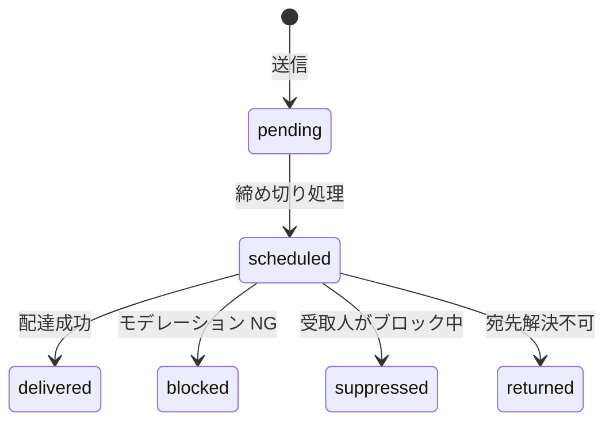
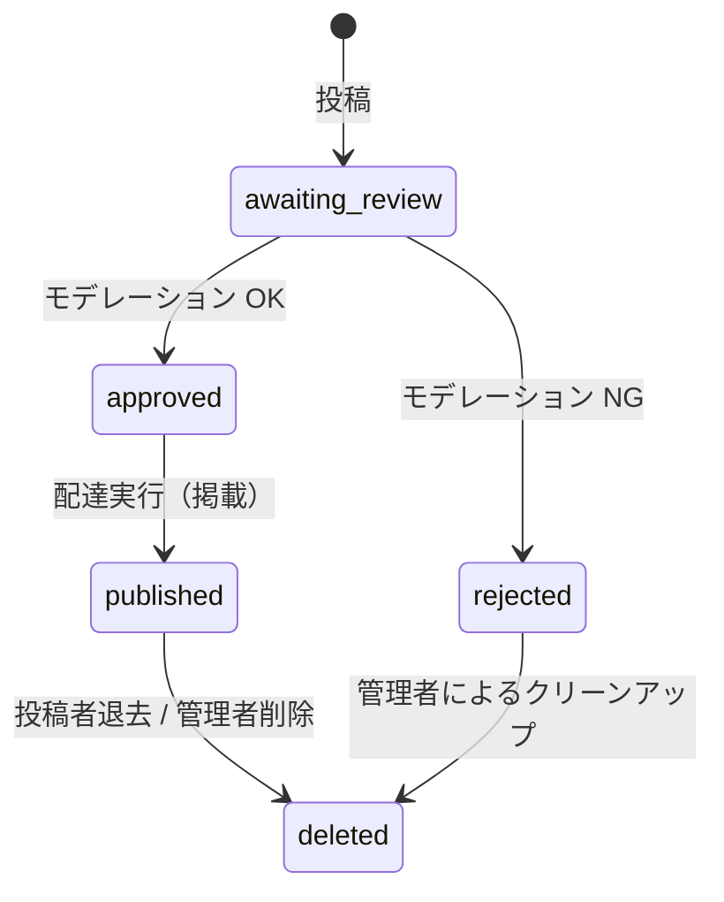
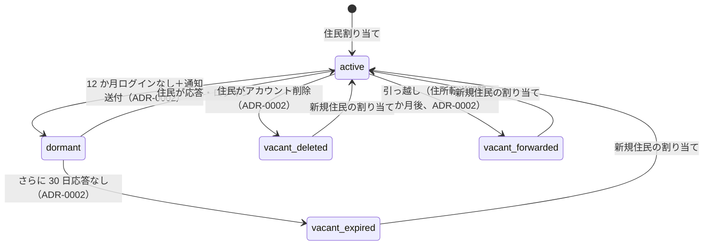

# DB 設計方針

- 状態: 草案
- 日付: 2026-11-19
- 根拠: `.ai/brief.md`・`.ai/requirements.md`・`.ai/features.md`・`.ai/architecture.md`
- チケット: YGO-004
- 関連 ADR: 0001〜0012, 0013

---

## §1 原則

1. **PostgreSQL が唯一の正本** [explicit]（ADR-0010）: データの正本はすべて PostgreSQL に置く。
   ジョブキューも PostgreSQL 上で動かす（pg-boss 相当）。Redis 等の別ブローカは使わない。

2. **主キーは UUID v4** [explicit]（ADR-0001）: すべてのエンティティは UUID v4 の主キーを持つ。
   ただし配達回 ID のみ例外として `YYYY-MM-DD-morning` / `YYYY-MM-DD-evening` の形式を使う（ADR-0004）。

3. **時刻は `timestamptz` で保存、スケジュールは JST で計算** [inferred]（architecture.md §7）:
   DB に格納する時刻はすべて `timestamptz`（タイムゾーン付き）とする。
   配達スケジュールの計算は JST 基準で行う（ADR-0004）。

4. **閲覧数・反応数・既読フラグは保存しない** [explicit]（P-1, P-2）: 即時性・数値評価の
   排除（P-1, P-2）に従い、いいね数・フォロワー数・スコア・既読状態は一切保存しない。

5. **実世界の個人情報は最小限** [inferred]（NFR-002）: 住民の実名・実住所・顔写真を
   システム内部で保持しない。認証はメールアドレス＋パスワード（ADR-0018）、セッションはサーバー側に持ち複数の端末で持てる（ADR-0019）。
   メールアドレスとパスワードのハッシュ・セッションの保持方針は `security.md` §3 に従う（OQ-028・OQ-036 は決定）。

6. **ジョブのペイロードは ID のみ** [inferred]（ADR-0010）: ジョブキューに積むペイロードには
   対象レコードの ID のみを含め、本文など大きなデータは含めない。

7. **パーティショニングなし** [inferred]（ADR-0012）: 住民 1 万人・1 配達回最大約 20 万通の
   規模（ADR-0012）では、テーブルパーティショニングは不要。将来の規模変更は ADR を置き換えて対応する。

---

## §2 論理モデル

DDL は書かない。主なカラムと一意制約のみを示す。

### 住民・住所

#### `residents` — 住民アカウント

> ADR-0001 では `users` と表記しているが、本文書および以降の設計では `residents` に統一する
>（同一テーブル）。

| カラム | 説明 |
|--------|------|
| `id` UUID PK | 内部 ID（変更不可、ADR-0001） |
| `nickname` text | 任意の表示名（FR-009） |
| `bio` text | 自己紹介文（FR-008） |
| `last_login_at` timestamptz | 最終ログイン日時（ADR-0002 ではアドレス側に置いていたが §3 参照） |
| `created_at` timestamptz | 登録日時 |
| `deleted_at` timestamptz | 論理削除フラグ代わりに使用（即時物理削除への橋渡し用） |

**注**: ADR-0002 は `addresses.last_login_at` と書いているが、住民が引っ越しで住所を変えると
その後のログイン記録が旧住所に紐づいてしまう。住民を認証する主体は `residents` であるため、
`last_login_at` は `residents` 側に置く。`addresses` の空き家判定は §3 の居住記録（`tenancies`）
から現在の住民を引いてその `last_login_at` を参照する。ADR-0002 の 5 つの `addresses.status`
値（active / dormant / vacant_deleted / vacant_expired / vacant_forwarded）はそのまま保持する。

#### `addresses` — 架空の住所

| カラム | 説明 |
|--------|------|
| `id` UUID PK | — |
| `address_text` text UNIQUE | 住所文字列（例: 夕暮ヶ丘三丁目 2-5）（FR-002, FR-003） |
| `status` text | active / dormant / vacant_deleted / vacant_expired / vacant_forwarded（ADR-0002） |
| `forwarding_expires_at` timestamptz | 住所転送の有効期限（引っ越しから 6 か月、ADR-0002） |
| `dormancy_notified_at` timestamptz | 休眠通知送付日時（ADR-0002） |
| `created_at` timestamptz | — |
| `vacated_at` timestamptz | 空き家化した日時 |

#### `tenancies` — 居住記録

住民と住所の紐づけ履歴。ある住所に誰が住んでいたかを記録する。
住所録の配達先解決と転送判定に使う（§3 参照）。

| カラム | 説明 |
|--------|------|
| `id` UUID PK | — |
| `resident_id` UUID FK→residents | — |
| `address_id` UUID FK→addresses | — |
| `started_at` timestamptz | 居住開始日時 |
| `ended_at` timestamptz NULL | 居住終了日時。NULL = 現在も居住中 |
| `is_current` bool | 現在の居住かどうか（UNIQUE(address_id) where is_current） |

---

### 手紙・郵便受け

#### `letters` — 手紙本体

| カラム | 説明 |
|--------|------|
| `id` UUID PK | — |
| `sender_id` UUID FK→residents NULL | 送信者（退去済みは NULL に変更、§5 参照） |
| `body_encrypted` bytea | 保存時暗号化済み本文（ADR-0006） |
| `delivery_run_id` text FK→delivery_runs | 次の配達回 ID |
| `state` text | pending / scheduled / delivered / blocked / suppressed / returned |
| `created_at` timestamptz | — |

UNIQUE 制約なし。複数宛先は `letter_recipients` で管理する。

#### `letter_recipients` — 宛先

| カラム | 説明 |
|--------|------|
| `id` UUID PK | — |
| `letter_id` UUID FK→letters | — |
| `recipient_address_text` text | 宛先住所（登録時点の文字列、ADR-0003） |
| `registered_tenancy_id` UUID FK→tenancies NULL | 住所録登録時点の居住記録（§3 参照）。画面・API 非公開 |
| `delivered_at` timestamptz NULL | 配達完了日時 |

UNIQUE(letter_id, recipient_address_text)

#### `mailbox_items` — 郵便受けの中身

| カラム | 説明 |
|--------|------|
| `id` UUID PK | — |
| `resident_id` UUID FK→residents | 受取人 |
| `delivery_run_id` text FK→delivery_runs | 配達回 ID |
| `kind` text | letter / newspaper / board_post |
| `item_id` UUID | 対応するレコードの ID（letters.id / newspapers.id / board_posts.id） |
| `deleted_at` timestamptz NULL | 受取人が削除した日時（FR-099） |
| `created_at` timestamptz | — |

UNIQUE(delivery_run_id, resident_id, kind, item_id) — 配達の冪等性を保証する（ADR-0010）

---

### 配達回

#### `delivery_runs` — 配達回

| カラム | 説明 |
|--------|------|
| `run_id` text PK | `YYYY-MM-DD-morning` / `YYYY-MM-DD-evening`（ADR-0004） |
| `status` text | pending / running / done / failed / skipped |
| `started_at` timestamptz NULL | — |
| `finished_at` timestamptz NULL | — |

---

### 通知

配達完了の通知（ADR-0025、FR-028・FR-102）。`sessions` は security.md §9 の提案のテーブル（ADR-0019）。

#### `push_subscriptions` — 通知の購読（端末ごと）

| カラム | 説明 |
|--------|------|
| `id` UUID PK | — |
| `resident_id` UUID FK→residents | 購読した住民 |
| `session_id` FK→sessions UNIQUE | 購読を作ったセッション（1 セッションに 1 購読）。セッションを無効にするとき、この行を同じトランザクションで消す（ADR-0019） |
| `endpoint` text | プッシュサービスの送り先（ADR-0025 の D6 で検査した値）。ログに出さない（security.md §2.5） |
| `p256dh` text | 中身の暗号化に使う端末の公開鍵 |
| `auth` text | 中身の暗号化に使う認証の秘密 |
| `created_at` timestamptz | — |

#### `delivery_notifications` — 配達完了の通知を送った記録

| カラム | 説明 |
|--------|------|
| `delivery_run_id` text FK→delivery_runs | 配達回 ID。保持期間はこの配達回の `finished_at` から数え、J14 が `delivery_runs` より先に消す（async.md J14） |
| `push_subscription_id` UUID FK→push_subscriptions | 送った購読。購読を消すときは、この行も一緒に消す |
| `resident_id` UUID FK→residents | 受け取る住民 |
| `created_at` timestamptz | J15 が行を入れた日時 |
| `sent_at` timestamptz NULL | 送った日時（NULL は未送信） |

UNIQUE(delivery_run_id, push_subscription_id) — 通知の重複を防ぐ（async.md J15）。件数は持たない（送るときに数える）。

---

### 新聞

#### `newspapers` — 紙面

| カラム | 説明 |
|--------|------|
| `id` UUID PK | — |
| `delivery_run_id` text FK→delivery_runs UNIQUE | この紙面を配達する配達回 |
| `kind` text | morning / evening |
| `storage_url` text | 組版済み静的 HTML の保存先（C8 オブジェクトストレージ） |
| `typeset_at` timestamptz NULL | 組版完了日時 |
| `is_holiday` bool DEFAULT false | 休刊フラグ（ADR-0007） |

#### `newspaper_items` — 組版に使った素材

| カラム | 説明 |
|--------|------|
| `id` UUID PK | — |
| `newspaper_id` UUID FK→newspapers | — |
| `source_kind` text | board_post / image |
| `source_id` UUID | 素材レコードの ID |

---

### 掲示板

#### `board_posts` — 町内掲示板の投稿

| カラム | 説明 |
|--------|------|
| `id` UUID PK | — |
| `author_id` UUID FK→residents NULL | 投稿者（退去済みは NULL） |
| `body` text | 本文（上限 1,000 文字、ADR-0004）。モデレーションを通過した後も平文保持 |
| `status` text | awaiting_review / approved / published / rejected / deleted |
| `delivery_run_id` text FK→delivery_runs NULL | 掲載予定の配達回 ID |
| `created_at` timestamptz | — |
| `published_at` timestamptz NULL | 掲載日時（配達時に status=published になる） |
| `deleted_at` timestamptz NULL | 削除日時 |

---

### 住所録

#### `address_book` — 住民の住所録

| カラム | 説明 |
|--------|------|
| `id` UUID PK | — |
| `owner_id` UUID FK→residents | 住所録の所有者（FR-051） |
| `address_text` text | 登録時点の住所文字列（ADR-0003 — 自動更新しない） |
| `memo` text NULL | 所有者だけが見えるメモ（FR-056） |
| `registered_tenancy_id` UUID FK→tenancies NULL | 登録時点の居住記録。画面・API 非公開（§3 参照） |
| `created_at` timestamptz | — |

UNIQUE(owner_id, address_text)

---

### ブロック・モデレーション・通報

#### `blocks` — ブロックリスト

| カラム | 説明 |
|--------|------|
| `id` UUID PK | — |
| `blocker_id` UUID FK→residents | ブロックした住民 |
| `blocked_id` UUID FK→residents | ブロックされた住民 |
| `created_at` timestamptz | — |

UNIQUE(blocker_id, blocked_id)

#### `reports` — 通報

| カラム | 説明 |
|--------|------|
| `id` UUID PK | — |
| `reporter_id` UUID FK→residents NULL | 通報者 |
| `content_kind` text | letter / board_post |
| `content_id` UUID | 通報対象レコードの ID |
| `reason` text | 通報理由 |
| `status` text | open / closed / dismissed |
| `created_at` timestamptz | — |
| `closed_at` timestamptz NULL | — |

#### `moderation_queue` — モデレーション審査キュー

| カラム | 説明 |
|--------|------|
| `id` UUID PK | — |
| `content_kind` text | board_post（クローズドな手紙は OQ-003 次第） |
| `content_id` UUID | 審査対象レコードの ID |
| `delivery_run_id` text FK→delivery_runs | 対象の配達回 |
| `llm_label` text NULL | ok / review / block（LLM の一次判定） |
| `policy_decision` text NULL | approved / blocked（ルール表との突合後、ADR-0005） |
| `processed_at` timestamptz NULL | — |

#### `moderation_actions` — モデレーター操作記録

| カラム | 説明 |
|--------|------|
| `id` UUID PK | — |
| `report_id` UUID FK→reports | — |
| `moderator_id` UUID FK→residents | 操作したモデレーター（権限は ADR-0020・security.md §4） |
| `action` text | approve / reject / dismiss |
| `note` text NULL | 操作メモ |
| `created_at` timestamptz | — |

---

### 画像・ジョブ・ログ・消去ログ

#### `images` — 画像メタデータ

| カラム | 説明 |
|--------|------|
| `id` UUID PK | — |
| `uploader_id` UUID FK→residents | — |
| `original_url` text | アップロード元の保存先 |
| `processed_url` text NULL | 新聞写真風加工後の保存先 |
| `state` text | pending / processed / failed |
| `created_at` timestamptz | — |

#### `jobs` — ジョブキュー

pg-boss が管理するテーブル。DDL は pg-boss に委ねる。
ペイロードには対象レコードの ID のみを含め、本文等の大きなデータは含めない（§1 原則 6）。

#### ログ

アクセスログ・操作ログは構造化ログとして DB 外に出力する。
個人を特定できない形で保持し（NFR-009）、30 日経過後に廃棄する（ADR-0013）。
DB 内には重要な操作の監査レコードのみ保持する（`moderation_actions` 等）。

#### `erasure_log` — 削除の監査ログ

| カラム | 説明 |
|--------|------|
| `id` UUID PK | — |
| `table_name` text | 削除したテーブル名 |
| `record_id` UUID | 削除したレコードの ID |
| `erased_at` timestamptz | 削除日時 |

バックアップのリストア後にこのログを再生し、削除済みデータが復元されないようにする（§6）。
60 日経過後に自動削除する（ADR-0013）。

---

## §3 住所と居住記録の規則

### 問題

ADR-0002 は「空き家は新規住民の割り当て候補となる」と定め、ADR-0003 は「住所録は自動更新しない」と定めている。これを組み合わせると、**住所録の旧住所に手紙を書いたとき、その住所には既に別の住民が住んでいる可能性がある**。

### 解決策：居住記録（`tenancies`）の導入

住所録の各エントリは `registered_tenancy_id`（住所録登録時点の居住記録 ID）を保持する。
このフィールドは画面・API には一切公開しない。住所録からは従来通り「住所文字列」のみが見える。

### 配達時の振り分けロジック

配達バッチが手紙を届ける際、`registered_tenancy_id` を参照して次のように振り分ける:

| 状況 | 処理 |
|------|------|
| tenancy が現在も有効（`is_current = true`） | 通常配達 |
| 旧住民が引っ越しており転送期間 6 か月以内（ADR-0002） | 新住所へ転送（FR-005） |
| 転送期間が切れているか、住所が vacant | 差し戻し（`state = returned`） |
| 受取人が送信者をブロックしている（FR-068） | 配達せず `state = suppressed`（差し戻しもしない。ブロックを明かさないため） |

**ADR-0003 との整合**: 住所録の表示上の住所は登録時点のまま変わらない。
`registered_tenancy_id` は内部の配達先解決にのみ使い、住所録の住所文字列は書き換えない。

---

## §4 データ種別ごとのライフサイクル

### ライフサイクル表

| データ種別 | テーブル | 作る | 保つ | 消す |
|-----------|---------|------|------|------|
| 住民 | `residents` | 新規登録時に作成 | アカウント削除まで | 削除申請で即時物理削除（ADR-0013）→ erasure_log に記録 |
| 住所 | `addresses` | 住民登録時・新規割り当て時 | 居住中は保持。空き家後も保持し、段階 3 から割り当て候補に戻す（ADR-0023） | 管理者が廃棄するまで削除しない（住所のプールを維持） |
| 居住記録 | `tenancies` | 住所割り当て時・転入時 | 歴史として保持（配達先解決に使う） | 住民削除から 1 年後に削除（ADR-0013） |
| 手紙（本体） | `letters` | 送信時（`pending` 状態） | 配達後も保持。送信者が削除されても `body_encrypted` は残す（受取人保護）。ただし送信者フラグを「退去済み」に更新 | 受取人全員が郵便受けから削除したとき、または通報クローズから 1 年後（レポート対象分）（ADR-0013） |
| 手紙（宛先） | `letter_recipients` | 送信時 | 手紙本体と同期 | 手紙削除時 |
| 郵便受け | `mailbox_items` | 配達バッチ時 | 受取人が削除するまで保持（FR-099） | 受取人の削除操作 or アカウント削除時 |
| 配達回 | `delivery_runs` | 締め切り処理時 | 30 日保持（ADR-0013）[assumed] | 30 日経過後に削除 |
| 通知の購読 | `push_subscriptions` | 住民が端末で通知を許可したとき（API） | セッションが有効な間（ADR-0025） | セッションの無効化・購読の削除・プッシュサービスの 404 / 410・アカウント削除時に即時削除 |
| 通知を送った記録 | `delivery_notifications` | J15 が送る前 | 30 日保持（ADR-0013・ADR-0025）[assumed] | 指している配達回の `finished_at` から 30 日経過後に、`delivery_runs` より先に削除（async.md J14。外部キーで配達回の削除を止めないため）。購読の削除・アカウント削除時に即時削除 |
| 朝刊・夕刊（紙面） | `newspapers` | 組版バッチ時 | バックナンバーとして保持（FR-039）。保持期間は OQ-030 次第（仮: 無期限） | 決定次第（OQ-030） |
| 新聞素材一覧 | `newspaper_items` | 組版時 | 紙面と同期 | 紙面削除時 |
| 掲示板投稿 | `board_posts` | 投稿時（`awaiting_review`） | 掲載後も保持。投稿者削除で即時 `deleted` に変更（ADR-0013） | 投稿者削除時に `body` を消去。deleted レコード自体は通報クローズから 1 年後削除 |
| 住所録 | `address_book` | 住民が手動で追加（FR-051） | 住民が手動で削除するまで保持（ADR-0003） | 所有者のアカウント削除時に削除 |
| ブロック | `blocks` | ブロック操作時 | ブロック解除まで | ブロック解除時、またはどちらかが退去時 |
| モデレーション審査 | `moderation_queue` | 締め切り処理時にジョブ経由で登録 | 審査完了後 1 年保持（ADR-0013）[assumed] | 1 年経過後削除 |
| モデレーター操作 | `moderation_actions` | モデレーターの操作時 | 1 年保持（ADR-0013）[assumed] | 1 年経過後削除 |
| 通報 | `reports` | 住民の通報操作時 | クローズまで保持。クローズ後 1 年保持（ADR-0013）[assumed] | クローズから 1 年後に削除 |
| 画像 | `images` | アップロード時 | 参照するコンテンツ（手紙・掲示板）が存在する間 | コンテンツ削除時にオブジェクトストレージからも削除 |
| ジョブ | `jobs`（pg-boss） | ジョブ enqueue 時 | 完了後 24 時間（pg-boss の設定）[assumed] | pg-boss が自動削除 |
| ログ（DB 外） | — | 操作・アクセス時 | 30 日保持（ADR-0013）[assumed] | 30 日経過後廃棄（NFR-009） |
| 消去ログ | `erasure_log` | 物理削除の実行時 | 60 日保持（ADR-0013）[assumed] | 60 日経過後削除 |

### 状態遷移図

#### 手紙（`letters.state`）

#### 掲示板投稿（`board_posts.status`）

#### 住所（`addresses.status`）

**段階**（ADR-0023）: MVP で起きる遷移は `[*] → active`（使われたことのない住所の割り当て）と
`active → vacant_deleted`（アカウント削除）だけ。`dormant` に関わる遷移・`vacant_expired`・
`vacant_forwarded`・空き家から `active` への再割り当ては段階 3（F-16）で入れる。

---

## §5 住民が退去するとき

詳細は ADR-0013 を参照。要点:

1. **住民自身のデータ**: `residents` レコードは即時物理削除し、`erasure_log` に記録する。
   プロフィール（`nickname`, `bio`）・認証情報は即時消去する。

2. **送信済み手紙**: 受取人の郵便受けに配達済みのものはそのまま残す。
   `sender_id` を NULL に変更し、API の表示では「退去済み」と返す。

3. **掲示板投稿**: 即時 `deleted` 状態に変更し、`body` を消去する。
   その投稿が掲載された新聞を組み直す（掲載内容から除去、ADR-0013）。

4. **住所**: `addresses.status` を `vacant_deleted` に変更する（ADR-0002）。

   **通知**: 通知の購読（`push_subscriptions`）と送った記録（`delivery_notifications`）は即時削除する（ADR-0013・ADR-0025）。

5. **長期不在による空き家化**: `vacant_expired` になった住所の元住民は、
   さらに 12 か月が経過した時点で退去済みとして扱い、上記 1〜4 を適用する（ADR-0013）[assumed]。

---

## §6 バックアップ

- バックアップは 30 日間保持する（ADR-0013）[assumed]。
- バックアップからリストアした後は `erasure_log` を順番に再生し、
  削除済みデータがリストアで復元されていないか確認・再削除する。
- バックアップの実装方法（マネージドサービスの機能 / pgdump 等）は `environment.md` で定義する。

---

## §7 `async.md` への引き継ぎ

非同期処理の冪等性は次の 3 つの DB 制約で保証する:

| 保証 | 仕組み |
|------|-------|
| 配達の重複防止 | `mailbox_items` の UNIQUE(delivery_run_id, resident_id, kind, item_id)（ADR-0010） |
| 組版の重複防止 | `newspapers` の UNIQUE(delivery_run_id) |
| 配達完了の通知の重複防止 | `delivery_notifications` の UNIQUE(delivery_run_id, push_subscription_id)（ADR-0025） |

ジョブのペイロードには ID のみを含める（§1 原則 6）。
本文など大きなデータをペイロードに入れると、ジョブ再実行時に古い内容が使われる恐れがあるため。

---

## §8 FR / NFR との対応

| FR / NFR | 対応する設計 |
|----------|------------|
| FR-001〜004 | §2 `residents` / `addresses`。内部 ID と住所の分離（ADR-0001） |
| FR-005 | §3 転送ルール（tenancies を使った配達先解決） |
| FR-006, FR-007 | §4 住所のライフサイクル・状態遷移（ADR-0002） |
| FR-011〜014 | §2 `letters` / `mailbox_items` |
| FR-017 | 既読フラグなし（§1 原則 4）|
| FR-021〜030 | §2 `delivery_runs`・§4 配達回ライフサイクル（ADR-0004） |
| FR-028, FR-102 | §2 通知（`push_subscriptions`・`delivery_notifications`、ADR-0025） |
| FR-031〜039 | §2 `newspapers` / `newspaper_items`・§4 新聞ライフサイクル |
| FR-041〜050 | §2 `board_posts`・§4 掲示板ライフサイクル |
| FR-051〜057 | §2 `address_book`・§3 ADR-0003（自動更新なし） |
| FR-068 | §2 `blocks`・§3 suppressed 処理 |
| FR-076〜082 | §2 `moderation_queue` / `reports` / `moderation_actions` |
| FR-093, FR-097 | §5 退去処理（ADR-0013） |
| FR-099 | §4 `mailbox_items.deleted_at` |
| NFR-002 | §1 原則 5（個人情報最小限） |
| NFR-009 | §4 ログ 30 日廃棄 |
| NFR-017 | §2 `letters.body_encrypted`（ADR-0006） |
| NFR-021 | §7 UNIQUE 制約による配達冪等性 |
| NFR-024 | §4 全体のライフサイクル表 |

---

## §9 OQ への依存（仮の扱い）

| OQ | 本文書での仮の扱い |
|----|-----------------|
| OQ-003（クローズドな手紙のモデレーション） | クローズドな手紙は `moderation_queue` に積まない（MVPは対象外、architecture.md §4）。通報分は security.md §5.4 の暫定（モデレーターが 1 通だけ復号して確認）に従い、OQ-003 の回答で変わりうる |
| OQ-030（アカウント情報の保持期間） | ADR-0013 の数値（logs 30 日, moderation 1 年, reports クローズ後 1 年, backups 30 日, erasure_log 60 日）を `[assumed]` として仮置き。確定したら ADR-0013 を更新する |
| OQ-031（管理者・モデレーター役割）→ 決定 | ロールは住民とモデレーターの 2 つ（ADR-0020）。`moderation_actions.moderator_id` は `residents` の FK として保持し、モデレーターのロールを持つ住民だけが書ける。権限の規則表は `security.md` §4。ロールの保持（`staff_roles` テーブルか `residents` の列か）は実装で決める |

---

## §10 他の文書への変更提案（別チケット）

1. **`architecture.md` §4・§5**: `users` テーブルの表記を `residents` に統一する
   （本文書で統一を決定、§2 冒頭の注記参照）。

2. **`open-questions.md` OQ-029**: 扱いを「持ち越し」→「決定（ADR-0012）」に更新する
   （architecture.md §9 にも同じ提案がある）。

3. **`architecture.md` ADR-0001 参照**: ADR-0001 の影響欄「`users` テーブル」を
   「`residents` テーブル（`users` から改名）」に更新する。

4. **`open-questions.md` OQ-030**: 本チケットで ADR-0013 として決定したため、
   扱いを「持ち越し」→「決定（ADR-0013）」に更新する。
