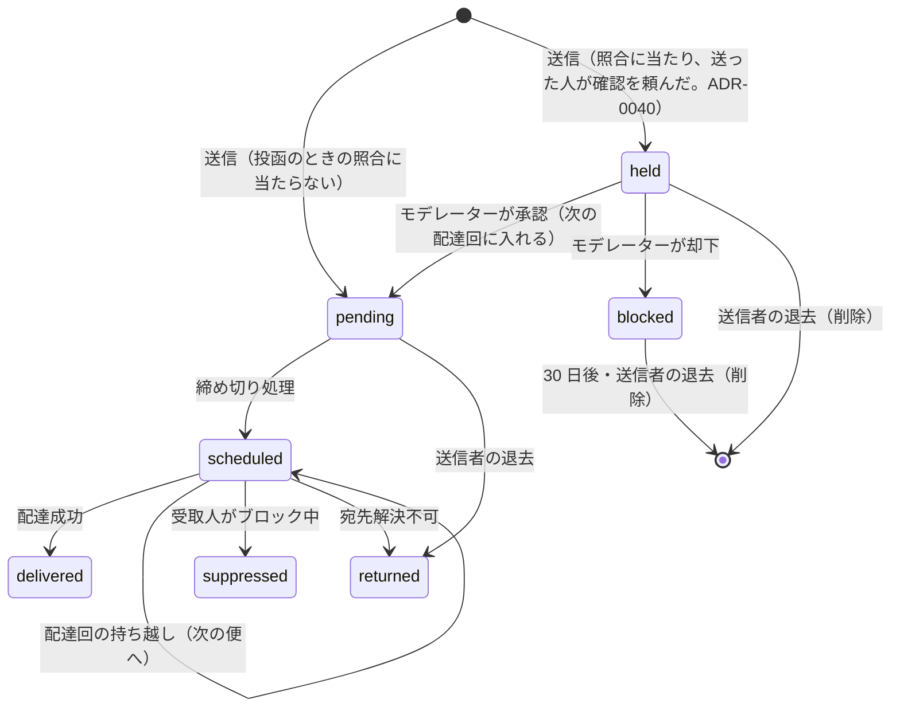
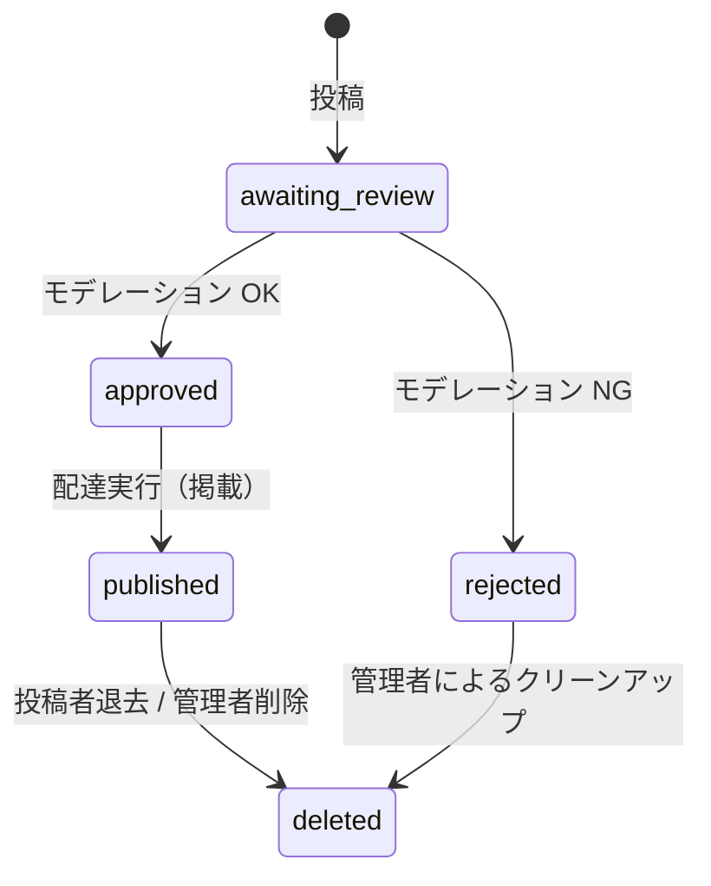
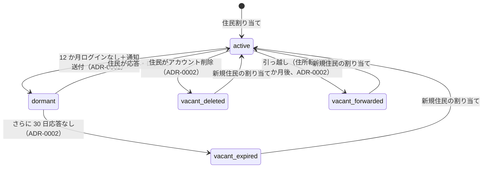

# DB 設計方針

- 状態: 草案
- 日付: 2026-11-19
- 根拠: `.ai/brief.md`・`.ai/requirements.md`・`.ai/features.md`・`.ai/architecture.md`
- チケット: YGO-004
- 関連 ADR: 0001〜0012, 0013, 0026, 0039

---

## §1 原則

1. **PostgreSQL が唯一の正本** [explicit]（ADR-0010）: データの正本はすべて PostgreSQL に置く。
   ジョブキューも PostgreSQL 上で動かす（pg-boss 相当）。Redis 等の別ブローカは使わない。

2. **主キーは UUID v4** [explicit]（ADR-0001）: すべてのエンティティは UUID v4 の主キーを持つ。
   ただし配達回 ID のみ例外として `YYYY-MM-DD-morning` / `YYYY-MM-DD-evening` の形式を使う（ADR-0004）。

3. **時刻は `timestamptz` で保存、スケジュールは JST で計算** [inferred]（architecture.md §7）:
   DB に格納する時刻はすべて `timestamptz`（タイムゾーン付き）とする。
   配達スケジュールの計算は JST 基準で行う（ADR-0004）。

4. **閲覧数・反応数・既読フラグは保存しない** [explicit]（P-1, P-2）: 即時性・数値評価の
   排除（P-1, P-2）に従い、いいね数・フォロワー数・スコア・既読状態は一切保存しない。

5. **実世界の個人情報は最小限** [inferred]（NFR-002）: 住民の実名・実住所・顔写真を
   システム内部で保持しない。認証はメールアドレス＋パスワード（ADR-0018）、セッションはサーバー側に持ち複数の端末で持てる（ADR-0019）。
   メールアドレスとパスワードのハッシュ・セッションの保持方針は `security.md` §3 に従う（OQ-028・OQ-036 は決定）。

6. **ジョブのペイロードは ID のみ** [inferred]（ADR-0010）: ジョブキューに積むペイロードには
   対象レコードの ID のみを含め、本文など大きなデータは含めない。

7. **パーティショニングなし** [inferred]（ADR-0012）: 住民 1 万人・1 配達回最大約 20 万通の
   規模（ADR-0012）では、テーブルパーティショニングは不要。将来の規模変更は ADR を置き換えて対応する。

---

## §2 論理モデル

DDL は書かない。主なカラムと一意制約のみを示す。

### 住民・住所

#### `residents` — 住民アカウント

> ADR-0001 では `users` と表記しているが、本文書および以降の設計では `residents` に統一する
>（同一テーブル）。

| カラム | 説明 |
|--------|------|
| `id` UUID PK | 内部 ID（変更不可、ADR-0001） |
| `nickname` text | 任意の表示名（FR-009） |
| `bio` text | 自己紹介文（FR-008） |
| `last_login_at` timestamptz | 最終ログイン日時（ADR-0002 ではアドレス側に置いていたが §3 参照） |
| `created_at` timestamptz | 登録日時 |
| `deleted_at` timestamptz | 論理削除フラグ代わりに使用（即時物理削除への橋渡し用） |

**注**: ADR-0002 は `addresses.last_login_at` と書いているが、住民が引っ越しで住所を変えると
その後のログイン記録が旧住所に紐づいてしまう。住民を認証する主体は `residents` であるため、
`last_login_at` は `residents` 側に置く。`addresses` の空き家判定は §3 の居住記録（`tenancies`）
から現在の住民を引いてその `last_login_at` を参照する。ADR-0002 の 5 つの `addresses.status`
値（active / dormant / vacant_deleted / vacant_expired / vacant_forwarded）はそのまま保持する。

#### `addresses` — 架空の住所

| カラム | 説明 |
|--------|------|
| `id` UUID PK | — |
| `address_text` text UNIQUE | 住所文字列（例: 夕暮ヶ丘三丁目 2-5）（FR-002, FR-003） |
| `status` text | active / dormant / vacant_deleted / vacant_expired / vacant_forwarded（ADR-0002） |
| `forwarding_expires_at` timestamptz | 住所転送の有効期限（引っ越しから 6 か月、ADR-0002） |
| `dormancy_notified_at` timestamptz | 休眠通知送付日時（ADR-0002） |
| `created_at` timestamptz | — |
| `vacated_at` timestamptz | 空き家化した日時 |

#### `tenancies` — 居住記録

住民と住所の紐づけ履歴。ある住所に誰が住んでいたかを記録する。
住所録の配達先解決と転送判定に使う（§3 参照）。

| カラム | 説明 |
|--------|------|
| `id` UUID PK | — |
| `resident_id` UUID FK→residents | — |
| `address_id` UUID FK→addresses | — |
| `started_at` timestamptz | 居住開始日時 |
| `ended_at` timestamptz NULL | 居住終了日時。NULL = 現在も居住中 |
| `is_current` bool | 現在の居住かどうか（UNIQUE(address_id) where is_current） |

---

### 手紙・郵便受け

#### `letters` — 手紙本体

| カラム | 説明 |
|--------|------|
| `id` UUID PK | — |
| `sender_id` UUID FK→residents NULL | 送信者（退去済みは NULL に変更、§5 参照） |
| `body_encrypted` bytea | 保存時暗号化済み本文（ADR-0006） |
| `delivery_run_id` text FK→delivery_runs NULL | 次の配達回 ID。`held`・`blocked` の手紙は NULL（配達回に入れない、ADR-0040） |
| `state` text | pending / held / scheduled / delivered / blocked / suppressed / returned（`held` は送った人が確認を頼んだ確認待ち、`blocked` はモデレーターが却下した手紙、ADR-0040） |
| `rule_version` text NULL | 投函のときの照合に使ったルール表の版（ADR-0040 の D2）。照合のない M2・M3 の手紙は NULL |
| `matched_rule_id` text NULL | 当たった規則の ID（`held`・`blocked` のときだけ）。本文の抜き書きは持たない |
| `decided_at` timestamptz NULL | モデレーターが `held` の手紙を操作した日時。`blocked` の 30 日の保持（J14）の起点 |
| `created_at` timestamptz | — |

UNIQUE 制約なし。複数宛先は `letter_recipients` で管理する。
CHECK(`(state IN ('held','blocked')) = (delivery_run_id IS NULL)`) — 確認待ちと却下の手紙は配達回に入らない。
CHECK(`state NOT IN ('held','blocked') OR (matched_rule_id IS NOT NULL AND rule_version IS NOT NULL)`) — 確認待ちと却下の手紙は、当たった規則と版を持つ（ADR-0040）。

#### `letter_recipients` — 宛先

| カラム | 説明 |
|--------|------|
| `id` UUID PK | — |
| `letter_id` UUID FK→letters | — |
| `recipient_address_text` text | 宛先住所（登録時点の文字列、ADR-0003） |
| `registered_tenancy_id` UUID FK→tenancies NULL | 住所録登録時点の居住記録（§3 参照）。画面・API 非公開 |
| `delivered_at` timestamptz NULL | 配達完了日時。J5 が `delivered` を確定するとき、受取人の `mailbox_items.visible_at`（手紙の枠の時刻）を書く（ADR-0035）。送った人には返さない（送信済みの「配達済み」は時間帯の終わり 12:00 / 21:00 を過ぎてから見せる、api.md §7 F-04） |

UNIQUE(letter_id, recipient_address_text)

#### `mailbox_items` — 郵便受けの中身

| カラム | 説明 |
|--------|------|
| `id` UUID PK | — |
| `resident_id` UUID FK→residents | 受取人 |
| `delivery_run_id` text FK→delivery_runs | 配達回 ID |
| `kind` text | letter / newspaper / board_post |
| `item_id` UUID | 対応するレコードの ID（letters.id / newspaper_editions.id / board_posts.id）。`kind = newspaper` のときは、その住民に届けた版（ADR-0039 の D1） |
| `visible_at` timestamptz | 受取人に見せ始める時刻（ADR-0035 の D10）。J4 が書く。新聞はその便の公開の時刻（07:00 / 17:00）、手紙は受取人ごとの枠の時刻（午前 08:00〜11:50・午後 18:00〜20:50 の 10 分刻み）。API では返さない |
| `deleted_at` timestamptz NULL | 受取人が削除した日時（FR-099） |
| `created_at` timestamptz | — |

UNIQUE(delivery_run_id, resident_id, kind, item_id) — 配達の冪等性を保証する（ADR-0010）  
INDEX(resident_id, visible_at) — 郵便受けの一覧で、`visible_at` を過ぎた行を住民ごとに引くため（ADR-0035）  
UNIQUE(delivery_run_id, resident_id) WHERE kind = 'newspaper' — 1 回の配達につき新聞は 1 つだけ。J4 のやり直しのあいだに興味が変わっても、別の版が 2 つ届かないようにする（ADR-0039）

---

### 配達回

#### `delivery_runs` — 配達回

| カラム | 説明 |
|--------|------|
| `run_id` text PK | `YYYY-MM-DD-morning` / `YYYY-MM-DD-evening`（ADR-0004） |
| `status` text | pending / running / done / failed / skipped |
| `started_at` timestamptz NULL | — |
| `finished_at` timestamptz NULL | — |

---

### 通知

配達完了の通知（ADR-0025、FR-028・FR-102）。`sessions` は security.md §9 の提案のテーブル（ADR-0019）。

#### `push_subscriptions` — 通知の購読（端末ごと）

| カラム | 説明 |
|--------|------|
| `id` UUID PK | — |
| `resident_id` UUID FK→residents | 購読した住民 |
| `session_id` FK→sessions UNIQUE | 購読を作ったセッション（1 セッションに 1 購読）。セッションを無効にするとき、この行を同じトランザクションで消す（ADR-0019） |
| `endpoint` text | プッシュサービスの送り先（ADR-0025 の D6 で検査した値）。ログに出さない（security.md §2.5） |
| `p256dh` text | 中身の暗号化に使う端末の公開鍵 |
| `auth` text | 中身の暗号化に使う認証の秘密 |
| `created_at` timestamptz | — |

#### `delivery_notifications` — 配達完了の通知を送った記録

| カラム | 説明 |
|--------|------|
| `delivery_run_id` text FK→delivery_runs | 配達回 ID。保持期間はこの配達回の `finished_at` から数え、J14 が `delivery_runs` より先に消す（async.md J14） |
| `push_subscription_id` UUID FK→push_subscriptions | 送った購読。購読を消すときは、この行も一緒に消す |
| `resident_id` UUID FK→residents | 受け取る住民 |
| `kind` text | newspaper / letter（新聞の通知か手紙の通知か、ADR-0035 の D12） |
| `created_at` timestamptz | J15 が行を入れた日時 |
| `sent_at` timestamptz NULL | 送った日時（NULL は未送信） |

UNIQUE(delivery_run_id, push_subscription_id, kind) — 通知の重複を防ぐ（async.md J15、ADR-0035）。件数は持たない（送るときに数える）。

---

### 新聞

紙面は一人 1 枚にせず、配達回ごとに版（edition）を組む（ADR-0039 の D1）。`newspapers` は配達回ごとの新聞の 1 行、`newspaper_editions` はその版。

#### `newspapers` — 紙面（配達回ごと）

| カラム | 説明 |
|--------|------|
| `id` UUID PK | — |
| `delivery_run_id` text FK→delivery_runs UNIQUE | この紙面を配達する配達回 |
| `kind` text | morning / evening |
| `typeset_at` timestamptz NULL | 組版完了日時 |
| `is_holiday` bool DEFAULT false | 休刊フラグ（ADR-0007） |

組版済みの HTML の保存先（もとの `storage_url`）は `newspaper_editions` に移した（ADR-0039）。
J3 は `newspapers` の行とすべての版の行を 1 つのトランザクションで入れる。休刊は J0 が、休刊の行と `holiday` の版の行を一緒に入れる。
こうして、配達回の新聞は「版がそろう」か「休刊」のどちらかになり、版が一部だけの状態は見えない。

#### `newspaper_editions` — 版（ADR-0039）

| カラム | 説明 |
|--------|------|
| `id` UUID PK | 郵便受けの `item_id` と、閲覧の API の `{id}` が指す値 |
| `newspaper_id` UUID FK→newspapers | — |
| `edition_key` text | `common`（共通の版）/ `interest:<key>`（興味の版、`<key>` は `interest_categories.key`）/ `holiday`（休刊の印）。知り合いの組の版は OQ-058 の答えのあとに足す。API では返さない（ADR-0039 の D11） |
| `storage_url` text NULL | 組版済み静的 HTML の保存先（C8）。`holiday` の版は NULL |
| `typeset_at` timestamptz | 組版完了日時 |

UNIQUE(newspaper_id, edition_key) — 1 つの配達回で同じ版は 1 つだけ。

#### `newspaper_items` — 組版に使った素材

| カラム | 説明 |
|--------|------|
| `id` UUID PK | — |
| `newspaper_edition_id` UUID FK→newspaper_editions | 素材が載った版（ADR-0039 で `newspaper_id` から変えた） |
| `source_kind` text | board_post / external_news / image |
| `source_id` UUID | 素材レコードの ID |
| `newspaper_article_id` UUID FK→newspaper_articles NULL | 載せた記事の文字（画像は NULL） |

#### `newspaper_articles` — 記事の文字（ADR-0039 の D7）

J16 が素材ごとに 1 回作り、J3・J8 はこれから組む（LLM を呼び直さない）。

| カラム | 説明 |
|--------|------|
| `id` UUID PK | — |
| `delivery_run_id` text FK→delivery_runs | 配達回 |
| `source_kind` text | board_post / external_news |
| `source_id` UUID | 素材（`board_posts.id` / `external_news_items.id`） |
| `interest_category_id` UUID FK→interest_categories NULL | 結び付けた興味（共通の記事は NULL。結び付け方は OQ-062） |
| `headline` text | 見出し |
| `body` text | 記事の文字（文字だけ。HTML は持たず、組版でエスケープする）。投稿の素材では、LLM が書いたまとめだけを持ち、投稿の本文は `board_posts.body` からそのまま載せる（OQ-061 の暫定） |
| `written_by` text | llm / template（LLM の失敗・検査に外れた・打ち切りのときは template、ADR-0039 の D8） |
| `prompt_version` text NULL | 使ったプロンプトの版（template は NULL） |
| `rule_version` text | 出力の検査に使ったルール表の版 |
| `created_at` timestamptz | — |

UNIQUE(delivery_run_id, source_kind, source_id) — 1 つの素材の記事は 1 回の配達につき 1 つ。版どうしで使い回す。

行を入れる人と時刻（ADR-0039 の D8）:
- J16 は、記事の打ち切り（04:30 / 16:15 JST）[assumed] より前にしか行を入れない（入れるトランザクションの中で DB の時計で確かめる。J17 の取り込みの打ち切りと同じ形）
- J3 は組む前に、行のない素材に `written_by = 'template'` の行を `ON CONFLICT DO NOTHING` で入れ、それから組む
- これで J3 が組んだあとに行が増えず、J3 の再試行・J8 の組み直しは同じ行から同じ HTML を組む（FR-037・NFR-022）。行を消すのは、素材の投稿の削除・投稿者の退去のとき（§4）だけ

#### `external_news_items` — 取り込んだ外のニュース（ADR-0039 の D6）

| カラム | 説明 |
|--------|------|
| `id` UUID PK | — |
| `delivery_run_id` text FK→delivery_runs | 取り込んだ配達回（その回の J17 が入れた。J16・J3 の素材はこの列がその回の行だけ） |
| `source_key` text | 配信元の識別子（許可した一覧のキー。テストは偽の配信元） |
| `external_id` text | 配信元の記事の ID |
| `title` text | 題 |
| `body` text | 本文（文字だけ） |
| `url` text NULL | 出典の URL（表示の仕方は OQ-060） |
| `interest_category_id` UUID FK→interest_categories NULL | 配信元の分類から結び付けた興味（結び付け方は OQ-062） |
| `fetched_at` timestamptz | 取り込んだ日時（保持は 30 日 [assumed]、ADR-0013） |

UNIQUE(source_key, external_id) — J17 のやり直しで重複しない。前の回に取り込んだ記事は、あとの回の J17 で入れ直さない
（`ON CONFLICT DO NOTHING` で最初の回の `delivery_run_id` のまま残る）。そのため、1 つの外のニュースが素材になるのは、取り込んだ 1 回の配達だけ。

INDEX(delivery_run_id) — J16・J3 がその回の素材を選ぶため。J17 が行を入れられるのは、その回の取り込みの打ち切り（審査の打ち切りと同じ 04:00 / 16:00 JST [assumed]、`async.md` §3）より前だけ。
打ち切りのあとは J16 の素材が増えない。

### 興味（ADR-0039 の D4・D5）

#### `interest_categories` — 興味の一覧

運用者の CLI で保つ。シードは架空の一般的な名前だけ（ADR-0038 の D5 と同じ考え）。中身は OQ-062。

| カラム | 説明 |
|--------|------|
| `id` UUID PK | — |
| `key` text UNIQUE | 識別子（API と `edition_key` で使う） |
| `label` text | 表示名 |
| `active` bool | 選べるか（外した興味は新しく選べない） |
| `sort_order` int | 並び順（J4 の版の選び方の順序にも使う） |

一覧は 30 種まで [assumed]。

#### `resident_interests` — 住民の興味

本人だけが読み書きできる（security.md §4.2）。件数を数える経路は作らない（P-2）。

| カラム | 説明 |
|--------|------|
| `resident_id` UUID FK→residents | — |
| `interest_category_id` UUID FK→interest_categories | — |
| `source` text | CHECK IN ('registration', 'settings')。検索から集めた値は置かない（OQ-059 の暫定） |
| `created_at` timestamptz | — |

PK(resident_id, interest_category_id)。1 人 5 つまで [assumed]（API が検査する）。

---

### 掲示板

#### `board_posts` — 町内掲示板の投稿

| カラム | 説明 |
|--------|------|
| `id` UUID PK | — |
| `author_id` UUID FK→residents NULL | 投稿者（退去済みは NULL） |
| `body` text | 本文（上限 1,000 文字、ADR-0004）。モデレーションを通過した後も平文保持 |
| `status` text | awaiting_review / approved / published / rejected / deleted |
| `delivery_run_id` text FK→delivery_runs NULL | 掲載予定の配達回 ID |
| `created_at` timestamptz | — |
| `published_at` timestamptz NULL | 掲載日時（配達時に status=published になる） |
| `deleted_at` timestamptz NULL | 削除日時 |

---

### 住所録

#### `address_book` — 住民の住所録

| カラム | 説明 |
|--------|------|
| `id` UUID PK | — |
| `owner_id` UUID FK→residents | 住所録の所有者（FR-051） |
| `address_text` text | 登録時点の住所文字列（ADR-0003 — 自動更新しない） |
| `memo` text NULL | 所有者だけが見えるメモ（FR-056） |
| `registered_tenancy_id` UUID FK→tenancies NULL | 登録時点の居住記録。画面・API 非公開（§3 参照） |
| `created_at` timestamptz | — |

UNIQUE(owner_id, address_text)

---

### ブロック・モデレーション・通報

#### `blocks` — ブロックリスト

| カラム | 説明 |
|--------|------|
| `id` UUID PK | — |
| `blocker_id` UUID FK→residents | ブロックした住民 |
| `blocked_id` UUID FK→residents | ブロックされた住民 |
| `created_at` timestamptz | — |

UNIQUE(blocker_id, blocked_id)

#### `reports` — 通報

| カラム | 説明 |
|--------|------|
| `id` UUID PK | — |
| `reporter_id` UUID FK→residents NULL | 通報者 |
| `content_kind` text | letter / board_post |
| `content_id` UUID | 通報対象レコードの ID |
| `reason` text | 通報理由 |
| `status` text | open / closed / dismissed |
| `created_at` timestamptz | — |
| `closed_at` timestamptz NULL | — |

#### `moderation_queue` — モデレーション審査キュー

| カラム | 説明 |
|--------|------|
| `id` UUID PK | — |
| `content_kind` text | board_post（手紙は入れない。手紙は投函のときに API が照合する、ADR-0040） |
| `content_id` UUID | 審査対象レコードの ID |
| `delivery_run_id` text FK→delivery_runs | 対象の配達回 |
| `llm_label` text NULL | ok / review / block（LLM の一次判定） |
| `policy_decision` text NULL | approved / blocked（ルール表との突合後、ADR-0005） |
| `matched_rule_id` text NULL | 当たった規則の ID（`blocked` のときだけ）。本文の抜き書きは持たない |
| `rule_version` text NULL | 判定に使ったルール表の版（security.md §5.2） |
| `processed_at` timestamptz NULL | — |

CHECK(`content_kind <> 'letter'`) — 手紙をこのキュー（LLM の経路）に乗せないことを DB でも守る（ADR-0026 の D2。もとは `content_kind <> 'letter' OR llm_label IS NULL` で、ADR-0040 で手紙の行を入れなくなったので改めた）。
このテーブルにも、ほかのどのテーブルにも、手紙の本文の平文は書かない。

#### `moderation_actions` — モデレーター操作記録

| カラム | 説明 |
|--------|------|
| `id` UUID PK | — |
| `report_id` UUID FK→reports NULL | 通報への操作のとき |
| `letter_id` UUID NULL | 確認待ちの手紙（`held`）への操作のとき（ADR-0040 の D5）。`blocked` の手紙は 30 日で消えるが記録は 1 年残すので、外部キーにしない |
| `moderator_id` UUID FK→residents | 操作したモデレーター（権限は ADR-0020・security.md §4） |
| `action` text | approve / reject / dismiss / view_letter（手紙の本文を見た記録。見るたびに 1 行。通報された手紙は ADR-0026 の D4 (c)（OQ-043 → 決定、ADR-0036）、確認待ちの手紙は ADR-0040 の D5）。`letter_id` の行は view_letter / approve / reject だけ。住民への処置（停止・警告など）の値は置かない（ADR-0032。内容は OQ-048） |
| `note` text NULL | 操作メモ |
| `created_at` timestamptz | — |

CHECK(`num_nonnulls(report_id, letter_id) = 1`) — 1 つの行は通報か確認待ちの手紙のどちらか一方への操作（ADR-0040）。

---

### 画像・ジョブ・ログ・消去ログ

#### `images` — 画像メタデータ

| カラム | 説明 |
|--------|------|
| `id` UUID PK | — |
| `uploader_id` UUID FK→residents | — |
| `original_url` text | アップロード元の保存先 |
| `processed_url` text NULL | 新聞写真風加工後の保存先 |
| `state` text | pending / processed / failed |
| `created_at` timestamptz | — |

#### `jobs` — ジョブキュー

pg-boss が管理するテーブル。DDL は pg-boss に委ねる。
ペイロードには対象レコードの ID のみを含め、本文等の大きなデータは含めない（§1 原則 6）。

#### ログ

アクセスログ・操作ログは構造化ログとして DB 外に出力する。
個人を特定できない形で保持し（NFR-009）、30 日経過後に廃棄する（ADR-0013）。
DB 内には重要な操作の監査レコードのみ保持する（`moderation_actions` 等）。

#### `erasure_log` — 削除の監査ログ

| カラム | 説明 |
|--------|------|
| `id` UUID PK | — |
| `table_name` text | 削除したテーブル名 |
| `record_id` UUID | 削除したレコードの ID |
| `erased_at` timestamptz | 削除日時 |

バックアップのリストア後にこのログを再生し、削除済みデータが復元されないようにする（§6）。
60 日経過後に自動削除する（ADR-0013）。

---

## §3 住所と居住記録の規則

### 問題

ADR-0002 は「空き家は新規住民の割り当て候補となる」と定め、ADR-0003 は「住所録は自動更新しない」と定めている。これを組み合わせると、**住所録の旧住所に手紙を書いたとき、その住所には既に別の住民が住んでいる可能性がある**。

### 解決策：居住記録（`tenancies`）の導入

住所録の各エントリは `registered_tenancy_id`（住所録登録時点の居住記録 ID）を保持する。
このフィールドは画面・API には一切公開しない。住所録からは従来通り「住所文字列」のみが見える。

### 配達時の振り分けロジック

配達バッチが手紙を届ける際、`registered_tenancy_id` を参照して次のように振り分ける:

| 状況 | 処理 |
|------|------|
| tenancy が現在も有効（`is_current = true`） | 通常配達 |
| 旧住民が引っ越しており転送期間 6 か月以内（ADR-0002） | 新住所へ転送（FR-005） |
| 転送期間が切れているか、住所が vacant | 差し戻し（`state = returned`） |
| 受取人が送信者をブロックしている（FR-068） | 配達せず `state = suppressed`（差し戻しもしない。ブロックを明かさないため） |

**ADR-0003 との整合**: 住所録の表示上の住所は登録時点のまま変わらない。
`registered_tenancy_id` は内部の配達先解決にのみ使い、住所録の住所文字列は書き換えない。

---

## §4 データ種別ごとのライフサイクル

### ライフサイクル表

| データ種別 | テーブル | 作る | 保つ | 消す |
|-----------|---------|------|------|------|
| 住民 | `residents` | 新規登録時に作成 | アカウント削除まで | 削除申請で即時物理削除（ADR-0013）→ erasure_log に記録 |
| 住所 | `addresses` | 住民登録時・新規割り当て時 | 居住中は保持。空き家後も保持し、段階 3 から割り当て候補に戻す（ADR-0023） | 管理者が廃棄するまで削除しない（住所のプールを維持） |
| 居住記録 | `tenancies` | 住所割り当て時・転入時 | 歴史として保持（配達先解決に使う） | 住民削除から 1 年後に削除（ADR-0013） |
| 手紙（本体） | `letters` | 送信時（`pending` 状態。確認を頼まれた手紙は `held`、ADR-0040。照合に当たって送った人が n を選んだ手紙は作らない） | 配達後も保持。送信者が削除されても `body_encrypted` は残す（受取人保護）。ただし送信者フラグを「退去済み」に更新。`held` はモデレーターが操作するまで保持（長く確かめられないときは OQ-065） | 受取人全員が郵便受けから削除したとき、または通報クローズから 1 年後（レポート対象分）（ADR-0013）。`blocked` は `decided_at` から 30 日後に J14 が本文と宛先ごと削除 [assumed]。送信者の退去で、その住民の `held`・`blocked` は即時削除（ADR-0040 の D6） |
| 手紙（宛先） | `letter_recipients` | 送信時 | 手紙本体と同期 | 手紙削除時 |
| 郵便受け | `mailbox_items` | 配達バッチ時 | 受取人が削除するまで保持（FR-099） | 受取人の削除操作 or アカウント削除時 |
| 配達回 | `delivery_runs` | 締め切り処理時 | 30 日保持（ADR-0013）[assumed] | 30 日経過後に削除 |
| 通知の購読 | `push_subscriptions` | 住民が端末で通知を許可したとき（API） | セッションが有効な間（ADR-0025） | セッションの無効化・購読の削除・プッシュサービスの 404 / 410・アカウント削除時に即時削除 |
| 通知を送った記録 | `delivery_notifications` | J15 が送る前 | 30 日保持（ADR-0013・ADR-0025）[assumed] | 指している配達回の `finished_at` から 30 日経過後に、`delivery_runs` より先に削除（async.md J14。外部キーで配達回の削除を止めないため）。購読の削除・アカウント削除時に即時削除 |
| 朝刊・夕刊（紙面） | `newspapers` | 組版バッチ時 | バックナンバーとして保持（FR-039）。保持期間は OQ-030 次第（仮: 無期限） | 決定次第（OQ-030） |
| 版 | `newspaper_editions` | 組版バッチ時（`newspapers` と同じトランザクション） | 紙面と同期 | 紙面削除時 |
| 新聞素材一覧 | `newspaper_items` | 組版時 | 紙面と同期 | 紙面削除時 |
| 記事の文字 | `newspaper_articles` | J16（素材ごとに 1 回、記事の打ち切りの前だけ）・J3（行のない素材に template） | 紙面と同じ（ADR-0013） | 紙面削除時。素材の投稿が削除されたとき・投稿者の退去時に即時削除し、版を組み直す |
| 外のニュース | `external_news_items` | J17 | 取り込みから 30 日（ADR-0013）[assumed]。OQ-060 の利用の条件で変わる | 30 日経過後に J14 が削除（載った記事の `newspaper_articles` は紙面と同じだけ残る） |
| 興味の一覧 | `interest_categories` | 運用者の CLI | 運用者が外すまで（外すときは `active = false`） | 削除しない（版の `edition_key` が指すため） |
| 住民の興味 | `resident_interests` | 登録のとき・設定（API） | 本人が外すまで | 本人が外したとき・アカウント削除時に即時削除（ADR-0013・ADR-0039 の D5） |
| 掲示板投稿 | `board_posts` | 投稿時（`awaiting_review`） | 掲載後も保持。投稿者削除で即時 `deleted` に変更（ADR-0013） | 投稿者削除時に `body` を消去。deleted レコード自体は通報クローズから 1 年後削除 |
| 住所録 | `address_book` | 住民が手動で追加（FR-051） | 住民が手動で削除するまで保持（ADR-0003） | 所有者のアカウント削除時に削除 |
| ブロック | `blocks` | ブロック操作時 | ブロック解除まで | ブロック解除時、またはどちらかが退去時 |
| モデレーション審査 | `moderation_queue` | 締め切り処理時にジョブ経由で登録（掲示板の投稿だけ、ADR-0040） | 審査完了後 1 年保持（ADR-0013）[assumed] | 1 年経過後削除 |
| モデレーター操作 | `moderation_actions` | モデレーターの操作時 | 1 年保持（ADR-0013）[assumed] | 1 年経過後削除 |
| 通報 | `reports` | 住民の通報操作時 | クローズまで保持。クローズ後 1 年保持（ADR-0013）[assumed] | クローズから 1 年後に削除 |
| 画像 | `images` | アップロード時 | 参照するコンテンツ（手紙・掲示板）が存在する間 | コンテンツ削除時にオブジェクトストレージからも削除 |
| ジョブ | `jobs`（pg-boss） | ジョブ enqueue 時 | 完了後 24 時間（pg-boss の設定）[assumed] | pg-boss が自動削除 |
| ログ（DB 外） | — | 操作・アクセス時 | 30 日保持（ADR-0013）[assumed] | 30 日経過後廃棄（NFR-009） |
| 消去ログ | `erasure_log` | 物理削除の実行時 | 60 日保持（ADR-0013）[assumed] | 60 日経過後削除 |

### 状態遷移図

#### 手紙（`letters.state`）

手紙の審査はルール表だけで行い、LLM は使わない（ADR-0026）。照合は投函のときに API が行い、照合に当たって送った人が送らないと選んだ手紙は保存しない（ADR-0040）。
`held` の手紙は送った人に「確認中」と見せ、`blocked` の手紙は配達せず、送った人には「届けられませんでした」と見せる（api.md §7 F-04）。
`pending` / `scheduled` の手紙は、配達の前に照合し直さない（ADR-0040 の D3）。

#### 掲示板投稿（`board_posts.status`）

#### 住所（`addresses.status`）

**段階**（ADR-0023）: MVP で起きる遷移は `[*] → active`（使われたことのない住所の割り当て）と
`active → vacant_deleted`（アカウント削除）だけ。`dormant` に関わる遷移・`vacant_expired`・
`vacant_forwarded`・空き家から `active` への再割り当ては段階 3（F-16）で入れる。

---

## §5 住民が退去するとき

詳細は ADR-0013 を参照。要点:

1. **住民自身のデータ**: `residents` レコードは即時物理削除し、`erasure_log` に記録する。
   プロフィール（`nickname`, `bio`）・認証情報は即時消去する。

2. **送信済み手紙**: 受取人の郵便受けに配達済みのものはそのまま残す。
   `sender_id` を NULL に変更し、API の表示では「退去済み」と返す。
   確認待ち（`held`）と却下（`blocked`）の手紙は届いていないので、本文と宛先ごと即時に削除する（ADR-0013・ADR-0040 の D6）。

3. **掲示板投稿**: 即時 `deleted` 状態に変更し、`body` を消去する。
   その投稿が掲載された新聞を組み直す（掲載内容から除去、ADR-0013）。
   その投稿から作った記事（`newspaper_articles`）も即時削除し、載った版をすべて組み直す（ADR-0039）。

   **興味**: `resident_interests` を即時削除する（ADR-0013・ADR-0039 の D5）。

4. **住所**: `addresses.status` を `vacant_deleted` に変更する（ADR-0002）。

   **通知**: 通知の購読（`push_subscriptions`）と送った記録（`delivery_notifications`）は即時削除する（ADR-0013・ADR-0025）。

5. **長期不在による空き家化**: `vacant_expired` になった住所の元住民は、
   さらに 12 か月が経過した時点で退去済みとして扱い、上記 1〜4 を適用する（ADR-0013）[assumed]。

---

## §6 バックアップ

- バックアップは 30 日間保持する（ADR-0013）[assumed]。
- バックアップからリストアした後は `erasure_log` を順番に再生し、
  削除済みデータがリストアで復元されていないか確認・再削除する。
- バックアップの実装方法（マネージドサービスの機能 / pgdump 等）は `environment.md` で定義する。

---

## §7 `async.md` への引き継ぎ

非同期処理の冪等性は次の DB 制約と、手紙の時刻・新聞の版の決定的な計算で保証する:

| 保証 | 仕組み |
|------|-------|
| 配達の重複防止 | `mailbox_items` の UNIQUE(delivery_run_id, resident_id, kind, item_id)（ADR-0010） |
| 組版の重複防止 | `newspapers` の UNIQUE(delivery_run_id) と `newspaper_editions` の UNIQUE(newspaper_id, edition_key)（ADR-0039） |
| 記事の文字の重複防止 | `newspaper_articles` の UNIQUE(delivery_run_id, source_kind, source_id)。あれば LLM を呼ばない（ADR-0039 の D7） |
| 外のニュースの重複防止 | `external_news_items` の UNIQUE(source_key, external_id)。素材はその回の `delivery_run_id` の行だけなので、同じ記事がほかの回に載らない（ADR-0039 の D6） |
| 新聞は 1 回の配達につき 1 つ | `mailbox_items` の部分一意索引 UNIQUE(delivery_run_id, resident_id) WHERE kind = 'newspaper'（ADR-0039） |
| 版の選び方の再現 | 興味が複数ある住民の版は `SHA-256(run_id:resident_id)` から決めるので、J4 をやり直しても同じ版（ADR-0039 の D3） |
| 配達の通知の重複防止 | `delivery_notifications` の UNIQUE(delivery_run_id, push_subscription_id, kind)（ADR-0025・ADR-0035） |
| 手紙の時刻の再現 | `mailbox_items.visible_at` は `SHA-256(run_id:resident_id)` から決めるので、J4 をやり直しても同じ値（ADR-0035 の D9） |

ジョブのペイロードには ID のみを含める（§1 原則 6）。
本文など大きなデータをペイロードに入れると、ジョブ再実行時に古い内容が使われる恐れがあるため。

---

## §8 FR / NFR との対応

| FR / NFR | 対応する設計 |
|----------|------------|
| FR-001〜004 | §2 `residents` / `addresses`。内部 ID と住所の分離（ADR-0001） |
| FR-005 | §3 転送ルール（tenancies を使った配達先解決） |
| FR-006, FR-007 | §4 住所のライフサイクル・状態遷移（ADR-0002） |
| FR-011〜014 | §2 `letters` / `mailbox_items` |
| FR-017 | 既読フラグなし（§1 原則 4）|
| FR-021〜030 | §2 `delivery_runs`・§4 配達回ライフサイクル（ADR-0004） |
| FR-028, FR-102 | §2 通知（`push_subscriptions`・`delivery_notifications` の `kind`、ADR-0025・ADR-0035） |
| FR-105, FR-106 | §2 `mailbox_items.visible_at`（手紙の枠の時刻・新聞の定時、全住民への新聞の行、ADR-0035） |
| FR-031〜039 | §2 `newspapers` / `newspaper_editions` / `newspaper_items`・§4 新聞ライフサイクル |
| FR-108 | §2 `newspaper_editions.edition_key`・`mailbox_items` の新聞の部分一意索引（ADR-0039） |
| FR-109 | §2 `interest_categories` / `resident_interests`・§5 退去で即時削除（ADR-0039） |
| FR-110 | §2 `external_news_items`・§4 保持 30 日（ADR-0039） |
| FR-111 | §2 `newspaper_articles`（`written_by`・`prompt_version`、ADR-0039） |
| FR-041〜050 | §2 `board_posts`・§4 掲示板ライフサイクル |
| FR-051〜057 | §2 `address_book`・§3 ADR-0003（自動更新なし） |
| FR-068 | §2 `blocks`・§3 suppressed 処理 |
| FR-076〜082 | §2 `moderation_queue` / `reports` / `moderation_actions` |
| FR-112 | §2 `letters`（`held`・`rule_version`・`matched_rule_id`・`decided_at`）・`moderation_actions.letter_id`・§4 手紙の状態遷移と保持（ADR-0040） |
| FR-113 | §9（年齢の列は OQ-063・OQ-064 の答えまで置かない、ADR-0041） |
| FR-093, FR-097 | §5 退去処理（ADR-0013） |
| FR-099 | §4 `mailbox_items.deleted_at` |
| NFR-002 | §1 原則 5（個人情報最小限） |
| NFR-009 | §4 ログ 30 日廃棄 |
| NFR-017 | §2 `letters.body_encrypted`（ADR-0006） |
| NFR-021 | §7 UNIQUE 制約による配達冪等性 |
| NFR-024 | §4 全体のライフサイクル表 |

---

## §9 OQ への依存（仮の扱い）

| OQ | 本文書での仮の扱い |
|----|-----------------|
| OQ-003（クローズドな手紙のモデレーション）→ 決定 | 手紙はルール表だけで審査する。通報された手紙をモデレーターが見るたびに `moderation_actions` に `view_letter` を書く（ADR-0026。見てよいことは OQ-043 → 決定、ADR-0036）。照合の時点は OQ-052 で投函のときに変わり、手紙は `moderation_queue` に積まなくなった（ADR-0040） |
| OQ-043（手紙で止める内容と、手紙の閲覧）→ 決定 | 通報された手紙はモデレーターが条件付きで 1 通だけ確かめてよい（2026-11-19、ADR-0036）。`moderation_actions.action` の `view_letter` は決定の記録として残す。表の変更はない |
| OQ-052（手紙で止める内容・止めた手紙の閲覧と、年齢や設定で守り方を変えるか）→ 決定 | 2026-11-20、ADR-0040・ADR-0041。`letters` に `held`・`rule_version`・`matched_rule_id`・`decided_at` を足し、`delivery_run_id` を NULL 可にした。`moderation_queue` に手紙の行を入れない（CHECK を `content_kind <> 'letter'` に改めた）。`moderation_actions` に `letter_id` を足した。`blocked` の保持は 30 日 [assumed]（§4） |
| OQ-063・OQ-064（年齢で何を変えるか・年齢の扱い） | 生年月日の列は置かない（ADR-0041 の D4）。年齢の列も、答えが出るまで `residents` に置かない（D5）。答えのあとに、年齢の列（年とともに進めるなら基準の日）を足す |
| OQ-065（手紙の照合の細部） | 長く確かめられない `held` の期限は置かない。決まったら §4 のライフサイクルと J14 を直す |
| OQ-051（新聞の中身）→ 決定 | 組ごとの版・興味・外のニュース・記事の文字（2026-11-20、ADR-0039）。§2 の新聞と興味の表 |
| OQ-058（知り合いで埋まる組・一部埋まらない組） | 全住民を知り合い 0 の組として扱うので、`edition_key` は `common` / `interest:<key>` / `holiday` だけ。答えのあとに知り合いの組の版の種類と、組分けに使う関係の表を足す |
| OQ-059（検索などから興味を集めること） | 検索からは集めないので、`resident_interests.source` に検索の値を置かず、検索語を保存する表を作らない |
| OQ-054（地図の印）→ 決定 | 2026-11-20、ADR-0042。表の変更はない。住所と位置の対応は C1 の静的な配置の定義と計算で求め、DB に位置・座標・地図の表を持たない（ADR-0028 の D3）。知り合いの家の印は `address_book.address_text`（登録した時点の住所、ADR-0003）を使う |
| OQ-066（地図の空き家・入居の表示の範囲・相手の同意） | 空き家・入居の表示は作らないので、表と問い合わせを足さない。答えのあとに、`addresses.status`（ADR-0002 の 5 つの値）と `tenancies.is_current` のどれを「空き家」と読むかと、表示に使う問い合わせを決める。同意が要るなら、住所録に相手の断りを持つ列か表を足す |
| OQ-060（外のニュースの配信元・利用の条件） | `external_news_items` の保持は 30 日 [assumed]。条件で保持期間と `url` の扱いが変わる |
| OQ-030（アカウント情報の保持期間） | ADR-0013 の数値（logs 30 日, moderation 1 年, reports クローズ後 1 年, backups 30 日, erasure_log 60 日）を `[assumed]` として仮置き。確定したら ADR-0013 を更新する |
| OQ-031（管理者・モデレーター役割）→ 決定 | ロールは住民とモデレーターの 2 つ（ADR-0020）。`moderation_actions.moderator_id` は `residents` の FK として保持し、モデレーターのロールを持つ住民だけが書ける。権限の規則表は `security.md` §4。ロールの保持（`staff_roles` テーブルか `residents` の列か）は実装で決める |
| OQ-037（違反した住民への処置）→ 決定 | 処置の内容はマスターが後で決める（2026-11-19、ADR-0032）。決まるまで、住民の停止・警告を表す列や状態（`residents` の列、`moderation_actions.action` の値）を置かない。内容は OQ-048（持ち越し）で、答えのあとに `moderation_actions.action` の値と §4 のライフサイクルを直す |

---

## §10 他の文書への変更提案（別チケット）

1. **`architecture.md` §4・§5**: `users` テーブルの表記を `residents` に統一する
   （本文書で統一を決定、§2 冒頭の注記参照）。

2. **`open-questions.md` OQ-029**: 扱いを「持ち越し」→「決定（ADR-0012）」に更新する
   （architecture.md §9 にも同じ提案がある）。

3. **`architecture.md` ADR-0001 参照**: ADR-0001 の影響欄「`users` テーブル」を
   「`residents` テーブル（`users` から改名）」に更新する。

4. **`open-questions.md` OQ-030**: 本チケットで ADR-0013 として決定したため、
   扱いを「持ち越し」→「決定（ADR-0013）」に更新する。
