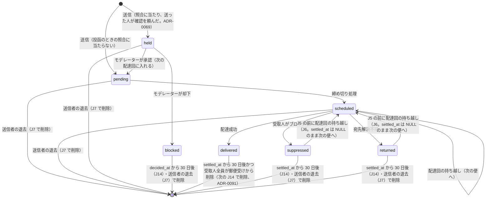
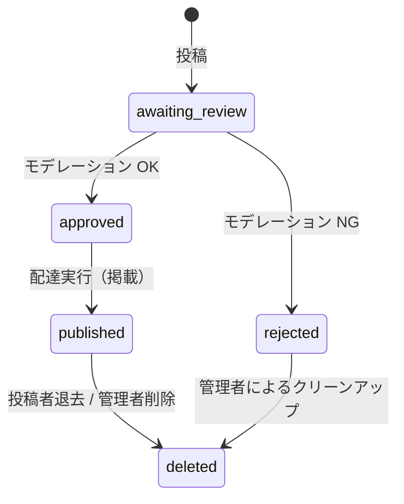
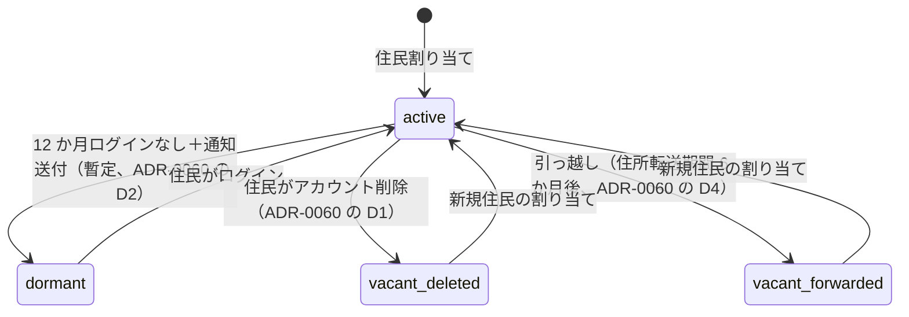

# DB 設計方針

- 状態: 草案
- 日付: 2026-11-19
- 根拠: `.ai/brief.md`・`.ai/requirements.md`・`.ai/features.md`・`.ai/architecture.md`
- チケット: YGO-004
- 関連 ADR: 0001〜0012, 0039, 0069, 0070, 0072, 0076, 0078, 0080, 0085, 0087, 0088, 0089, 0090

---

## §1 原則

1. **PostgreSQL が唯一の正本** [explicit]（ADR-0010）: データの正本はすべて PostgreSQL に置く。
   ジョブキューも PostgreSQL 上で動かす（pg-boss 相当）。Redis 等の別ブローカは使わない。

2. **主キーは UUID v4** [explicit]（ADR-0082）: すべてのエンティティは UUID v4 の主キーを持つ。
   ただし配達回 ID のみ例外として `YYYY-MM-DD-morning` / `YYYY-MM-DD-evening` の形式を使う（ADR-0004）。

3. **時刻は `timestamptz` で保存、スケジュールは JST で計算** [inferred]（architecture.md §7）:
   DB に格納する時刻はすべて `timestamptz`（タイムゾーン付き）とする。
   配達スケジュールの計算は JST 基準で行う（ADR-0004）。

4. **閲覧数・反応数・既読フラグは保存しない** [explicit]（P-1, P-2）: 即時性・数値評価の
   排除（P-1, P-2）に従い、いいね数・フォロワー数・スコア・既読状態は一切保存しない。

5. **実世界の個人情報は最小限** [inferred]（NFR-002）: 住民の実名・実住所・顔写真を
   システム内部で保持しない。認証はメールアドレス＋パスワード（ADR-0080）、セッションはサーバー側に持ち複数の端末で持てる（ADR-0090）。
   メールアドレスとパスワードのハッシュ・セッションの保持方針は `security.md` §3 に従う（OQ-028・OQ-036 は決定）。

6. **ジョブのペイロードは ID のみ** [inferred]（ADR-0010）: ジョブキューに積むペイロードには
   対象レコードの ID のみを含め、本文など大きなデータは含めない。

7. **パーティショニングなし** [inferred]（ADR-0012）: 住民 1 万人・1 配達回最大約 20 万通の
   規模（ADR-0012）では、テーブルパーティショニングは不要。将来の規模変更は ADR を置き換えて対応する。

---

## §2 論理モデル

DDL は書かない。主なカラムと一意制約のみを示す。

### 住民・住所

#### `residents` — 住民アカウント

| カラム | 説明 |
|--------|------|
| `id` UUID PK | 内部 ID（変更不可、ADR-0082） |
| `nickname` text | 任意の表示名（FR-009） |
| `bio` text | 自己紹介文（FR-008） |
| `age_at_registration` smallint NOT NULL | 登録のときに住民が入れた年齢（FR-113、ADR-0093 の D1）。CHECK(`age_at_registration BETWEEN 0 AND 999`)。登録のあとは書き換えない（D2） |
| `age_base_date` date NOT NULL | 年齢を進める起点の日。登録した日の JST の日付（ADR-0093 の D3）。登録のあとは書き換えない |
| `birthday_month` smallint NOT NULL | 誕生日の月（FR-127、ADR-0093 の D3・D5）。CHECK(`birthday_month BETWEEN 1 AND 12`)。架空でよい。登録のあとは書き換えない（D2） |
| `birthday_day` smallint NOT NULL | 誕生日の日。CHECK(`birthday_day BETWEEN 1 AND 31`)。月日の組み合わせを CHECK で確かめる: `birthday_day <= CASE WHEN birthday_month = 2 THEN 29 WHEN birthday_month IN (4, 6, 9, 11) THEN 30 ELSE 31 END`（2/29 は許し、2/30・4/31 などは許さない）。登録のあとは書き換えない |

今の年齢 = `age_at_registration` + 「`age_base_date` より後で、今日（JST）以前に来た誕生日の回数」（ADR-0093 の D3）。登録の日が誕生日でも、その日には上がらない。誕生日が 2/29 の住民は、うるう年でない年は 3/1 に上がる。C2 が読むときに時計のアダプタで計算し、列は書き換えない。
誕生日で行を引く索引（今日が誕生日の住民を J3 が探すため）は、組 1・2 と誕生日の欄（ADR-0074 の D9）を作るときに足す `[assumed]`。MVP では誕生日で引く処理がないので置かない。
| `last_login_at` timestamptz | 最終ログイン日時（住民の側に置く。下の注） |
| `created_at` timestamptz | 登録日時 |
| `deleted_at` timestamptz | 論理削除フラグ代わりに使用（即時物理削除への橋渡し用） |

年齢と誕生日の 4 列は平文で持ち、退去で行ごと即時に消す（ADR-0093 の D8・ADR-0091）。年齢と誕生日を変える UPDATE は C2 のどの経路にも書かない（ADR-0093 の D2）。

**注**: `last_login_at` を `addresses` に置くと、住民が引っ越しで住所を変えたとき
その後のログイン記録が旧住所に紐づいてしまう。住民を認証する主体は `residents` であるため、
`last_login_at` は `residents` 側に置く。`addresses` の休眠の判定（J10）は §3 の居住記録（`tenancies`）
から現在の住民を引いてその `last_login_at` を参照する。`addresses.status` の 5 つの
値（active / dormant / vacant_deleted / vacant_expired / vacant_forwarded）は ADR-0060 のとおり持つ。

#### `credentials` — 認証情報（ADR-0080・`security.md` §3）

住民 1 人に 1 行。退去では J7 の手順 0 が、その住民の `sessions` と `auth_tokens` の行を消したあとにこの行を消し、`erasure_log` に記録する（`security.md` §2.4 の退去の処理の 4、ADR-0091 の D8。`residents` を外部キーで指すので、`residents` を消す前に消す）。
`residents` と分けるのは、退去で J7 が最初に消す範囲と、鍵の入れ替えで暗号化し直す範囲を 1 つの表にまとめるため [assumed]。

| カラム | 説明 |
|--------|------|
| `resident_id` UUID PK FK→residents | 住民 1 人に 1 行 |
| `email_encrypted` bytea | 暗号化したメールアドレス（AES-256-GCM、ADR-0080。AAD は `resident_id`）。平文は持たない |
| `email_key_version` int NOT NULL | `email_encrypted` を暗号化した鍵の版（ADR-0021）。`keys.reencrypt`（`kind: 'email'`）が版 `from_version` の行を選ぶ（`environment.md` §8.3） |
| `email_hmac` bytea NOT NULL | 検索用の HMAC（ADR-0080）。メールアドレスは小文字にそろえてから計算する [assumed] |
| `email_hmac_key_version` int NOT NULL | `email_hmac` を計算した HMAC の鍵の版。HMAC の鍵の入れ替え（`environment.md` §8.3）で、どの行を作り直し済みかを示す |
| `password_hash` text NOT NULL | Argon2id のハッシュ（パラメータを含む文字列、`security.md` §3.2） |
| `email_verified_at` timestamptz NULL | メールアドレスを確かめた日時。NULL = まだ。NULL のまま `created_at` から 24 時間を過ぎた登録は J14 が行ごと消す（ADR-0087） |
| `totp_secret_encrypted` bytea NULL | モデレーターの二要素認証（TOTP）の秘密（ADR-0089 の D3・ADR-0090 の D6）。AES-256-GCM で、鍵はメールアドレスと同じ鍵輪（`EMAIL_KEYRING`）、AAD は `resident_id` と用途 `totp` を合わせたもの。平文は持たない。モデレーターでない住民は NULL |
| `totp_key_version` int NULL | `totp_secret_encrypted` を暗号化した鍵の版。`keys.reencrypt`（`kind: 'email'`）が版 `from_version` の行を選ぶ（`environment.md` §8.3） |
| `totp_enabled_at` timestamptz NULL | 二要素認証を有効にした日時（`POST /api/v1/me/second-factor/confirmation`）。秘密があって NULL なら、登録したがまだ有効にしていない |
| `totp_last_step` bigint NULL | 最後に通したコードの時間の刻み。同じ刻みか前の刻みのコードは通さない `[assumed]`（使い回しを拒む） |
| `created_at` timestamptz | — |
| `updated_at` timestamptz | — |

- 一意: UNIQUE(`email_hmac_key_version`, `email_hmac`)。
- CHECK: `totp_secret_encrypted` と `totp_key_version` は、どちらも NULL か、どちらも値がある。`totp_enabled_at` は秘密があるときだけ値を持てる（ADR-0089 の D3）。二要素認証の作り直しと解除（運用者の CLI）は TOTP の 4 列を NULL にする。HMAC の鍵の入れ替えのあいだは、ログインと登録の重複の確かめで、鍵輪の新旧の両方の版の HMAC を (版, 値) の組で引く（`environment.md` §8.3）。
- 索引: (`email_key_version`) と (`email_hmac_key_version`)。再暗号化と HMAC の作り直しが、古い版の残りの行を 1,000 件ずつ引くため。
- 退去で行ごと消す（J7 の最初の手順、`security.md` §2.4・ADR-0091）。バックアップから戻したときは `erasure.replay` が消す（§6）。
- 索引: (`totp_key_version`)（再暗号化が古い版の残りの行を引くため。NULL の行は引かない部分索引）。

#### `sessions` — セッション（ADR-0089 の D1・ADR-0090）

1 つのログインに 1 行。無効にする方法と消し方は `security.md` §3.3・§4 のライフサイクル表。

| カラム | 説明 |
|--------|------|
| `id` UUID PK | 一覧（`GET /api/v1/sessions`）で見せる識別子。Cookie の値とは別（ADR-0090 の D3） |
| `token_hash` bytea NOT NULL UNIQUE | Cookie のセッション ID の SHA-256。セッション ID の平文は DB に持たない。認証は要求の Cookie の値のハッシュでこの列を引く |
| `resident_id` UUID NOT NULL FK→residents | 住民。外部キーは既定（ADR-0091 の D9） |
| `created_at` timestamptz NOT NULL | ログインした日時 |
| `last_seen_at` timestamptz NOT NULL | 最後に操作した日時。前に書いた時刻から 1 時間を過ぎた要求のときだけ書く `[assumed]` |
| `expires_at` timestamptz NOT NULL | `least(created_at + interval '90 days', last_seen_at + interval '30 days')`（ADR-0090 の D1）。`last_seen_at` を書くのと同じ UPDATE で書き直す |
| `reauthenticated_at` timestamptz NOT NULL | 最後にパスワードを入れた日時（ログインと再認証。ADR-0090 の D5） |
| `second_factor_at` timestamptz NULL | 二要素認証を済ませた日時（ADR-0090 の D6）。NULL = 済ませていない。admin の経路はこの列が NULL でないセッションだけが呼べる |
| `invalidated_at` timestamptz NULL | 退去の受付で無効にした日時（書くのは退去の受付だけ、ADR-0090 の D4・ADR-0091 の D7） |

- 認証の確かめ: `token_hash` が当たり、`invalidated_at IS NULL` かつ `expires_at > now()` の行だけを通す。
- 索引: (`resident_id`)（一覧・すべて消す・J7）と (`expires_at`)（J14）。
- IP アドレスと端末の情報の列は置かない（ADR-0090 の D3）。

#### `auth_tokens` — 確認と再設定のトークン（ADR-0089 の D6・ADR-0080 の D2）

メールの確認・パスワードの再設定・メールアドレスの変更の確認に送るリンクのトークン。1 回の発行に 1 行。

| カラム | 説明 |
|--------|------|
| `id` UUID PK | — |
| `token_hash` bytea NOT NULL UNIQUE | `HMAC-SHA-256(RESET_TOKEN_SIGNING_KEY, トークン)`。トークンは推測できない 32 バイトの乱数で、メールのリンクにだけ載せる。平文は DB・ログに持たない |
| `resident_id` UUID NOT NULL FK→residents | 住民。外部キーは既定（ADR-0091 の D9） |
| `purpose` text NOT NULL | CHECK(`purpose IN ('email_verification', 'password_reset', 'email_change')`) |
| `new_email_encrypted` bytea NULL | `email_change` のときだけ。確かめる前の新しいメールアドレス（AES-256-GCM、鍵輪は `EMAIL_KEYRING`、AAD は `resident_id` と用途 `email_change`）。確認が済んだら同じトランザクションで `credentials` に書き移す（ADR-0090 の D7） |
| `new_email_key_version` int NULL | `new_email_encrypted` を暗号化した鍵の版。`keys.reencrypt`（`kind: 'email'`）が版 `from_version` の行も暗号化し直す |
| `created_at` timestamptz NOT NULL | 発行した日時 |
| `expires_at` timestamptz NOT NULL | `email_verification` は `credentials.created_at + interval '24 hours'`（ADR-0087 の D2。送り直しの行も同じ時刻）、`password_reset` は発行から 30 分（ADR-0080 の D2）、`email_change` は発行から 24 時間 `[assumed]` |
| `used_at` timestamptz NULL | 使った日時。NULL = まだ |

- CHECK: `purpose = 'email_change'` のときだけ、`new_email_encrypted` と `new_email_key_version` のどちらにも値がある。
- 確かめ: `token_hash` で引き、`purpose` が経路に合い、`used_at IS NULL` かつ `expires_at > now()` の行だけを通す（外れればどれも 400 `token_invalid`）。通したら同じトランザクションで `used_at` を書く。
- 同じ住民・同じ `purpose` の新しい行を作るときは、同じトランザクションでまだ使っていない前の行を消す `[assumed]`。
- 索引: (`resident_id`) と (`expires_at`)。J14 が `expires_at < now()` の行を消す。退去では J7 の手順 0 が消す（ADR-0091 の D8・D14）。

#### `staff_roles` — ロールの付与（ADR-0089 の D2・ADR-0020）

| カラム | 説明 |
|--------|------|
| `resident_id` UUID FK→residents | ロールを持つ住民。外部キーは既定 |
| `role` text NOT NULL | CHECK(`role IN ('moderator')`)。住民（`resident`）のロールは行を持たない |
| `granted_at` timestamptz NOT NULL | 付与した日時 |
| `granted_by` text NOT NULL | 付与した運用者の CLI の作業者の識別子（住民の ID ではない） |

- PK (`resident_id`, `role`)。
- 付与は運用者の CLI が行を入れ、剥奪は行を消す。API・C2 のどの経路もこの表に書かない（ADR-0020）。退去では J7 の手順 5 が行を消す。

#### `rate_limit_buckets` — 流量の制限の数え（ADR-0089 の D4・ADR-0088）

| カラム | 説明 |
|--------|------|
| `key` bytea | `HMAC-SHA-256(RATE_LIMIT_HMAC_KEY, <規則の名前> ":" <主体>)`（ADR-0088 の D3）。主体（IP・メールアドレス・住民 ID）の平文は持たない |
| `window_start` timestamptz | 窓の始まり（要求の時刻を窓の幅で切り下げたもの） |
| `count` int NOT NULL | その窓で数えた回数 |
| `updated_at` timestamptz NOT NULL | 最後に数えた日時 |

- PK (`key`, `window_start`)。数えは `INSERT … ON CONFLICT (key, window_start) DO UPDATE SET count = rate_limit_buckets.count + 1 RETURNING count` で、本来の処理とは別のトランザクションで先に書く。
- 住民を指す外部キーを持たない。J14 が `window_start < now() - interval '1 day'` の行を消す。退去の J7 では消さない。

#### `addresses` — 架空の住所

| カラム | 説明 |
|--------|------|
| `id` UUID PK | — |
| `address_text` text UNIQUE | 住所文字列（例: 夕暮ヶ丘三丁目 2-5）（FR-002, FR-003） |
| `status` text | active / dormant / vacant_deleted / vacant_expired / vacant_forwarded（ADR-0060。`vacant_expired` は OQ-088 の答えまで遷移がなく、使われない） |
| `forwarding_expires_at` timestamptz | 住所転送の有効期限（引っ越しから 6 か月、ADR-0060 の D4） |
| `dormancy_notified_at` timestamptz | 休眠通知送付日時（ADR-0060 の D2） |
| `created_at` timestamptz | — |
| `vacated_at` timestamptz | 空き家化した日時 |

`addresses` の行は、住所を初めて割り当てたときに作る（使われたことのない住所には行がない。街のすべての住所は C3 の住所のプールの静的な定義が持つ `[assumed]`、ADR-0084 の D15）。
登録の要求の住所は、提示した候補か地図の空き家の印から選ばれたもので、候補かどうかは確かめない。MVP で割り当てるのは `addresses` に行のない住所だけで、行を作る `INSERT` が `address_text` の UNIQUE に当たったとき（行のある住所・同じ住所を同時に選んだ登録の負けた側）は、登録のトランザクションを戻して 409（`conflict`）にする（ADR-0082 の D3・ADR-0062 の D3・D4、`[assumed]`）。表・列・索引は足さない。

**確認が済まない登録の期限**（ADR-0087。OQ-046 → 決定、2026-11-25）: メールの確認が済まない登録（`credentials.email_verified_at IS NULL`）が住所を押さえるのは `credentials.created_at` から 24 時間 `[assumed]`。
期限を過ぎた登録は、J14 が登録ごとに 1 つのトランザクションで `auth_tokens` → `resident_interests` → `tenancies` → `addresses` → `credentials` → `residents` の順に行を消す（`address_book_daily_counts` は `residents` の削除の CASCADE。`erasure_log` には記録しない）。
登録のトランザクションも、割り当ての前に、要求の住所（`addresses.address_text`）か要求のメールアドレスの `email_hmac` に当たる期限切れの登録を同じ順に消す（D5）。行が消えた住所は「`addresses` に行がない住所」に戻り、候補と空き家に戻る（D6）。
期限切れの登録は `credentials` の `email_verified_at IS NULL AND created_at < now() - interval '24 hours'` で引く。列・索引は足さない（確認が済まない行は少なく、J14 は毎日 1 回）。

**入居の読み方**（FR-115、ADR-0084 の D13。OQ-079 → 決定、2026-11-21）: 地図の入居の一覧（`GET /api/v1/addresses/occupancy`、`api.md` §7 F-19）は、家ごとに次のとおり読む。
入居（`occupied = true`）は `status` が `active` か `dormant`（休眠は空き家にしない）。空き家（`false`）は、`addresses` に行がない住所と、`status` が `vacant_deleted`・`vacant_expired`・`vacant_forwarded` の住所。
問い合わせは `SELECT address_text, status IN ('active', 'dormant') AS occupied FROM addresses` の 1 回で、C3 がプールの定義の住所の集合と突き合わせ、行のない住所を `false` にして番・号の順に並べる。
要求を受けたときの状態を読み（ADR-0084 の D14）、スナップショットの表・集計の列・件数は持たない。表・列・索引は足さない `[assumed]`（`address_text` の UNIQUE の索引で足り、行の数は住所のプールの大きさまで）。

#### `tenancies` — 居住記録

住民と住所の紐づけ履歴。ある住所に誰が住んでいたかを記録する。
住所録の配達先解決と転送判定に使う（§3 参照）。

| カラム | 説明 |
|--------|------|
| `id` UUID PK | — |
| `resident_id` UUID FK→residents NULL | 住んでいた住民。退去では J7 の手順 9 が NULL にする（ADR-0091 の D11。行は退去から 1 年残す）。NULL の行は退去した住民の居住記録 |
| `address_id` UUID FK→addresses | — |
| `started_at` timestamptz | 居住開始日時 |
| `ended_at` timestamptz NULL | 居住終了日時。NULL = 現在も居住中。退去では J7 の手順 7 が、住所を `vacant_deleted` にするのと同じトランザクションで今の時刻を書き、`is_current` を false にする（ADR-0091 の D10） |
| `is_current` bool | 現在の居住かどうか（UNIQUE(address_id) where is_current） |
| `resident_erased_at` timestamptz NULL | 住民が退去した時刻（ADR-0091 の D10）。J7 の手順 9 が、`resident_id` を NULL にするのと同じ UPDATE で書く（引っ越しで終わった前の行も含め、その住民の行すべてに同じ時刻）。J14 は、この列から 1 年を過ぎた行を消す（`ended_at` は起点にしない）。住民が残る行は NULL |

退去した住民の居住記録を J14 が消すときは、同じトランザクションで、先にその行を指す `address_book.registered_tenancy_id` と `letter_recipients.registered_tenancy_id` を NULL にする（ADR-0091 の D12。`tenancies` を指す外部キーは既定（NO ACTION）で、指す列を残すと削除が止まる）。

---

### 手紙・郵便受け

#### `letters` — 手紙本体

| カラム | 説明 |
|--------|------|
| `id` UUID PK | — |
| `sender_id` UUID FK→residents NULL | 送信者（退去では J7 の手順 9 が NULL にする、ADR-0091 の D11・§5 参照） |
| `body_encrypted` bytea | 保存時暗号化済み本文（ADR-0006。AAD は手紙の `id`、ADR-0021） |
| `body_key_version` int NOT NULL | `body_encrypted` を暗号化した鍵の版（ADR-0021）。`keys.reencrypt`（`kind: 'letter'`）が版 `from_version` の行を選ぶ（`environment.md` §8.3・`async.md` §2）。索引: (`body_key_version`) |
| `delivery_run_id` text FK→delivery_runs NULL | 次の配達回 ID。`held`・`blocked` の手紙は NULL（配達回に入れない、ADR-0069） |
| `state` text | pending / held / scheduled / delivered / blocked / suppressed / returned（`held` は送った人が確認を頼んだ確認待ち、`blocked` はモデレーターが却下した手紙、ADR-0069） |
| `rule_version` text NULL | 投函のときの照合に使ったルール表の版（ADR-0069 の D2）。照合のない M2・M3 の手紙は NULL |
| `matched_rule_id` text NULL | 当たった規則の ID（`held`・`blocked` のときだけ）。本文の抜き書きは持たない |
| `decided_at` timestamptz NULL | モデレーターが `held` の手紙を操作した日時。`blocked` の 30 日の保持（J14）の起点 |
| `settled_at` timestamptz NULL | 手紙を `delivered`・`suppressed`・`returned` にした時刻（ADR-0091 の D1）。書くのは J5 の手順 3 だけで、同じ配達回で確定させた手紙に同じ値を書く。J4 は `returned`・`suppressed` にしても書かず、その回を J6 が持ち越せば手紙は `scheduled` に戻って NULL のまま次の便に移る（async.md J6 の手順 2）。送った人の送信済みに出す 30 日（api.md §7 F-04、ADR-0091 の D5）と、`returned`・`suppressed`・`delivered` の J14 の 30 日の起点 [assumed] |
| `created_at` timestamptz | — |

UNIQUE 制約なし。複数宛先は `letter_recipients` で管理する。
CHECK(`(state IN ('held','blocked')) = (delivery_run_id IS NULL)`) — 確認待ちと却下の手紙は配達回に入らない。
CHECK(`state NOT IN ('held','blocked') OR (matched_rule_id IS NOT NULL AND rule_version IS NOT NULL)`) — 確認待ちと却下の手紙は、当たった規則と版を持つ（ADR-0069）。

#### `letter_recipients` — 宛先

| カラム | 説明 |
|--------|------|
| `id` UUID PK | — |
| `letter_id` UUID FK→letters | — |
| `route` text NOT NULL | 宛先にした住所録の行の `source` を写す（`address`・`board_post`・`letter`、ADR-0065 の D12・D15）。住所を指定した手紙は `address` |
| `recipient_address_text` text NULL | 宛先住所（登録時点の文字列、ADR-0003）。`route = 'address'` の宛先だけに入り、`board_post`・`letter` の行宛ての手紙は NULL（相手の住所を持たない、ADR-0065 の D12・D15） |
| `board_post_id` UUID NULL | `route = 'board_post'` の手紙の、宛先の行を足したもとの投稿の ID（送信済みの一覧で宛先の代わりに示し、受け取った投稿者の郵便受けでも、どの投稿から届いたかを示す。外部キーにしない） |
| `registered_tenancy_id` UUID FK→tenancies NULL | 住所録登録時点の居住記録（§3 参照）。住所録の行宛ての手紙は、その行の居住記録を写す。指す居住記録を J14 が消すとき、同じトランザクションで NULL にする（ADR-0091 の D12。NULL の宛先は §3 の振り分けで差し戻し）。画面・API 非公開 |
| `delivered_at` timestamptz NULL | 配達完了日時。J5 が `delivered` を確定するとき、受取人の `mailbox_items.visible_at`（手紙の枠の時刻）を書く（ADR-0035）。送った人には返さない（送信済みの「配達済み」は時間帯の終わり 12:00 / 21:00 を過ぎてから見せる、api.md §7 F-04） |

UNIQUE(letter_id, recipient_address_text)
CHECK(route IN ('address', 'board_post', 'letter'))
CHECK((route = 'address') = (recipient_address_text IS NOT NULL))
CHECK(board_post_id IS NULL OR route = 'board_post')

#### `mailbox_items` — 郵便受けの中身

| カラム | 説明 |
|--------|------|
| `id` UUID PK | — |
| `resident_id` UUID FK→residents | 受取人。CASCADE なしの外部キーで、受取人の退去では J7 が `residents` を消す前にその住民の行をすべて消す（ADR-0091 の退去の表） |
| `delivery_run_id` text FK→delivery_runs | 配達回 ID |
| `kind` text | letter / newspaper / board_post |
| `item_id` UUID | 対応するレコードの ID（letters.id / newspaper_editions.id / board_posts.id）。`kind = newspaper` のときは、その住民に届けた版（ADR-0039 の D1） |
| `visible_at` timestamptz | 受取人に見せ始める時刻（ADR-0035 の D10）。J4 が書く。新聞はその便の公開の時刻（07:00 / 17:00）、手紙は受取人ごとの枠の時刻（午前 08:00〜11:50・午後 18:00〜20:50 の 10 分刻み）。API では返さない |
| `deleted_at` timestamptz NULL | 受取人が削除した日時（FR-099） |
| `created_at` timestamptz | — |

UNIQUE(delivery_run_id, resident_id, kind, item_id) — 配達の冪等性を保証する（ADR-0010）  
INDEX(resident_id, visible_at) — 郵便受けの一覧で、`visible_at` を過ぎた行を住民ごとに引くため（ADR-0035）  
UNIQUE(delivery_run_id, resident_id) WHERE kind = 'newspaper' — 1 回の配達につき新聞は 1 つだけ。J4 のやり直しのあいだに興味が変わっても、別の版が 2 つ届かないようにする（ADR-0039）

---

### 配達回

#### `delivery_runs` — 配達回

| カラム | 説明 |
|--------|------|
| `run_id` text PK | `YYYY-MM-DD-morning` / `YYYY-MM-DD-evening`（ADR-0004） |
| `status` text | pending / running / done / failed / skipped。`failed` を書くのは J0 だけで、J6 の再試行が尽きたときに書く（`async.md` §3、ADR-0094 の D5） |
| `started_at` timestamptz NULL | 締め切りの時刻。J1 が `running` にする UPDATE で `now()` を書く（async.md §4 J1） |
| `prepared_at` timestamptz NULL | 準備（J4）が終わった時刻。J4 がすべての宛先を書き終えた最後のトランザクションで `now()` を書く [assumed]。J0 はこの列で準備の完了を判断する（NULL の間は J5 を積まない）。`pending` の間は NULL、`done` の回は NULL でない。J6 は書き換えない（準備の途中で持ち越した `skipped` の回は NULL のまま）（async.md §3・§4 J4・J5、ADR-0017） |
| `finished_at` timestamptz NULL | 配達回が終わった時刻。J5 が `done` にする UPDATE（手順 5）と、J6 が `skipped` にする UPDATE（手順 5）で `now()` を書く [assumed]。J5 では同じトランザクションの手順 3 の `letters.settled_at` と同じ値（公開の時刻）、J6 では持ち越した時刻。`pending`・`running`・`failed` の間は NULL。J15 の新聞の通知の期限（公開から 30 分）と、J14 の `delivery_notifications` の保持（30 日）の起点（async.md §4 J14・J15、ADR-0076 の D2・D7） |

CHECK ((status IN ('done', 'skipped')) = (finished_at IS NOT NULL)) — 終わった回だけが終わった時刻を持つ [assumed]。
CHECK (status <> 'pending' OR prepared_at IS NULL) — 締め切りの前の回は準備していない [assumed]。
CHECK (status <> 'done' OR prepared_at IS NOT NULL) — 公開した回は準備を終えている [assumed]。

行は消さない（J14 も J7 も消さない、ADR-0091）。1 日 2 行で、住民の ID も本文も持たない。`letters`・`mailbox_items`・`delivery_notifications`・`newspapers`・`newspaper_articles`・`external_news_items`・`board_posts`・`moderation_queue` の `delivery_run_id` は、この表を CASCADE・SET NULL なしの外部キーで指す。

---

### 通知

配達完了の通知（ADR-0076、FR-028・FR-102）。`sessions` の表は §2 の住民・住所の節（ADR-0089 の D1）。退去では、受付（API）でその住民のセッションをすべて無効にし（`invalidated_at`）、同じトランザクションでその購読と送った記録を消す。J7 の手順 0 が、購読と送った記録の残り → `sessions` の行すべて → `credentials` の行の順に消す（ADR-0091 の D7・D8）。

#### `push_subscriptions` — 通知の購読（端末ごと）

| カラム | 説明 |
|--------|------|
| `id` UUID PK | — |
| `resident_id` UUID FK→residents | 購読した住民 |
| `session_id` FK→sessions UNIQUE | 購読を作ったセッション（1 セッションに 1 購読）。セッションの行を消すとき（ログアウト・取り消し・パスワードの再設定と変更・強制ログアウト・二要素認証の解除・期限切れの J14）と、退去の受付でセッションを無効にするとき（`invalidated_at`）、この行を同じトランザクションで消す（ADR-0090 の D4） |
| `endpoint` text | プッシュサービスの送り先（ADR-0076 の D6 で検査した値）。ログに出さない（security.md §2.5） |
| `p256dh` text | 中身の暗号化に使う端末の公開鍵 |
| `auth` text | 中身の暗号化に使う認証の秘密 |
| `created_at` timestamptz | — |

#### `delivery_notifications` — 配達完了の通知を送った記録

| カラム | 説明 |
|--------|------|
| `delivery_run_id` text FK→delivery_runs | 配達回 ID。保持期間はこの配達回の `finished_at` から数える（async.md J14） |
| `push_subscription_id` UUID FK→push_subscriptions | 送った購読。購読を消すときは、この行も一緒に消す |
| `resident_id` UUID FK→residents | 受け取る住民 |
| `kind` text | newspaper / letter（新聞の通知か手紙の通知か、ADR-0035 の D12） |
| `created_at` timestamptz | J15 が行を入れた日時 |
| `sent_at` timestamptz NULL | 送った日時（NULL は未送信） |

UNIQUE(delivery_run_id, push_subscription_id, kind) — 通知の重複を防ぐ（async.md J15、ADR-0035）。件数は持たない（送るときに数える）。

---

### 新聞

紙面は一人 1 枚にせず、配達回ごとに版（edition）を組む（ADR-0039 の D1）。`newspapers` は配達回ごとの新聞の 1 行、`newspaper_editions` はその版。

#### `newspapers` — 紙面（配達回ごと）

| カラム | 説明 |
|--------|------|
| `id` UUID PK | — |
| `delivery_run_id` text FK→delivery_runs UNIQUE | この紙面を配達する配達回 |
| `kind` text | morning / evening |
| `typeset_at` timestamptz NULL | 組版完了日時 |
| `is_holiday` bool DEFAULT false | 休刊フラグ（ADR-0007） |

組版済みの HTML の保存先（もとの `storage_url`）は `newspaper_editions` に移した（ADR-0039）。
J3 は `newspapers` の行とすべての版の行を 1 つのトランザクションで入れる。休刊は J0 が、休刊の行と `holiday` の版の行を一緒に入れる。
こうして、配達回の新聞は「版がそろう」か「休刊」のどちらかになり、版が一部だけの状態は見えない。

#### `newspaper_editions` — 版（ADR-0039）

| カラム | 説明 |
|--------|------|
| `id` UUID PK | 郵便受けの `item_id` と、閲覧の API の `{id}` が指す値 |
| `newspaper_id` UUID FK→newspapers | — |
| `edition_key` text | `common`（共通の版）/ `interest:<key>`（興味の版、`<key>` は `interest_categories.key`）/ `holiday`（休刊の印）/ `acquaintance:<resident_id>`（組 1・2 の住民ごとの版、`<resident_id>` は `residents.id`。ADR-0074 の D4。紙面には知り合いの投稿と、朝刊ではその日が誕生日の知り合いの誕生日の欄（ADR-0074 の D9）が載る。MVP では作らず、作る時期は OQ-070）。API では返さない（ADR-0039 の D11） |
| `storage_url` text NULL | 組版済み静的 HTML の保存先（C8）。`holiday` の版は NULL |
| `typeset_at` timestamptz | 組版完了日時 |

UNIQUE(newspaper_id, edition_key) — 1 つの配達回で同じ版は 1 つだけ。

#### `newspaper_items` — 組版に使った素材

| カラム | 説明 |
|--------|------|
| `id` UUID PK | — |
| `newspaper_edition_id` UUID FK→newspaper_editions | 素材が載った版（ADR-0039 で `newspaper_id` から変えた） |
| `source_kind` text | board_post / external_news / image |
| `source_id` UUID | 素材レコードの ID |
| `newspaper_article_id` UUID FK→newspaper_articles NULL | 載せた記事の文字（画像は NULL） |

#### `newspaper_articles` — 記事の文字（ADR-0055 の D7）

J16 が素材ごとに 1 回作り、J3・J8 はこれから組む（LLM を呼び直さない）。

| カラム | 説明 |
|--------|------|
| `id` UUID PK | — |
| `delivery_run_id` text FK→delivery_runs | 配達回 |
| `source_kind` text | board_post / external_news |
| `source_id` UUID | 素材（`board_posts.id` / `external_news_items.id`） |
| `interest_category_id` UUID FK→interest_categories NULL | 結び付けた興味（共通の記事は NULL。結び付け方は OQ-062） |
| `headline` text | 見出し。投稿の素材でも LLM が書く（ADR-0054 の D5）。決まった形（`written_by = 'template'`）では、外のニュースは素材の題、投稿は決まった文「掲示板から」[assumed]（`board_posts` に題がないため。ADR-0054 の D10） |
| `body` text NULL | 記事の文字（文字だけ。HTML は持たず、組版でエスケープする）。外のニュースでは必ず持つ。投稿の素材では NULL（まとめを書かない。LLM の行も template の行も。ADR-0054 の D9、OQ-074 → 決定）。投稿の本文は `board_posts.body` からそのまま載せる（書き換えない。ADR-0054 の D4） |
| `written_by` text | llm / template（LLM の失敗・検査に外れた・打ち切りのときは template、ADR-0055 の D8）。紙面には出さない。規約が LLM の文であることを示すよう求めるとき（OQ-073）は、これで見分ける（ADR-0054 の D3） |
| `prompt_version` text NULL | 使ったプロンプトの版（template は NULL） |
| `rule_version` text | 出力の検査に使ったルール表の版 |
| `created_at` timestamptz | — |

UNIQUE(delivery_run_id, source_kind, source_id) — 1 つの素材の記事は 1 回の配達につき 1 つ。版どうしで使い回す。

CHECK ((source_kind = 'board_post') = (body IS NULL)) — 投稿の記事はまとめを持たず、外のニュースの記事は本文を持つ（ADR-0054 の D11）。

行を入れる人と時刻（ADR-0055 の D8）:
- J16 は、記事の打ち切り（04:30 / 16:15 JST）[assumed] より前にしか行を入れない（入れるトランザクションの中で DB の時計で確かめる。J17 の取り込みの打ち切りと同じ形）
- J3 は組む前に、行のない素材に `written_by = 'template'` の行を `ON CONFLICT DO NOTHING` で入れ、それから組む
- これで J3 が組んだあとに行が増えず、J3 の再試行・J8 の組み直しは同じ行から同じ HTML を組む（FR-037・NFR-022）。行を消すのは、素材の投稿の削除・投稿者の退去のとき（§4）だけ

#### `newspaper_birthday_entries` — 誕生日の欄に載せた住民（ADR-0074 の D9）

組 1・2 と一緒に作る（MVP では作らない。時期は OQ-070）[assumed]。J3 が住民ごとの版（`acquaintance:<resident_id>`）の朝刊を組むとき、誕生日の欄に載せた住民ごとに 1 行を、版と同じトランザクションで入れる。
J3 の再試行と J8 の組み直しは、この行から欄を組み、`residents` と住所録を読み直さない（`newspaper_articles` と同じく、保存した行から同じ HTML を組む）。

| カラム | 説明 |
|--------|------|
| `id` UUID PK | — |
| `newspaper_edition_id` UUID FK→newspaper_editions | 欄が載った版（`acquaintance:` の版だけ） |
| `resident_id` UUID | 載った住民（外部キーにしない。退去で J7 がこの列で行を引いて消す） |
| `nickname` text | J3 の時点のニックネーム |
| `age` integer | その日に上がったあとの年齢（ADR-0093 の D3） |
| `address_text` text | J3 の時点の今の住所 |
| `position` integer | 欄の中の並び順（住所の順） |

UNIQUE(newspaper_edition_id, resident_id)。誕生日の月日は持たない。
平文で持ち、載った住民の退去で J7 が即時に消し、行のあった版を J8 で組み直す（§4・§5）。それ以外は紙面と同じだけ残す。ログ・ジョブのペイロード・LLM には出さない（ADR-0093 の D8）。

#### `external_news_items` — 取り込んだ外のニュース（ADR-0039 の D6）

| カラム | 説明 |
|--------|------|
| `id` UUID PK | — |
| `delivery_run_id` text FK→delivery_runs | 取り込んだ配達回（その回の J17 が入れた。J16・J3 の素材はこの列がその回の行だけ） |
| `source_key` text | 配信元の識別子（許可した一覧のキー。テストは偽の配信元） |
| `external_id` text | 配信元の記事の ID |
| `title` text | 題 |
| `body` text | 本文（文字だけ） |
| `url` text NULL | 出典の URL（表示の仕方は OQ-060） |
| `interest_category_id` UUID FK→interest_categories NULL | 配信元の分類から結び付けた興味（結び付け方は OQ-062） |
| `fetched_at` timestamptz | 取り込んだ日時（保持は 30 日 [assumed]、ADR-0091） |

UNIQUE(source_key, external_id) — J17 のやり直しで重複しない。前の回に取り込んだ記事は、あとの回の J17 で入れ直さない
（`ON CONFLICT DO NOTHING` で最初の回の `delivery_run_id` のまま残る）。そのため、1 つの外のニュースが素材になるのは、取り込んだ 1 回の配達だけ。

INDEX(delivery_run_id) — J16・J3 がその回の素材を選ぶため。J17 が行を入れられるのは、その回の取り込みの打ち切り（審査の打ち切りと同じ 04:00 / 16:00 JST [assumed]、`async.md` §3）より前だけ。
打ち切りのあとは J16 の素材が増えない。

### 興味（ADR-0039 の D4・D5、ADR-0045）

#### `interest_categories` — 興味の一覧

運用者の CLI で保つ。シードは架空の一般的な名前だけ（ADR-0038 の D5 と同じ考え）。中身は OQ-062。

| カラム | 説明 |
|--------|------|
| `id` UUID PK | — |
| `key` text UNIQUE | 識別子（API と `edition_key` で使う） |
| `label` text | 表示名 |
| `active` bool | 選べるか（外した興味は新しく選べない） |
| `sort_order` int | 並び順（J4 の版の選び方の順序にも使う） |
| `keywords` text[] NOT NULL DEFAULT '{}' | 過去の新聞の検索で興味に当てる語（段階 2、ADR-0045 の D3）。運用者の CLI が NFKC・小文字にそろえて保ち、2 文字以上の語だけを受け付ける。シードは架空の一般的な語だけ。中身は OQ-062 |

一覧は 30 種まで [assumed]。

#### `resident_interests` — 住民の興味

本人だけが読み書きできる（security.md §4.2）。件数を数える経路は作らない（P-2）。

| カラム | 説明 |
|--------|------|
| `resident_id` UUID FK→residents | — |
| `interest_category_id` UUID FK→interest_categories | — |
| `source` text | CHECK IN ('registration', 'settings')。検索から推し量った興味はこの表に置かず、`inferred_interests` に置く（ADR-0045 の D4） |
| `created_at` timestamptz | — |

PK(resident_id, interest_category_id)。1 人 5 つまで [assumed]（API が検査する）。

#### `inferred_interests` — 過去の新聞の検索から推し量った興味（段階 2、ADR-0045）

S2-3 で足す。自分に届いた過去の新聞の検索（`GET /api/v1/newspapers?q=`）の検索語が興味の `label` か `keywords` に当たったとき、API がその興味の ID だけを書く。
検索語・検索の結果を持つ列は置かない。本人にも返さず、ほかの住民・モデレーターに返す経路も作らない（ADR-0045 の D8）。件数を数える経路は作らない（P-2）。

| カラム | 説明 |
|--------|------|
| `resident_id` UUID FK→residents | — |
| `interest_category_id` UUID FK→interest_categories | — |
| `last_matched_at` timestamptz | 最後に当たった時刻。同じ興味にまた当たったら更新する |

PK(resident_id, interest_category_id)。1 人 5 つまで [assumed]。5 つあるときに新しい興味に当たったら、`last_matched_at` がいちばん古い行を同じトランザクションで置き換える（API が `residents` の行を `FOR UPDATE` で読んでから行う）。
最後に当たってから 30 日 [assumed] を過ぎた行は J14 が消す。退去で即時に消す（§5）。

---

### 掲示板

#### `board_posts` — 町内掲示板の投稿

| カラム | 説明 |
|--------|------|
| `id` UUID PK | — |
| `author_id` UUID FK→residents NULL | 投稿者（退去では J7 の手順 9 が、どの状態の行も NULL にする、ADR-0091 の D11） |
| `body` text | 本文（上限 1,000 文字、ADR-0004）。モデレーションを通過した後も平文保持 |
| `status` text | awaiting_review / approved / published / rejected / deleted |
| `delivery_run_id` text FK→delivery_runs NULL | 掲載予定の配達回 ID |
| `created_at` timestamptz | — |
| `published_at` timestamptz NULL | 掲載日時（配達時に status=published になる） |
| `deleted_at` timestamptz NULL | 削除日時 |
| `accepts_letters` boolean NOT NULL DEFAULT false | 投稿者が「この投稿を見た人から手紙を受け取る」（オープン）を選んだか（ADR-0065 の D11）。投稿のときに選び、投稿者が `PATCH` でいつでも切り替えられる。効くのは `status = 'published'` の間だけ |

知り合いの判定（ADR-0065 の D7）は、住所録の行の `board_post_id` から主キーで引くので、索引は足さない。

---

### 住所録

#### `address_book` — 住民の住所録

| カラム | 説明 |
|--------|------|
| `id` UUID PK | — |
| `owner_id` UUID FK→residents | 住所録の所有者（FR-051） |
| `source` text NOT NULL | 行の種類（ADR-0065 の D7・D12・D15）。`address`（住所を入れた行）・`board_post`（掲示板のオープンの投稿から足した行）・`letter`（掲示板の経路で届いた手紙の差出人を足した行）のどれか（CHECK）。住所を入れる `PATCH` で `address` にする |
| `address_text` text NULL | 登録時点の住所文字列（ADR-0003 — 自動更新しない）。`source = 'address'` の行だけに入り、`board_post`・`letter` の行は NULL（相手の住所を持たない、ADR-0065 の D12・D15） |
| `board_post_id` UUID FK→board_posts ON DELETE SET NULL NULL | `source = 'board_post'` の行の、足したもとの投稿（ADR-0065 の D7）。投稿が物理削除されると NULL になるが、行は消えない（住民が消すまで保持、ADR-0003・ADR-0065 の D6）。住所を入れる `PATCH` で NULL にする。画面・API では投稿の ID として返し、投稿者の住所は返さない |
| `source_letter_id` UUID NULL | `source = 'letter'` の行の、足したもとの手紙（ADR-0065 の D15。外部キーにしない。手紙が消えても行は残る）。住所を入れる `PATCH` で NULL にする。画面・API では返さない |
| `memo` text NULL | 所有者だけが見えるメモ（FR-056） |
| `registered_tenancy_id` UUID FK→tenancies NULL | 登録時点の居住記録。画面・API 非公開（§3 参照）。指す居住記録を J14 が消すとき、同じトランザクションで NULL にする（行は消さない。NULL の行は知り合いにならない。ADR-0091 の D12） |
| `created_at` timestamptz | — |
| `counted_at` timestamptz | 1 日の上限に数えた時刻（ADR-0066 の D5）。行を作った `POST` と、`address_text` を変えた `PATCH` のときに、数えと同じトランザクションで書く。相互にならない追加の判定（M）に使う。画面・API 非公開 |

UNIQUE(owner_id, address_text)
UNIQUE(owner_id, board_post_id) [assumed]（同じ投稿から 2 度足さない）
UNIQUE(owner_id, source_letter_id) [assumed]（同じ手紙から 2 度足さない）
CHECK(source IN ('address', 'board_post', 'letter'))
CHECK((source = 'address') = (address_text IS NOT NULL))
CHECK(board_post_id IS NULL OR source = 'board_post')
CHECK(source_letter_id IS NULL OR source = 'letter')

知り合い（ADR-0065 の D2、OQ-066 → 決定）は列を足さず、そのつど求める。A の行の `registered_tenancy_id` が B の `tenancies.is_current = true` の行を指し、
かつ B の行が A の今の居住記録を指し、2 つの行の `source` の組が「`address` と `address`」か「`board_post` と `letter`」のとき、A と B は知り合い（ADR-0065 の D2・D15）。
`address` の行と `board_post`・`letter` の行の組は知り合いにしない（住所を入れた行と、住所を見せない行を結び付けない）。
掲示板の経路（ADR-0065 の D7、OQ-081 → 決定）は、関係を表に保存せず、そのつど求める。X の行が `source = 'board_post'`・`board_post_id = P` を持ち、その行の `registered_tenancy_id` が Y の今の居住記録を指し、
P が `author_id = Y`・`status = 'published'`・`accepts_letters = true` なら、X はその行宛てに Y へ手紙を出せる（向きは X から Y だけ）。`board_post` でない行と、`board_post_id` が NULL になった行には D7 は効かない。
住所録の `acquainted`（api.md §7 F-09）は、その行が D2 か、その行について D7 を満たすときに true。手紙の知り合いと `acquainted` は `blocks` を見ない。
新聞の知り合い（ADR-0074 の D2）だけは、これに `blocks` に行がないことと、組が「`address` と `address`」であることを足す（ADR-0065 の D14）。住所がない・空き家の住所を足した行は `registered_tenancy_id` が NULL で、知り合いにならない。
住所録の追加の 1 日 20 件 `[assumed]` は、`address_book` の `created_at` では数えない（行を消して足し直せば上限を越えられるため）。
下の `address_book_daily_counts` で数える（ADR-0065 の D4）。

#### `address_book_daily_counts` — 住所録の追加の 1 日の数え（ADR-0065 の D4・ADR-0066 の D1）

| カラム | 説明 |
|--------|------|
| `owner_id` UUID FK→residents ON DELETE CASCADE | 数える住民 |
| `jst_date` date | JST の暦日 |
| `count` integer | その日に数えた件数（0〜20） |

PRIMARY KEY(owner_id, jst_date)

- 数えるのは、`address_book` の行を作った `POST /api/v1/address-book` と、`address_text` を変えた `PATCH /api/v1/address-book/{id}`（`registered_tenancy_id` を取り直す）。
  メモだけの `PATCH`・`DELETE`・400 と 429 の要求は数えない。`DELETE` しても `count` は減らない。
- API は住民ごとの `pg_advisory_xact_lock`（api.md の 1 日の上限の数え方と同じ）の中で、まず相互にならない追加の判定（下）を行い、次に `count` が 20 なら 429 `daily_limit_reached` を返して何も変えない。20 未満なら、エントリの作成か住所の変更と同じトランザクションで `count` を 1 足し（行がなければ作る）、`address_book.counted_at` を書く。
- 相互にならない追加の判定（ADR-0066 の D1、値は `[assumed]`）: N は、本人の今日を含む直近 7 日（`jst_date` が今日（JST）の 6 日前から今日まで）の `count` の合計。
  M は、本人の `address_book` の行のうち、`counted_at` がその 7 日に入り、今その相手と互いに足している（ADR-0065 の D2）ものの数（掲示板の経路だけの相手は入れない）。
  N ≥ 100 かつ M × 50 < N なら 429 `add_suspended` を返し、何も変えない。止めた状態は保存しない。
- 7 日の判定のため、行は 7 日分持つ（§4。J14 が `jst_date` が今日（JST）より 7 日以上前の行を消す）。
- 住所は書かない。件数だけを置き、何を足したか・探ったかを残さない。
- `address_book` と別の表にするのは、`address_book` の行は本人が消せ（FR-053）、行に数えを置くと消せば数えも消えるため。

---

### ブロック・モデレーション・通報

#### `blocks` — ブロックリスト

| カラム | 説明 |
|--------|------|
| `id` UUID PK | — |
| `blocker_id` UUID FK→residents | ブロックした住民 |
| `blocked_id` UUID FK→residents | ブロックされた住民 |
| `created_at` timestamptz | — |

UNIQUE(blocker_id, blocked_id)

#### `reports` — 通報

| カラム | 説明 |
|--------|------|
| `id` UUID PK | — |
| `reporter_id` UUID FK→residents NULL | 通報者。手紙の通報では、その手紙を受け取った住民（ADR-0078 の D8）。モデレーターの当事者の判定に使う。通報者の退去では J7 の手順 9 が NULL にし、行は残す（ADR-0091 の D11） |
| `content_kind` text | letter / board_post |
| `content_id` UUID | 通報対象レコードの ID。`letter` は `letters.id`、`board_post` は `board_posts.id`。手紙の通報の要求は郵便受けの行の ID（`mailbox_item_id`）で受け、API がその行から引いた `letters.id` を書く。行は、郵便受けの行が通報者のもの・`kind = 'letter'`・`visible_at <= now()`・`deleted_at IS NULL` で、手紙が `delivered` のときだけ作る（api.md §7 F-08、ADR-0078 の D8〜D10）。郵便受けの行の ID は保存しない |
| `reason` text | 通報理由 |
| `status` text | open / closed / dismissed |
| `created_at` timestamptz | — |
| `closed_at` timestamptz NULL | — |

#### `moderation_queue` — モデレーション審査キュー

| カラム | 説明 |
|--------|------|
| `id` UUID PK | — |
| `content_kind` text | board_post（手紙は入れない。手紙は投函のときに API が照合する、ADR-0069） |
| `content_id` UUID | 審査対象レコードの ID |
| `delivery_run_id` text FK→delivery_runs | 対象の配達回 |
| `llm_label` text NULL | ok / review / block（LLM の一次判定） |
| `policy_decision` text NULL | approved / blocked（ルール表との突合後、ADR-0005） |
| `matched_rule_id` text NULL | 当たった規則の ID（`blocked` のときだけ）。本文の抜き書きは持たない |
| `rule_version` text NULL | 判定に使ったルール表の版（security.md §5.2） |
| `processed_at` timestamptz NULL | — |

CHECK(`content_kind <> 'letter'`) — 手紙をこのキュー（LLM の経路）に乗せないことを DB でも守る（ADR-0072 の D2）。
このテーブルにも、ほかのどのテーブルにも、手紙の本文の平文は書かない。

#### `moderation_actions` — モデレーター操作記録

| カラム | 説明 |
|--------|------|
| `id` UUID PK | — |
| `report_id` UUID FK→reports NULL | 通報への操作のとき |
| `letter_id` UUID NULL | 確認待ちの手紙（`held`）への操作のとき（ADR-0069 の D5）。`blocked` の手紙は 30 日で消えるが記録は 1 年残すので、外部キーにしない |
| `moderator_id` UUID FK→residents NULL | 操作したモデレーター（権限は ADR-0020・security.md §4）。書くときは必ず入れる。モデレーターの退去では J7 の手順 9 が NULL にし、記録は 1 年残す（ADR-0091 の D11） |
| `action` text | approve / reject / dismiss / view_letter（手紙の本文を見た記録。見るたびに 1 行。通報された手紙は ADR-0072 の D4 (c)（OQ-043 → 決定、ADR-0078）、確認待ちの手紙は ADR-0069 の D5）。`letter_id` の行は view_letter / approve / reject だけ。住民への処置（停止・警告など）の値は置かない（ADR-0032。内容は OQ-048） |
| `note` text NULL | 操作メモ |
| `created_at` timestamptz | — |

CHECK(`num_nonnulls(report_id, letter_id) = 1`) — 1 つの行は通報か確認待ちの手紙のどちらか一方への操作（ADR-0069）。

---

### 画像・ジョブ・ログ・消去ログ

#### `images` — 画像メタデータ

| カラム | 説明 |
|--------|------|
| `id` UUID PK | — |
| `uploader_id` UUID FK→residents NULL | 画像を上げた住民。上げるときは必ず入れる。退去では J7 の手順 9 が NULL にし、行は残す（ADR-0091 の D11） |
| `original_url` text NULL | アップロード元の保存先。J13 の加工が終わるか失敗した時点で元の画像を消して NULL にする。取りこぼしはアップロードから 24 時間 [assumed] を過ぎたあとの次の J14 が消す（最長で約 48 時間）（ADR-0074 の D5、FR-118） |
| `processed_url` text NULL | 新聞写真風加工後の保存先 |
| `state` text | pending / processing / processed / failed（J13 が始めに `processing` にし、加工が終われば `processed`、最後の再試行に失敗すれば `failed`。再試行は `pending`・`processing` の行で動く。`processing` のまま 24 時間を過ぎた行は J14 が `failed` にする。`async.md` J13・J14、ADR-0074 の D5） |
| `created_at` timestamptz | — |

#### `jobs` — ジョブキュー

pg-boss が管理するテーブル。DDL は pg-boss に委ねる。
ペイロードには対象レコードの ID のみを含め、本文等の大きなデータは含めない（§1 原則 6）。

#### ログ

アクセスログ・操作ログは構造化ログとして DB 外に出力する。
個人を特定できない形で保持し（NFR-009）、30 日経過後に廃棄する（ADR-0091）。
DB 内には重要な操作の監査レコードのみ保持する（`moderation_actions` 等）。

#### `erasure_log` — 削除の監査ログ

| カラム | 説明 |
|--------|------|
| `id` UUID PK | — |
| `table_name` text | 削除したテーブル名 |
| `record_id` UUID | 削除したレコードの ID |
| `erased_at` timestamptz | 削除日時 |

バックアップのリストア後にこのログを再生し、削除済みデータが復元されないようにする（§6）。
60 日経過後に自動削除する（ADR-0091）。

### 住民を指す外部キー（ADR-0091 の D9）

`residents` を指す外部キーは、`address_book_daily_counts.owner_id` を除き、すべて ON DELETE を書かない既定（NO ACTION）にする `[assumed]`。
J7 は、`residents` の行を消す（`async.md` J7 の手順 10）前に、指す行を消すか、指す列を NULL にする。どれかを忘れると、`residents` の削除が外部キーで失敗する。

| 列 | ON DELETE | 退去での扱い（`async.md` J7 の手順） |
|----|-----------|------------------------------------|
| `credentials.resident_id` | 既定 | 手順 0 で行を消す（ADR-0091 の D8） |
| `sessions.resident_id` | 既定 | 手順 0 で行をすべて消す（D8） |
| `auth_tokens.resident_id` | 既定 | 手順 0 で行をすべて消す（D8） |
| `staff_roles.resident_id` | 既定 | 手順 5 で行を消す（D13） |
| `push_subscriptions.resident_id` | 既定 | 受付と手順 0 で行を消す（D7・D8） |
| `delivery_notifications.resident_id` | 既定 | 受付・手順 0・手順 6 で行を消す |
| `letters.sender_id`（NULL 可） | 既定 | 手順 1 で届いていない手紙を消し、手順 9 で残った届いた手紙の列を NULL にする（D11） |
| `mailbox_items.resident_id` | 既定 | 手順 8 で行を消す |
| `board_posts.author_id`（NULL 可） | 既定 | 手順 2・3 で `deleted` にして本文を消し、手順 9 でどの状態の行も列を NULL にする（D11） |
| `address_book.owner_id` | 既定 | 手順 4 で行を消す |
| `blocks.blocker_id`・`blocks.blocked_id` | 既定 | 手順 5 で行を消す |
| `resident_interests.resident_id`・`inferred_interests.resident_id` | 既定 | 手順 6 で行を消す |
| `tenancies.resident_id`（NULL 可） | 既定 | 手順 7 で今の行を終わらせ（D10）、手順 9 で前の行も含めて列を NULL にし、同じ UPDATE で `resident_erased_at` を書く（D10・D11）。行は J14 が `resident_erased_at` から 1 年で、指す列を NULL にしてから消す（D12） |
| `reports.reporter_id`（NULL 可） | 既定 | 手順 9 で列を NULL にする（D11）。行は保持期間（§4）のまま |
| `moderation_actions.moderator_id`（NULL 可） | 既定 | 手順 9 で列を NULL にする（D11）。行は保持期間（§4）のまま |
| `images.uploader_id`（NULL 可） | 既定 | 手順 9 で列を NULL にする（D11）。行は §4 のまま |
| `address_book_daily_counts.owner_id` | CASCADE | 手順 10 の `residents` の削除で一緒に消える（ADR-0065 の D4） |

`newspaper_birthday_entries.resident_id` は外部キーにしない（手順 6 で、この列で行を引いて消す）。

---

## §3 住所と居住記録の規則

### 問題

ADR-0060 は「空き家は新規住民の割り当て候補となる」と定め（D5）、ADR-0003 は「住所録は自動更新しない」と定めている。これを組み合わせると、**住所録の旧住所に手紙を書いたとき、その住所には既に別の住民が住んでいる可能性がある**。

### 解決策：居住記録（`tenancies`）の導入

住所録の各エントリは `registered_tenancy_id`（住所録登録時点の居住記録 ID）を保持する。
このフィールドは画面・API には一切公開しない。住所録からは従来通り「住所文字列」のみが見える。

### 配達時の振り分けロジック

配達バッチが手紙を届ける際、`registered_tenancy_id` を参照して次のように振り分ける:

| 状況 | 処理 |
|------|------|
| tenancy が現在も有効（`is_current = true`） | 通常配達 |
| 旧住民が引っ越しており転送期間 6 か月以内（ADR-0060 の D4） | 新住所へ転送（FR-005） |
| 転送期間が切れているか、住所が vacant | 差し戻し（`state = returned`） |
| 宛先の `registered_tenancy_id` が NULL（指していた居住記録を J14 が消した、ADR-0091 の D12） | 差し戻し（`state = returned`） |
| 受取人が送信者をブロックしている（FR-068） | 配達せず `state = suppressed`（差し戻しもしない。ブロックを明かさないため） |

**ADR-0003 との整合**: 住所録の表示上の住所は登録時点のまま変わらない。
`registered_tenancy_id` は内部の配達先解決と知り合いの判定（§2 `address_book`、ADR-0065）にだけ使い、住所録の住所文字列は書き換えない。

**知り合いとの関係**（ADR-0065 の D5）: 投函のときに知り合いを確かめるので、出せるのは、互いのエントリが相手の今の居住記録を指す相手への手紙（組の `source` は §2 `address_book` のとおり、ADR-0065 の D2・D15）と、送る人がオープンの掲載中の投稿から足したエントリが投稿者の今の居住記録を指す、そのエントリ宛ての手紙（ADR-0065 の D7）だけになる。
上の振り分けは投函のあとに状況が変わった手紙（相手が引っ越した・空き家になった・ブロックした）に使う。オープンを外した・投稿を消した相手への手紙は、ほかの状況が変わらなければ通常配達になる。転送と知り合いの関係は OQ-082（持ち越し、段階 3）。

---

## §4 データ種別ごとのライフサイクル

### ライフサイクル表

| データ種別 | テーブル | 作る | 保つ | 消す |
|-----------|---------|------|------|------|
| 住民 | `residents` | 新規登録時に作成 | アカウント削除まで。メールの確認が済まない登録は登録から 24 時間まで（ADR-0087） | 削除申請で即時物理削除（ADR-0091）→ erasure_log に記録。確認が済まないまま 24 時間を過ぎた登録は J14 か同じ住所・同じメールアドレスの登録の要求が削除し、erasure_log に記録しない（ADR-0087 の D4・D5） |
| 認証情報 | `credentials` | 新規登録時に `residents` と同じトランザクションで作成。TOTP の秘密の列はモデレーターが二要素認証を登録したとき（API、ADR-0089 の D3） | アカウント削除まで。メールの確認が済まない行は `created_at` から 24 時間まで（ADR-0087）。鍵の入れ替えでは行を残したまま暗号化（メールアドレスと TOTP の秘密）と HMAC を新しい版で作り直す（`environment.md` §8.3） | 退去で J7 の手順 0 が、`sessions` の行のあとに行ごと削除し、`erasure_log` に記録（`security.md` §2.4、ADR-0091 の D8）。確認が済まないまま 24 時間を過ぎた行は J14 か登録の要求が `residents` の前に削除（ADR-0087 の D4・D5）。TOTP の列は二要素認証の作り直しと解除で運用者の CLI が NULL にする |
| セッション | `sessions` | ログイン時（API） | 有効期限（`expires_at`）が切れるか、ログアウトするまで。再認証（`reauthenticated_at`）と二要素認証を済ませた時刻はこの行に書く（ADR-0090 の D5・D6）。退去の受付では `invalidated_at` を付けて無効にする（`invalidated_at` を付けるのは退去の受付だけ、ADR-0091 の D7・ADR-0090 の D4） | ログアウト・セッションの取り消し・パスワードの再設定の完了（その住民のすべて）・パスワードの変更（今のセッションのほかすべて）では API が削除し、強制ログアウトと二要素認証の解除では運用者の CLI がその住民の行をすべて削除する（それを指す `push_subscriptions` と `delivery_notifications` も同じトランザクションで先に消す、ADR-0090 の D4・D6）。有効期限切れでは J14 が `expires_at < now()` の行を、それを指す `push_subscriptions` と `delivery_notifications` を同じトランザクションで先に消してから削除する [assumed]（security.md §2.1、async.md J14、ADR-0091 の保持期間）。退去で J7 の手順 0 が、無効にした行も含めてその住民の行をすべて削除し、`erasure_log` に記録（ADR-0091 の D8）。表の定義は §2 の `sessions`（ADR-0089 の D1） |
| ロール | `staff_roles` | 運用者の CLI がロールを付与したとき（ADR-0020・ADR-0089 の D2） | 剥奪されるまで | 剥奪で運用者の CLI が削除。退去で J7 の手順 5 が削除（`erasure_log` に記録しない、ADR-0091 の D13） |
| 確認と再設定のトークン | `auth_tokens` | 登録・確認のメールの送り直し・再設定の申し込み・メールアドレスの変更のとき（API、ADR-0089 の D6） | `expires_at` まで（使った行も期限まで残す） | `expires_at < now()` の行を J14 が削除（ADR-0091 の D14）。退去で J7 の手順 0 が削除し、`erasure_log` に記録（ADR-0091 の D8）。確認が済まない登録を消すときは最初に削除（ADR-0087 の D4） |
| 流量の制限の数え | `rate_limit_buckets` | 流量の制限の対象の要求のとき（API、ADR-0088） | 窓の始まりから 1 日 | `window_start < now() - interval '1 day'` の行を J14 が削除（ADR-0089 の D4・ADR-0091 の D14）。住民を指さないので退去では消さない |
| 住所 | `addresses` | 住民登録時・新規割り当て時 | 居住中は保持。空き家後も保持し、段階 3 から割り当て候補に戻す（ADR-0062） | 管理者が廃棄するまで削除しない（住所のプールを維持）。ただし、メールの確認が済まないまま 24 時間を過ぎた登録の行は、J14 か同じ住所・同じメールアドレスの登録の要求が `tenancies` のあとに削除し、住所は使われたことのない住所に戻る（ADR-0087 の D4〜D6） |
| 居住記録 | `tenancies` | 住所割り当て時・転入時 | 歴史として保持（配達先解決に使う）。住民の退去では J7 の手順 7 が、住所を `vacant_deleted` にするのと同じトランザクションで今の行の `ended_at` を書いて `is_current` を false にし、手順 9 が引っ越しで終わった前の行も含めて `resident_id` を NULL にし、同じ UPDATE で `resident_erased_at` を書く（ADR-0091 の D10・D11） | `resident_erased_at < now() - interval '1 year'` の行を J14 が削除（退去から 1 年、ADR-0091 の D10）。同じトランザクションで、先にその行を指す `address_book.registered_tenancy_id`・`letter_recipients.registered_tenancy_id` を NULL にする（ADR-0091 の D12）。メールの確認が済まないまま 24 時間を過ぎた登録の行は、J14 か登録の要求が `addresses` の前に削除（指す行はない、ADR-0087 の D4） |
| 手紙（本体） | `letters` | 送信時（`pending` 状態。確認を頼まれた手紙は `held`、ADR-0069。照合に当たって送った人が n を選んだ手紙は作らない） | 配達後も保持。送信者が削除されても届いた手紙の `body_encrypted` は残す（受取人保護）。`sender_id` は J7 の手順 9 が NULL にし、API では「退去済み」と示す（ADR-0091 の D11）。`held` はモデレーターが操作するまで保持（長く確かめられないときは OQ-065） | J14 が本文と宛先ごと削除する（ADR-0091 の D2〜D4）[assumed]。`delivered` は、`settled_at` から 30 日を過ぎ、受取人全員が郵便受けから削除した（`kind = 'letter'` のその手紙の `mailbox_items` に `deleted_at IS NULL` の行が 1 つもない）あとの次の J14。`returned`・`suppressed` は `settled_at` から 30 日後。`blocked` は `decided_at` から 30 日後（ADR-0069 の D6）。`reports`（`content_kind = 'letter'`）の行がある手紙は消さず、通報がクローズから 1 年で消えたあとの J14 で同じ条件を当てる。`erasure_log` には記録しない。どの削除も、送った人の送信済みに出す期間（確定から 30 日、api.md §7 F-04・ADR-0091 の D5）のあと。送信者の退去で、その住民の届いていない手紙（`pending`・`scheduled`・`held`・`blocked`・`returned`・`suppressed`）は J7 が即時削除（§5） |
| 手紙（宛先） | `letter_recipients` | 送信時 | 手紙本体と同期 | 手紙削除時（同じトランザクション） |
| 郵便受け | `mailbox_items` | 配達バッチ時 | 受取人が削除するまで保持（FR-099）。削除では `deleted_at` を付ける | 手紙の行（`kind = 'letter'`）は、その手紙を J14 か J7（退去した送り手の `scheduled` の手紙）が消すとき同じトランザクションで削除（ADR-0091）。受取人のアカウント削除では、その住民の行（`resident_id` が本人）をすべて J7 が即時に削除（ADR-0091 の退去の表） |
| 配達回 | `delivery_runs` | 投函・投稿のとき API が `pending` で冪等に作る（api.md §2.3）。なければ J1（締め切り）が作る。J6（持ち越し先がなければ作る）と J5 の手順 1（準備しなかった手紙を移す先がなければ作る）も作る | 期間を置かずに保持（郵便受け・紙面などが外部キーで指し、`done` の回だけを返す条件に使う。ADR-0091）[assumed] | 削除しない（J14・J7 の対象にしない） |
| 通知の購読 | `push_subscriptions` | 住民が端末で通知を許可したとき（API） | セッションが有効な間（ADR-0076） | セッションの無効化・購読の削除・プッシュサービスの 404 / 410・アカウント削除時に即時削除 |
| 通知を送った記録 | `delivery_notifications` | J15 が送る前 | 30 日保持（ADR-0091・ADR-0076）[assumed] | 指している配達回の `finished_at` から 30 日経過後に J14 が削除（async.md J14）。購読の削除・アカウント削除時に即時削除 |
| 朝刊・夕刊（紙面） | `newspapers` | 組版バッチ時 | バックナンバーとして保持（FR-039）。保持期間は OQ-030 次第（仮: 無期限） | 決定次第（OQ-030） |
| 版 | `newspaper_editions` | 組版バッチ時（`newspapers` と同じトランザクション） | 紙面と同期 | 紙面削除時 |
| 新聞素材一覧 | `newspaper_items` | 組版時 | 紙面と同期 | 紙面削除時 |
| 記事の文字 | `newspaper_articles` | J16（素材ごとに 1 回、記事の打ち切りの前だけ）・J3（行のない素材に template） | 紙面と同じ（ADR-0091） | 紙面削除時。素材の投稿が削除されたとき・投稿者の退去時に即時削除し、版を組み直す |
| 誕生日の欄（組 1・2 と一緒に作る） | `newspaper_birthday_entries` | J3（住民ごとの版の朝刊を組むとき、ADR-0074 の D9） | 紙面と同じ | 紙面削除時。載った住民の退去時に J7 が即時削除し、行のあった版を J8 で組み直す [assumed] |
| 外のニュース | `external_news_items` | J17 | 取り込みから 30 日（ADR-0091）[assumed]。OQ-060 の利用の条件で変わる | 30 日経過後に J14 が削除（載った記事の `newspaper_articles` は紙面と同じだけ残る） |
| 興味の一覧 | `interest_categories` | 運用者の CLI | 運用者が外すまで（外すときは `active = false`） | 削除しない（版の `edition_key` が指すため） |
| 住民の興味 | `resident_interests` | 登録のとき・設定（API） | 本人が外すまで | 本人が外したとき・アカウント削除時に即時削除（ADR-0091・ADR-0039 の D5）。メールの確認が済まないまま 24 時間を過ぎた登録の行は、J14 か登録の要求が最初に削除（ADR-0087 の D4） |
| 推し量った興味（段階 2） | `inferred_interests` | 過去の新聞の検索で興味に当たったとき（API、ADR-0045） | 最後に当たってから 30 日 [assumed] | 30 日経過後に J14 が削除。5 つを超えるときはいちばん古い行を置き換える。アカウント削除時に即時削除（ADR-0091・ADR-0045 の D5）。本人が消す経路はない（D8） |
| 掲示板投稿 | `board_posts` | 投稿時（`awaiting_review`） | 掲載後も保持。投稿者削除で即時 `deleted` に変更し、J7 の手順 9 がどの状態の行も `author_id` を NULL にする（ADR-0091 の D11） | 投稿者削除時に `body` を消去。deleted レコード自体は通報クローズから 1 年後削除 |
| 住所録 | `address_book` | 住民が手動で追加（FR-051） | 住民が手動で削除するまで保持（ADR-0003）。足したもとの投稿・手紙が消えても行は残す（`board_post_id` は NULL になる、ADR-0065 の D6） | 所有者のアカウント削除時に削除 |
| 住所録の追加の数え | `address_book_daily_counts` | 住所録の追加・住所を変えた更新のとき（API、ADR-0065 の D4） | 今日を含む直近 7 日（JST の暦日。相互にならない追加の判定、ADR-0066 の D5）。エントリを消しても減らさない | `jst_date` が今日（JST）より 7 日以上前の行を次の J14 が削除。アカウント削除時に即時削除（外部キーの CASCADE） |
| ブロック | `blocks` | ブロック操作時 | ブロック解除まで | ブロック解除時、またはどちらかが退去時 |
| モデレーション審査 | `moderation_queue` | 締め切り処理時にジョブ経由で登録（掲示板の投稿だけ、ADR-0069） | 審査完了後 1 年保持（ADR-0091）[assumed] | 1 年経過後削除 |
| モデレーター操作 | `moderation_actions` | モデレーターの操作時 | 1 年保持（ADR-0091）[assumed]。モデレーターの退去では J7 の手順 9 が `moderator_id` を NULL にし、行は同じ期間残す（ADR-0091 の D11） | 1 年経過後削除 |
| 通報 | `reports` | 住民の通報操作時 | クローズまで保持。クローズ後 1 年保持（ADR-0091）[assumed]。通報者の退去では J7 の手順 9 が `reporter_id` を NULL にし、行は同じ期間残す（ADR-0091 の D11） | クローズから 1 年後に削除 |
| 画像 | `images` | アップロード時 | 加工した画像は、参照するコンテンツ（手紙・掲示板）が存在する間。元の画像は加工が終わるか失敗するまで（取りこぼしは最長でアップロードから約 48 時間。24 時間 [assumed] を過ぎたあとの次の J14 で消す、ADR-0074 の D5）。上げた住民の退去では J7 の手順 9 が `uploader_id` を NULL にし、行は残す（ADR-0091 の D11） | 元の画像は J13 の加工のあと（失敗でも）に消し、残りは 24 時間を過ぎたあとの次の J14 が消す。加工した画像はコンテンツ削除時にオブジェクトストレージからも削除 |
| ジョブ | `jobs`（pg-boss） | ジョブ enqueue 時 | 完了後 24 時間（pg-boss の設定）[assumed] | pg-boss が自動削除 |
| ログ（DB 外） | — | 操作・アクセス時 | 30 日保持（ADR-0091）[assumed] | 30 日経過後廃棄（NFR-009） |
| 消去ログ | `erasure_log` | 物理削除の実行時 | 60 日保持（ADR-0091）[assumed] | 60 日経過後削除 |

### 状態遷移図

#### 手紙（`letters.state`）

送った人の送信済み（api.md §7 F-04）は、確定した手紙を状態にかかわらず確定の時刻（`settled_at`、`blocked` は `decided_at`）から 30 日まで返す。J14 の削除はどれもそのあとなので、送った人には削除が見えない（ADR-0091 の D5、security.md T-06）。
通報された手紙（`reports` の行があるもの）は、J14 では `delivered`・`suppressed`・`returned` から `[*]` に進まない。通報の行が消えたあとの J14 で同じ条件を当てる（ADR-0091 の D4）。

手紙の審査はルール表だけで行い、LLM は使わない（ADR-0072）。照合は投函のときに API が行い、照合に当たって送った人が送らないと選んだ手紙は保存しない（ADR-0069）。
ルール表の `reject` の段に当たった手紙（422 `letter_rejected`）と、本文に絵文字がある手紙（400）も保存しない。`letters` の行も、`matched_rule_id` も、`moderation_actions` の行もできない（ADR-0069 の D11・D13）。表と列は変えない。`held` と `blocked` の手紙は `review` の段に当たった手紙だけ。
`held` の手紙は送った人に「確認中」と見せ、`blocked` の手紙は配達せず、送った人には「届けられませんでした」と見せる（api.md §7 F-04）。
`pending` / `scheduled` の手紙は、配達の前に照合し直さない（ADR-0069 の D3）。
手紙のほかの書き込み（`board_posts.body`・`residents.nickname`・`residents.bio`・`address_book.memo`・`reports.reason`）も、絵文字があれば（400）、`reject` の段に当たれば（422 `content_rejected`）保存しない。新しい行はできず、保存済みの値も変わらない。保存済みの値は当て直さない（ADR-0070 の D2・D3・D5）。表と列は変えない。

#### 掲示板投稿（`board_posts.status`）

#### 住所（`addresses.status`）

**休眠は入居**（ADR-0060 の D2・D3）: `dormant` から空き家（`vacant_expired`）への遷移は持たない。休眠を空き家にするかとその閾値は OQ-088（持ち越し）の答えまで決めず、遷移もジョブも作らない。
`vacant_expired` の値は `status` に残し（§2）、なったときは空き家と読む。答えまで、この値の住所は出ない。

**段階**（ADR-0062）: MVP で起きる遷移は `[*] → active`（使われたことのない住所の割り当て）と
`active → vacant_deleted`（アカウント削除）だけ。`dormant` に関わる遷移・
`vacant_forwarded`・空き家から `active` への再割り当ては段階 3（F-16）で入れる。

---

## §5 住民が退去するとき

詳細は ADR-0091 を参照。要点:

1. **住民自身のデータ**: `residents` レコードは即時物理削除し、`erasure_log` に記録する。
   プロフィール（`nickname`, `bio`）は即時消去する。
   セッションは退去の受付ですべて無効にし（`invalidated_at`）、J7 の最初の手順（手順 0）で、通知の購読の残り → `sessions` の行すべて → `credentials` の行の順に消して、`sessions` と `credentials` の行を `erasure_log` に記録する（ADR-0091 の D7・D8）。

2. **送信済み手紙**: 受取人の郵便受けに配達済みのものはそのまま残す。
   `sender_id` を J7 の手順 9 で NULL に変更し、API の表示では「退去済み」と返す（ADR-0091 の D11）。
   届いていない手紙（`pending`・`scheduled`・`held`・`blocked`・`returned`・`suppressed`）は、受取人のために残す理由がなく、送った人ももう送信済みを見られないので、本文と宛先ごと即時に削除する。`scheduled` の手紙の、まだ `visible_at` を過ぎていない郵便受けの行も一緒に消す（ADR-0091 の退去の表・ADR-0069 の D6）[assumed]。

3. **掲示板投稿**: 即時 `deleted` 状態に変更し、`body` を消去する。どの状態の投稿も、`author_id` を J7 の手順 9 で NULL にする（ADR-0091 の D11）。
   その投稿が掲載された新聞を組み直す（掲載内容から除去、ADR-0091）。
   その投稿から作った記事（`newspaper_articles`）も即時削除し、載った版をすべて組み直す（ADR-0039）。

   **新聞の誕生日の欄**（組 1・2 を作る段階から）: その住民の `newspaper_birthday_entries` の行を即時削除し、行のあった住民ごとの版を組み直して欄から除く（J7・J8、ADR-0074 の D9）[assumed]。

   **興味**: `resident_interests` と `inferred_interests`（段階 2）を即時削除する（ADR-0091・ADR-0039 の D5・ADR-0045 の D5）。

   **受け取った郵便受けの行**: その住民の `mailbox_items`（`resident_id` が本人）を、`residents` を消す前に即時削除する（ADR-0091 の退去の表）。その住民に届いた手紙は、残りの受取人の行で §4 の条件を当てる。

   **住所録の追加の数え**: `address_book_daily_counts` は `residents` の削除で即時に消える（外部キーの CASCADE、ADR-0065 の D4）。

4. **住所**: `addresses.status` を `vacant_deleted` に変更する（ADR-0060 の D1）。
   同じトランザクションで、その住民の今の居住記録の `ended_at` を今の時刻、`is_current` を false にする（J7 の手順 7、ADR-0091 の D10）。そのあとの J4 は、その住民に新聞の行を作らない。

   **住民を指す列**: `residents` を消す前に、J7 の手順 9 が 1 つのトランザクションで `letters.sender_id`・`board_posts.author_id`・`reports.reporter_id`・`moderation_actions.moderator_id`・`images.uploader_id`・`tenancies.resident_id` を NULL にする（ADR-0091 の D11）。行は残し、それぞれの保持期間（§4）で消す。外部キーごとの扱いは §2 の「住民を指す外部キー」。

   **通知**: 通知の購読（`push_subscriptions`）と送った記録（`delivery_notifications`）は即時削除する（ADR-0091・ADR-0076）。

5. **長期不在による空き家化**: 今は起きない（休眠は入居で、`vacant_expired` への遷移を持たない。ADR-0060 の D3、OQ-088）。
   OQ-088 の答えで遷移を作るときは、`vacant_expired` になった住所の元住民を、さらに 12 か月が経過した時点で退去済みとして扱い、上記 1〜4 を適用する（ADR-0091）[assumed]。

---

## §6 バックアップ

- バックアップは 30 日間保持する（ADR-0091）[assumed]。
- バックアップからリストアした後は `erasure_log` を順番に再生し、
  削除済みデータがリストアで復元されていないか確認・再削除する。
- バックアップはマネージドの PostgreSQL の自動のバックアップ（毎日の全体と、その間の時点に戻せる WAL）で取り、別の地域にも写す。復元の練習は検証環境で行う（`environment.md` §6.5、ADR-0052）[assumed]。
- 古い版の鍵は、再暗号化が終わってもバックアップの保持の 30 日のあいだは復元のためだけに残す（`environment.md` §8.3）。

---

## §7 `async.md` への引き継ぎ

非同期処理の冪等性は次の DB 制約と、手紙の時刻・新聞の版の決定的な計算で保証する:

| 保証 | 仕組み |
|------|-------|
| 配達の重複防止 | `mailbox_items` の UNIQUE(delivery_run_id, resident_id, kind, item_id)（ADR-0010） |
| 組版の重複防止 | `newspapers` の UNIQUE(delivery_run_id) と `newspaper_editions` の UNIQUE(newspaper_id, edition_key)（ADR-0039） |
| 記事の文字の重複防止 | `newspaper_articles` の UNIQUE(delivery_run_id, source_kind, source_id)。あれば LLM を呼ばない（ADR-0055 の D7） |
| 外のニュースの重複防止 | `external_news_items` の UNIQUE(source_key, external_id)。素材はその回の `delivery_run_id` の行だけなので、同じ記事がほかの回に載らない（ADR-0039 の D6） |
| 新聞は 1 回の配達につき 1 つ | `mailbox_items` の部分一意索引 UNIQUE(delivery_run_id, resident_id) WHERE kind = 'newspaper'（ADR-0039） |
| 版の選び方の再現 | 興味が複数ある住民の版は `SHA-256(run_id:resident_id)` から決めるので、J4 をやり直しても同じ版（ADR-0039 の D3） |
| 配達の通知の重複防止 | `delivery_notifications` の UNIQUE(delivery_run_id, push_subscription_id, kind)（ADR-0076・ADR-0035） |
| 手紙の時刻の再現 | `mailbox_items.visible_at` は `SHA-256(run_id:resident_id)` から決めるので、J4 をやり直しても同じ値（ADR-0035 の D9） |

ジョブのペイロードには ID のみを含める（§1 原則 6）。
本文など大きなデータをペイロードに入れると、ジョブ再実行時に古い内容が使われる恐れがあるため。

---

## §8 FR / NFR との対応

| FR / NFR | 対応する設計 |
|----------|------------|
| FR-001〜004 | §2 `residents` / `addresses`。内部 ID と住所の分離（ADR-0082） |
| FR-005 | §3 転送ルール（tenancies を使った配達先解決） |
| FR-006, FR-007, FR-071 | §4 住所のライフサイクル・状態遷移（ADR-0060）。休眠（`dormant`）は入居と読み、空き家に遷移しない（§2 `addresses` の入居の読み方、ADR-0084 の D13・ADR-0060 の D3。休眠を空き家にするかと閾値は OQ-088） |
| FR-115 | §2 `addresses` の入居の読み方と入居の一覧の問い合わせ（表・列・索引は足さない、ADR-0084 の D13〜D15） |
| FR-011〜014 | §2 `letters` / `mailbox_items` |
| FR-017 | 既読フラグなし（§1 原則 4）|
| FR-021〜030 | §2 `delivery_runs`・§4 配達回ライフサイクル（ADR-0004） |
| FR-028, FR-102 | §2 通知（`push_subscriptions`・`delivery_notifications` の `kind`、ADR-0076・ADR-0035） |
| FR-105, FR-106 | §2 `mailbox_items.visible_at`（手紙の枠の時刻・新聞の定時、全住民への新聞の行、ADR-0035） |
| FR-031〜039 | §2 `newspapers` / `newspaper_editions` / `newspaper_items`・§4 新聞ライフサイクル |
| FR-108 | §2 `newspaper_editions.edition_key`（`acquaintance:<resident_id>` は ADR-0074）・`mailbox_items` の新聞の部分一意索引（ADR-0039）。知り合いは `address_book.registered_tenancy_id`・`tenancies`・`blocks` から求める（表は足さない） |
| FR-118 | §2 `images.original_url`（NULL 可）・§4 画像の保持（ADR-0074 の D5） |
| FR-109 | §2 `interest_categories`（`keywords`）/ `resident_interests` / `inferred_interests`・§4 推し量った興味の保持 30 日・§5 退去で即時削除（ADR-0039・ADR-0045） |
| FR-119 | 表は足さない。検索の対象は `mailbox_items`（自分に届いた版）・`newspaper_editions`・`newspaper_articles`。検索語は保存しない（ADR-0045 の D1・D4） |
| FR-110 | §2 `external_news_items`・§4 保持 30 日（ADR-0039） |
| FR-111 | §2 `newspaper_articles`（`written_by`・`prompt_version`、ADR-0039） |
| FR-041〜050 | §2 `board_posts`・§4 掲示板ライフサイクル |
| FR-051〜057 | §2 `address_book`・§3 ADR-0003（自動更新なし） |
| FR-121 | §2 `address_book` の知り合いの求め方・§3 知り合いとの関係（投函のときに確かめる。表は足さない、ADR-0065） |
| FR-122 | §2 `address_book`（知り合いと掲示板の経路は関係を表に保存せず求める・`blocks` は見ない・`source`・`board_post_id`・`source_letter_id` と住所を持たない行・知り合いにする `source` の組）・§2 `letter_recipients`（`route`。住所録の住所を持たない行宛ては住所を持たない）・§2 `board_posts.accepts_letters`（ADR-0065 の D7・D11・D12・D15）・§2 `address_book_daily_counts`（1 日 20 件。追加と住所を変えた更新を数え、削除で減らさない）（ADR-0065） |
| FR-125 | §2 `address_book.counted_at`・§2 `address_book_daily_counts`（7 日の判定と 7 日分の保持）・§4 の保持期間（ADR-0066） |
| FR-068 | §2 `blocks`・§3 suppressed 処理 |
| FR-076〜082 | §2 `moderation_queue` / `reports` / `moderation_actions` |
| FR-112 | §2 `letters`（`held`・`rule_version`・`matched_rule_id`・`decided_at`）・`moderation_actions.letter_id`・§4 手紙の状態遷移と保持（ADR-0069） |
| FR-094 | 足す表・列はない。年を含む生年月日・保護者の同意・年齢確認の結果の列を置かない。年齢は FR-113 の `residents.age_at_registration` を住民の設定のまま使い、確かめない（ADR-0027 の D1・D2・ADR-0041 の D2・D4・ADR-0093） |
| FR-113 | §2 `residents.age_at_registration`・`age_base_date`・`birthday_month`・`birthday_day` と今の年齢の式（ADR-0093）・§9（年齢による違いは作らない、ADR-0057） |
| FR-127 | §2 `residents.birthday_month`・`birthday_day`（CHECK で暦にある月日だけ。書き換えない、ADR-0093 の D3・D5）・§2 `newspaper_editions.edition_key` の `acquaintance:`（誕生日の欄、ADR-0074 の D9）・§2 `newspaper_birthday_entries`（欄の中身。組 1・2 と一緒に作る）・§4・§5（載った住民の退去で消して組み直す） |
| FR-093, FR-097 | §5 退去処理（ADR-0091） |
| FR-099 | §4 `mailbox_items.deleted_at` |
| NFR-002 | §1 原則 5（個人情報最小限） |
| NFR-009 | §4 ログ 30 日廃棄 |
| NFR-017 | §2 `letters.body_encrypted`（ADR-0006） |
| NFR-021 | §7 UNIQUE 制約による配達冪等性 |
| NFR-024 | §4 全体のライフサイクル表 |

---

## §9 OQ への依存（仮の扱い）

| OQ | 本文書での仮の扱い |
|----|-----------------|
| OQ-003（クローズドな手紙のモデレーション）→ 決定 | 手紙はルール表だけで審査する。通報された手紙をモデレーターが見るたびに `moderation_actions` に `view_letter` を書く（ADR-0072。見てよいことは OQ-043 → 決定、ADR-0078）。照合の時点は OQ-052 で投函のときに変わり、手紙は `moderation_queue` に積まなくなった（ADR-0069） |
| OQ-043（手紙で止める内容と、手紙の閲覧）→ 決定 | 通報された手紙はモデレーターが条件付きで 1 通だけ確かめてよい（2026-11-19、ADR-0078）。`moderation_actions.action` の `view_letter` は決定の記録として残す。表の変更はない |
| OQ-052（手紙で止める内容・止めた手紙の閲覧と、年齢や設定で守り方を変えるか）→ 決定 | 2026-11-20、ADR-0069・ADR-0041。`letters` に `held`・`rule_version`・`matched_rule_id`・`decided_at` を足し、`delivery_run_id` を NULL 可にした。`moderation_queue` に手紙の行を入れない（CHECK を `content_kind <> 'letter'` に改めた）。`moderation_actions` に `letter_id` を足した。`blocked` の保持は 30 日 [assumed]（§4） |
| OQ-063（年齢で何を変えるか）→ 決定 | 2026-11-20、ADR-0057。年齢による違いは作らない。ルール表と権限の規則に年齢の条件を持たせないので、表に年齢の区切りや年齢ごとの規則の列は置かない |
| OQ-064（年齢の扱い）→ 決定 | 2026-11-20、ADR-0093。`residents` に `age_at_registration`（CHECK 0〜999）と `age_base_date`（登録した日の JST の日付）を足した（§2）。今の年齢は読むときに計算し、列を書き換えるジョブは持たない。生年月日の列は置かない（ADR-0041 の D4）。ほかの住民に見せる条件は、既存の `mailbox_items`（`kind = 'letter'`・行の配達回（`delivery_runs.status`）が `done`・`visible_at`・`deleted_at IS NULL` の行だけ。`failed` の回の行は数えない、ADR-0094 の D7）・`letters.sender_id`・`letters.created_at`・`tenancies.is_current`・`started_at`・`blocks`（見る住民がブロックした行だけ）から C2 が求めるので、表を足さない。削除した手紙は数えないので、§4 の保持（受取人の削除操作で `mailbox_items` を消す、受取人全員の削除で `letters` を消す）は変わらない。見せてよいという事実を持つ表も置かない（ADR-0093 の D4・理由） |
| OQ-077（誕生日を集めて新聞に載せるか）→ 決定 | 2026-11-21、ADR-0093・ADR-0074。`residents` に `birthday_month`・`birthday_day`（NOT NULL。月日の組み合わせを CHECK で確かめ、2/29 は許す）を足した（§2）。`age_base_date` は登録の日のまま残し、今の年齢はそこから後に来た誕生日の回数で進める。誕生日の欄（ADR-0074 の D9）は J3 が組を計算するときに `residents` から読み、欄の中身を `newspaper_birthday_entries` に保存する（組み直しと退去のため。組 1・2 と一緒に作る）。誕生日で引く索引は組 1・2 を作るときに足す（`[assumed]`） |
| OQ-076（当たった手紙の扱い）→ 決定 | 2026-11-21、ADR-0069・ADR-0057。照合を `reject` と `review` の 2 段に分けた。`reject` の段に当たった手紙と、絵文字のある手紙は保存しないので、表と列の変更はない（§4）。ルール表の項目の段（`tier`）はルール表の持ち方の一部で、置き場は OQ-065 |
| OQ-087（絶対NGと絵文字を手紙のほかに当てるか）→ 決定 | 2026-11-22、ADR-0069・ADR-0070・ADR-0071。全ての書き込みに当てるが、入力の検査と書いたときの照合で、当たった書き込み（422 `content_rejected`）と絵文字のある書き込み（400）は保存しないので、表と列の変更はない（§4） |
| OQ-065（手紙の照合の細部） | 長く確かめられない `held` の期限は置かない。決まったら §4 のライフサイクルと J14 を直す |
| OQ-051（新聞の中身）→ 決定 | 組ごとの版・興味・外のニュース・記事の文字（2026-11-20、ADR-0039）。§2 の新聞と興味の表 |
| OQ-058（知り合いで埋まる組・一部埋まらない組）→ 決定 | 2026-11-20、ADR-0074（ADR-0044 を置き換え）。MVP では全住民を知り合い 0 の組として扱うので、作る `edition_key` は `common` / `interest:<key>` / `holiday` だけ。組 1・2 の版の種類 `acquaintance:<resident_id>` を §2 に書いた（作る時期は OQ-070）。組は保存せず、知り合いは既存の `address_book.registered_tenancy_id`・`tenancies.is_current`・`blocks` から J3 が求めるので、表を足さない。`images.original_url` を NULL 可にし、元の画像の保持を §4 に書いた |
| OQ-071（地図の印を付けるエントリ）→ 決定 | 2026-11-20、ADR-0051。印は本人の住所録のすべてのエントリの `address_book.address_text` に付ける（OQ-054 の答え「2:1」、ADR-0084 の D1 (c)・ADR-0065 の D8。投稿から足した行は `address_text` が NULL で印が付かない、ADR-0065 の D12）。地図の印には `acquainted`（§2 `address_book` の知り合いの求め方）を使わない。表と列の変更はない |
| OQ-059（検索などから興味を集めること）→ 決定 | 2026-11-20、ADR-0045。`interest_categories.keywords` と `inferred_interests` を足した（段階 2）。`resident_interests.source` は `registration` / `settings` のまま。検索語を保存する列・表は作らない。保持は §4 |
| OQ-072（推し量ることを住民が止められるか）→ 決定 | 2026-11-21、ADR-0053。止められない。止めたことを持つ列・表は置かない（`residents` にも `inferred_interests` にも足さない）。表と列の変更はない。検索と `inferred_interests` への書き込みの連動は S2-3 の設計で整理してここに書く |
| OQ-054（地図の印）→ 決定 | 2026-11-20、ADR-0084。表の変更はない。住所と位置の対応は C1 の静的な配置の定義と計算で求め、DB に位置・座標・地図の表を持たない（ADR-0083 の D3）。知り合いの家の印は `address_book.address_text`（登録した時点の住所、ADR-0003）を使う |
| OQ-066（手紙は知り合いにだけ・知り合いの登録）→ 決定 | 2026-11-20、ADR-0065。知り合いのための表と列は足さない。知り合いは `address_book.registered_tenancy_id` と `tenancies.is_current` から `blocks` を見ずに求める（§2）。住所録の追加の 1 日 20 件は、消しても減らない `address_book_daily_counts`（住民と JST の暦日ごと）で数え、住所を変えた `PATCH` も数える（§2、ADR-0065 の D4） |
| OQ-079（地図の空き家・入居の表示の範囲）→ 決定 | 2026-11-21、ADR-0084・ADR-0060。入居は `addresses.status` の `active`・`dormant`、空き家は行のない住所と `vacant_*`。`addresses` を要求のときに読むだけで、表・列・索引は足さない（§2 `addresses` の入居の読み方） |
| OQ-088（休眠を空き家にする判定と閾値・転送中の旧住所の表示） | 仮置きなし（持ち越し、段階 3 の F-16 の前に聞く）。休眠は暫定の 12 か月で `dormant` にし、`vacant_expired` への遷移は持たない（§4 の状態遷移、ADR-0060 の D2・D3）。答えで、§2 の入居の読み方と §4 の `dormant` の遷移が変わりうる。表は変わらない見込み |
| OQ-081（掲示板の経路の中身）→ 決定 | 2026-11-21、ADR-0065・ADR-0066。オープンは投稿ごとなので `board_posts.accepts_letters`（既定は false）を足した。経路は投稿に結び付き、住所を見せないので、`address_book.source`・`board_post_id`（投稿の物理削除で NULL にし、行は残す）・`source_letter_id`（届いた手紙の差出人を住所を見せずに足し返す、ADR-0065 の D15）を足し、その行と `letter_recipients` の宛先の住所を NULL にできるようにした（`letter_recipients.route`・`board_post_id`）。知り合いにする行の組を `source` で分けた（住所を入れた行と住所を見せない行を組にしない）。関係は表に保存せず、住所録・居住記録・投稿からそのつど求める（§2 `address_book`）。相互にならない追加の判定のために `address_book.counted_at` を足し、`address_book_daily_counts` を 7 日分持つ（§2・§4） |
| OQ-082（マッチング・商店・団体との手紙、転送のときの知り合い） | 仮置きなし（どれも MVP の外）。転送中の相手を知り合いとみなすなら、§3 の振り分けと知り合いの求め方（`tenancies` の転送の行）を直す |
| OQ-060（外のニュースの配信元・利用の条件） | `external_news_items` の保持は 30 日 [assumed]。条件で保持期間と `url` の扱いが変わる |
| OQ-030（アカウント情報の保持期間） | ADR-0091 の数値（logs 30 日, moderation 1 年, reports クローズ後 1 年, backups 30 日, erasure_log 60 日、手紙の `blocked`・`returned`・`suppressed`・`delivered` と送信済みに出す期間の 30 日）を `[assumed]` として仮置き。確定したら新しい ADR で決め、ADR-0091 を置き換える |
| OQ-031（管理者・モデレーター役割）→ 決定 | ロールは住民とモデレーターの 2 つ（ADR-0020）。`moderation_actions.moderator_id` は `residents` の FK として保持し、モデレーターのロールを持つ住民だけが書ける。権限の規則表は `security.md` §4。ロールは `staff_roles` の表に持つ（§2、ADR-0089 の D2） |
| OQ-037（違反した住民への処置）→ 決定 | 処置の内容はマスターが後で決める（2026-11-19、ADR-0032）。決まるまで、住民の停止・警告を表す列や状態（`residents` の列、`moderation_actions.action` の値）を置かない。内容は OQ-048（持ち越し）で、答えのあとに `moderation_actions.action` の値と §4 のライフサイクルを直す |
