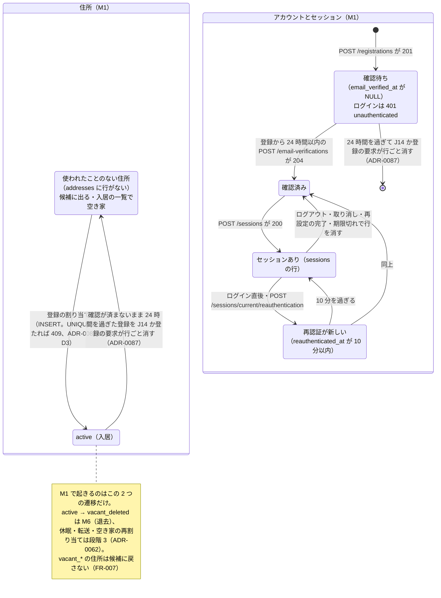

# M1 の住所と認証の状態遷移図

M1 で起きる住所（`addresses.status`）の遷移と、入居の一覧での読み方、アカウントの確認とセッションの状態。全体の住所の遷移は `db.md` §4 の状態遷移図。

- FR: FR-001, FR-007, FR-010, FR-092, FR-098, FR-100, FR-115
- ADR: 0060, 0062, 0080, 0082, 0084, 0087, 0089, 0090
- 確かめた M: M1

## 読み方

- 入居の一覧は `active`・`dormant` を入居、行がない住所と `vacant_*` を空き家と読む（ADR-0084 の D13）。M1 で出るのは行がない住所と `active` だけ。
- パスワード・メールアドレスの変更は再認証が新しいときだけ受ける（ADR-0090 の D5）。パスワードの変更は今のセッションのほかの行を消す（ADR-0090 の D4）。
- 確認待ちの登録が住所を押さえるのは登録（`credentials.created_at`）から 24 時間で、確認のリンクも同じ時刻に切れる（ADR-0087）。期限を過ぎてから J14 が消すまでの間（最長で登録から約 48 時間）、住所は `active` のままで入居と出る。
- セッションの列（`token_hash`・`reauthenticated_at`・`second_factor_at`・`invalidated_at`・`expires_at`）は `db.md` §2 の `sessions`（ADR-0089 の D1）。
