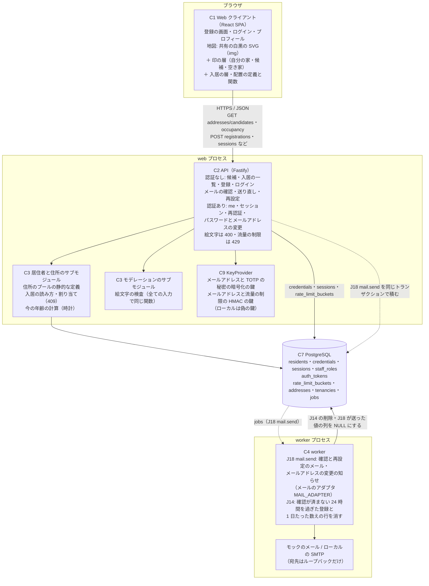

# M1 のコンポーネント図（F-01・F-02・F-19）

M1 で動くコンポーネントと、そのあいだの呼び出し。ID は `architecture.md` §2 の C1〜C13 と同じ。M1 で使わない C4 のジョブ・C5〜C13 の大半は描かない（全体の図は `architecture.md` §3）。

- FR: FR-001, FR-002, FR-003, FR-007, FR-010, FR-091, FR-092, FR-098, FR-100, FR-103, FR-113, FR-114, FR-115, FR-124, FR-127
- ADR: 0010, 0033, 0061, 0062, 0070, 0080, 0082, 0083, 0084, 0087, 0088, 0090, 0093, 0100, 0101
- 確かめた M: M1

## 読み方

- 地図の画像・配置の定義は C1 の静的なファイルで、地図のための API は入居の一覧だけ。DB の地図の表と、座標を返す経路はない（ADR-0083 の D3）。
- C2 は登録の住所が候補かどうかを確かめない。プールにない住所は 400、C3 が割り当てられない住所は 409（ADR-0082 の D3）。
- 点線の経路（web が確認と再設定のメールを worker に渡す）は J18 `mail.send`（`async.md` §2 の J18 の行・§4 J18）。web が登録・送り直し・再設定の依頼・メールアドレスの変更の要求と確認と同じトランザクションで `jobs` に積み、ペイロードは `{kind, auth_token_id}` だけ（`security.md` T-03）。トークンと前のアドレスは `auth_tokens` の列に `EMAIL_KEYRING` で暗号化して置き、worker が復号して送る（ADR-0101 の D7。`RESET_TOKEN_SIGNING_KEY` は web だけ、`environment.md` §8.1）。
