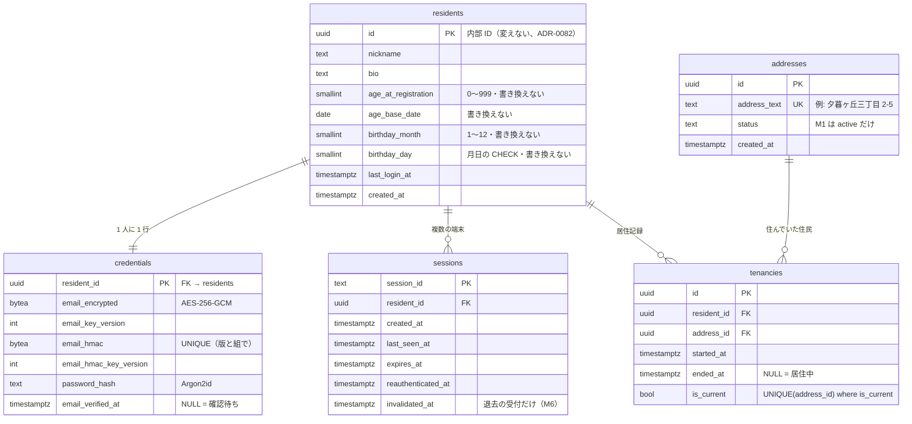

# M1 の ER 図

M1 で作る表と、そのあいだの関係。列の正本は `db.md` §2（`residents`・`credentials`・`addresses`・`tenancies`）と `security.md` §3.3（`sessions`）。M1 で使わない列（休眠・転送の列）は描かない。

- FR: FR-001, FR-002, FR-003, FR-008, FR-009, FR-092, FR-098, FR-100, FR-113, FR-127
- ADR: 0073, 0080, 0081, 0082, 0084
- 確かめた M: M1

## 読み方

- 街のすべての住所は C3 の住所のプールの静的な定義が持ち、`addresses` の行は初めて割り当てたときに作る（ADR-0084 の D15）。地図の表はない（ADR-0083 の D3）。
- `sessions` の表の定義は `db.md` §2 にまだない（`reviews/0001-design-review.md` の R-025）。列は `security.md` §3.3 の項目から描いた `[assumed]`。
