# M1 の ER 図

M1 で作る表と、そのあいだの関係。列の正本は `db.md` §2（`residents`・`credentials`・`sessions`・`staff_roles`・`auth_tokens`・`rate_limit_buckets`・`addresses`・`tenancies`）。M1 で使わない列（休眠・転送の列）は描かない。

- FR: FR-001, FR-002, FR-003, FR-008, FR-009, FR-010, FR-092, FR-098, FR-100, FR-113, FR-127
- ADR: 0073, 0080, 0082, 0084, 0087, 0088, 0089, 0090, 0091
- 確かめた M: M1

```mermaid
erDiagram
    residents ||--|| credentials : "1 人に 1 行"
    residents ||--o{ sessions : "複数の端末"
    residents ||--o{ staff_roles : "モデレーターだけ"
    residents ||--o{ auth_tokens : "確認と再設定のリンク"
    residents ||--o{ tenancies : "居住記録"
    addresses ||--o{ tenancies : "住んでいた住民"

    residents {
        uuid id PK "内部 ID（変えない、ADR-0082）"
        text nickname
        text bio
        smallint age_at_registration "0〜999・書き換えない"
        date age_base_date "書き換えない"
        smallint birthday_month "1〜12・書き換えない"
        smallint birthday_day "月日の CHECK・書き換えない"
        timestamptz last_login_at
        timestamptz created_at
    }
    credentials {
        uuid resident_id PK "FK → residents"
        bytea email_encrypted "AES-256-GCM"
        int email_key_version
        bytea email_hmac "UNIQUE（版と組で）"
        int email_hmac_key_version
        text password_hash "Argon2id"
        timestamptz email_verified_at "NULL = 確認待ち（24 時間で消える、ADR-0087）"
        bytea totp_secret_encrypted "モデレーターだけ・NULL 可"
        int totp_key_version
        timestamptz totp_enabled_at
        bigint totp_last_step
        timestamptz created_at "確認の期限の起点"
    }
    sessions {
        uuid id PK "一覧で見せる識別子"
        bytea token_hash UK "Cookie の値の SHA-256"
        uuid resident_id FK
        timestamptz created_at
        timestamptz last_seen_at
        timestamptz expires_at "least(作成 + 90 日, 最終操作 + 30 日)"
        timestamptz reauthenticated_at
        timestamptz second_factor_at "NULL = 二要素認証まだ"
        timestamptz invalidated_at "退去の受付だけ（M6）"
    }
    staff_roles {
        uuid resident_id PK "FK → residents"
        text role PK "moderator だけ"
        timestamptz granted_at
        text granted_by "運用者の CLI の作業者"
    }
    auth_tokens {
        uuid id PK
        bytea token_hash UK "HMAC（トークンの平文を持たない）"
        uuid resident_id FK
        text purpose "email_verification / password_reset / email_change"
        bytea new_email_encrypted "email_change だけ"
        int new_email_key_version
        timestamptz created_at
        timestamptz expires_at "確認は登録から 24 時間・再設定は 30 分"
        timestamptz used_at "NULL = まだ"
    }
    rate_limit_buckets {
        bytea key PK "HMAC（主体の平文を持たない）"
        timestamptz window_start PK
        int count
        timestamptz updated_at
    }
    addresses {
        uuid id PK
        text address_text UK "例: 夕暮ヶ丘三丁目 2-5"
        text status "M1 は active だけ"
        timestamptz created_at
    }
    tenancies {
        uuid id PK
        uuid resident_id FK
        uuid address_id FK
        timestamptz started_at
        timestamptz ended_at "NULL = 居住中"
        bool is_current "UNIQUE(address_id) where is_current"
    }
```

## 読み方

- 街のすべての住所は C3 の住所のプールの静的な定義が持ち、`addresses` の行は初めて割り当てたときに作る（ADR-0084 の D15）。地図の表はない（ADR-0083 の D3）。
- `rate_limit_buckets` は住民を指さないので、関係の線を引かない。J14 が 1 日たった行を消す（ADR-0089 の D4）。
- メールの確認が済まないまま 24 時間を過ぎた登録は、`auth_tokens` → `resident_interests` → `tenancies` → `addresses` → `credentials` → `residents` の順に行ごと消える（ADR-0087 の D4・ADR-0091 の D14）。期限を過ぎた `auth_tokens` の行も J14 が消す。
