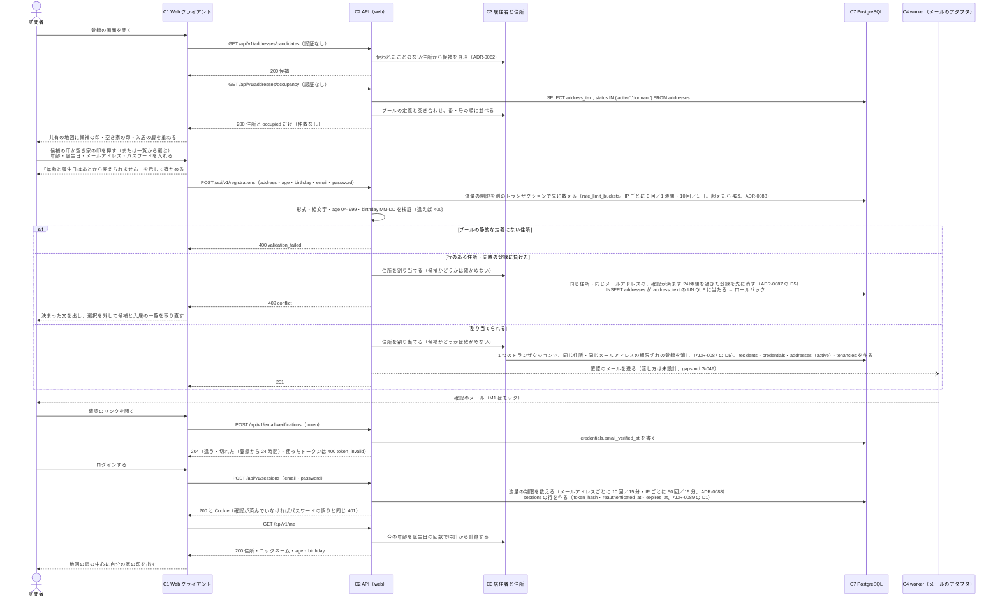

# M1 の主な流れ: 地図で住所を選んで登録し、確かめてログインする（シーケンス図）

M1 の中心の一続き（候補と入居を見る → 地図で選ぶ → 登録 → メールの確認 → ログイン → 地図で自分の家を見る）。経路と状態コードは `api.md` §7 F-01・F-02・F-19。

- FR: FR-001, FR-002, FR-007, FR-010, FR-091, FR-092, FR-098, FR-103, FR-113, FR-114, FR-115, FR-124, FR-127
- ADR: 0030, 0062, 0070, 0073, 0080, 0082, 0083, 0084, 0087, 0088, 0089, 0090
- 確かめた M: M1

## 読み方

- 確認が済まない登録が住所を押さえる期限と、確認のリンクの期限は、どちらも登録から 24 時間（ADR-0087、OQ-046 → 決定）。送り直しても延びない。期限を過ぎた登録は J14 が行ごと消す。
- 流量の制限の値と対象の経路は `security.md` §3.5 の表（ADR-0088）。
- 登録の画面が呼ぶ API は候補と入居の一覧の 2 つだけ。地図の画面は `me`・候補・入居の一覧と、M2 から住所録を呼ぶ（ADR-0084 の D4・D5）。
