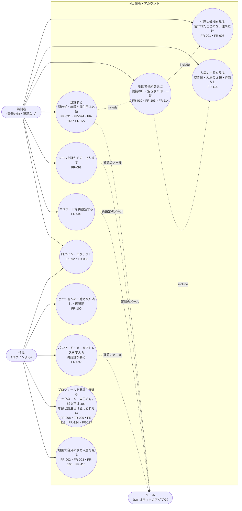

# M1 のユースケース図（F-01・F-02・F-19）

M1（住所・アカウント）で住民と訪問者ができること。範囲は `roadmap.md` §4 の M1 の行と `api.md` §7 F-01・F-02・F-19。

- FR: FR-001, FR-002, FR-003, FR-007, FR-008, FR-009, FR-010, FR-091, FR-092, FR-094, FR-098, FR-100, FR-103, FR-113, FR-114, FR-115, FR-124, FR-127
- ADR: 0030, 0057, 0061, 0062, 0070, 0080, 0082, 0083, 0084, 0090, 0093
- 確かめた M: M1

## 読み方

- M1 に入れないもの: 知り合いの家の印（M2）、ほかの住民への年齢の表示（M3）、ニックネームと自己紹介の絶対NG（422 `content_rejected`、M4）、退去 `DELETE /me`（M6）、空き家を候補に戻すこと（段階 3、`roadmap.md` §6 S3-1）。
- メールを送るのは worker（`environment.md` §8.1 の `MAIL_ADAPTER` は worker だけ）。確認・送り直し・再設定・メールアドレスの変更のメールと、変更の確認のあとの前のアドレスへの知らせは、web が要求と同じトランザクションで積むジョブ J18 `mail.send` で worker に渡す（`async.md` §4 J18）。
