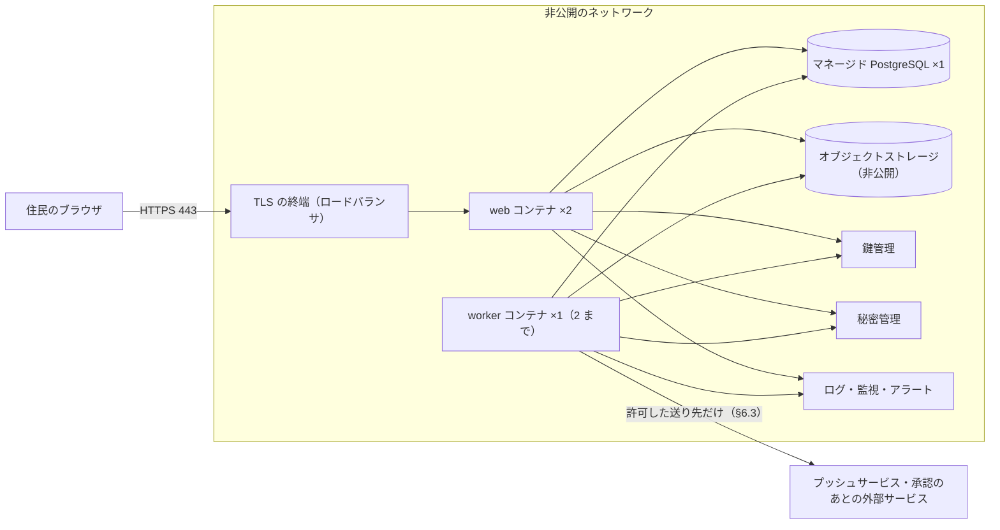

# 開発・検証環境の構築計画（スタックの計画と IaC の設計）

- 状態: 草案
- 日付: 2026-11-21
- チケット: YGO-009
- 根拠: `.ai/brief.md`・`requirements.md`（NFR-058・NFR-063・NFR-065・NFR-067・NFR-071〜NFR-080・NFR-091・NFR-092）・`architecture.md`・`async.md`・`db.md`・`security.md`・`roadmap.md`・ADR-0006・0009〜0012・0021・0033・0076・0085・0086・0100
- 関連 ADR: 0052（ローカルの開発と `check.sh` の環境・IaC は OpenTofu で設計だけ）・0068（使い終わった道具は片付ける）・0106（依存を足す・変える変更ごとのロックファイル）・0109（CI は prepare.sh のあとに check.sh、CI の定義は秘書の決まった形の check.yml）

---

## §1 方針

1. **デプロイ・IaC の適用・クラウドの契約はしない** [explicit]（NFR-071・NFR-072・NFR-076、構想「デプロイはしない」）。
   この文書に書くのはスタックの計画と IaC の設計までで、クラウドのアカウント・ドメイン・外部サービスを使う手順は書かない。
   本番と検証環境（staging）は設計だけで、作らない。作るとき（デプロイの準備）は、費用と契約をマスターが事前に承認する（NFR-080・NFR-087）。
2. **事業者を選ばない** [inferred]（NFR-080。費用と契約にかかわる）。本番の事業者（クラウド・鍵管理・秘密管理・ログ）は、デプロイの準備のときにマスターに聞く（OQ-085、持ち越し）。
   設計は事業者の名前を使わず、役割（マネージドの PostgreSQL・S3 互換のオブジェクトストレージ・鍵管理・秘密管理）で書く。
3. **手元で再現できる** [inferred]（NFR-058・NFR-067）。開発とテストは、ネットワークなしで、手元に入れた道具だけで動く。`sh scripts/check.sh` がすべての確認の入り口（NFR-063）。
4. **外部サービスはアダプタの裏に置く** [inferred]（NFR-065・`roadmap.md` §1 の 4）。開発とテストはモック・偽の値・ローカルのアダプタだけを使い、本番のアダプタは承認のあとに作る（ADR-0086・ADR-0033）。
5. **秘密はレポジトリと IaC の状態に入れない**。認証情報をコミットしないことは [explicit]（CLAUDE.md「公開レポジトリ」・NFR-083）、
   コードに含めず環境変数か秘密管理で渡すこと（NFR-016）と IaC の状態にも入れないこと（§7.3）は [assumed]（構想にはなく、この設計で決めた）。偽の値は本物と見分けがつく形にする（`EXAMPLE_..._DO_NOT_USE`・`example.invalid`、NFR-066）。

---

## §2 環境の一覧

| 環境 | `APP_ENV` | 今あるか | 何に使うか | 外部サービス |
|------|-----------|----------|------------|--------------|
| 開発 | `development` | 作る（M0） | 手元で web・worker・クライアントを動かす | 使わない。メールはモックかローカルの SMTP（宛先はループバックだけ、ADR-0033） |
| テスト | `test` | 作る（M0） | `sh scripts/check.sh` と CI。使い捨ての PostgreSQL（§4） | 使わない。ネットワークなし |
| 検証環境 | `staging` | 設計だけ（§6・§7） | 本番と同じ構成を小さく作り、IaC と復元の練習を確かめる | 作るかどうかと費用は OQ-085 |
| 本番 | `production` | 設計だけ（§6・§7） | 住民が使う | 承認のあとの本番のアダプタだけ |

- `APP_ENV` が `development` か `test` のとき、プロセスは偽の鍵とモックのアダプタだけを読み込む。
  `staging` か `production` のとき、偽の鍵（`EXAMPLE_` で始まる値）を見つけたらプロセスは起動に失敗する [assumed]。
- 本番のアダプタ（LLM・メール・外のニュース）は、まだ作らない（ADR-0086・ADR-0033・OQ-060）。`staging`・`production` の設定は、それができるまで使わない。

---

## §3 ローカルの開発環境（`development`）

### §3.1 要る道具

| 道具 | 版の決め方 | 理由 |
|------|-----------|------|
| Node.js | 主版 26（2026-11 の Active LTS）`[assumed]`。`package.json` の `engines.node` に `26.x` と書く（YGO-078）| ADR-0009。CI とジョブの環境にはマスターが入れる（OQ-086 → 決定）。秘書は「マスターが用意するもの」の表の主版をマスターに伝える |
| npm | Node.js に付くもの。依存はロックファイルで固定する | 依存を変えるときは `scripts/prepare.sh` とマニフェスト・ロックファイルを同じ変更で直す。ロックファイルは、依存を足す・変える変更ごとに、その変更の中で `npm install --package-lock-only --ignore-scripts` で作り・直し、`package.json` と同じ変更に入れる（最初のロックファイルも同じ。ADR-0106 の D1。作れなければ D2） |
| PostgreSQL | サーバーの主版 18 `[assumed]`。本番のマネージドサービスでも同じ主版を選ぶ（「マスターが用意するもの」の表） | ADR-0010。手元の OS に入れたもの（`initdb`・`pg_ctl`・`psql` がパスにある）を使う。CI とジョブの環境にはマスターが入れる（OQ-086 → 決定） |

コンテナの実行環境（コンテナのエンジンや Compose）は要らない（ADR-0052 の D2）。手元に入れた PostgreSQL を、レポジトリが管理する場所で動かす。

### §3.2 起動の手順（M0 で台本を作る）

1. `npm ci`（ネットワークを使うのは、`prepare.sh` の `npm ci` と IaC のコードを書いたあとの `tofu init -backend=false`（ADR-0052 の D3・D6）のほかは、例外として依存を足す・変える変更ごとにロックファイルを作り・直す `npm install --package-lock-only --ignore-scripts`（ADR-0106）だけ）。
   - 秘書のジョブでは `npm ci` を `sh scripts/prepare.sh` が行う（YGO-062）。`package.json` がないときは何も入れずに終了コード 0 で終わる。`npm` がないときは「検証の環境に Node.js を入れる」と出して止まる。
   - `prepare.sh` は、`package.json` があり `package-lock.json` がないときはロックファイルを作らず、「依存を変える変更の中でロックファイルを作ってコミットする」と出して終了コード 1 で止まる。ロックファイルがあるときは `npm ci` だけを動かす（ADR-0106 の D3）。
   - 例外の `npm install --package-lock-only --ignore-scripts` は、依存を足す・変える変更ごとに、その変更の中で 1 回試し、できた（直った）ロックファイルを `package.json` と同じ変更でコミットする。終える前に `sh scripts/prepare.sh` と `sh scripts/check.sh` がどちらも終了コード 0 で終わることを確かめる（ADR-0106 の D1）。作れなかったら、ロックファイルを手で書かず・手で直さず、止まった段とエラーの行をチケットに書いて、それまでのファイルを変更として出す（ADR-0106 の D2）。`sh scripts/check.sh` はネットワークなしのまま（NFR-063）。
2. 開発の DB を起こす: `sh scripts/dev-db.sh start`。
   - 初めてのときだけ `initdb` で、レポジトリの中の無視するディレクトリ（`.local/pg/`。M0 で `.gitignore` に `.local/` を足す）にデータを作る。
   - 待ち受けはループバック（`127.0.0.1`）と `.local/pg/` の中の Unix ソケットだけ。認証はソケットの `peer` か、ループバックの `scram-sha-256` に偽のパスワード（`EXAMPLE_DB_PASSWORD_DO_NOT_USE`）。
   - データベース `yuguregaoka_dev` を作り、マイグレーションを当てる。
   - `sh scripts/dev-db.sh stop` で止め、`reset` で `.local/pg/` を消して作り直す。`clean` は止めて `.local/pg/` を消し、作り直さない。
   - ジョブで起こしたら、ジョブの終わりまでに web・worker・開発サーバーを止めて `clean` する（§4.4）[assumed]。
3. 3 つのプロセスをそれぞれの端末で起こす:

| プロセス | コマンド（M0 で決める名前）| エントリポイント | 待ち受け |
|----------|----------------------------|------------------|----------|
| web | `npm run dev:web` | `src/server.ts`（ADR-0100）| `127.0.0.1:3000` |
| worker | `npm run dev:worker` | `src/worker.ts`（ADR-0100）| 待ち受けない（DB だけに繋ぐ） |
| クライアントの開発サーバー | `npm run dev:client` | Vite | `127.0.0.1:5173`。`/api` を web へ中継する |

- 本番に近い形で確かめるときは、`npm run build` でクライアントを静的なファイルにし、web がそれを配る（ADR-0009）。
- worker の時計は外から差し替えられる（`roadmap.md` M0。作るのは YGO-080）。開発では `CLOCK_OFFSET` で時刻をずらし、配達回の流れ（`async.md` §3）を手元で早回しで見られるようにする [assumed]。

### §3.3 開発でのアダプタ

| 要素 | 開発・テストのアダプタ | 本番（設計だけ）|
|------|------------------------|-----------------|
| C9 KeyProvider（ADR-0006・ADR-0021）| 偽の鍵。鍵の変数には文字列 `EXAMPLE_KEY_DO_NOT_USE:<用途>:<版>` をそのまま置き、KeyProvider がその SHA-256 から版ごとの 32 バイトの鍵を作る（変数の値が `EXAMPLE_` で始まるので、§2 の起動の検査で見分けられる） | 鍵管理のサービスで包んだデータ鍵（§8.3） |
| C8 オブジェクトストレージ | ファイルのアダプタ（`.local/storage/`）。テストは一時ディレクトリ | S3 互換の非公開のバケット |
| メール（ADR-0033）| モック（送った文面を記録する）か、ローカルの SMTP（宛先は `localhost`・`127.0.0.1`・`::1` だけ。ほかを設定すると起動に失敗）| 承認のあとに作る（OQ-049）|
| C5 の LLM の分類器・C12 の文章アダプタ（ADR-0086・ADR-0039）| モック。決まった答え・失敗・打ち切りを返せる | 承認のあとに作る（OQ-047・OQ-062）|
| C13 外のニュース | 偽の記事のアダプタ（`EXAMPLE_NEWS_DO_NOT_USE`）| OQ-060 のあと |
| C11 Web Push（ADR-0076）| モックのプッシュ送信（送った中身を記録する）。プッシュサービスに送らない | 許可したホストだけに送る（§6.4）|
| 時計 | 差し替えられる時計 | 実時間（JST に固定して扱う）|

ローカルの SMTP のサーバーそのものは、レポジトリに含めない。使う人が手元に入れたものを、ループバックで待ち受けさせる。受け入れ条件はモックで確かめる（ADR-0033 の D4）。

---

## §4 テストと `check.sh`（`test`）

### §4.1 `check.sh` の流れ（コードができてから足す）

`check.sh` は 1・2・6・7 を動かす（YGO-062）。1 と 6 は `package.json` があるときだけ動く。4・5 は YGO-076 で足す。3 は M1 の TC が依存しないため M1 のチケットにせず、ここに残す `[assumed]`（M1 の TC はどれも型の検査と lint の結果を確かめない）。

1. **Node.js を確かめる**（YGO-062）: `node` のコマンドがあるかと、その主版が `package.json` の `engines.node` と合うかを確かめる。足りなければ、要る主版と「検証の環境に Node.js を入れる」を出して**失敗する**（飛ばさない）。
   - 続けて、`package-lock.json` があることと、`package.json` の依存の名前がどれもロックファイルにあり版に `^`・`~` がないことを確かめる（ADR-0106 の D1）。
   - Node.js は `check.sh` を動かす機械（手元・CI・秘書のジョブの環境）にあらかじめ入っていることを前提にする。CI とジョブの環境にはマスターが入れる（OQ-086 → 決定）。
     秘書は「マスターが用意するもの」の表を読み、Vitest を `check.sh` からつなぐ前に node があることを確かめる（`roadmap.md` §4 の M0 の依存）。
2. 文書の確認（今のまま）。
3. 型の検査と lint。
4. **使い捨ての PostgreSQL を起こす**:
   - `mktemp -d` で一時ディレクトリを作り、`initdb` でデータを置く。
   - `pg_ctl start` で起こす。`listen_addresses = ''`（TCP で待ち受けない）にし、Unix ソケットは一時ディレクトリの中に置く。ネットワークを使わない。
   - 片付けの `trap` を EXIT・INT・TERM・HUP に掛け、成功・失敗・中断のどれでも PostgreSQL を止めて一時ディレクトリを消す。止められない・消せないときは失敗する（§4.4）。
   - `initdb`・`pg_ctl` が見つからないときは、理由を出して**失敗する**（飛ばさない）。DB を使うテストは受け入れ条件（`roadmap.md` A-01〜A-19）なので、飛ばすと通ったように見えてしまう。
   - そのため、PostgreSQL のサーバーの道具は、`check.sh` を動かす機械（手元・CI・秘書のジョブの環境）にあらかじめ入っていることを前提にする。CI とジョブの環境にはマスターが入れる（OQ-086 → 決定、2026-11-21）。
     秘書は「マスターが用意するもの」の表を読み、DB のテストを足す前に道具があることを確かめる（`roadmap.md` §4 の M0 の依存）。
     `prepare.sh` は npm の依存だけを入れ（IaC のあとは `tofu init` も）、OS の道具は入れない [assumed]。
5. マイグレーションを当てたデータベースを 1 つ作り、それをひな型（`CREATE DATABASE ... TEMPLATE`）にして、テストのファイルごとにデータベースを作る [assumed]。テストどうしが互いのデータを見ない。
6. Vitest を動かす（ADR-0009）。`node_modules/` がなければ `sh scripts/prepare.sh` を先に動かすよう出して失敗する。`check.sh` は `prepare.sh` も `npm ci` も呼ばず、依存は CI と手元で `check.sh` の前に `prepare.sh` が入れる（ADR-0109 の D1・D3）。`npx --no-install vitest run` で動かし、結果を JUnit XML で `test-results/junit.xml` に書く（標準の出力の報告も残す）。XML がない・`skipped`（skip と todo）がある・名前に TC-NNN のないテストがある、のどれでも失敗する。単体・統合（DB）・API（Fastify の `inject`。ポートを開かない）・組版のスナップショット・C1 の部品のテスト（Vitest と Testing Library）。
7. 最後に `check: ok` を出す。

ブラウザを動かす端から端までのテストは `check.sh` に入れない（ブラウザの取り込みにネットワークが要る。範囲は NFR-064 のとおり実装の段階で決める）。

### §4.2 テストの値と設定

- テストの設定（`DATABASE_URL`・偽の鍵・モックの選択）は、テストの準備のコード（`test/setup.ts` など）が組み立てて渡す。`.env.test` のファイルは使わない。
  （`.env*` はこのレポジトリでは秘書の変更の外で、レポジトリにも置かない。CLAUDE.md・NFR-091）
- 偽の値: 鍵は `EXAMPLE_KEY_DO_NOT_USE`、メールは `test@example.invalid`、住所は `夕暮ヶ丘三丁目 2-5`、URL は `https://example.invalid/`、プッシュの送り先は `https://push.example.invalid/`（NFR-066・`security.md` §6.2）。
- テストの準備で、ループバックと Unix ソケットのほかへの接続を失敗させる [assumed]。間違えて外へ出る呼び出しは、テストの失敗として見つかる。

### §4.3 開発の変数の置き場

開発の変数は、各自が手元に作る `.env`（バージョン管理に含めない）に書く。中身の一覧と偽の値は §8.1 の表。
レポジトリに `.env.example` は置かない（`.env*` を秘書の変更で作れないため）。§8.1 の表がその代わり。

### §4.4 片付け（ADR-0068）

- **片付けるもの** [assumed]: `check.sh` とジョブが自分で起こしたプロセス（使い捨ての PostgreSQL・`dev-db.sh` の開発の DB・web・worker・Vite の開発サーバー）と、
  作った一時のもの（`mktemp` のディレクトリ・ソケット・ログ・レポジトリの外のファイル）。コンテナを使うときは、作ったコンテナ・イメージ・ボリューム・ネットワークも。
- **いつ**: 遅くとも `check.sh` の 1 回、ジョブの 1 回の終わりまで。成功・失敗・中断（INT・TERM・HUP）のどれでも。
- **`check.sh`** [assumed]: 片付けの関数を `trap` で EXIT・INT・TERM・HUP に掛ける。`pg_ctl stop -m fast` で止め、止まらなければ `-m immediate` で止めてから一時ディレクトリを消す。
  関数は何度呼んでも同じに動く。止められない・消せないときは理由を出して失敗する。
- **ジョブ** [assumed]: 開発の DB やプロセスを起こしたら、ジョブの終わりまでに止め、`sh scripts/dev-db.sh clean` を動かす（§3.2）。
- **片付けないもの**: マスターが入れた道具（NFR-091。使い終わっても置いたままにする、OQ-090 → 決定）・ジョブの間の `node_modules/` [assumed]・`check.sh` の結果の `test-results/`（次の `check.sh` の始めに消して作り直す。コミットしない）[assumed]・マスターの手元の `.local/pg/` [assumed]。
- 受け入れ確認は `roadmap.md` の A-01。

---

## §5 CI の計画

- **CI の設定のファイルはジョブの変更の外**（NFR-091・CLAUDE.md）。CI の定義は秘書の CI の決まった形 `.github/workflows/check.yml` で、入れるのは秘書（ADR-0109 の D2）。ジョブは書かない・変えない。ここは計画だけ。
  NFR-091 と CLAUDE.md の「変えないもの」はジョブ（秘書の変更のジョブ）の変更の決まりで、秘書が決まった形の `check.yml` をプロジェクトに入れること（CLAUDE.md の作り方の節）を止めない。CI の実行の環境に道具を入れるのはマスター（OQ-086 → 決定）。
- CI の仕事は 1 つ: レポジトリを取り出す → `sh scripts/prepare.sh`（依存の取り込み。CI でネットワークを使うのはここだけ。CI ではロックファイルを作らず、コミットしたものを `npm ci` で使う。ロックファイルを作り・直す例外は依存を足す・変える変更の中だけ、ADR-0106）→ `sh scripts/check.sh`。この順は ADR-0109 の D1 で、M1 のテストは Vitest と npm の依存で書くため、`prepare.sh` の段がないと `check.sh` は `node_modules/` がないとして失敗する。
  秘書の `check.yml` が、`sh scripts/prepare.sh` の段を `sh scripts/check.sh` の前に置く（ADR-0109 の D2）`[assumed]`。決まった形が `check.sh` だけを動かすなら CI は緑にならず M1 の達成を止めるので、段を足すことを秘書に伝える（G-079）。今はレポジトリに `.github/` がなく、`.ai/gaps.md` の G-079 を YGO-101 で追う。YGO-101 は秘書が `check.yml` を入れるのを待ち、そのあとで読んで確かめた事実を G-079 に記録し、この段落と準備書を今の状態に書き直す。`sh scripts/prepare.sh` の行が `sh scripts/check.sh` の行より前にあれば G-079 を閉じ、段がないか後ろにあれば閉じずに秘書に伝え、題に G-079 を付けた続きのチケットを切る `[assumed]`（ADR-0109 の D6・D8 から導いた暫定。D4 の決定は変えない）。CI の定義に段があることはどのチケットの受け入れ確認にも入れない（ADR-0109 の D4・D6）。CI が緑かは M1 の達成の確認で見る。
  Node.js と PostgreSQL のサーバーの道具は、CI の実行の環境（イメージ）にあらかじめ入れておく（§4.1）。マスターが入れる（OQ-086 → 決定）。入れた道具は使い終わっても置いたままにする（OQ-090 → 決定、§4.4）。マスターが用意する道具と主版は「マスターが用意するもの」の表にある。
  `check.sh` の中身は手元と同じで、CI だけの確認を作らない。
- **ジョブがコマンドを動かす権限**: 道具を入れること（下の表、OQ-086）とは別に、秘書の実装のジョブに許すものは次の 1 つの一覧で、文書どうしでこれを使う: コマンドを動かす道具（Bash）・`node -v`・`npm --version`・`npm_config_cache` を付けた `npm install --package-lock-only --ignore-scripts`・`sh scripts/prepare.sh`・`sh scripts/check.sh`。許すのは秘書（ジョブの実行の設定で、許すコマンドに足す）で、マスターの道具の用意とは分ける `[assumed]`。今の状態: 実装のジョブでは、コマンドを動かす道具（Bash）と `node -v`（`v26.13.1`、主版 26）・`sh scripts/check.sh`（`check: ok`、終了コード 0）は動き、`npm --version` と `sh scripts/prepare.sh` は拒まれた（変更 20261128-c35a9e の実装のジョブで 1 つずつ動かした。記録は YGO-088 の「止まっている理由」の節）。`npm_config_cache` を付けた `npm install --package-lock-only --ignore-scripts` は、実装のジョブではまだ動かしていない（許されているかは確かめていない）。実装のジョブでの `npm --version` の主版は、まだ確かめていない。秘書が許すのは、この残りの 3 つで、計画の段階の権限とは別に、実装のジョブの実行の設定で、拒まれた 2 つとまだ動かしていない 1 つを許すルールを足す。これが YGO-078（`package.json` とロックファイル）を止めている（止まった回数と変更は `.ai/gaps.md` の G-082 にだけ置く。G-080・G-082。準備書 `.ai/deploy/readiness.md` §4 で追う。許したあと、実装のジョブで一覧が動くのを確かめるのは YGO-088）。計画の段階では `node -v`・`npm --version`・`sh scripts/prepare.sh`・`sh scripts/check.sh` の 4 つとも動き、`npm --version` が `11.20.0` を返し、レジストリ `https://registry.npmjs.org/` に届いた。`11.20.0` は計画の段階の値で、実装のジョブの主版の根拠にはならない（計画の段階で動いたコマンドは、実装のジョブで動く根拠にならない）。npm は入っていて、許されるものが段階ごとに違う。ジョブでは既定の npm のキャッシュ（ホームの下）に書けないため、npm のコマンドには `npm_config_cache` に一時ディレクトリを渡す `[assumed]`。npm が許されないあいだは、実装のジョブでロックファイルを作れない（ADR-0106 の D2）。`check.sh` は動くが、`package.json` がないので Node.js の依存・ロックファイル・Vitest の段は、動かして確かめられない。
- `check.sh` が起こしたものは `check.sh` 自身が片付ける（§4.4）。CI だけの片付けの手順を作らない。
- CI に秘密を登録しない。テストは偽の値だけで通る（§4.2）。外からの変更の提案でも同じに動く。
- CI からデプロイ・IaC の適用（`tofu apply`）・クラウドへのログインをしない。IaC の確認は、IaC のコードを書いたあと、`prepare.sh` が `tofu init -backend=false` でプロバイダを取り込み、`check.sh` が `tofu fmt -check` と `tofu validate` をネットワークなしで動かす（ADR-0052 の D6）。
- `develop` へのマージはマスターの承認（NFR-086）で、CI の結果はその材料にする。

### §5.1 マスターに伝える道具の一覧

マスターが用意する道具と主版は、この文書の最後の「マスターが用意するもの」の表にある（CI の定義の `sh scripts/prepare.sh` の段は §5 の本文）。

---

## §6 想定する本番の構成（設計だけ）

### §6.1 構成



- web は C1 の静的なファイルと C2 の API を配る（ADR-0009）。CDN は置かない [assumed]（規模は ADR-0012 で足り、作るものを増やさない、NFR-055）。
- 外から届くのはロードバランサの 443 だけ。DB・オブジェクトストレージ・worker は外から届かない。
- 運用者の CLI（モデレーターのロール・商店のアカウント・鍵の入れ替え）は、worker と同じイメージを、その場限りの作業として非公開のネットワークの中で動かす [assumed]。

### §6.2 大きさ（すべて [assumed]、ADR-0012 の規模から）

| 要素 | 台数 | 1 台の大きさ | 根拠 |
|------|------|-------------|------|
| web | 2 | 1 vCPU・1 GiB | ピークの同時接続 500 程度。2 台は入れ替えのあいだも止めないため |
| worker | 1（2 まで）| 2 vCPU・2 GiB | 組版（版は興味の数 + 1 で、住民の数では増えない、ADR-0039）と J4 の準備（1 配達回で最大約 20 万通）。2 台にしても `singletonKey` と advisory lock で 1 回分しか動かない（`async.md` §5）|
| PostgreSQL | 1 | 2 vCPU・8 GiB・SSD 50 GiB から（自動で広げる）| 平常の手紙 1 日 2 万通（1 人 2 通）× 1 通 約 1.5 KB で年に約 11 GB。郵便受けと索引を足して余裕を見る |
| DB の接続 | — | web 1 台 10・worker 1 台 10（pg-boss を含む）| web 2 台と worker 2 台で合わせて 40 まで。運用者の CLI の分を足しても `max_connections` の 100 に収まる |
| オブジェクトストレージ | 1 バケット（用途で接頭辞を分ける）| — | 紙面の HTML（`newspapers/`）・消去の控え（`erasure/`、住民の ID と受付の時刻だけ、60 日。ADR-0096 の D3・D5）。段階 2 で画像（`images/`） |

### §6.3 外への通信

- web は外部へ出ない。DB・オブジェクトストレージ・鍵管理・秘密管理・ログへは非公開の経路で繋ぐ [assumed]。
- worker が外へ出るのは許可した送り先だけ。アプリの検査（ADR-0076 の D6・`async.md` J17）に加えて、ネットワークの出口の許可の一覧でも止める（二重にする。`security.md` T-16・T-19）。

| 送り先 | 使うジョブ | いつから |
|--------|-----------|----------|
| プッシュサービス（§6.4）| J15 | デプロイのとき |
| 外部の LLM の API | J2・J16 | 承認のあと（OQ-047・OQ-062）|
| 外のニュースの配信元 | J17 | OQ-060 のあと |
| メール送信サービス | J12 と確認メールなど | 承認のあと（OQ-049）|

### §6.4 プッシュサービスの許可のホストと VAPID の鍵（ADR-0076 の D6 と「決めていないこと」）

- **許可のホスト**: 設定 `PUSH_ALLOWED_HOSTS` に、カンマ区切りでホスト名を持つ。一致は完全一致だけで、先頭に `.` を付けた値だけを「そのホストの下のすべて」として扱う。IP アドレスとワイルドカード `*` は受け付けない（起動に失敗する）。
  web（購読の登録の検査、400）と worker（送る前の検査）の両方が同じ値を読む。
- 値は IaC の環境ごとの変数に置き、デプロイの準備のときに、主なブラウザが公開しているプッシュサービスのホストを入れる（デプロイしない間は空）。テストの値は `push.example.invalid`。
- **VAPID の鍵**: 秘密鍵は秘密管理に置き、worker だけに渡す（`VAPID_PRIVATE_KEY`、`security.md` §6.1）。公開鍵（`VAPID_PUBLIC_KEY`）は秘密でない設定で、web（`/api/v1/notifications/public-key` で返す）と worker に渡す。
  開発とテストはモックのプッシュ送信なので、偽の値（`EXAMPLE_VAPID_KEY_DO_NOT_USE`）でよい。

### §6.5 バックアップと復元（`db.md` §6）

- マネージドの PostgreSQL の自動のバックアップ（毎日の全体）と、その間の時点に戻せる記録（WAL）を **30 日**持つ（ADR-0091）[assumed]。バックアップは鍵管理の鍵で暗号化する。
- バックアップは同じ事業者の別の地域にも写す [assumed]（地域全体の障害に備える。費用は §9）。
- 復元の練習は検証環境で行う（月に 1 回 [assumed]、検証環境を作るなら。OQ-085 (2)）: バックアップを検証環境に戻す → 本番の消去の控え（`erasure/`）を検証環境のバケットに写す [assumed] → web を止めたまま `erasure.replay` を動かし、積んだ J7 と J14 が終わってから web を戻す → 退去した住民のデータが戻っていないことを確かめる（`async.md` §4 `erasure.replay`・§6・`security.md` T-13、ADR-0096 の D4）。本番に戻すのは運用者の手作業で、手順は `report.md` に書く（NFR-075）。
- オブジェクトストレージは版を持たせず、紙面は DB の `newspapers` から組み直せる（ADR-0098）。消した画像を戻さないため、オブジェクトストレージのバックアップは作らない [assumed]。DB を戻しても消去の控え（`erasure/`）は巻き戻らず、再生に使える（ADR-0096 の D3）。
- 鍵との関係: バックアップの中の手紙は、そのときの鍵の版で暗号化されている。古い版の鍵は、再暗号化が終わってもバックアップの保持の 30 日のあいだは復号のためだけに残し、そのあとに消す（§8.3）。

### §6.6 監視とアラート（`async.md` §7・NFR-074）

- ログは 1 行 1 件の JSON を標準出力に書き、監視のサービスが集める。ログに残さないものは `security.md` §2.5 のとおり。保持は `db.md` のとおり。
- **アラートの出し方**: J0（5 分ごと）が `async.md` §7 の監視項目を調べ、外れていれば `alert=<項目の名前>` を含む決まった形の 1 行を書く。監視のサービスがその行を拾って知らせる。
  開発とテストでは知らせずにログに書くだけで、テストはその行が出ることを確かめる。
- **J0 の心拍**: J0 は毎回 `heartbeat=delivery.tick` の 1 行を書く。15 分（3 回分）心拍がなければ、監視のサービスがアラートを出す（worker が止まったとき、J0 は自分でアラートを書けないため）。
- **閾値**（`async.md` §7 の表で、ここに任されていた行。ジョブの 4 行は `async.md` §7 にも同じ値を書いた。DB の容量はジョブでないので、ここだけに書く）[assumed]:

| 項目 | 閾値 |
|------|------|
| 古い版の行が残っているのに `keys.reencrypt` のジョブがない（§8.3） | J0 が 2 回続けて（10 分）見たら |
| J16 で `written_by = 'template'` になった記事の割合 | 1 配達回で **20%** を超えたら（記事が 10 件より少ない回は数えない）|
| pg-boss の `failed` のジョブ | J1〜J6・J15 は 1 件でも。ほかのジョブは 24 時間で 10 件以上 |
| J0 の心拍 | 15 分ない |
| DB の容量 | 80% を超えたら |

- **知らせる先**: 運用者の連絡の窓口 1 つ（メールかチャットの受け口）を監視のサービスに登録する。どこにするか・誰が受けるかは、デプロイの準備のときにマスターに聞く（OQ-085 (4)）。デプロイしない間は置かない。
- `security.md` §7.1 の検知の指標は、数をログに書いて同じ仕組みで集める。どの値で知らせるかは OQ-075 で決める。

---

## §7 IaC の設計（書くだけで、適用しない）

### §7.1 道具

**OpenTofu**（HCL で書く宣言の IaC）を使う（ADR-0052 の D4）。IaC のコードはまだ書かない。事業者が決まって（OQ-085）、デプロイの準備をマスターが承認してから書く（ADR-0052 の D5）。

### §7.2 ディレクトリとモジュール

```
infra/
  modules/
    network/          非公開のネットワーク・出口の許可の一覧・ロードバランサ
    identity/         web・worker・運用者の CLI・IaC の実行のそれぞれの権限
    database/         マネージド PostgreSQL・バックアップ 30 日・別の地域への写し
    object_storage/   非公開のバケット・暗号化・公開の禁止
    keys/             手紙・メールアドレスの鍵（鍵管理）
    secrets/          秘密の入れ物（値は入れない）
    web/              web のコンテナ・台数・環境変数・秘密の参照
    worker/           worker のコンテナ・台数・環境変数・秘密の参照
    monitoring/       ログの集め方・アラートの規則（§6.6）・知らせる先
  envs/
    staging/          モジュールを小さい大きさで呼ぶ
    production/       モジュールを §6.2 の大きさで呼ぶ
```

| モジュール | 入力（主なもの）| 出力（主なもの）|
|-----------|-----------------|-----------------|
| network | 環境の名前・worker の出口の許可の一覧 | 非公開のネットワークの ID・ロードバランサの宛先 |
| identity | 環境の名前 | web・worker・CLI の権限の ID |
| database | 大きさ・容量・保持の日数（30）| 接続先（秘密の入れ物へ）|
| object_storage | 環境の名前 | バケットの名前 |
| keys | 環境の名前 | 鍵の ID |
| secrets | 秘密の名前の一覧（§8.1）| 秘密の参照 |
| web / worker | イメージ・台数・大きさ・秘密の参照・`PUSH_ALLOWED_HOSTS` | — |
| monitoring | アラートの閾値（§6.6）・知らせる先 | — |

- 権限は最小にする: web と worker は別の権限を持ち、`security.md` §6.1 の「保持するプロセス」の秘密だけを読める。web は LLM・外のニュース・メール・VAPID の秘密鍵を読めない（`roadmap.md` A-07）。
- web と worker に固定のアクセスキーを渡さない。オブジェクトストレージと鍵管理には、コンテナに付けた権限で繋ぐ。

### §7.3 状態（state）と秘密

- 状態は環境ごとに分け、非公開で暗号化したオブジェクトストレージに、ロック付きで置く（OpenTofu の状態の暗号化も使う）。状態のバケットは IaC の外で、運用者が最初に 1 回だけ作る。
- IaC は秘密の**入れ物**だけを作り、値は入れない。値は運用者が秘密管理の CLI で入れる。こうすると状態に秘密の値が入らない（DB の管理者のパスワードは、マネージドサービスに作らせて秘密管理に置かせる）。
- `infra/` に `*.tfvars` の本物の値を置かない。環境ごとの変数は、秘密でない値（大きさ・台数・許可のホスト）だけ。

### §7.4 適用の手順（デプロイの準備で使う。今は使わない）

1. マスターが、事業者・費用の上限・検証環境の有無を承認する（OQ-085・NFR-080）。
2. 運用者が `tofu plan` を手元で動かし、変更の一覧をマスターに見せる。
3. 承認のあと、運用者が `tofu apply` を動かす（CI から自動では適用しない）。先に検証環境、次に本番。
4. 秘密の値を入れ（§8.2）、web と worker を起こす。

---

## §8 秘密情報の扱い（`security.md` §6）

### §8.1 環境変数の一覧

「開発・テストの値」はすべて偽の値。本番の値は秘密管理か、秘密でない設定から入れる。

| 変数 | 中身 | 読むプロセス | 秘密 | 開発・テストの値 |
|------|------|-------------|------|------------------|
| `APP_ENV` | §2 の環境 | web・worker | いいえ | `development` / `test` |
| `DATABASE_URL` | PostgreSQL への接続 | web・worker | はい | ループバックか Unix ソケットの `yuguregaoka_dev`（パスワードは `EXAMPLE_DB_PASSWORD_DO_NOT_USE`）|
| `SESSION_SIGNING_KEY` | セッションの Cookie の署名の鍵 | web | はい | `EXAMPLE_KEY_DO_NOT_USE` |
| `RESET_TOKEN_SIGNING_KEY` | 確認と再設定のトークンの鍵付きハッシュ（`auth_tokens.token_hash` の HMAC、ADR-0102 の D6）の鍵 | web | はい | `EXAMPLE_KEY_DO_NOT_USE` |
| `RATE_LIMIT_HMAC_KEY` | 流量の制限の数えの `key` の HMAC の鍵（ADR-0088 の D3） | web | はい | `EXAMPLE_KEY_DO_NOT_USE` |
| `LETTER_KEYRING` | 手紙の鍵の版の一覧（本番は鍵管理で包んだデータ鍵）| web・worker | はい | 偽の鍵（§3.3）|
| `LETTER_KEY_CURRENT_VERSION` | いま暗号化に使う版 | web・worker | いいえ | `1` |
| `EMAIL_KEYRING`・`EMAIL_KEY_CURRENT_VERSION` | メールアドレスと TOTP の秘密の暗号化の鍵（版付き。`credentials`・`auth_tokens` の暗号化の列に使う。J18 が送る前のトークンと前のメールアドレスの列 `auth_tokens.mail_token_encrypted`・`old_email_encrypted` も含む、ADR-0102 の D3・D7・`async.md` §4 J18）| web・worker | はい（版の番号は いいえ）| 偽の鍵・`1` |
| `EMAIL_HMAC_KEYRING`・`EMAIL_HMAC_KEY_CURRENT_VERSION` | メールアドレスの検索の HMAC の鍵（版付き。入れ替えのあいだだけ 2 つの版を持つ）| web | はい（版の番号は いいえ）| 偽の鍵・`1` |
| `KMS_KEY_ID` | データ鍵を包む鍵管理の鍵 | web・worker | いいえ | なし（偽の鍵を使う）|
| `OBJECT_STORAGE_BUCKET` | バケットの名前 | web・worker | いいえ | なし（ファイルのアダプタ。`.local/storage/`）|
| `VAPID_PUBLIC_KEY` | Web Push の公開鍵 | web・worker | いいえ | `EXAMPLE_VAPID_KEY_DO_NOT_USE` |
| `VAPID_PRIVATE_KEY` | Web Push の署名の鍵 | worker | はい | `EXAMPLE_VAPID_KEY_DO_NOT_USE` |
| `PUSH_ALLOWED_HOSTS` | プッシュサービスの許可のホスト（§6.4）| web・worker | いいえ | `push.example.invalid` |
| `MAIL_ADAPTER` | `mock` / `smtp_local`（J18 `mail.send` が使う、`async.md` §4 J18） | worker | いいえ | `mock` |
| `PUBLIC_BASE_URL` | 確認と再設定のメールのリンクの先（web の画面の起点の URL、J18）`[assumed]` | worker | いいえ | `https://town.example.com` |
| `SMTP_HOST`・`SMTP_PORT` | ローカルの SMTP の宛先（ループバックだけ、ADR-0033）| worker | いいえ | `127.0.0.1`・`1025` |
| `LLM_API_KEY` | 外部の LLM の API キー | worker | はい | 置かない（モック）。承認のあと |
| `NEWS_SOURCE_CREDENTIALS` | 外のニュースの配信元の認証情報 | worker | はい | 置かない（偽の記事）。OQ-060 のあと |
| `MAIL_SERVICE_CREDENTIALS` | 本番のメール送信サービスの認証情報 | worker | はい | 置かない。OQ-049 のあと |
| `CLOCK_OFFSET` | 時計をずらす秒数（§3.2）| web・worker | いいえ | 開発だけ。`staging`・`production` で設定されていたら起動に失敗 |
| `LOG_LEVEL` | ログの細かさ | web・worker | いいえ | `info` |

- 各プロセスは、自分の列にある変数だけを読む。どちらのプロセスも、自分の列にない秘密が設定されていたら起動に失敗する [assumed]。
  web は `LLM_API_KEY`・`VAPID_PRIVATE_KEY`・`NEWS_SOURCE_CREDENTIALS`・`MAIL_SERVICE_CREDENTIALS` で（A-07 を設定の側でも守る）、worker は `SESSION_SIGNING_KEY`・`RESET_TOKEN_SIGNING_KEY`・`RATE_LIMIT_HMAC_KEY`・`EMAIL_HMAC_KEYRING` で失敗する。
- 運用者の CLI（§6.1）は、作業ごとに要る秘密だけを、その作業の間だけ読む（`security.md` §6.1 の注記）。ふだんの CLI（ロールの付与・商店のアカウントを作る）は worker と同じ秘密で動き、HMAC の鍵の入れ替え（§8.3）のときだけ HMAC の鍵を読む。
- 手紙に当てる成人向けの言葉の一覧（`security.md` §6.1）の置き場は OQ-065 で決める。ここには足さない。

### §8.2 保管と渡し方

| 環境 | 方法 |
|------|------|
| 開発 | 各自の `.env`（バージョン管理に含めない）。値は §8.1 の偽の値 |
| テスト・CI | テストの準備のコードが偽の値を渡す（§4.2）。CI に秘密を登録しない |
| 検証環境・本番（設計だけ）| 秘密管理のサービスに置き、コンテナの起動のときに、そのプロセスの権限で読める秘密だけを環境変数として渡す。事業者は OQ-085 |

### §8.3 鍵の入れ替えの手順（ADR-0021・`security.md` §6.3）

手紙の鍵（`body_key_version`）とメールアドレスの鍵は、同じ手順で入れ替える。

1. **新しい版を足す**: 運用者が鍵管理で新しいデータ鍵（版 N+1）を作り、`LETTER_KEYRING` に足す。`LETTER_KEY_CURRENT_VERSION` は N のまま。web と worker を順に入れ替え、すべてのプロセスが N+1 を復号できるようにする。
2. **暗号化を新しい版に切り替える**: `LETTER_KEY_CURRENT_VERSION` を N+1 にして、もう一度入れ替える。（1 と 2 を分けるのは、N+1 を知らないプロセスが、ほかのプロセスが N+1 で書いた手紙を読めなくなるのを避けるため。）
3. **再暗号化**: 運用者の CLI で `keys.reencrypt` のジョブを積む（入力は `{kind: 'letter' | 'email', from_version: N}`、`async.md` §2）。
   - worker が、版 N の行を **1,000 件ずつ** 1 つのトランザクションで読み（`FOR UPDATE SKIP LOCKED`）、N で復号して N+1 で暗号化し直す。AAD は同じ手紙の ID（ADR-0021）。`kind: 'email'` は、`credentials` のメールアドレス（`email_key_version`）と TOTP の秘密（`totp_key_version`）、`auth_tokens` の変更中の新しいメールアドレス（`new_email_key_version`）・送る前のトークン（`mail_token_key_version`）・前のメールアドレス（`old_email_key_version`、`async.md` §4 J18）のうち、版 N の列を暗号化し直す（AAD は `resident_id` と、TOTP と新しいメールアドレスは用途を合わせたもの、ADR-0102 の D3・D5・D6。送る前のトークンと前のメールアドレスは行の `id` と用途 `auth_token_mail`・`email_change_notice`、D7）。
   - 版 N の行がなくなるまで繰り返す。途中で止まっても、残った版 N の行から続きができる（冪等）。
   - 動くのは `pg_try_advisory_lock` を取った worker 1 台だけ。1 回のジョブは 50 分で区切り（ジョブの期限 1 時間の中に収める）、版 N の行が残っていれば、**ロックを放してから** 次のジョブを `startAfter` 60 秒の遅れを付けて積んで終わる（`async.md` §5）[assumed]。
   - ロックが取れなかった `keys.reencrypt` は、ほかの工程と違って何もせずに成功にはせず、**失敗にして再試行させる**（`async.md` §5）。前のジョブがまだロックを持っているうちに次のジョブが拾われても、続きのジョブが消えない。
   - 運用者は、始めたあとと 4 の前に、CLI で版 N の行の残りの件数（`kind` ごと）と `keys.reencrypt` のジョブの状態を確かめる。版 N の行が残っているのに `created`・`retry`・`active` の `keys.reencrypt` がなければ、止まっているので CLI で積み直す（続きから動く）。同じことは監視でも見る（`async.md` §7）。
   - 平文を DB・ログ・ジョブのペイロードに書かない（`security.md` §2.5）。
   - 配達の窓（`async.md` §2）を避け、窓が閉じた直後（12:30 か 21:30 JST）に始める [assumed]。次の便の前に終えることを目標にする（ADR-0021）。
     終わらずに次の窓に入っても止めずに続ける。1 つのトランザクションは 1,000 件で短く、`SKIP LOCKED` で配達のジョブがロックした行を飛ばすので、J4・J5 の待ちは短い。止めたいときは運用者がジョブを取り消し、あとで積み直せば続きから動く。
4. **古い版を止める**: 版 N の行が 0 になったら、N を「新しく使わない・ふつうの復号にも使わない」にする（ADR-0021 の無効化）。N はバックアップの保持の 30 日（§6.5）のあいだ、復元のためだけに残し、そのあとに消す。
5. **漏えいしたとき**（`security.md` §6.4）: 1〜3 をすぐに行い、4 では 30 日を待たずに N を消す。そのため、それより古いバックアップから戻した手紙の本文は読めなくなる（漏えいした鍵を残さないほうを選ぶ）。

- メールアドレスの HMAC の鍵は worker に渡さない（`security.md` §6.1）ので、`keys.reencrypt` では入れ替えない。入れ替えるときは、新しい版を `EMAIL_HMAC_KEYRING` に足して web に配り、
  運用者の CLI がその作業の間だけ HMAC の鍵とメールアドレスの鍵を読める権限で動き、復号したメールアドレスから新しい HMAC を 1,000 件ずつ作り直す。
  終わるまで、web のログインは鍵輪の新旧の両方の版の HMAC で引く。終わったら古い版を鍵輪から外す [assumed]。
- セッションの署名の鍵と VAPID の鍵は `security.md` §6.3 のとおり（入れ替えると既存のセッション・購読が無効になる）。
- 流量の制限の HMAC の鍵（`RATE_LIMIT_HMAC_KEY`）は版を持たない。入れ替えると `rate_limit_buckets` の数えが窓の途中から始め直しになるだけで、作り直しはしない（古い `key` の行は J14 が 1 日で消す、ADR-0102 の D4）。

---

## §9 費用の見積もりの考え方（NFR-078・NFR-079）

金額は書かない。事業者が決まっていない（OQ-085）ので、ここでは量と式だけを書き、事業者の料金表で計算するのはデプロイの準備のとき（契約と支出はマスターの事前承認、NFR-080）。

- **開発とテスト**: 手元と CI で動くだけで、費用はかからない（クラウドを使わない、NFR-072・NFR-076）。CI の実行の時間は、使う CI の無料の範囲に収まるかを、秘書が `check.yml` を入れるときに確かめる（ADR-0109 の D2。費用がかかるならマスターの事前承認、NFR-080）。
- **外部の LLM**: `roadmap.md` §9.1（ADR-0086）。ここでは数えない。

| 項目 | 量（ADR-0012 の規模、[assumed]）| 式 |
|------|---------------------------------|----|
| web | 2 台 × 1 vCPU・1 GiB × 730 時間 / 月 | 台数 × 時間 × 1 時間の単価 |
| worker | 1 台 × 2 vCPU・2 GiB × 730 時間 / 月 | 同上 |
| PostgreSQL | 1 台 × 2 vCPU・8 GiB、容量 50 GiB から（年に約 11 GB 増える）| 時間 × 単価 + 容量 × 容量の単価 |
| バックアップ | 30 日分。別の地域への写しを含む | 保管の量 × 単価 + 写しの転送の量 × 単価 |
| オブジェクトストレージ | 紙面の HTML: 1 日 2 回 × 版の数（興味の数 + 1）× 1 版 約 100 KB。段階 2 の画像は下の行 | 保管の量 × 単価 + 要求の数 × 単価 |
| 鍵管理 | 鍵 2 つ（手紙・メールアドレス）。データ鍵を開くのはプロセスの起動のときだけ | 鍵の数 × 月の単価 + 要求の数 × 単価 |
| 秘密管理 | 秘密 10 前後（§8.1 の「はい」）| 秘密の数 × 月の単価 + 読む回数 × 単価 |
| ログと監視 | 1 日のログの量（要求の数 × 1 行の大きさ）と保持の日数 | 取り込む量 × 単価 + 保持の量 × 単価 + アラートの規則の数 × 単価 |
| ロードバランサと出ていく通信 | 1 日の応答の量（郵便受け・紙面）| 時間 × 単価 + 出ていく量 × 単価 |
| ドメインと証明書 | 1 つ（デプロイのとき。NFR-072 のとおり今は取らない）| 年の単価 |
| メール送信（OQ-049）| 1 か月: 登録の確認（新しい住民の数）+ 再設定（住民の 5% と見て 500 通）+ 段階 3 の休眠の通知（休眠になる住民の数）| 通数 × 1 通の単価（無料の範囲があればその分を引く）|
| 画像の加工（NFR-078、段階 2）| 1 日 600 枚（投稿 1,000 件の 3 割に 2 枚）× 1 枚 約 0.2 秒の CPU。加工した画像 1 枚 約 300 KB | worker の CPU の時間（今の worker に収まれば追加なし）+ 保管の量 × 単価。外部の画像サービスは使わない（`architecture.md` §6 の libvips 系、`[assumed]`）|
| プッシュ通知 | 1 日 2 回 × 購読の数（最大 1 万人 × 端末の数）| 出ていく量 × 単価（プッシュサービスへの送信は無料と見る [assumed]）|
| 検証環境（作るなら、OQ-085 (2)）| 本番の 1/4 の大きさで、確かめるときだけ作って消す | 本番の式 × 大きさの比 × 動かす時間 |

---

## §10 しないこと・未確定事項・対応表

### §10.1 この文書の範囲でしないこと

- デプロイ・IaC の適用・クラウドの契約・アカウントの作成・ドメインの取得（NFR-071・NFR-072）。
- IaC のコード（`infra/`）を書くこと（ADR-0052 の D5）。
- CI の設定を足すこと（NFR-091。`check.yml` は秘書が入れる、ADR-0109 の D2）。
- `.env*` のファイルを作ること（NFR-091）。

### §10.2 未確定事項

| ID | 内容 | 扱い |
|----|------|------|
| OQ-085 | 本番の事業者・検証環境を作るか・費用の上限・アラートを知らせる先・ドメイン | 持ち越し（デプロイの準備の前にマスターに聞く。そのとき要回答にする）|
| OQ-049 | 本番のメール送信サービスの選定の進め方と費用の上限 | 持ち越し（ADR-0033）。§9 のメール送信の行の単価が決まる |
| OQ-047・OQ-062 | 外部 LLM の確定と費用の上限 | 持ち越し（ADR-0086・ADR-0039）。§6.3 の LLM の送り先が決まる |
| OQ-060 | 外のニュースの配信元 | 持ち越し。§6.3 の送り先と §8.1 の認証情報が決まる |
| OQ-065 | 成人向けの言葉の一覧の置き場 | 持ち越し。§8.1 に置き場が加わりうる |

### §10.3 FR / NFR との対応

| NFR | 本書の箇所 |
|-----|-----------|
| NFR-016 | §1 の 5・§7.3・§8 |
| NFR-058・NFR-067 | §3・§4 |
| NFR-059 | §1 の 2・4・§6.3 |
| NFR-063 | §4.1・§5 |
| NFR-065・NFR-066 | §3.3・§4.2 |
| NFR-071・NFR-072・NFR-076 | §1 の 1・§7.4・§10.1 |
| NFR-073 | 本書 |
| NFR-074 | §6.6（`async.md` §7 と合わせて）|
| NFR-078・NFR-079・NFR-080 | §9 |
| NFR-091 | §4.2・§4.3・§5・§10.1・マスターが用意するもの |
| NFR-092 | §3.2・§4.1・§4.4・§5・マスターが用意するもの |

---

## マスターが用意するもの

マスターが入れる道具（秘書は入れない）。秘書がこの表を読み、入っていなければマスターにチケットを出す。
| 道具 | 主版 | 場所 | 確かめ方 | 待つチケット |
|---|---|---|---|---|
| node | 26 | ジョブ | `node --version` | — |
| node | 26 | CI | `node --version` | — |
| npm | 11 | ジョブ | `npm --version` | — |
| npm | 11 | CI | `npm --version` | — |
| initdb | 18 | ジョブ | `initdb --version` | YGO-076 |
| initdb | 18 | CI | `initdb --version` | YGO-076 |
| pg_ctl | 18 | ジョブ | `pg_ctl --version` | YGO-076 |
| pg_ctl | 18 | CI | `pg_ctl --version` | YGO-076 |
| psql | 18 | ジョブ | `psql --version` | YGO-076 |
| psql | 18 | CI | `psql --version` | YGO-076 |
- 場所: `ジョブ`（秘書のジョブの環境）か `CI`。両方に要るなら 2 行にする
- 確かめ方: `<道具> --version` だけ。ほかのコマンド・ほかの引数は書かない（秘書は動かさない）
- 待つチケット: その道具がないと始められないチケットの ID（`、` か空白で区切る。なければ `—`）

主版は §3.1 の決定（`[assumed]`）。npm の 11 は Node.js 26 に付くものとした `[assumed]` で、違えばこの行を直す。
道具を入れるのも、使い終わったあと置いたままにするのもマスター（OQ-086・OQ-090 → 決定）。
待つチケットは、その道具がないと直接止まるものだけを書く `[assumed]`（ジョブの `node` は `v26.13.1` で動き、ジョブの `npm` は入っていて計画の段階で `11.20.0` を返したが（計画の段階の値で、実装のジョブの根拠にはならない）、実装のジョブでは `npm --version` が拒まれて主版をまだ確かめていない。道具の用意で待つチケットはどちらもない。YGO-078 を止めているのは道具ではなく、実装のジョブで `npm --version` と `sh scripts/prepare.sh` が拒まれ、npm のロックファイルの作成がまだ動かしていない（許されているかは確かめていない）ことで（Bash の道具と `node -v`・`sh scripts/check.sh` は動く。§5 の「ジョブがコマンドを動かす権限」、G-080。許したあと動くのを確かめるのは YGO-088）、この表には書かない。YGO-076 は受け入れ確認でジョブと CI の両方の主版 18 を求める。YGO-078 のあとに続くチケットは書かない）。
`tofu` は IaC のコードを書く変更で主版を決めて、この表に足す `[assumed]`。CI の定義の `sh scripts/prepare.sh` の段は道具ではないので、この表に入れず §5 の本文に置く。
