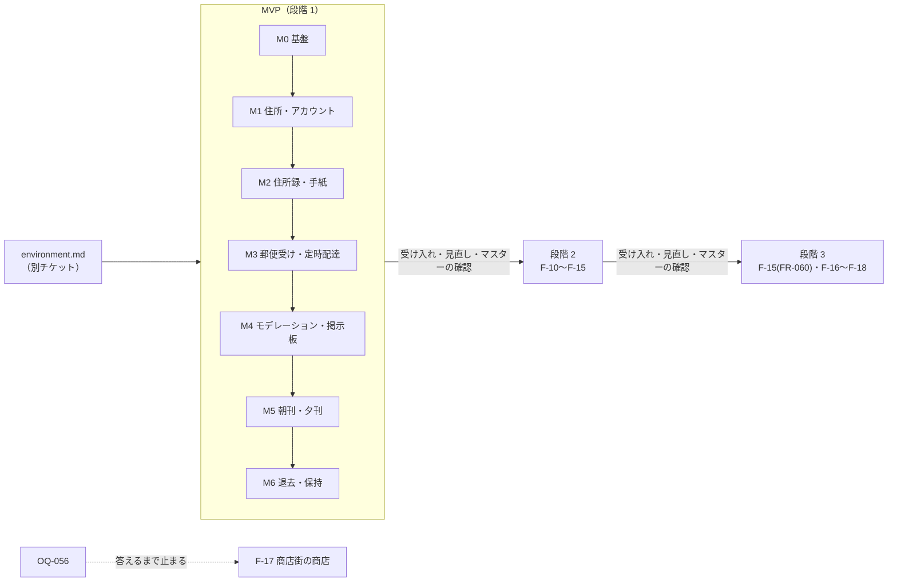

# 開発ロードマップ

- 状態: 草案
- 日付: 2026-11-19
- チケット: YGO-008
- 根拠: `.ai/brief.md`・`requirements.md`・`features.md`・`architecture.md`・`db.md`・`api.md`・`async.md`・`security.md`・`open-questions.md`・ADR-0001〜0021
- 関連 ADR: 0022（段階の切り方と関門）・0023（休眠と空き家の再割り当ては段階 3）・0024（マッチングは恋愛のためではない・連絡先の共有の禁止）・0025（配達完了の通知）・0026（クローズドな手紙の審査）・0027（未成年の利用）・0028（架空の街の地図は静的な画像で MVP）・0029（商店・団体のアカウントは管理者が作る）・0030（新規登録は開放式）・0031（外部 LLM の費用の見積もりとサービスの暫定の選定）・0032（違反した住民への処置の内容はマスターが後で決める）・0033（メール送信はテスト環境ではモックかローカルの SMTP、本番はマスターの事前承認を得て選ぶ）・0034（共有を禁止する連絡先は街の外の連絡先だけ、禁止はマッチングの中だけ）・0035（新聞は全住民に定時、手紙は午前・午後のランダムな時刻、通知は新聞と手紙で分ける）・0037（地図は全住民で共有する 1 枚の白黒の画像、印とゲーム風の地図は今は作らない）・0038（商店は実在の企業・個人のお店を目指す、コミュニティは住民が作り制約を置く）・0039（新聞は組ごとの版、知り合い 0 の組は興味で分ける、記事の文字は LLM、組版はサーバー）・0040（手紙は送るときに照合し、送った人が頼んだ手紙をモデレーターが確かめる）・0041（年齢で守り方を変え、年齢は住民の設定をそのまま使う）

---

## §1 方針

1. **段階は `features.md` のとおり 3 つ**（MVP・段階 2・段階 3）[inferred]（構想の「開発ロードマップを作成する」と
   features.md §1.2 の段階分けから。構想そのものに段階の分け方はない）。新しい段階は作らない（ADR-0022）。
   MVP の中だけ、作る順番として M0〜M6 のマイルストーンに分ける（§4）。
2. **段階を進めるのはマスターの確認** [inferred]（設計 → レビュー → 実装の進め方の NFR-088 と、構想の
   「重大な仕様変更は事前承認」から。構想に段階ごとの確認の定めはない）。各段階は
   「受け入れ条件をすべて満たす → 見直し（`reviews/`）→ マスターの確認」で閉じる（ADR-0022）。
3. **受け入れ条件は手元で確かめられる形で書く** [inferred]（NFR-061・NFR-063・NFR-067）。
   すべて `sh scripts/check.sh` から動くテスト、または文書の有無で判定する。ネットワークなしで通ること。
4. **外部サービスはアダプタの裏に置き、モックで受け入れる** [inferred]（NFR-065・ADR-0022）。
   LLM（暫定の選定は Anthropic API、本番のアダプタは承認のあと。ADR-0031。新聞の文章アダプタも同じで、モデルは OQ-062、ADR-0039）・外のニュースの取り込み（偽の記事のアダプタだけ、本番は OQ-060 のあと、ADR-0039）・メール送信（テスト環境はモックかローカルの SMTP、本番のサービスはマスターの事前承認を得て選び、アダプタは承認のあと。ADR-0033）・鍵管理（C9）・オブジェクトストレージ（C8）・Web Push の送信（C11、ADR-0025）が対象。
5. **要回答の答えを受け入れ条件にしない** [inferred]（CLAUDE.md）。答えを待つ部分は暫定のまま進め、
   答えで変わる箇所を §8 に書く。答えがないと作れない部分だけを「止まる」とする。
6. **デプロイはしない** [explicit]（NFR-071・NFR-072・NFR-076）。開発・検証環境の構築計画は
   `environment.md`（別チケット）に回す（§9）。

---

## §2 段階の一覧

`features.md` §2 の段階の欄と同じ。

| 段階 | 機能 | 位置づけ（features.md §1.2） |
|------|------|------------------------------|
| MVP（段階 1） | F-01・F-02・F-03・F-04・F-05・F-06・F-07・F-08・F-09・F-19 | 「朝、自分の家のポストを開ける」体験が成立する最小の範囲 |
| 段階 2 | F-10・F-11・F-12・F-13・F-14・F-15（FR-060 を除く） | MVP のデータモデルを拡張する機能 |
| 段階 3 | F-15 の FR-060・F-16・F-17・F-18 | データのライフサイクルやアルゴリズムの確定を待つ機能 |
| このフェーズの範囲外 | F-20 | FR-090（features.md §1.4） |

### 機能ごとの段階

| ID | 機能 | 段階 | 作る順（§4〜§6） |
|----|------|------|------------------|
| F-01 | 架空の住所によるユーザー ID | MVP | M1 |
| F-02 | アカウント（作成・ログイン・セッション維持・削除） | MVP | M1（削除は M6） |
| F-03 | 郵便受け | MVP | M3 |
| F-04 | 個人宛の手紙 | MVP | M2 |
| F-05 | 朝便・夕便の定時配達 | MVP | M3 |
| F-06 | 朝刊・夕刊（組ごとの版・興味・外のニュース・記事の文字は LLM、ADR-0039） | MVP | M5 |
| F-07 | 町内掲示板 | MVP | M4 |
| F-08 | 非同期モデレーション（ブロック・通報・送信上限を含む） | MVP | M3（ブロック）・M4 |
| F-09 | 住所録 | MVP | M2 |
| F-10 | グループ宛ての手紙 | 段階 2 | S2-1 |
| F-11 | 画像添付と新聞写真風加工 | 段階 2 | S2-2 |
| F-12 | 新聞バックナンバー | 段階 2 | S2-3 |
| F-13 | 掲示板カテゴリ・イベント・住民募集 | 段階 2 | S2-4 |
| F-14 | モデレーション保留への異議申し立て | 段階 2 | S2-5 |
| F-15 | 自分のデータのエクスポート | 段階 2（FR-060 は段階 3） | S2-6・S3-4 |
| F-16 | 引っ越し・住所転送・空き家（休眠・再割り当てを含む、ADR-0023） | 段階 3 | S3-1 |
| F-17 | 商店街（商店は住所を持ち、商店・団体が情報発信できる。商店のアカウントは管理者が作る、ADR-0029。コミュニティは住民が作る、ADR-0038。団体が住所を持つかは OQ-057） | 段階 3 | S3-2（商店の部分は OQ-056 で止まる） |
| F-18 | マッチング（恋愛のカテゴリなし・連絡先の欄なし、ADR-0024） | 段階 3 | S3-3 |
| F-19 | 架空の街の地図（全住民で共有する 1 枚の白黒の静的な画像、ADR-0028・ADR-0037。印は付けない、OQ-054 の暫定） | MVP | M1 |
| F-20 | 企業広告・折込チラシ | このフェーズの範囲外 | — |

---

## §3 段階どうしの依存

| 後の段階 | 前提になるもの | 理由 |
|----------|----------------|------|
| MVP | 設計文書（requirements〜security・本書）・ADR-0001〜0023・ADR-0025〜0028・ADR-0036・ADR-0037・ADR-0039〜0041・`environment.md`（別チケット） | 作り始める前に、ローカルで DB と 2 プロセスを動かす手順が要る（NFR-058・NFR-073） |
| 段階 2 | MVP の受け入れ・見直し・マスターの確認 | 段階 2 は MVP のデータモデルを広げる（features.md §1.2） |
| 段階 3 | 段階 2 の受け入れ・見直し・マスターの確認 | F-16 は段階 2 のエクスポート（F-15）と画像（F-11）の保持の扱いを引き継ぐ。F-18 は F-10・F-11 を使う |

段階 2 の中・段階 3 の中の機能は、§5・§6 の表の依存を満たせば順番を入れ替えてよい。

---

## §4 MVP（段階 1）

### 段階

F-01〜F-09 と F-19。作る順番は次の 7 つのマイルストーン（ADR-0022）。各マイルストーンの終わりに `sh scripts/check.sh` が通ること。

| ID | マイルストーン | 含めるもの | 主な ADR・文書 |
|----|----------------|------------|----------------|
| M0 | 基盤 | 1 リポジトリ・2 プロセス（web / worker）の骨組み、PostgreSQL と pg-boss 相当のキュー、C3 の 8 サブモジュールの空の形、時刻を外から差し替えられる時計、アダプタ（KeyProvider の偽の鍵・ファイルのオブジェクトストレージ・モックのメール・ローカルの SMTP（宛先はループバックだけ、ADR-0033）・モックの LLM 分類器・モックのプッシュ送信）、Vitest を `check.sh` からつなぐ | ADR-0008・0009・0010・0015・0033、architecture.md §2・§6 |
| M1 | 住所・アカウント（F-01・F-02・F-19） | 住所のプール（使われたことのない住所）と候補の提示・選択、登録（開放式・招待なし、ADR-0030。メール確認はモックのメール）、ログイン・ログアウト、サーバー側セッション、再認証、流量の制限（登録の要求も対象）、プロフィールの表示・更新。架空の街の地図: 全住民で共有する 1 枚の白黒の静的な SVG（ADR-0037）（レポジトリの中で描いた架空の図、区画は「番」まで）を C1 の静的なファイルとして `` で出し、代替テキストを付ける。地図の API と DB の表は作らない。印（知り合いの家・自分の住所・登録のときの候補）は付けない（OQ-054 の暫定） | ADR-0001・0018・0019・0023・0028・0030・0037、security.md §3・§7 T-05・T-07、api.md §7 F-01・F-02・F-19 |
| M2 | 住所録・手紙（F-09・F-04） | 住所録の追加・削除・メモ・検索と `registered_tenancy_id`、手紙の投函（`pending`・2,000 字・1 日 20 通。投函のときの照合は M4 で足す、ADR-0040 の D8）、本文の保存時暗号化（鍵の版・AAD）、送信済み一覧、`nextDeliveryRun` と `FOR SHARE` | ADR-0003・0004・0006・0021、db.md §2・§3、api.md §2.3 |
| M3 | 郵便受け・定時配達（F-03・F-05、F-08 のブロック） | J0・J1・J4・J5・J6 と、**J3 の休刊だけの経路**（紙面を組まずに `newspapers` に `is_holiday = true` の行を `ON CONFLICT DO NOTHING` で入れる。ADR-0007）、配達の時刻表 API、郵便受けの一覧・詳細・削除、ブロックの登録と配達時の `suppressed`。J2 は M4 まで作らないので、M3 の J0 は J2 を積まず、審査の打ち切り（04:00 / 16:00 JST）まで待ってから J3（休刊）を積む。こうして `newspapers` の行ができ、J4・J5 に進む（async.md §3 の J0 の判断）。宛先の振り分けは「通常・差し戻し・抑止」の 3 つ（転送は段階 3）。J4 は新聞（M3 では休刊の行）を全住民に `mailbox_items` で作り、各行に `visible_at` を書く（新聞は 07:00 / 17:00、手紙は受取人ごとの枠の時刻。郵便受けの API は `visible_at` を過ぎた項目だけを返す、ADR-0035）。配達の通知: J15（新聞の通知は公開のあとに 1 回・公開から 30 分まで、手紙の通知は J0 が枠ごとに積み・枠の時刻から 30 分まで。M3 の紙面は休刊だけだが、休刊の回にも新聞の通知を送るので、新聞の通知は M3 から流れる。ADR-0035 の D11）、購読の API（`/api/v1/me/push-subscription`・`/api/v1/notifications/public-key`）と送り先の検査、C1 のサービスワーカー、C11 の Web Push のアダプタ（テストではモック） | ADR-0004・0007・0016・0017・0025・0035、async.md §3・§4 |
| M4 | モデレーション・掲示板（F-07・F-08） | 掲示板の投稿（`awaiting_review`・1,000 字・1 日 5 件）と掲載、J2（掲示板の投稿だけ。ルール表 → モックの LLM → ルール表との突合）、クローズドな手紙の審査（OQ-052 → 決定、ADR-0040）: 投函のときに API がルール表の手紙の項目（`spam`・`external_link`・`adult_words`。テストは偽の規則で、成人向けの言葉の本物の一覧はレポジトリに置かない）だけで照合し、LLM は渡さない。当たれば何も保存せずに 422 `letter_needs_review`、web のポップアップの y / n、y なら `request_review: true` で `held`、送信済みの「確認中」「届けられませんでした」の表示、422 の流量の制限。確認待ちの手紙の経路（`/api/v1/admin/held-letters` の一覧・1 通の取得・`approve` / `reject`）と `letter_id` 付きの `moderation_actions`。J14 の `blocked` の 30 日の削除と J7 の `held`・`blocked` の削除。通報、モデレーターのロール（運用者 CLI・二要素認証）、管理者の経路、通報された手紙の 1 通だけの復号（`GET /api/v1/admin/reports/{id}/letter`、OQ-043 → 決定、ADR-0036）と `view_letter` の記録。照合の細部（OQ-065）は M4 を始める前に ADR で決める | ADR-0005・0014・0020・0026・0036・0040、security.md §2.3・§3.5・§4・§5 |
| M5 | 朝刊・夕刊（F-06） | J3 を M3 の休刊だけの経路から本物の組版に広げる（TSX → 静的 HTML、版ごとに組む、保存キー `newspapers/<run_id>/<edition_key>/<hash>.html`、`UNIQUE(delivery_run_id)` と `UNIQUE(newspaper_id, edition_key)`）。興味の一覧（運用者の CLI、シードは架空の名前）・登録の興味の項目（任意）・興味の設定の API（`/api/v1/interest-categories`・`/api/v1/me/interests`）。J17（外のニュースの取り込み。偽の記事のアダプタだけ、本番は OQ-060 のあと）。J16（記事の文字。モックの文章アダプタ・出力の検査・ルール表・決まった形への切り替え）。J4 の組分けと版の選び方（暫定は全住民が知り合い 0 の組、興味がなければ共通の版、複数ならハッシュ）と、新聞の部分一意索引 UNIQUE(delivery_run_id, resident_id) WHERE kind = 'newspaper'。紙面の API（自分の郵便受けに届いた版だけ）と HTML の中継、J8（掲載済み投稿の削除による版ごとの組み直し） | ADR-0007・0011・0039、async.md §4 J3・J4・J8・J16・J17、db.md §2 |
| M6 | 退去・保持（F-02 の削除） | `DELETE /me`、J7、J14、`erasure.replay` | ADR-0013、db.md §5・§6、async.md §4 J7・J14 |

### 依存

| マイルストーン | 前に要るもの | 理由 |
|----------------|--------------|------|
| M0 | `environment.md`（別チケット） | ローカルの PostgreSQL と 2 プロセスの起動手順 |
| M1 | M0 | DB・アダプタ（メール）・時計 |
| M2 | M1 | 住所録と手紙は住民と住所を参照する。手紙は住所録から宛先を選ぶ（FR-053） |
| M3 | M2 | 配達するのは手紙。振り分けは `registered_tenancy_id`（M2）を使う |
| M4 | M3 | 掲示板の投稿は J5（M3）で `published` になる。審査は J0 の工程判断（M3）に乗る。M4 から J0 は J2 を積み、審査が済めば打ち切りを待たずに J3 へ進む。手紙の審査（ADR-0040）: M2・M3 の間は手紙を照合しないで配達する。M4 で、`POST /api/v1/letters` に投函のときの照合・422・`request_review`・`held` を、管理者の経路に確認待ちの手紙の経路を足す。J1〜J6 は手紙について M3 のまま（J4 は判定を見ずに `scheduled` の手紙をすべて準備し、`moderation_queue` に手紙の行を入れない。J5 の準備されなかった手紙を次の便へ移す処理は安全網として M3 から置く。async.md §4）。M4 の前に OQ-065（照合の細部）を ADR で決める |
| M5 | M4 | 紙面の素材は承認済みの投稿（M4）。J16 は J2（M4）のあとに動き、出力をルール表（M4）に当てる。M3 の J3（休刊だけの経路）を本物の組版に広げる。組版の締め切りまでに組めないときの休刊の経路はそのまま残す。新聞の版と興味の決め方は ADR-0039。モデル・プロンプトの ADR（OQ-062）を M5 の前に書く |
| M6 | M5 | J7 は掲載済み投稿の削除で J8（M5）を積む |

MVP で依存する ADR: 0001〜0021 と 0022・0023・0025・0026・0027・0028・0036・0037・0039・0040・0041。ADR-0002 のうち休眠と空き家の再割り当ては段階 3（ADR-0023）。

### 受け入れ条件

次の 17 項目をすべて満たし、見直しとマスターの確認を経て MVP を閉じる。テストのデータは架空の値（例: 夕暮ヶ丘三丁目 2-5、`test@example.invalid`）を使う（NFR-066）。

| # | 条件 | 確かめ方 |
|---|------|----------|
| A-01 | `sh scripts/check.sh` がネットワークなしで通り、すべてのテストを動かす | ネットワークを切った状態で実行して終了コード 0 |
| A-02 | 時刻を制御した端から端までの流れ: 住民 2 人が登録し、一方が住所録にもう一方を加え、D 日 00:30 JST に手紙を出すと、07:00 の公開の後に朝刊（または休刊の印）が両方の住民の郵便受けに出るが、手紙は 07:00 には出ない。手紙は相手の枠の時刻（午前 08:00〜11:50 のどれか。`SHA-256(run_id:resident_id)` から計算した値）を過ぎて初めて相手の郵便受けに出て、その 1 枠前の時刻にはまだ出ない（`GET /mailbox/items/{id}` も 404）。送った人の送信済みは 12:00 までは「投函済み」で、12:00 を過ぎて「配達済み」になる。D 日 01:05 に出した手紙は D 日の夕便で、午後 18:00〜20:50 のどれかの枠に届く（ADR-0035） | 時計を差し替えた統合テスト。J0 を 5 分刻みで動かす |
| A-03 | 冪等性: J1〜J6 のそれぞれを同じ配達回で 2 回動かしても、`mailbox_items`・`newspapers`・`newspaper_editions` の行の数が変わらず、一意制約の違反が出ない。J16・J17 も、2 回動かして `newspaper_articles`・`external_news_items` の行の数が変わらない（ADR-0039） | 統合テスト（NFR-021・NFR-062） |
| A-04 | `async.md` §7 のテストの 15 のケース（冪等性・`FOR SHARE` と締め切りの競合・途中停止と再開・休刊・持ち越し・公開と退去の競合・モックの LLM の失敗・通知の重複と期限・手紙の時刻・新聞の LLM の失敗・やり直しで LLM を呼ばない・外のニュースは取り込んだ回だけ・記事の打ち切りのあとの J16・版の決定性と新聞の部分一意索引・LLM に渡すもの）がすべてある | テストの名前と async.md §7 の表の対応を `status.md` に書き、すべて通る |
| A-05 | 組版の決定性: 同じ保存した記事（`newspaper_articles`）から描いた、それぞれの版の HTML がバイト単位で同じ。J3 と J8 のやり直しで LLM を呼ばない（呼ばれたら失敗するモックを差し込む、ADR-0039 の D7）。組版の締め切りまでに組めないときは `is_holiday = true` になり、その配達回は紙面の代わりに休刊の印が全住民の郵便受けに届き、手紙も届く（新聞の通知も送る、ADR-0035 の D11） | スナップショットテスト・休刊のテスト（NFR-022・NFR-030） |
| A-06 | 承認されていない投稿は配達されない。ルール表に当たる → `rejected`。モックの LLM の `ok` / `review` / `block` / 失敗 / 決められた値以外 が security.md §5.2 のとおりに扱われ、失敗と想定外の値は公開されない。クローズドな手紙（ADR-0026・ADR-0040）: (i) 当たったとき: テスト用の偽の規則（`EXAMPLE_LETTER_RULE_DO_NOT_USE`）に当たる本文を `request_review` なしで投函すると 422 `letter_needs_review` で、`letters` と `letter_recipients` に行ができず（DB を直接読む）、1 日の上限に数えられず、応答に規則の ID・種類・本文の位置が含まれない。(ii) n: 送り直さなければ何も残らず、本文に入れた目印の文字列が DB・ログ・ジョブのペイロードに出ない。(iii) y: 同じ本文に `request_review: true` を付けて送り直すと `held`（`delivery_run_id` は NULL、`matched_rule_id`・`rule_version` あり）で保存され、送った人の送信済みに「確認中」と見え（規則は見えない）、1 日の上限に数えられ、J1〜J6 を流しても誰の郵便受けにも出ない。`request_review: true` でも当たらない本文は `pending` で届く。(iv) モデレーターの確認: `approve` した手紙は `pending` になって次の配達回で届く。`reject` した手紙は `blocked` で誰の郵便受けにも出ず、送った人には「届けられませんでした」とだけ見え、J14 で `decided_at` から 30 日を過ぎると本文と宛先ごと消える（時計を差し替える）。(v) 当たらない手紙: `pending` で保存されて届く。投函のあとにルール表の版を上げて同じ本文が当たるようにしても、その手紙は当て直されずに届く（ADR-0040 の D3）。(vi) 本文を守る: 投函の照合の間、LLM の呼び出しが 0 回（呼ばれたら失敗するモックを web 側に差し込む）。`moderation_queue` に手紙の行がなく、`content_kind = 'letter'` の行を入れようとすると CHECK 制約で失敗する。手紙の本文に入れた目印の文字列が、ログ・`moderation_queue`・ジョブのペイロード・422 の応答に出ない。J2 は手紙を扱わず、J2 を止めても手紙は遅れずに届く。(vii) 連絡先と外部リンク: 連絡先の共有の禁止（FR-101）は掲示板・手紙に及ばない（ADR-0034）。本番のルール表に FR-101 を理由にした項目がない（規則の ID・当てる対象で確かめる）。手紙に当てる本番の項目の種類は `spam`・`external_link`・`adult_words` だけ。偽の値（`contact@example.invalid`・`000-0000-0000`）を本文に含む手紙は `external_link` に当たらず、422 にならずに届く。偽の URL（`https://example.invalid/`）を含む手紙は `external_link` に当たって 422 になる | 単体テスト・統合テスト・DB を直接読むテスト・ログを取り込むテスト（NFR-005・NFR-011・NFR-012・FR-078・FR-080・FR-101・FR-112） |
| A-07 | API の経路で LLM を呼ばない。web プロセスは LLM の API キーを読まない。web プロセスは新聞の文章アダプタと外のニュースのアダプタを読まず、外のニュースのアダプタは偽の記事（`EXAMPLE_NEWS_DO_NOT_USE`）のものだけ（ADR-0039 の D6。本番のアダプタは OQ-060 のあと）。メールのアダプタはモックとローカルの SMTP の 2 つだけで、外部のメール送信サービスを呼ぶアダプタがない。ローカルの SMTP の宛先にループバック（`localhost`・`127.0.0.1`・`::1`）以外（例: `smtp.example.invalid`）を設定すると起動に失敗する（ADR-0033 の D3。本番のサービスは OQ-049 のあとに選ぶ） | 呼ばれたら失敗するモックを web 側に差し込んだ API テスト・設定の読み込みのテスト（security.md §1・§6.1、ADR-0033） |
| A-08 | 即時性と数値を返さない: ルートの一覧に WebSocket・SSE・ロングポーリングがない。すべての応答のスキーマに件数・総数・未読・既読・閲覧数・反応数・残りの上限の項目がない（429 も残りの数を返さない）。通知の購読の API（`/api/v1/me/push-subscription`・`/api/v1/notifications/public-key`）の応答にも件数がなく、通知を今すぐ送る経路がない。興味の一覧と興味の API（`/api/v1/interest-categories`・`/api/v1/me/interests`）の応答にも件数（興味ごとの住民の数など）がなく、ほかの住民の興味・版の一覧・`edition_key`・検索の履歴を返す経路がない（ADR-0039） | ルートとスキーマを走査するテスト（ADR-0014・0025・0039、api.md §8） |
| A-09 | 権限: security.md §4.2 の表の各行に、許可と拒否の両方のテストがある。他人のデータは 404、admin の経路だけ 403。モデレーターは当事者の案件を処理できない。通報された手紙（`GET /api/v1/admin/reports/{id}/letter`、ADR-0036 の D2 で決定）は、通報が `open`・対象が手紙・当事者（送った人・受け取った人・通報した人）でない・二要素認証済みのときだけ 1 通返り、呼ぶたびに `moderation_actions` に `view_letter` の記録が残り、応答は `no-store`。条件が 1 つでも欠けたら 404（通報が `open` でない・当事者・二要素認証なし・対象が手紙でない のそれぞれで確かめる）。`view_letter` の行を書けないとき（書き込みを失敗させるテスト）は本文を返さない。確認待ちの手紙（`/api/v1/admin/held-letters`、ADR-0040 の D5）: 1 通の取得と操作は、手紙が `held`・当事者（送った人・宛先の住民）でない・二要素認証済みのときだけ効き、取得のたびに `moderation_actions` に `letter_id` 付きの `view_letter` の記録が残り、応答は `no-store`。条件が 1 つでも欠けたら 404（`held` でない（`pending`・`blocked`）・当事者・二要素認証なし のそれぞれで確かめる）。`view_letter` の行を書けないときは本文を返さない。一覧は本文を含まず、呼んだモデレーターが当事者の手紙を出さず、総件数を返さない。操作は `approve` / `reject` 以外を 400 で拒み、操作済みの手紙への 2 回目の操作は 404。却下した手紙（`blocked`）を見る経路がない。住民は他人の確認待ちの手紙を見られない（404）。管理用の審査キューに手紙の行が出ない。通報への操作（`POST /api/v1/admin/reports/{id}/actions`）は approve / reject / dismiss 以外を 400 で拒み、住民を停止・警告する経路がない（ADR-0032 の D2。処置の内容は OQ-048 の答えで変わる）。興味の表（security.md §4.2）: 自分の興味だけを見て変えられ、ほかの住民の興味はモデレーターからも見られない。新聞の版: 自分の郵便受けに届いていない版は、同じ配達回のものでも 404（ADR-0039 の D11） | 権限表のテスト（ADR-0020・0026・0032・0039・0040） |
| A-10 | 保存時の暗号化: `letters` の保存値に本文の平文が含まれない。AAD（手紙の ID）が違うと復号に失敗する。鍵の版を入れ替えても古い版の手紙を読める。メールは暗号化した値と HMAC だけ、パスワードは Argon2id | 単体テスト・DB を直接読むテスト（ADR-0006・0018・0021） |
| A-11 | 上限: 手紙 2,000 字・投稿 1,000 字を超えると 400。JST の暦日ごとに手紙 21 通目・投稿 6 件目は 429（code は `daily_limit_reached`）。ログインと再設定に流量の制限が効き、超えると 429（code は `rate_limited`、api.md §5）。手紙の 422（`letter_needs_review`）は 1 日の上限に数えず、住民ごとの流量の制限を超えると 429（code は `rate_limited`。値は OQ-065 の ADR で決めたもの、ADR-0040 の D7） | API テスト（ADR-0004・0005・0040、security.md §3.5） |
| A-12 | 住所: 候補は使われたことのない住所だけ（ADR-0023）。同じ住所を同時に選ぶと片方が 409。候補の提示のほかに住所を列挙する経路がない。登録とプロフィールの要求・応答のスキーマに、生年月日・保護者の同意の項目がなく、登録に年齢の確認（本人確認の書類・外部の年齢確認への経路を含む）がない（FR-094・FR-113、ADR-0027・ADR-0041 の D2・D4）。年齢の項目も、OQ-063・OQ-064 の答えが出るまでスキーマと `residents` の列にない（ADR-0041 の D5。答えで項目を足すときは、ここで確かめることを直す）。登録の要求のスキーマに招待トークン・紹介者の項目がなく、招待なしで登録できる。登録の要求が流量の制限を超えると 429 で code は `rate_limited`（api.md §5。`daily_limit_reached` ではない）（FR-091、ADR-0030）。登録の興味の項目（`interests`）は任意で、なくても登録でき、一覧にない値・6 つ以上は 400（FR-109、ADR-0039） | API テスト・スキーマを走査するテスト・DB のスキーマを走査するテスト（FR-003・FR-091・FR-094・FR-113、security.md T-05・§2.2・§3.5） |
| A-13 | 退去: `DELETE /me` の後は、退去した住民のどのセッション（どの端末）で呼んでも 401 `unauthenticated`（api.md §2.4 のセッションの無効化・§5 のエラーの表）。退去した住所の `GET /api/v1/profiles/{address}` は 404 `not_found`（api.md §7 F-01）。J7 の後は ADR-0013 の表のとおり（認証情報の消去・未配達の手紙は `returned`・確認待ちと却下の手紙（`held`・`blocked`）は本文と宛先ごと消える（ADR-0040 の D6）・掲載済み投稿の本文の消去と組み直し・住所は `vacant_deleted`）。退去したあとに通知の購読（`push_subscriptions`）と送った記録（`delivery_notifications`）が残らない（ADR-0025）。退去したあとに興味（`resident_interests`）とその住民の投稿から作った記事（`newspaper_articles`）が残らず、その記事が載った版が組み直される（ADR-0039）。リストアを模したあと `erasure.replay` で消し直される。ログに手紙の本文・パスワード・トークン・平文のメールが出ない | 統合テスト・ログを取り込むテスト（NFR-010・security.md §2.5） |
| A-14 | 文書: `status.md` に F-01〜F-09・F-19 の実装済み・未実装・暫定対応（§8 の暫定を含む。OQ-058・OQ-059・OQ-061 の暫定を新聞の暫定対応として、OQ-063・OQ-064 の暫定（年齢による違いと年齢の項目を作らない）を F-02・F-08 の暫定対応として書く）を書く。見直しを `reviews/` に残し、重大・中は直してある | 文書の有無と見直しの記録（NFR-088） |
| A-15 | 配達の通知（ADR-0025・ADR-0035、FR-028・FR-102・FR-105）: (1) 2 種類の通知: 購読のある住民 2 人（その便の手紙 2 通と 0 通）で朝便を流すと、07:00 の公開のあとにモックのプッシュ送信が 2 人に「新聞が配達されました！」を 1 通ずつ受け、手紙 2 通の住民の枠の時刻のあとにその住民に「手紙が配達されました！（2通）」を 1 通受ける。どちらの中身も決まった文面と件数だけで、差出人・本文・住所を含まない。(2) 0 通の住民: 手紙の通知を受けない（新聞の通知だけ）。(3) 休刊: 休刊の回も、郵便受けに休刊の印が出て、全住民に「新聞が配達されました！」を 1 通ずつ送り、手紙の通知も送る。(4) 枠の時刻の前: 手紙の通知は枠の時刻の前には送らず、公開の前・`skipped` の便ではどちらも送らない。(5) 30 分の期限: 新聞は公開から、手紙は枠の時刻から 30 分を過ぎたら送らない。(6) 重複: J15 を 2 回動かしても、J0 が同じ枠を何度積んでも、通知が増えない（`UNIQUE(delivery_run_id, push_subscription_id, kind)`）。(7) ログアウト: ログアウトした端末には送らない。(8) SSRF: プライベートの宛先の `endpoint` の登録は 400 | (1)〜(5) 時計を差し替えた統合テスト（(3) は J3 の休刊の経路で）。(6)(7) 統合テスト。(8) API テスト |
| A-16 | 架空の街の地図（ADR-0028・ADR-0037、FR-103。印は OQ-054 の暫定で付けない）: (1) 地図の画面に画像が 1 枚出て、代替テキストがある。(2) 住民 2 人のそれぞれのセッションで取った地図の画像が、バイト単位で同じ（OQ-054 の暫定、ADR-0037 の D1 (b)。全住民で共有する 1 枚の画像（ADR-0037 の D1 (a)）は決定だが、住民ごとに変えないことは暫定で、OQ-054 の答えで印を重ねるなら見直す。ログインしていない人に地図の画面を出すかは決めておらず、ここでは確かめない）。(3) ルートの一覧に地図の API の経路がなく、DB に地図の表がない。(4) 画像の中に号までの住所（`2-5` の形）・住民・入居・空き家・数がない。(5) 画像の中に `<script>`・イベント属性・外部の URL への参照がない。(6) 画像の中のすべての色（`fill`・`stroke`・`stop-color` など）が白黒（白・黒・灰色、sRGB で R=G=B）だけ（ADR-0037 の D2） | (1)(4)(5)(6) 画像のファイルを読む単体テスト。(2) API テスト。(3) A-08 のルートの走査のテストを広げる・DB のスキーマを走査するテスト |
| A-17 | 新聞の版と興味（ADR-0039、FR-108〜FR-111）: (1) 住民 50 人・興味 3 種で朝便を流すと、版は 4 つまで（共通の版 1 + 興味の版 3）で、住民の数によらない。(2) 住民は 1 回の配達につき新聞を 1 つだけ受け取る。興味が 1 つならその版、興味がなければ共通の版、複数なら `SHA-256(run_id:resident_id)` から計算した版で、J4 をやり直しても同じ版。2 回のあいだに興味を変えても新聞は 1 つ。(3) モックの文章アダプタが受け取る入力に、手紙の本文・住所・ID・ニックネーム・住民ごとの興味に入れた目印の文字列が入らない。(4) モックの出力が長すぎる・HTML を含む・ルール表に当たる・失敗した・記事の打ち切りまでに返らない のそれぞれで、その記事は決まった形（素材の題と本文そのまま、`written_by = 'template'`）で組まれ、休刊にならない。(5) 住所録を検索したあと住民の興味が増えず、検索語（目印の文字列）が DB とログに出ない（OQ-059 の暫定）。(6) 投稿の本文は書き換えずに紙面に載り、LLM が書いた文に「AI が書いた文」の印がある（OQ-061 の暫定）。(7) 全住民が知り合い 0 の組として扱われ、`edition_key` は `common`・`interest:<key>`・`holiday` だけ（OQ-058 の暫定） | (1)(2)(7) 時計を差し替えた統合テスト。(3)(4) 入力を記録するモックの文章アダプタを使う統合テスト。(5) 統合テスト・ログを取り込むテスト。(6) スナップショットテスト |

---

## §5 段階 2

### 段階

F-10〜F-15（F-15 の FR-060 を除く）。

| ID | 機能 | 主な変更 |
|----|------|----------|
| S2-1 | F-10 グループ宛ての手紙 | `letter_recipients` を複数にする。宛先の数の上限（OQ-038） |
| S2-2 | F-11 画像添付と新聞写真風加工 | `images`・J13・C8 への保存。手紙・掲示板（3 枚まで）・新聞の画像 |
| S2-3 | F-12 新聞バックナンバー | `delivery_runs.status = 'done'` の配達回の紙面のうち、自分の郵便受けに届いた版だけを返す（ADR-0039）。休刊・持ち越しの回は出さない |
| S2-4 | F-13 掲示板カテゴリ・イベント・住民募集 | 投稿のカテゴリと絞り込み |
| S2-5 | F-14 異議申し立て | `block` で却下された投稿に 1 回の申し立て（security.md §5.2）と、モデレーターの処理。手紙の異議は、投函のときに送った人が確認を頼む（y）形で M4 に入れた（ADR-0040）。`reject` された手紙への異議は OQ-065 |
| S2-6 | F-15 エクスポート（FR-096） | 自己紹介・住所録・自分の手紙などの書き出し。退去と同じ認可・再認証 |

### 依存

| 機能 | 前に要るもの | 始める前に書くもの | 関係する OQ |
|------|--------------|--------------------|-------------|
| S2-1 F-10 | M2・M3 | 宛先の上限を api.md に書く（OQ-038 を決定にする） | OQ-038（持ち越し）・OQ-052（決定、ADR-0040。グループ宛の手紙も投函のときに手紙ごとに 1 回照合し、確認待ちと承認・却下はすべての宛先に同じく効く） |
| S2-2 F-11 | M2・M4・M5 | 画像加工の ADR（加工の方式・外見の識別力を下げる基準・費用の見積もり NFR-078） | OQ-026（決定） |
| S2-3 F-12 | M5 | 紙面の保持期間を ADR-0013 に足す | OQ-030 |
| S2-4 F-13 | M4 | カテゴリの一覧（db.md・api.md） | — |
| S2-5 F-14 | M4 | 異議の手続き（security.md §5。投稿の取り下げへの異議。住民への処置への異議は OQ-048 の答えのあと、ADR-0032。手紙の異議は投函のときの y で受ける、ADR-0040） | OQ-048（持ち越し、止まらない）・OQ-065（持ち越し、`reject` された手紙への異議） |
| S2-6 F-15 | M1・M2 | 書き出す項目と形式（api.md） | — |

### 受け入れ条件

| # | 条件 | 確かめ方 |
|---|------|----------|
| B-01 | MVP の受け入れ条件 A-01〜A-13・A-15〜A-17 が引き続き通る | `sh scripts/check.sh` |
| B-02 | グループ宛ての手紙は宛先ごとに冪等に届き（宛先の数 × 1 行）、上限を超えると 400。宛先の一部がブロック・差し戻しでも、ほかの宛先には届く | 統合テスト |
| B-03 | 画像は加工が終わるまでどこにも出ない。組版までに加工が終わらない画像は紙面に載らない（async.md J13）。元の画像は住民にもモデレーターにも返さない | 統合テスト |
| B-04 | バックナンバーは `done` の配達回の紙面のうち、自分の郵便受けに届いた版だけを返し（ほかの版は 404、ADR-0039 の D11）、件数・閲覧数・`edition_key` を返さない | API テスト（A-08 のテストを広げる） |
| B-05 | カテゴリの絞り込みは決定的な並び（api.md §6）で、人気の順を使わない | API テスト |
| B-06 | 異議申し立ては 1 つの投稿に 1 回だけ。申し立てても人の審査が終わるまで公開されない | 単体テスト・権限表のテスト |
| B-07 | エクスポートは本人だけ（他人は 404）・再認証が要り、他の住民の内部 ID・`registered_tenancy_id` を含まない | API テスト |
| B-08 | `status.md` に F-10〜F-15 の状態を書き、見直しを `reviews/` に残す | 文書 |

---

## §6 段階 3

### 段階

F-15 の FR-060・F-16・F-17・F-18。

| ID | 機能 | 主な変更 |
|----|------|----------|
| S3-1 | F-16 引っ越し・住所転送・空き家 | 引っ越しの申請、転送（6 か月）、J11、休眠（J10・J12）、長期不在の退去（J9）、空き家の再割り当て（ADR-0023） |
| S3-2 | F-17 商店街 | コミュニティ: 住民が趣味などで作り、作ることに制約を置く（ADR-0038 の D2・D3。制約の中身は OQ-057）。発信は配達の前に審査する（ADR-0038 の D4）。商店: 実在の企業・個人のお店を目指し、アカウントは管理者が運用者の CLI で作る（ADR-0029・ADR-0038 の D1）。**商店の部分は OQ-056 の答えがないと作れない** |
| S3-3 | F-18 マッチング | 趣味・友人のマッチング（恋愛のカテゴリは設けない、FR-064）、提案は定時配達に乗せる、任意参加・辞退・ブロック、成立後は手紙でやり取りし、登録と提案に街の外の連絡先の欄を設けない（FR-101、ADR-0024） |
| S3-4 | F-15 の FR-060 | 住所録のインポート・エクスポート |

### 依存

| 機能 | 前に要るもの | 始める前に書くもの | 関係する OQ |
|------|--------------|--------------------|-------------|
| S3-1 F-16 | M3（振り分け）・M6（退去）・S2-6 | 引っ越しの API と転送の振り分けを api.md・async.md に足す。休眠の通知の文面 | OQ-039（決定、ADR-0033）・OQ-049（持ち越し） |
| S3-2 F-17 | M4・S2-4・S3-1 | コミュニティの制約の中身の ADR（OQ-057 を決定にする。1 人が作れる数・作る条件・住所を持つか・誰が発信できるか・作った住民が退去したときの扱い）。商店は、発信する主体・認証・住所の割り当ての ADR（OQ-056 の答えのあと。作る主体は ADR-0029） | OQ-045（決定、ADR-0038）・OQ-057（持ち越し、S3-2 の前に決める）・**OQ-056（要回答、商店の部分だけ止まる）** |
| S3-3 F-18 | M3・M4・S2-1・S2-2 | マッチングのアルゴリズムの ADR（FR-066）・カテゴリの分け方（FR-069） | OQ-041（決定、ADR-0034）・OQ-050（持ち越し、アルゴリズムの ADR で決める） |
| S3-4 FR-060 | S2-6 | 取り込む形式と、取り込んだ住所の `registered_tenancy_id` の取り方 | — |

### 受け入れ条件

| # | 条件 | 確かめ方 |
|---|------|----------|
| C-01 | 段階 2 の受け入れ条件 B-01〜B-07 が引き続き通る | `sh scripts/check.sh` |
| C-02 | 引っ越しの後 6 か月は旧住所あての手紙が新住所の住民に届き、住所録の表示の住所は変わらない（ADR-0003）。6 か月を過ぎると差し戻し | 時計を差し替えた統合テスト |
| C-03 | 12 か月ログインなしで `dormant` と通知 1 通（モックのメール）、さらに 30 日で `vacant_expired`、そこから 12 か月で J7。途中でログインすると `active` に戻る | 時計を差し替えた統合テスト（ADR-0002・0013） |
| C-04 | 空き家を新しい住民に割り当てても、前の住民あてに住所録から出した手紙は新しい住民に届かない（db.md §3） | 統合テスト |
| C-05 | J9〜J12 を 2 回動かしても状態と通知の積み込みが重ならない（J12 のまれな 2 通は async.md のとおり許容） | 統合テスト |
| C-06 | マッチングの提案は定時配達でだけ届き、候補数・成立率を返さない。参加しない住民は候補に出ない。辞退・ブロックの後は提案されない。カテゴリの一覧に恋愛がなく、参加の登録・提案のスキーマに街の外の連絡先（メール・電話番号・外部のアカウントなど）の項目がない。参加の登録に年齢の条件と年齢の項目がない（FR-064・FR-094・FR-101。年齢で使える機能を変えるかは OQ-063 で、答えで変わる）。禁止する連絡先は街の外の連絡先だけで、禁止はマッチングの中だけ（ADR-0034）。自由記述の欄の扱いと最初の手紙の出し方は OQ-050 で決めてから、確かめる項目を足す | 統合テスト・A-08 のテストを広げる |
| C-07 | 住所録のインポートは本人の住所録だけを変え、存在しない住所は取り込まない | API テスト |
| C-08 | 商店街（S3-2）。(1) コミュニティ: 住民が作れ、OQ-057 の ADR で決めた制約を超えると作れない。運用者の CLI・管理者の経路（C10）にコミュニティを作る経路がなく、モデレーターは住民としてだけ作れる。発信は配達の前に審査され、承認の前には出ない。制約の中身を決めたら、確かめる項目を足す（ADR-0038 の D2〜D4）。(2) 商店: OQ-056 の答えが出たときだけ作り、受け入れ条件を足す。足すときは少なくとも次を入れる: 商店のアカウントは運用者の CLI でだけ作れ、住民の登録と API のどの経路でも作れない（ADR-0029 の D1・D2。API テスト・A-08 のルートの走査を広げる）。答えがないときは商店の部分を未実装として `status.md` に書けば段階 3 を閉じてよい。(3) テストとシードのデータに実在の企業・お店・人の名前がなく、偽の名前だけを使う（ADR-0038 の D5） | API テスト・統合テスト・A-08 のルートの走査を広げる・文書 |
| C-09 | `status.md` に段階 3 の状態を書き、見直しを `reviews/` に残す | 文書 |

---

## §7 未確定・範囲外

| 項目 | 扱い | 動く条件 |
|------|------|----------|
| FR-103 地図の印（知り合いの家・自分の住所・登録のときの候補） | 全住民で共有する 1 枚の白黒の画像は決定（ADR-0037）で M1 に入る。印は暫定（付けない） | OQ-054 の答えで、住所と画像の上の位置の対応・ADR-0028 の D1・ADR-0037 の D3・M1 の内容・A-16 が変わる |
| FR-103 ゲーム風の地図 | 作らない（ADR-0037 の D4） | OQ-055（持ち越し）。段階 2 の計画を立てる前にマスターに聞き、作るなら段階と受け入れ条件を足す |
| FR-101 連絡先の共有の禁止のマッチングの中での守り方 | 範囲は決定（街の外の連絡先だけ・マッチングの中だけ、ADR-0034）で S3-3 に入る。M4 の手紙・掲示板の審査には及ばない | OQ-050（持ち越し）。S3-3 のアルゴリズムの ADR で、自由記述の欄の扱いと成立後に最初の手紙を出す方法を決め、C-06 を足す |
| FR-108 知り合いで埋まる組・一部埋まらない組の紙面 | 組ごとの版と知り合い 0 の組の興味の版は決定（ADR-0039）で M5 に入る。組 1・2 は暫定（全住民を知り合い 0 の組として扱う） | OQ-058 の答えで、J4 の組分け・`edition_key` の種類・版の数・A-17 (1)(2)(7) が変わる |
| FR-109 検索などから興味を集めること | 登録とあとからの設定で集めることは決定（ADR-0039）で M5 に入る。検索からは暫定（集めない） | OQ-059 の答えで、検索の経路・住民への知らせと同意・security.md §2.1・§2.5・A-17 (5) が変わる |
| FR-110 外のニュースの配信元 | 街の中と外のニュースを使うことは決定（ADR-0039）で M5 に入る（偽の記事のアダプタ）。本番のアダプタは作らない | OQ-060（持ち越し）。本番のアダプタを作る前、遅くとも契約の前にマスターに聞く。答えで C13 の許可した送り先・保持期間・費用が変わる |
| FR-111 LLM の文の印・投稿の書き換え | 記事の文字を LLM で作り、組版はサーバーで行うことは決定（ADR-0039）で M5 に入る。印と書き換えは暫定（投稿は書き換えず、LLM の文に印を付ける） | OQ-061 の答えで、J16 が書く範囲・テンプレートの印・A-17 (6) が変わる |
| FR-111 新聞の LLM のモデル・プロンプト | モックの文章アダプタで M5 に入る | OQ-062（持ち越し）。M5 の前に秘書が ADR で決める。本番のアダプタは承認のあと。費用は §9.1 |
| FR-112 手紙の照合の細部 | 投函のときの照合・y / n・確認待ちの手紙のモデレーターの確認は決定（OQ-052 → 決定、ADR-0040）で M4 に入る。スパムの決め方・外部リンクの形・言葉の一覧の置き場・ポップアップの文言・422 の流量の制限の値・長く確かめられない `held`・`reject` された手紙への異議は未定 | OQ-065（持ち越し）。M4 を始める前に秘書が ADR で決め、A-06・A-11 の確かめる値を足す |
| FR-113 年齢で変えるもの・年齢の扱い | 年齢で守り方を変えること・年齢は住民の設定をそのまま使うことは決定（ADR-0041）。何を変えるか・年齢の扱いが決まるまで、年齢による違いと年齢の項目は作らない | OQ-063・OQ-064（要回答、§8） |
| 違法な物の取引の場にしないための守り | 作らない（別のチケットで設計する） | OQ-053（持ち越し）。設計したら security.md §5.1 と M4・A-06 に足す（手紙に足すなら、投函のときの照合に乗せる、ADR-0040） |
| FR-058 誰が自分を住所録に加えたか | 暫定（知らせない）で MVP に入る | OQ-040（持ち越し） |
| FR-107 コミュニティを作ることの制約 | 制約を置くことは決定（ADR-0038 の D3）で S3-2 に入る。中身は未定で、決まるまでコミュニティを作る経路は作らない | OQ-057（持ち越し）。S3-2 の前に秘書が ADR で決め、C-08 (1) に確かめる項目を足す。費用を取る制約にするならマスターに聞く |
| F-20 広告・折込チラシ | このフェーズの範囲外（FR-090） | 実在の企業・お店の商業の発信との境は OQ-056（要回答）で決める。答えで F-20 の範囲が変わるなら、features.md §1.4 と FR-083〜FR-090 を見直す |

---

## §8 段階が依存する要回答の項目

`open-questions.md` の「要回答」の 7 項目（OQ-054・056・058・059・061・063・064）。どれも、答えを前提にした決定はしていない。
「止まる」は答えがないと作れないもの。それ以外は暫定のまま作り、答えで変わる箇所を直す。

| OQ | 題 | 段階・機能 | 止まるか | 使っている暫定 | 答えで変わるところ |
|----|----|------------|----------|----------------|--------------------|
| OQ-054 | 地図の印（知り合いの家・自分の住所・登録のときの候補）をいつ・どう付けるか | MVP・F-19（M1、FR-103）。印を作る段階は答えで決まる | 止まらない | 付けない（全住民で共有する 1 枚の白黒の画像。住所と位置の対応を持たない） | 住所と画像の上の位置の対応・印を重ねる仕組みと地図の API（ADR-0028 の D3）・FR-103・ADR-0028 の D1・ADR-0037 の D1 (b)・D3・security.md §7 の T-05・M1 の内容・A-16 (2) |
| OQ-056 | 実在の店をどう迎えるか（選び方・確かめ方・発信する主体・商業の発信の範囲・実在の人の情報） | 段階 3・F-17 の商店の部分（S3-2、FR-104・FR-047） | **止まる**（商店の部分だけ。コミュニティの部分は止まらない） | なし（商店の部分は作らない） | 商店の設計（発信する主体・認証・住所の割り当て）・security.md §2 の実在の人の情報と §4 の主体・F-20 との境・契約や利用料（NFR-080）・C-08 (2) |
| OQ-058 | 知り合いで埋まる組・一部埋まらない組の紙面 | MVP・F-06（M5、FR-108） | 止まらない | 全住民を知り合い 0 の組として扱う（版は共通の版と興味の版だけ） | J4 の組分け・`edition_key` の種類・版の数（ADR-0039 の D1・D2）・知り合いの関係を読む処理と表（db.md）・相手の同意（security.md §4.2・T-21）・A-17 (1)(2)(7) |
| OQ-059 | 検索などから興味を集めること | MVP・F-06・F-02（M5、FR-109） | 止まらない | 検索からは集めない。住所録の検索語を DB・ログに残さない | 検索の経路から興味を集める処理・住民への知らせと同意（security.md §2.1・§2.5・§2.6、OQ-032）・`resident_interests.source`・A-17 (5) |
| OQ-061 | LLM が書いた文の示し方と、住民の投稿を LLM が書き換えてよいか | MVP・F-06（M5、FR-111） | 止まらない | 投稿の本文は書き換えずに載せ、LLM の文に「AI が書いた文」の印を付ける | J16 が書く範囲・紙面のテンプレートの印（async.md J3・J16、ADR-0039 の D9）・security.md §5.3・T-20・A-17 (6) |
| OQ-063 | 年齢で何を変えるか（止める項目・使える機能・年齢の区切り） | MVP・F-08（M4）・F-02（M1）、段階 3・F-18（S3-3） | 止まらない | 年齢による違いを作らない（すべての住民に同じ守り・同じ手紙の項目、ADR-0041 の D1） | ルール表の項目の年齢の条件（security.md §5.1・ADR-0040 の D1）・機能の権限（security.md §4.2）・FR-064・FR-094・FR-113・M1・M4 の内容・A-06・A-09・A-12・C-06 |
| OQ-064 | 年齢の扱い（登録で必須か・あとから変えられるか・ほかの住民に見せるか・年とともに進むか） | MVP・F-02・F-01（M1） | 止まらない | 年齢の項目と `residents` の列を置かない（ADR-0041 の D5） | 登録・プロフィールの API（api.md §7 F-01・F-02）・`residents` の列（db.md §2）・security.md §1 原則 5・§2.1・§2.2・§4.2・FR-113・M1 の内容・A-12 |

OQ-001（恋愛マッチングの年齢条件）は 2026-11-19 の答えで決定した（恋愛のカテゴリを設けない、ADR-0024）。FR-064 は止まらなくなった。

OQ-002（配達完了後の通知）は 2026-11-19 に決定した（通知あり・郵便の件数を含む、ADR-0025）。FR-028 は M3 に入った。

OQ-042（通知で数える「郵便」と通知の中身）は 2026-11-19 に決定した（新聞は全住民に定時に届けて通知し、手紙は午前・午後のランダムな時刻に届けて件数を通知する、ADR-0035）。
M3 は止まらず、J4 が `visible_at` を書き、J15 は新聞と手紙の 2 種類になった。A-02（手紙は 07:00 には出ず、相手の枠の時刻を過ぎて出る）・A-04（手紙の時刻のケース）・A-15（8 項目）を直した。残りは OQ-051（のちに決定）。

OQ-051（知り合いが少なくても成り立つ新聞の中身）は 2026-11-20 に決定した（一人 1 枚にせず組ごとの版・知り合い 0 の組は興味で分ける・興味は登録とあとからの設定で集める・素材は街の中と外のニュース・記事の文字は LLM、組版はサーバー、ADR-0039）。
M5 は止まらず、興味の一覧と設定・J16・J17・版ごとの組版・J4 の版の選び方を足した。A-03〜A-05・A-07〜A-09・A-12〜A-14 を直し（A-04 は async.md §7 の 15 のケース）、A-17 を足した（受け入れ条件は 17 項目）。
残りは OQ-058・OQ-059・OQ-061（要回答、止まらない）と OQ-060・OQ-062（持ち越し）。

OQ-003（クローズドな手紙のモデレーション範囲）は 2026-11-19 に決定した（対象とする・LLM には渡さない・厳格なアクセス制御、ADR-0026）。手紙の審査は M4 に入った。残りは OQ-043（のちに決定）。

OQ-043（手紙で止める内容と、モデレーターが手紙を見てよい場面）は 2026-11-19 に決定した（通報された手紙はモデレーターが条件付きで 1 通だけ確かめてよい・住民を守る制限は住民が自分で外せる設定にしない、ADR-0036）。
M4 は止まらず、通報された手紙の確認は決定に基づくものになった。A-09 を、条件が 1 つでも欠けたら 404、`view_letter` が書けなければ本文を返さない、ことを確かめる形にした。
A-06 の手紙の確認は OQ-052 の暫定の下でのものにした。残りは OQ-052（のちに決定）と OQ-053（持ち越し、別のチケット）。

OQ-052（手紙で止める内容・止めた手紙の閲覧と、年齢や設定で守り方を変えるか）は 2026-11-20 に決定した（手紙は投函のときにスパム・外部リンク・成人向けの言葉に当て、当たったら送った人が y / n を選び、y の手紙をモデレーターが確かめる、ADR-0040。年齢で守り方を変え、年齢は住民の設定をそのまま使う、ADR-0041）。
M4 は止まらず、手紙の照合を J2 から投函の API に移し、確認待ちの手紙の経路を足した。A-06 を (i)〜(vii) の確認に書き直し、A-09 に確認待ちの手紙の経路の許可と拒否を、A-11 に 422 の扱いを、A-13 に `held`・`blocked` の削除を足し、
A-12 を、生年月日の項目がなく、年齢の項目は OQ-063・OQ-064 の答えまで置かない形に直した。残りは OQ-063・OQ-064（要回答、止まらない）と OQ-065（持ち越し、M4 の前に決める）。

OQ-004（未成年の利用ポリシー）は 2026-11-19 に決定した（年齢制限なし・特別な制限なし、ADR-0027）。M1 の登録と S3-3 の参加の条件に年齢を入れない（「特別な制限なし」は OQ-052 → 決定、ADR-0041 で置き換えた。何を変えるかは OQ-063 で、答えまで年齢を入れない）。

OQ-005（架空の街の地図）は 2026-11-19 に決定した（静的な画像として実装し、開発の初期段階で行う、ADR-0028）。F-19 は止まらなくなり、MVP の M1 に入った。残りは OQ-044（のちに決定）。

OQ-044（地図の上で住所の場所を示すか）は 2026-11-19 に決定した（全住民で共有する 1 枚の画像・白黒・ゲーム風は今は作らない、ADR-0037）。
M1 は止まらず、A-16 (2) は OQ-054 の暫定（住民ごとに中身を変えない、ADR-0037 の D1 (b)）に基づくものとし、(6) 画像の色が白黒（R=G=B）であることを足した。残りは OQ-054（印、要回答、止まらない）と OQ-055（ゲーム風の地図、持ち越し、§7）。

OQ-006（商店・団体のアカウントの主体）は 2026-11-19 に決定した（管理者作成、ADR-0029）。作る経路は運用者の CLI。F-17 は残りの OQ-045 で止まっていた（のちに決定）。

OQ-045（商店・団体は誰か、作ったあと誰が発信するか）は 2026-11-20 に決定した（商店は実在の企業・個人のお店を目指す・コミュニティは住民が趣味などで作り、作ることに制約を置く、ADR-0038）。
S3-2 のうちコミュニティの部分は止まらず、C-08 をコミュニティと商店に分けて書き直した。商店の部分は残りの OQ-056（要回答）で止まる。コミュニティの制約の中身は OQ-057（持ち越し、S3-2 の前に決める）。

OQ-007（新規登録の方式）は 2026-11-19 に決定した（開放式、ADR-0030）。M1 の登録は招待なしで、A-12 に招待の項目がないことと登録の要求の流量の制限を足した。

OQ-008（外部 LLM のサービスと費用）は 2026-11-19 に決定した（費用の見積もりをロードマップに含め、サービスの選定は秘書に任せる（暫定）、ADR-0031）。見積もりは §9.1。
暫定の選定は Anthropic API の `claude-haiku-5-5` で、本番のアダプタはデプロイと契約の承認のあとに作る。M4 はモックの LLM で受け入れ、受け入れ条件は変わらない。

OQ-037（違反した住民への処置）は 2026-11-19 に決定した（処置の内容は未定（後ほど決定）、ADR-0032）。内容が決まるまで、住民への処置を実行する手段は作らない。
M4 と S2-5 は止まらない。A-09 に、通報への操作が approve / reject / dismiss だけで、住民を停止・警告する経路がないことの確認を足した。残りは OQ-048（持ち越し）。

OQ-039（メール送信サービス）は 2026-11-19 に決定した（テスト環境はモックかローカルの SMTP、本番はマスターの事前承認を得て選定、ADR-0033）。
メールのアダプタはモックとローカルの SMTP（宛先はループバックだけ）の 2 つで、本番のアダプタは選定の承認のあとに作る。M1 と S3-1 はモックのメールで受け入れ、止まらない。
A-07 に、メールのアダプタがこの 2 つだけで、宛先がループバック以外なら起動に失敗することの確認を足した。残りは OQ-049（持ち越し）。

OQ-041（共有を禁止する「連絡先」と禁止の範囲）は 2026-11-19 に決定した（街の外の連絡先のみ・禁止はマッチングの中のみで、掲示板・手紙には及ばない、ADR-0034）。
S3-3 は止まらず、M4 の審査は変わらない。A-06 に、本番のルール表に FR-101 を理由にした項目がないことと、手紙で止める内容の暫定の下で偽の連絡先を含む手紙がルール表の段で当たらずに届くことの確認を足した（手紙の確認は OQ-052 (1) の答えで変わる。のちに OQ-052 → 決定、2026-11-20、A-06 (vii) に書き直した）。残りは OQ-050（持ち越し）。

持ち越しで段階に関係するもの: OQ-065（M4 の前に、手紙の照合の細部（スパムの決め方・外部リンクの形・成人向けの言葉の一覧の置き場・ポップアップの文言・422 の流量の制限の値・長く確かめられない `held`・`reject` された手紙への異議）を ADR で決める）・OQ-062（M5 の前に、新聞の LLM のモデル・プロンプトと記事と興味の結び付け方・興味の一覧の中身を ADR で決める。費用の上限は OQ-047 と一緒に聞く）・OQ-060（本番の外のニュースのアダプタを作る前、遅くとも契約の前に、配信元・利用の条件・費用の上限をマスターに聞く）・OQ-057（S3-2 の前に、コミュニティを作ることの制約の中身を ADR で決める。費用を取る制約ならマスターに聞く）・OQ-053（デプロイの前に、別のチケットで、違法な物の取引の場にしないための守りを設計する）・OQ-050（S3-3 の前に、マッチングのアルゴリズムの ADR で、参加の登録の自由記述の欄の扱いと成立後に最初の手紙を出す方法を決める）・OQ-049（本番のアダプタを作る前、遅くともデプロイの前に、本番のメール送信サービスの候補の出し方・承認の手続き・費用の上限をマスターに聞く）・OQ-048（処置を実行する手段を作る前、遅くともデプロイの前に、違反した住民への処置の内容をマスターに聞く）・OQ-046（M1 の前に、メールの確認が済まない登録が住所を押さえる期限を決める）・OQ-047（契約の前に、LLM の暫定の選定の確定と費用の上限をマスターに聞く）・OQ-038（S2-1 の前に決める）・OQ-040（FR-058、暫定は知らせない）・OQ-030（S2-3 の前に紙面の保持期間を決める）・OQ-033〜OQ-035（実装の段階で決める）。

---

## §9 デプロイ・環境・費用

- **デプロイはしない**（NFR-071）。どの段階の受け入れ条件にも、本番の環境・クラウドのアカウント・ドメインを使うものを入れない（NFR-072）。
- **開発・検証環境の構築計画は `environment.md`（別チケット）に回す**（NFR-073）。ローカルの PostgreSQL・2 プロセスの起動・偽の鍵・モックのメール（とローカルの SMTP、ADR-0033）とモックの LLM・監視の通知先（async.md §7）はそこで書く。M0 はその文書を前提にする。
- **費用のかかる操作はしない**。外部 LLM の費用の見積もりは本書の §9.1 に書く（NFR-077、ADR-0031）。メール送信（本番のサービスはマスターの事前承認を得て選ぶ。ADR-0033、OQ-049）・画像加工（NFR-078）の費用は `environment.md` に見積もりとして書く。契約と支出はマスターの事前承認を得る（NFR-080）。

### §9.1 外部 LLM の費用の見積もり

モデレーション（J2）で掲示板の投稿を分類する外部 LLM の費用。サービスは秘書の暫定の選定で、Anthropic API の `claude-haiku-5-5`（ADR-0031。確定は OQ-047）。
これは見積もりで、契約も支出もしない（NFR-080）。手紙は LLM に渡さないので含まない（ADR-0026）。

**前提**（すべて [assumed]）:

- 料金: Anthropic の料金表（2026-11-03 時点）で、入力 100 万トークンあたり $0.10、出力 100 万トークンあたり $0.50。契約の前に最新の料金で計算し直す（OQ-047）。
- 住民 1 万人（ADR-0012）。掲示板の投稿は 1 人 1 日 5 件まで（ADR-0005）。
- 1 件あたり入力 約 2,000 トークン（指示・ラベルの定義・本文 1,000 字まで）、出力 約 300 トークン。1 件を 1 回だけ送る（再試行は数えない）。

| 場合 | 1 日の投稿 | 1 日の入力 / 出力 | 1 日の費用 | 30 日の費用 |
|------|-----------|-------------------|-----------|------------|
| 上限（全員が 1 日 5 件） | 50,000 件 | 1 億 / 1,500 万トークン | $10.00 + $7.50 = $17.50 | 約 $525 |
| 想定の平常 | 1,000 件 | 200 万 / 30 万トークン | $0.20 + $0.15 = $0.35 | 約 $10.50 |

含めないもの: 画像の審査（段階 2 の F-11 で、画像加工の ADR と合わせて見積もる）・人の審査の手間・プロンプトのキャッシュによる割引・円への換算。

**新聞の記事の文字（J16、ADR-0039）の参考の見積もり**: モデルは未定（OQ-062）なので、上の J2 の暫定の料金（入力 $0.10・出力 $0.50 / 100 万トークン）で仮に計算する。
J16 は素材ごとに 1 回だけ呼び、版の数では増えない（ADR-0039 の D7）。前提はすべて [assumed]。

- 1 つの記事あたり入力 約 1,500 トークン（指示・素材の本文・版の興味の名前）、出力 約 300 トークン。
- 平常: 1 日 1,100 件（投稿 1,000 件と外のニュース 100 件）。上限: 投稿 1 日 50,000 件（外のニュースは数えない）。

| 場合 | 1 日の記事 | 1 日の入力 / 出力 | 1 日の費用 | 30 日の費用 |
|------|-----------|-------------------|-----------|------------|
| 上限（全員が 1 日 5 件） | 50,000 件 | 7,500 万 / 1,500 万トークン | $7.50 + $7.50 = $15.00 | 約 $450 |
| 想定の平常 | 1,100 件 | 165 万 / 33 万トークン | $0.165 + $0.165 = 約 $0.33 | 約 $10 |

含めないもの: 外のニュースの配信の費用（OQ-060）・再試行・モデルを変えたときの差。費用の上限は OQ-047 と一緒にマスターに聞く（OQ-062）。

---

## §10 進捗の記録

| 文書 | 書くこと |
|------|----------|
| `status.md` | マイルストーン（M0〜M6）と段階 2・3 の機能ごとの、実装済み・未実装・暫定対応。§8 の暫定を使っている箇所 |
| `retros.md` | 受け入れ条件を満たせなかったときの問題・根本原因・気づけなかった理由・再発防止 |
| `reviews/` | 各段階の終わりの見直し（重大・中・軽微） |
| `report.md` | 完成の報告（動作確認・テスト・既知の問題・未実装・デプロイと運用の手順の計画） |

---

## §11 FR / NFR との対応

| FR / NFR | 本書の箇所 |
|----------|------------|
| FR-001〜003・FR-008〜010 | §4 M1・A-12 |
| FR-103 | §4 M1・A-16（ADR-0037。印は §8 OQ-054、ゲーム風の地図は §7 OQ-055） |
| FR-004〜007・FR-071〜075 | §6 S3-1・C-02〜C-05（アカウント削除による空き家は §4 M6・A-13） |
| FR-011〜014・FR-017〜020・FR-099 | §4 M2・M3・A-02・A-10・A-11 |
| FR-013 | §5 S2-1・B-02 |
| FR-015・FR-016・FR-040・FR-043 | §5 S2-2・B-03 |
| FR-021〜027・FR-029・FR-030 | §4 M3・A-02〜A-04 |
| FR-028 | §4 M3・A-15（ADR-0035） |
| FR-102 | §4 M3・A-15 |
| FR-105 | §4 M3・A-02・A-04・A-15（ADR-0035） |
| FR-106 | §4 M3（全住民への新聞の行）・M5・A-02・A-17（紙面の中身は FR-108〜FR-111、ADR-0039） |
| FR-108 | §4 M5・A-09・A-17 (1)(2)(7)（組 1・2 は §8 OQ-058） |
| FR-109 | §4 M5・A-08・A-12・A-13・A-17 (5)（検索からは §8 OQ-059） |
| FR-110 | §4 M5・A-07（配信元は §7 OQ-060） |
| FR-111 | §4 M5・A-03・A-05・A-17 (3)(4)(6)・§9.1（印は §8 OQ-061、モデルは §7 OQ-062） |
| FR-031〜038 | §4 M5・A-05 |
| FR-039 | §5 S2-3・B-04 |
| FR-041・FR-042・FR-044・FR-048・FR-049 | §4 M4・A-06・A-11 |
| FR-045・FR-050 | §5 S2-4・B-05 |
| FR-046・FR-047・FR-104・FR-107 | §6 S3-2・C-08（ADR-0038。商店の迎え方は §8 OQ-056、コミュニティの制約は §7 OQ-057） |
| FR-051〜057・FR-059 | §4 M2 |
| FR-058 | §7（OQ-040） |
| FR-060 | §6 S3-4・C-07 |
| FR-061〜070・FR-101 | §6 S3-3・C-06・A-06（FR-101 の範囲は ADR-0034 で決定。守り方の細部は §7・OQ-050） |
| FR-076〜080・FR-082 | §4 M4・A-06・A-07（FR-078 は A-06・A-09、通報された手紙は ADR-0036、止める内容は ADR-0040） |
| FR-112 | §4 M4・A-06・A-09・A-11・A-13（ADR-0040。照合の細部は §7 OQ-065） |
| FR-113 | §4 M1・A-12（ADR-0041。何を変えるかは §8 OQ-063、扱いは §8 OQ-064） |
| FR-081 | §5 S2-5・B-06 |
| FR-083〜090 | §7（範囲外） |
| FR-091〜095・FR-097・FR-098・FR-100 | §4 M1・M6・A-09・A-12・A-13 |
| FR-096 | §5 S2-6・B-07 |
| NFR-011・NFR-012 | A-06・A-07 |
| NFR-017 | A-10 |
| NFR-021・NFR-022・NFR-062 | A-03〜A-05 |
| NFR-061・NFR-063・NFR-065・NFR-066・NFR-067 | §1・A-01 |
| NFR-071〜073・NFR-076〜080 | §9 |
| NFR-077 | §9.1（ADR-0031。確定と費用の上限は OQ-047。新聞の LLM は ADR-0039・OQ-062） |
| NFR-088 | §1・A-14・B-08・C-09 |
