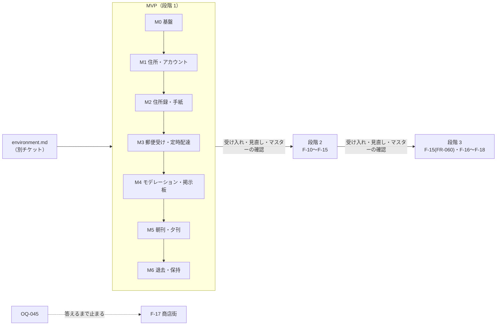

# 開発ロードマップ

- 状態: 草案
- 日付: 2026-11-19
- チケット: YGO-008
- 根拠: `.ai/brief.md`・`requirements.md`・`features.md`・`architecture.md`・`db.md`・`api.md`・`async.md`・`security.md`・`open-questions.md`・ADR-0001〜0021
- 関連 ADR: 0022（段階の切り方と関門）・0023（休眠と空き家の再割り当ては段階 3）・0024（マッチングは恋愛のためではない・連絡先の共有の禁止）・0025（配達完了の通知）・0026（クローズドな手紙の審査）・0027（未成年の利用）・0028（架空の街の地図は静的な画像で MVP）・0029（商店・団体のアカウントは管理者が作る）・0030（新規登録は開放式）

---

## §1 方針

1. **段階は `features.md` のとおり 3 つ**（MVP・段階 2・段階 3）[inferred]（構想の「開発ロードマップを作成する」と
   features.md §1.2 の段階分けから。構想そのものに段階の分け方はない）。新しい段階は作らない（ADR-0022）。
   MVP の中だけ、作る順番として M0〜M6 のマイルストーンに分ける（§4）。
2. **段階を進めるのはマスターの確認** [inferred]（設計 → レビュー → 実装の進め方の NFR-088 と、構想の
   「重大な仕様変更は事前承認」から。構想に段階ごとの確認の定めはない）。各段階は
   「受け入れ条件をすべて満たす → 見直し（`reviews/`）→ マスターの確認」で閉じる（ADR-0022）。
3. **受け入れ条件は手元で確かめられる形で書く** [inferred]（NFR-061・NFR-063・NFR-067）。
   すべて `sh scripts/check.sh` から動くテスト、または文書の有無で判定する。ネットワークなしで通ること。
4. **外部サービスはアダプタの裏に置き、モックで受け入れる** [inferred]（NFR-065・ADR-0022）。
   LLM（OQ-008）・メール送信（OQ-039）・鍵管理（C9）・オブジェクトストレージ（C8）・Web Push の送信（C11、ADR-0025）が対象。
5. **要回答の答えを受け入れ条件にしない** [inferred]（CLAUDE.md）。答えを待つ部分は暫定のまま進め、
   答えで変わる箇所を §8 に書く。答えがないと作れない部分だけを「止まる」とする。
6. **デプロイはしない** [explicit]（NFR-071・NFR-072・NFR-076）。開発・検証環境の構築計画は
   `environment.md`（別チケット）に回す（§9）。

---

## §2 段階の一覧

`features.md` §2 の段階の欄と同じ。

| 段階 | 機能 | 位置づけ（features.md §1.2） |
|------|------|------------------------------|
| MVP（段階 1） | F-01・F-02・F-03・F-04・F-05・F-06・F-07・F-08・F-09・F-19 | 「朝、自分の家のポストを開ける」体験が成立する最小の範囲 |
| 段階 2 | F-10・F-11・F-12・F-13・F-14・F-15（FR-060 を除く） | MVP のデータモデルを拡張する機能 |
| 段階 3 | F-15 の FR-060・F-16・F-17・F-18 | データのライフサイクルやアルゴリズムの確定を待つ機能 |
| このフェーズの範囲外 | F-20 | FR-090（features.md §1.4） |

### 機能ごとの段階

| ID | 機能 | 段階 | 作る順（§4〜§6） |
|----|------|------|------------------|
| F-01 | 架空の住所によるユーザー ID | MVP | M1 |
| F-02 | アカウント（作成・ログイン・セッション維持・削除） | MVP | M1（削除は M6） |
| F-03 | 郵便受け | MVP | M3 |
| F-04 | 個人宛の手紙 | MVP | M2 |
| F-05 | 朝便・夕便の定時配達 | MVP | M3 |
| F-06 | 朝刊・夕刊 | MVP | M5 |
| F-07 | 町内掲示板 | MVP | M4 |
| F-08 | 非同期モデレーション（ブロック・通報・送信上限を含む） | MVP | M3（ブロック）・M4 |
| F-09 | 住所録 | MVP | M2 |
| F-10 | グループ宛ての手紙 | 段階 2 | S2-1 |
| F-11 | 画像添付と新聞写真風加工 | 段階 2 | S2-2 |
| F-12 | 新聞バックナンバー | 段階 2 | S2-3 |
| F-13 | 掲示板カテゴリ・イベント・住民募集 | 段階 2 | S2-4 |
| F-14 | モデレーション保留への異議申し立て | 段階 2 | S2-5 |
| F-15 | 自分のデータのエクスポート | 段階 2（FR-060 は段階 3） | S2-6・S3-4 |
| F-16 | 引っ越し・住所転送・空き家（休眠・再割り当てを含む、ADR-0023） | 段階 3 | S3-1 |
| F-17 | 商店街（アカウントは管理者が作る、ADR-0029） | 段階 3 | S3-2（OQ-045 で止まる） |
| F-18 | マッチング（恋愛のカテゴリなし・連絡先の欄なし、ADR-0024） | 段階 3 | S3-3 |
| F-19 | 架空の街の地図（静的な画像、ADR-0028。全住民に同じは OQ-044 の暫定） | MVP | M1 |
| F-20 | 企業広告・折込チラシ | このフェーズの範囲外 | — |

---

## §3 段階どうしの依存

| 後の段階 | 前提になるもの | 理由 |
|----------|----------------|------|
| MVP | 設計文書（requirements〜security・本書）・ADR-0001〜0023・ADR-0025〜0028・`environment.md`（別チケット） | 作り始める前に、ローカルで DB と 2 プロセスを動かす手順が要る（NFR-058・NFR-073） |
| 段階 2 | MVP の受け入れ・見直し・マスターの確認 | 段階 2 は MVP のデータモデルを広げる（features.md §1.2） |
| 段階 3 | 段階 2 の受け入れ・見直し・マスターの確認 | F-16 は段階 2 のエクスポート（F-15）と画像（F-11）の保持の扱いを引き継ぐ。F-18 は F-10・F-11 を使う |

段階 2 の中・段階 3 の中の機能は、§5・§6 の表の依存を満たせば順番を入れ替えてよい。

---

## §4 MVP（段階 1）

### 段階

F-01〜F-09 と F-19。作る順番は次の 7 つのマイルストーン（ADR-0022）。各マイルストーンの終わりに `sh scripts/check.sh` が通ること。

| ID | マイルストーン | 含めるもの | 主な ADR・文書 |
|----|----------------|------------|----------------|
| M0 | 基盤 | 1 リポジトリ・2 プロセス（web / worker）の骨組み、PostgreSQL と pg-boss 相当のキュー、C3 の 8 サブモジュールの空の形、時刻を外から差し替えられる時計、アダプタ（KeyProvider の偽の鍵・ファイルのオブジェクトストレージ・モックのメール・モックの LLM 分類器・モックのプッシュ送信）、Vitest を `check.sh` からつなぐ | ADR-0008・0009・0010・0015、architecture.md §2・§6 |
| M1 | 住所・アカウント（F-01・F-02・F-19） | 住所のプール（使われたことのない住所）と候補の提示・選択、登録（開放式・招待なし、ADR-0030。メール確認はモックのメール）、ログイン・ログアウト、サーバー側セッション、再認証、流量の制限（登録の要求も対象）、プロフィールの表示・更新。架空の街の地図: 1 枚の静的な SVG（全住民に同じ。OQ-044 の暫定）（レポジトリの中で描いた架空の図、区画は「番」まで）を C1 の静的なファイルとして `` で出し、代替テキストを付ける。地図の API と DB の表は作らない。住所の場所は示さない（OQ-044 の暫定） | ADR-0001・0018・0019・0023・0028・0030、security.md §3・§7 T-05・T-07、api.md §7 F-01・F-02・F-19 |
| M2 | 住所録・手紙（F-09・F-04） | 住所録の追加・削除・メモ・検索と `registered_tenancy_id`、手紙の投函（`pending`・2,000 字・1 日 20 通）、本文の保存時暗号化（鍵の版・AAD）、送信済み一覧、`nextDeliveryRun` と `FOR SHARE` | ADR-0003・0004・0006・0021、db.md §2・§3、api.md §2.3 |
| M3 | 郵便受け・定時配達（F-03・F-05、F-08 のブロック） | J0・J1・J4・J5・J6 と、**J3 の休刊だけの経路**（紙面を組まずに `newspapers` に `is_holiday = true` の行を `ON CONFLICT DO NOTHING` で入れる。ADR-0007）、配達の時刻表 API、郵便受けの一覧・詳細・削除、ブロックの登録と配達時の `suppressed`。J2 は M4 まで作らないので、M3 の J0 は J2 を積まず、審査の打ち切り（04:00 / 16:00 JST）まで待ってから J3（休刊）を積む。こうして `newspapers` の行ができ、J4・J5 に進む（async.md §3 の J0 の判断）。宛先の振り分けは「通常・差し戻し・抑止」の 3 つ（転送は段階 3）。配達完了の通知: J15（公開のあとに 1 回・公開から 30 分まで）、購読の API（`/api/v1/me/push-subscription`・`/api/v1/notifications/public-key`）と送り先の検査、C1 のサービスワーカー、C11 の Web Push のアダプタ（テストではモック） | ADR-0004・0007・0016・0017・0025、async.md §3・§4 |
| M4 | モデレーション・掲示板（F-07・F-08） | 掲示板の投稿（`awaiting_review`・1,000 字・1 日 5 件）と掲載、J2（ルール表 → モックの LLM → ルール表との突合）、クローズドな手紙の審査（J2 でルール表だけで照合・LLM は渡さない・当たれば `blocked`・判定できなければ持ち越し、送信済みの「届けられませんでした」の表示。本番のルール表に手紙の項目は置かず、テストは偽の規則、OQ-043 の暫定）、通報、モデレーターのロール（運用者 CLI・二要素認証）、管理者の経路、通報された手紙の 1 通だけの復号（`GET /api/v1/admin/reports/{id}/letter`、OQ-043 (3) の暫定）と `view_letter` の記録 | ADR-0005・0014・0020・0026、security.md §2.3・§4・§5 |
| M5 | 朝刊・夕刊（F-06） | J3 を M3 の休刊だけの経路から本物の組版に広げる（TSX → 静的 HTML、コンテンツのハッシュの保存キー、`UNIQUE(delivery_run_id)`）、紙面の API と HTML の中継、J8（掲載済み投稿の削除による組み直し） | ADR-0007・0011、async.md §4 J3・J8 |
| M6 | 退去・保持（F-02 の削除） | `DELETE /me`、J7、J14、`erasure.replay` | ADR-0013、db.md §5・§6、async.md §4 J7・J14 |

### 依存

| マイルストーン | 前に要るもの | 理由 |
|----------------|--------------|------|
| M0 | `environment.md`（別チケット） | ローカルの PostgreSQL と 2 プロセスの起動手順 |
| M1 | M0 | DB・アダプタ（メール）・時計 |
| M2 | M1 | 住所録と手紙は住民と住所を参照する。手紙は住所録から宛先を選ぶ（FR-053） |
| M3 | M2 | 配達するのは手紙。振り分けは `registered_tenancy_id`（M2）を使う |
| M4 | M3 | 掲示板の投稿は J5（M3）で `published` になる。審査は J0 の工程判断（M3）に乗る。M4 から J0 は J2 を積み、審査が済めば打ち切りを待たずに J3 へ進む。手紙の審査（ADR-0026）: M3 の間は手紙を審査しないで配達する（J4 は判定を見ずに `scheduled` の手紙をすべて準備する）。M4 で、J1 に手紙の `moderation_queue` の行を入れる処理を、J4 に「判定が `approved` の手紙だけ」の条件を、J5 に J4 が準備しなかった手紙を次の便へ移す処理を、J6 に移した手紙のキューの行を入れる処理を足す（async.md §4） |
| M5 | M4 | 紙面の素材は承認済みの投稿（M4）。M3 の J3（休刊だけの経路）を本物の組版に広げる。組版の締め切りまでに組めないときの休刊の経路はそのまま残す |
| M6 | M5 | J7 は掲載済み投稿の削除で J8（M5）を積む |

MVP で依存する ADR: 0001〜0021 と 0022・0023・0025・0026・0027・0028。ADR-0002 のうち休眠と空き家の再割り当ては段階 3（ADR-0023）。

### 受け入れ条件

次の 16 項目をすべて満たし、見直しとマスターの確認を経て MVP を閉じる。テストのデータは架空の値（例: 夕暮ヶ丘三丁目 2-5、`test@example.invalid`）を使う（NFR-066）。

| # | 条件 | 確かめ方 |
|---|------|----------|
| A-01 | `sh scripts/check.sh` がネットワークなしで通り、すべてのテストを動かす | ネットワークを切った状態で実行して終了コード 0 |
| A-02 | 時刻を制御した端から端までの流れ: 住民 2 人が登録し、一方が住所録にもう一方を加え、D 日 00:30 JST に手紙を出すと、07:00 の公開より前は相手の郵便受けに出ず、07:00 の公開の後に手紙と朝刊（または休刊の印）が出る。D 日 01:05 に出した手紙は D 日の夕便（17:00）で届く | 時計を差し替えた統合テスト。J0 を 5 分刻みで動かす |
| A-03 | 冪等性: J1〜J6 のそれぞれを同じ配達回で 2 回動かしても、`mailbox_items`・`newspapers` の行の数が変わらず、一意制約の違反が出ない | 統合テスト（NFR-021・NFR-062） |
| A-04 | `async.md` §7 のテストの 8 つのケース（冪等性・`FOR SHARE` と締め切りの競合・途中停止と再開・休刊・持ち越し・公開と退去の競合・モックの LLM の失敗・通知の重複と期限）がすべてある | テストの名前と async.md §7 の表の対応を `status.md` に書き、すべて通る |
| A-05 | 組版の決定性: 同じ素材から描いた紙面の HTML がバイト単位で同じ。組版の締め切りまでに組めないときは `is_holiday = true` になり、その配達回は手紙だけが届く | スナップショットテスト・休刊のテスト（NFR-022・NFR-030） |
| A-06 | 承認されていない投稿は配達されない。ルール表に当たる → `rejected`。モックの LLM の `ok` / `review` / `block` / 失敗 / 決められた値以外 が security.md §5.2 のとおりに扱われ、失敗と想定外の値は公開されない。クローズドな手紙（ADR-0026）: テスト用の偽の規則に当たる手紙は `blocked` で誰の郵便受けにも出ず、送った人には「届けられませんでした」とだけ見え（規則は見えない）、当たらない手紙は届き、打ち切りまでに判定できない手紙は次の便に持ち越される。J4 の準備が済んだあとに J2 が `approved` を書いた手紙は、`delivered` にならずに次の便に移り、移し先で審査されて届く（どの郵便受けにも出ないまま確定しない）。手紙の審査の間、LLM の呼び出しが 0 回（呼ばれたら失敗するモックを差し込む）で、`moderation_queue` の手紙の行の `llm_label` は NULL（CHECK 制約）。手紙の本文に入れた目印の文字列が、ログ・`moderation_queue`・ジョブのペイロードに出ない | 単体テスト・統合テスト・ログを取り込むテスト（NFR-005・NFR-011・NFR-012・FR-078・FR-080） |
| A-07 | API の経路で LLM を呼ばない。web プロセスは LLM の API キーを読まない | 呼ばれたら失敗するモックを web 側に差し込んだ API テスト・設定の読み込みのテスト（security.md §1・§6.1） |
| A-08 | 即時性と数値を返さない: ルートの一覧に WebSocket・SSE・ロングポーリングがない。すべての応答のスキーマに件数・総数・未読・既読・閲覧数・反応数・残りの上限の項目がない（429 も残りの数を返さない）。通知の購読の API（`/api/v1/me/push-subscription`・`/api/v1/notifications/public-key`）の応答にも件数がなく、通知を今すぐ送る経路がない | ルートとスキーマを走査するテスト（ADR-0014・0025、api.md §8） |
| A-09 | 権限: security.md §4.2 の表の各行に、許可と拒否の両方のテストがある。他人のデータは 404、admin の経路だけ 403。モデレーターは当事者の案件を処理できない。通報された手紙（`GET /api/v1/admin/reports/{id}/letter`）は、通報が `open`・当事者でない・二要素認証済みのときだけ 1 通返り、呼ぶたびに `moderation_actions` に `view_letter` の記録が残り、応答は `no-store`。ルール表に当たって止めた手紙（通報なし）はモデレーターから見て 404。管理用の審査キューに手紙の行が出ない。通報された手紙の取得は OQ-043 (3) の暫定で、答えでこの確認が変わる（読ませないなら、経路がないことを確かめる） | 権限表のテスト（ADR-0020・0026） |
| A-10 | 保存時の暗号化: `letters` の保存値に本文の平文が含まれない。AAD（手紙の ID）が違うと復号に失敗する。鍵の版を入れ替えても古い版の手紙を読める。メールは暗号化した値と HMAC だけ、パスワードは Argon2id | 単体テスト・DB を直接読むテスト（ADR-0006・0018・0021） |
| A-11 | 上限: 手紙 2,000 字・投稿 1,000 字を超えると 400。JST の暦日ごとに手紙 21 通目・投稿 6 件目は 429（code は `daily_limit_reached`）。ログインと再設定に流量の制限が効き、超えると 429（code は `rate_limited`、api.md §5） | API テスト（ADR-0004・0005、security.md §3.5） |
| A-12 | 住所: 候補は使われたことのない住所だけ（ADR-0023）。同じ住所を同時に選ぶと片方が 409。候補の提示のほかに住所を列挙する経路がない。登録とプロフィールの要求・応答のスキーマに、生年月日・年齢・保護者の同意の項目がなく、登録に年齢の確認がない（FR-094、ADR-0027）。登録の要求のスキーマに招待トークン・紹介者の項目がなく、招待なしで登録できる。登録の要求が流量の制限を超えると 429 で code は `rate_limited`（api.md §5。`daily_limit_reached` ではない）（FR-091、ADR-0030） | API テスト・スキーマを走査するテスト（FR-003・FR-091・FR-094、security.md T-05・§2.2・§3.5） |
| A-13 | 退去: `DELETE /me` の後は、退去した住民のどのセッション（どの端末）で呼んでも 401 `unauthenticated`（api.md §2.4 のセッションの無効化・§5 のエラーの表）。退去した住所の `GET /api/v1/profiles/{address}` は 404 `not_found`（api.md §7 F-01）。J7 の後は ADR-0013 の表のとおり（認証情報の消去・未配達の手紙は `returned`・掲載済み投稿の本文の消去と組み直し・住所は `vacant_deleted`）。退去したあとに通知の購読（`push_subscriptions`）と送った記録（`delivery_notifications`）が残らない（ADR-0025）。リストアを模したあと `erasure.replay` で消し直される。ログに手紙の本文・パスワード・トークン・平文のメールが出ない | 統合テスト・ログを取り込むテスト（NFR-010・security.md §2.5） |
| A-14 | 文書: `status.md` に F-01〜F-09・F-19 の実装済み・未実装・暫定対応（§8 の暫定を含む）を書く。見直しを `reviews/` に残し、重大・中は直してある | 文書の有無と見直しの記録（NFR-088） |
| A-15 | 配達完了の通知（ADR-0025、FR-028・FR-102。数え方と中身は OQ-042 の暫定）: (1) 購読のある住民 2 人（その便の手紙 2 通と 0 通）で朝便を流すと、07:00 の公開のあとにモックのプッシュ送信が通知を 1 通だけ受ける。(2) その通知の中身は便と「2」だけで、差出人・本文・住所を含まない。(3) 0 通の住民には送らない。(4) 公開の前・`skipped` の便・公開から 30 分のあとには送らない。(5) J15 を 2 回動かしても通知が増えない。(6) ログアウトした端末には送らない。(7) プライベートの宛先の `endpoint` の登録は 400 | (1)(4) 時計を差し替えた統合テスト。(2)(3)(5)(6) 統合テスト。(7) API テスト |
| A-16 | 架空の街の地図（ADR-0028、FR-103。住所の場所は OQ-044 の暫定で示さない）: (1) 地図の画面に画像が 1 枚出て、代替テキストがある。(2) 住民 2 人のそれぞれのセッションで取った地図の画像が、バイト単位で同じ（D1 (b)、OQ-044 の暫定。答えで変わる。ログインしていない人に地図の画面を出すかは決めておらず、ここでは確かめない）。(3) ルートの一覧に地図の API の経路がなく、DB に地図の表がない。(4) 画像の中に号までの住所（`2-5` の形）・住民・入居・空き家・数がない。(5) 画像の中に `<script>`・イベント属性・外部の URL への参照がない | (1)(4)(5) 画像のファイルを読む単体テスト。(2) API テスト。(3) A-08 のルートの走査のテストを広げる・DB のスキーマを走査するテスト |

---

## §5 段階 2

### 段階

F-10〜F-15（F-15 の FR-060 を除く）。

| ID | 機能 | 主な変更 |
|----|------|----------|
| S2-1 | F-10 グループ宛ての手紙 | `letter_recipients` を複数にする。宛先の数の上限（OQ-038） |
| S2-2 | F-11 画像添付と新聞写真風加工 | `images`・J13・C8 への保存。手紙・掲示板（3 枚まで）・新聞の画像 |
| S2-3 | F-12 新聞バックナンバー | `delivery_runs.status = 'done'` の配達回の紙面だけを返す。休刊・持ち越しの回は出さない |
| S2-4 | F-13 掲示板カテゴリ・イベント・住民募集 | 投稿のカテゴリと絞り込み |
| S2-5 | F-14 異議申し立て | `block` で却下された投稿に 1 回の申し立て（security.md §5.2）と、モデレーターの処理 |
| S2-6 | F-15 エクスポート（FR-096） | 自己紹介・住所録・自分の手紙などの書き出し。退去と同じ認可・再認証 |

### 依存

| 機能 | 前に要るもの | 始める前に書くもの | 関係する OQ |
|------|--------------|--------------------|-------------|
| S2-1 F-10 | M2・M3 | 宛先の上限を api.md に書く（OQ-038 を決定にする） | OQ-038（持ち越し）・OQ-043（要回答、止まらない。グループ宛の手紙も手紙ごとに審査する、ADR-0026） |
| S2-2 F-11 | M2・M4・M5 | 画像加工の ADR（加工の方式・外見の識別力を下げる基準・費用の見積もり NFR-078） | OQ-026（決定） |
| S2-3 F-12 | M5 | 紙面の保持期間を ADR-0013 に足す | OQ-030 |
| S2-4 F-13 | M4 | カテゴリの一覧（db.md・api.md） | — |
| S2-5 F-14 | M4 | 異議の手続き（security.md §5） | OQ-037（要回答、止まらない） |
| S2-6 F-15 | M1・M2 | 書き出す項目と形式（api.md） | — |

### 受け入れ条件

| # | 条件 | 確かめ方 |
|---|------|----------|
| B-01 | MVP の受け入れ条件 A-01〜A-13・A-15・A-16 が引き続き通る | `sh scripts/check.sh` |
| B-02 | グループ宛ての手紙は宛先ごとに冪等に届き（宛先の数 × 1 行）、上限を超えると 400。宛先の一部がブロック・差し戻しでも、ほかの宛先には届く | 統合テスト |
| B-03 | 画像は加工が終わるまでどこにも出ない。組版までに加工が終わらない画像は紙面に載らない（async.md J13）。元の画像は住民にもモデレーターにも返さない | 統合テスト |
| B-04 | バックナンバーは `done` の配達回の紙面だけを返し、件数・閲覧数を返さない | API テスト（A-08 のテストを広げる） |
| B-05 | カテゴリの絞り込みは決定的な並び（api.md §6）で、人気の順を使わない | API テスト |
| B-06 | 異議申し立ては 1 つの投稿に 1 回だけ。申し立てても人の審査が終わるまで公開されない | 単体テスト・権限表のテスト |
| B-07 | エクスポートは本人だけ（他人は 404）・再認証が要り、他の住民の内部 ID・`registered_tenancy_id` を含まない | API テスト |
| B-08 | `status.md` に F-10〜F-15 の状態を書き、見直しを `reviews/` に残す | 文書 |

---

## §6 段階 3

### 段階

F-15 の FR-060・F-16・F-17・F-18。

| ID | 機能 | 主な変更 |
|----|------|----------|
| S3-1 | F-16 引っ越し・住所転送・空き家 | 引っ越しの申請、転送（6 か月）、J11、休眠（J10・J12）、長期不在の退去（J9）、空き家の再割り当て（ADR-0023） |
| S3-2 | F-17 商店街 | 商店・団体の住所と発信。アカウントは管理者が運用者の CLI で作る（ADR-0029）。**OQ-045 の答えがないと作れない** |
| S3-3 | F-18 マッチング | 趣味・友人のマッチング（恋愛のカテゴリは設けない、FR-064）、提案は定時配達に乗せる、任意参加・辞退・ブロック、成立後は手紙でやり取りし、登録と提案に街の外の連絡先の欄を設けない（FR-101、ADR-0024） |
| S3-4 | F-15 の FR-060 | 住所録のインポート・エクスポート |

### 依存

| 機能 | 前に要るもの | 始める前に書くもの | 関係する OQ |
|------|--------------|--------------------|-------------|
| S3-1 F-16 | M3（振り分け）・M6（退去）・S2-6 | 引っ越しの API と転送の振り分けを api.md・async.md に足す。休眠の通知の文面 | OQ-039（要回答、止まらない。モックで受け入れる） |
| S3-2 F-17 | M4・S2-4・S3-1 | 発信する主体・認証・住所の割り当ての ADR（OQ-045 の答えのあと。作る主体は ADR-0029） | **OQ-045（要回答、止まる）** |
| S3-3 F-18 | M3・M4・S2-1・S2-2 | マッチングのアルゴリズムの ADR（FR-066）・カテゴリの分け方（FR-069） | OQ-041（要回答、止まらない） |
| S3-4 FR-060 | S2-6 | 取り込む形式と、取り込んだ住所の `registered_tenancy_id` の取り方 | — |

### 受け入れ条件

| # | 条件 | 確かめ方 |
|---|------|----------|
| C-01 | 段階 2 の受け入れ条件 B-01〜B-07 が引き続き通る | `sh scripts/check.sh` |
| C-02 | 引っ越しの後 6 か月は旧住所あての手紙が新住所の住民に届き、住所録の表示の住所は変わらない（ADR-0003）。6 か月を過ぎると差し戻し | 時計を差し替えた統合テスト |
| C-03 | 12 か月ログインなしで `dormant` と通知 1 通（モックのメール）、さらに 30 日で `vacant_expired`、そこから 12 か月で J7。途中でログインすると `active` に戻る | 時計を差し替えた統合テスト（ADR-0002・0013） |
| C-04 | 空き家を新しい住民に割り当てても、前の住民あてに住所録から出した手紙は新しい住民に届かない（db.md §3） | 統合テスト |
| C-05 | J9〜J12 を 2 回動かしても状態と通知の積み込みが重ならない（J12 のまれな 2 通は async.md のとおり許容） | 統合テスト |
| C-06 | マッチングの提案は定時配達でだけ届き、候補数・成立率を返さない。参加しない住民は候補に出ない。辞退・ブロックの後は提案されない。カテゴリの一覧に恋愛がなく、参加の登録・提案のスキーマに街の外の連絡先（メール・電話番号・外部のアカウントなど）の項目がない。参加の登録に年齢の条件と年齢の項目がない（FR-064・FR-094・FR-101） | 統合テスト・A-08 のテストを広げる |
| C-07 | 住所録のインポートは本人の住所録だけを変え、存在しない住所は取り込まない | API テスト |
| C-08 | 商店街（S3-2）は OQ-045 の答えが出たときだけ作り、受け入れ条件を足す。足すときは少なくとも次を入れる: 商店・団体のアカウントは運用者の CLI でだけ作れ、住民の登録と API のどの経路でも作れない（ADR-0029 の D1・D2。API テスト・A-08 のルートの走査を広げる）。答えがないときは未実装として `status.md` に書けば段階 3 を閉じてよい | 文書 |
| C-09 | `status.md` に段階 3 の状態を書き、見直しを `reviews/` に残す | 文書 |

---

## §7 未確定・範囲外

| 項目 | 扱い | 動く条件 |
|------|------|----------|
| FR-103 地図の上の住所の場所 | 暫定（示さない。全住民に同じ 1 枚の画像）で M1 に入る（ADR-0028） | OQ-044 の答えで、住所と画像の上の位置の対応・ADR-0028 の D1・M1 の内容・A-16 が変わる |
| FR-101 連絡先の共有の禁止の範囲 | 暫定（マッチングの中だけ）で S3-3 に入る | OQ-041 の答えで、手紙・掲示板の審査（M4）に及ぶかが変わる |
| FR-028 配達完了の通知の数え方と中身 | 暫定（手紙だけを数える・0 通の住民には送らない・中身は便と件数だけ）で M3 に入る（ADR-0025） | OQ-042 の答えで J15 の数え方・送る相手・中身と A-15 が変わる |
| FR-078 手紙で止める内容と、手紙の閲覧 | 手紙の審査（ルール表だけ、ADR-0026）は M4 に入る。止める内容と閲覧は暫定（本番のルール表に手紙に当てる項目を置かない（テストは偽の規則）・止めた手紙は人が見ない（送った人には「届けられませんでした」とだけ見せる）・通報された手紙はモデレーターが 1 通だけ確かめる（YGO-007 からの暫定）） | OQ-043 の答えで本番のルール表の手紙の項目・止めた手紙と通報された手紙の権限・`GET /api/v1/admin/reports/{id}/letter` の有無・A-09 が変わる |
| FR-058 誰が自分を住所録に加えたか | 暫定（知らせない）で MVP に入る | OQ-040（持ち越し） |
| F-20 広告・折込チラシ | このフェーズの範囲外（FR-090） | — |

---

## §8 段階が依存する要回答の項目

`open-questions.md` の「要回答」の 8 項目（OQ-008・037・039・041・042・043・044・045）。どれも、答えを前提にした決定はしていない。
「止まる」は答えがないと作れないもの。それ以外は暫定のまま作り、答えで変わる箇所を直す。

| OQ | 題 | 段階・機能 | 止まるか | 使っている暫定 | 答えで変わるところ |
|----|----|------------|----------|----------------|--------------------|
| OQ-008 | 外部 LLM のサービスと費用 | MVP・F-08（M4） | 止まらない | モックの LLM で受け入れる | 本番のアダプタと費用の見積もり（`environment.md`）。受け入れ条件は変わらない |
| OQ-037 | 違反した住民への処置 | MVP・F-08（M4）、段階 2・F-14 | 止まらない | 処置を `moderation_actions` に記録するだけ | 処置の実行手段（利用停止など）と、異議の手続き（S2-5） |
| OQ-039 | メール送信サービス | MVP・F-02（M1）、段階 3・F-16 | 止まらない | モックかローカルの SMTP | 本番のアダプタと費用（`environment.md`）。受け入れ条件は変わらない |
| OQ-041 | 共有を禁止する「連絡先」と禁止の範囲 | 段階 3・F-18（S3-3）、手紙・掲示板に及ぶなら MVP・F-08（M4） | 止まらない | マッチングの中だけ（登録と提案に連絡先の欄を設けない） | FR-101 の範囲。及ぶならルール表（security.md §5）・J2 の対象・A-06。クローズドな手紙に及ぶなら OQ-043 と合わせて決める。街の住所も含むなら FR-067・ADR-0024 の D2・成立後に相手へ手紙を出す方法（提案に街の住所を載せるか）・C-06 |
| OQ-042 | 通知で数える「郵便」と通知の中身 | MVP・F-05（M3、FR-028） | 止まらない | 手紙だけを数える・0 通の住民には送らない・中身は便と件数だけ | J15 の数え方と送る相手（async.md §4）・ADR-0025 の通知の中身・security.md §7 の T-17・A-15 |
| OQ-043 | 手紙で止める内容と、モデレーターが手紙を見てよい場面 | MVP・F-08（M4）、段階 2・F-14 | 止まらない | 本番のルール表に手紙に当てる項目を置かない（テストは偽の規則）・止めた手紙は人が見ない（送った人には「届けられませんでした」とだけ見せる）・通報された手紙はモデレーターが 1 通だけ確かめる（YGO-007 からの暫定） | 本番のルール表の手紙の項目（security.md §5.1）・止めた手紙と通報された手紙の権限（security.md §2.3・§4.2・§5.4）と通報された手紙の取得の有無と条件（api.md §7 F-08）・止めた手紙の保持期間（ADR-0013）・異議の手続き（S2-5）・A-09 |
| OQ-044 | 地図の上で住所の場所を示すか | MVP・F-19（M1、FR-103） | 止まらない | 示さない（全住民に同じ 1 枚の画像） | 住所と画像の上の位置の対応・FR-103・ADR-0028 の D1・security.md §7 の T-05・M1 の内容・A-16 |
| OQ-045 | 商店・団体は誰か・作ったあと誰が発信するか | 段階 3・F-17（S3-2、FR-104） | **止まる** | なし（作らない） | F-17 の設計（発信する主体・認証・住所の割り当て）・security.md §4 の主体・F-20 との境・S3-2 の受け入れ条件（C-08） |

OQ-001（恋愛マッチングの年齢条件）は 2026-11-19 の答えで決定した（恋愛のカテゴリを設けない、ADR-0024）。FR-064 は止まらなくなった。

OQ-002（配達完了後の通知）は 2026-11-19 に決定した（通知あり・郵便の件数を含む、ADR-0025）。FR-028 は M3 に入った。

OQ-003（クローズドな手紙のモデレーション範囲）は 2026-11-19 に決定した（対象とする・LLM には渡さない・厳格なアクセス制御、ADR-0026）。手紙の審査は M4 に入った。残りは OQ-043。

OQ-004（未成年の利用ポリシー）は 2026-11-19 に決定した（年齢制限なし・特別な制限なし、ADR-0027）。M1 の登録と S3-3 の参加の条件に年齢を入れない。

OQ-005（架空の街の地図）は 2026-11-19 に決定した（静的な画像として実装し、開発の初期段階で行う、ADR-0028）。F-19 は止まらなくなり、MVP の M1 に入った。残りは OQ-044。

OQ-006（商店・団体のアカウントの主体）は 2026-11-19 に決定した（管理者作成、ADR-0029）。作る経路は運用者の CLI。F-17 は残りの OQ-045 で止まる。

OQ-007（新規登録の方式）は 2026-11-19 に決定した（開放式、ADR-0030）。M1 の登録は招待なしで、A-12 に招待の項目がないことと登録の要求の流量の制限を足した。

持ち越しで段階に関係するもの: OQ-046（M1 の前に、メールの確認が済まない登録が住所を押さえる期限を決める）・OQ-038（S2-1 の前に決める）・OQ-040（FR-058、暫定は知らせない）・OQ-030（S2-3 の前に紙面の保持期間を決める）・OQ-033〜OQ-035（実装の段階で決める）。

---

## §9 デプロイ・環境・費用

- **デプロイはしない**（NFR-071）。どの段階の受け入れ条件にも、本番の環境・クラウドのアカウント・ドメインを使うものを入れない（NFR-072）。
- **開発・検証環境の構築計画は `environment.md`（別チケット）に回す**（NFR-073）。ローカルの PostgreSQL・2 プロセスの起動・偽の鍵・モックのメールと LLM・監視の通知先（async.md §7）はそこで書く。M0 はその文書を前提にする。
- **費用のかかる操作はしない**。外部 LLM（OQ-008）・メール送信（OQ-039）・画像加工（NFR-078）の費用は `environment.md` に見積もりとして書き、契約と支出はマスターの事前承認を得る（NFR-080）。

---

## §10 進捗の記録

| 文書 | 書くこと |
|------|----------|
| `status.md` | マイルストーン（M0〜M6）と段階 2・3 の機能ごとの、実装済み・未実装・暫定対応。§8 の暫定を使っている箇所 |
| `retros.md` | 受け入れ条件を満たせなかったときの問題・根本原因・気づけなかった理由・再発防止 |
| `reviews/` | 各段階の終わりの見直し（重大・中・軽微） |
| `report.md` | 完成の報告（動作確認・テスト・既知の問題・未実装・デプロイと運用の手順の計画） |

---

## §11 FR / NFR との対応

| FR / NFR | 本書の箇所 |
|----------|------------|
| FR-001〜003・FR-008〜010 | §4 M1・A-12 |
| FR-103 | §4 M1・A-16（住所の場所は §8 OQ-044） |
| FR-004〜007・FR-071〜075 | §6 S3-1・C-02〜C-05（アカウント削除による空き家は §4 M6・A-13） |
| FR-011〜014・FR-017〜020・FR-099 | §4 M2・M3・A-02・A-10・A-11 |
| FR-013 | §5 S2-1・B-02 |
| FR-015・FR-016・FR-040・FR-043 | §5 S2-2・B-03 |
| FR-021〜027・FR-029・FR-030 | §4 M3・A-02〜A-04 |
| FR-028 | §4 M3・A-15（数え方は §8 OQ-042） |
| FR-102 | §4 M3・A-15 |
| FR-031〜038 | §4 M5・A-05 |
| FR-039 | §5 S2-3・B-04 |
| FR-041・FR-042・FR-044・FR-048・FR-049 | §4 M4・A-06・A-11 |
| FR-045・FR-050 | §5 S2-4・B-05 |
| FR-046・FR-047・FR-104 | §6 S3-2・C-08・§8 OQ-045 |
| FR-051〜057・FR-059 | §4 M2 |
| FR-058 | §7（OQ-040） |
| FR-060 | §6 S3-4・C-07 |
| FR-061〜070・FR-101 | §6 S3-3・C-06（FR-101 の範囲は §7・§8 OQ-041） |
| FR-076〜080・FR-082 | §4 M4・A-06・A-07（FR-078 は A-06・A-09、止める内容は §8 OQ-043） |
| FR-081 | §5 S2-5・B-06 |
| FR-083〜090 | §7（範囲外） |
| FR-091〜095・FR-097・FR-098・FR-100 | §4 M1・M6・A-09・A-12・A-13 |
| FR-096 | §5 S2-6・B-07 |
| NFR-011・NFR-012 | A-06・A-07 |
| NFR-017 | A-10 |
| NFR-021・NFR-022・NFR-062 | A-03〜A-05 |
| NFR-061・NFR-063・NFR-065・NFR-066・NFR-067 | §1・A-01 |
| NFR-071〜073・NFR-076〜080 | §9 |
| NFR-088 | §1・A-14・B-08・C-09 |
