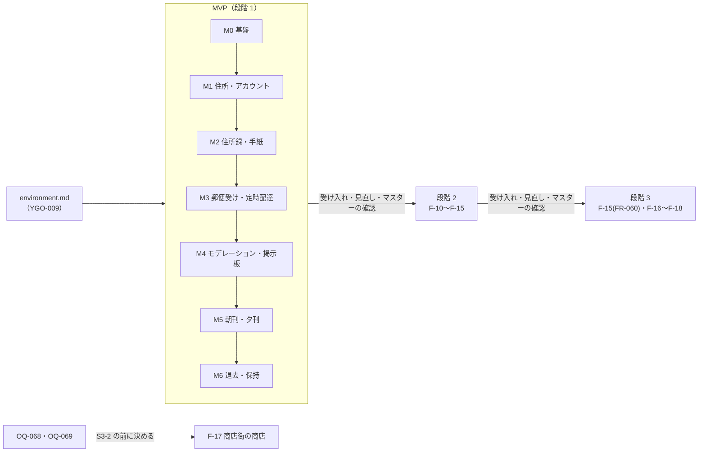

# 開発ロードマップ

- 状態: 草案
- 日付: 2026-11-19
- チケット: YGO-008
- 根拠: `.ai/brief.md`・`requirements.md`・`features.md`・`architecture.md`・`db.md`・`api.md`・`async.md`・`security.md`・`open-questions.md`・ADR-0001〜0021
- 関連 ADR: 0022（段階の切り方と関門。0099 で置き換え）・0023（休眠と空き家の再割り当ては段階 3）・0024（マッチングは恋愛のためではない・連絡先の共有の禁止）・0026（クローズドな手紙の審査。0072 で置き換え）・0027（未成年の利用）・0028（架空の街の地図は静的な画像で MVP。0058 で置き換え）・0029（商店・団体のアカウントは管理者が作る）・0030（新規登録は開放式）・0031（外部 LLM の費用の見積もりとサービスの暫定の選定。0086 で置き換え）・0032（違反した住民への処置の内容はマスターが後で決める）・0033（メール送信はテスト環境ではモックかローカルの SMTP、本番はマスターの事前承認を得て選ぶ）・0035（新聞は全住民に定時、手紙は午前・午後のランダムな時刻、通知は新聞と手紙で分ける）・0037（地図は全住民で共有する 1 枚の白黒の画像、印とゲーム風の地図は今は作らない）・0038（商店は実在の企業・個人のお店を目指す、コミュニティは住民が作り制約を置く）・0039（新聞は組ごとの版、知り合い 0 の組は興味で分ける、記事の文字は LLM、組版はサーバー）・0041（年齢で守り方を変え、年齢は住民の設定をそのまま使う）・0042（地図に自分の家・候補・知り合いの家の印を C1 が重ねる。0059 で置き換え）・0043（商店とは契約と利用料の考えをメモだけ、架空の店と金額のない入居者募集の張り紙、発信はお店の担当者、出せるものはランクで変え折込チラシが最高、商店は実在の情報を出してよい）・0044（MVP は全住民が知り合い 0 の組、新聞の知り合いは互いに住所録に入れた住民で掲示板の投稿だけを載せ、組 1・2 は住民ごとに組む、アップロードした元の画像は持たない。0074 で置き換え）・0045（興味は自分に届いた過去の新聞の検索から推し量り、検索語は残さず興味の ID だけを持つ、明るく開いた文で知らせて個別の同意は取らない、推し量った興味を本人が見て消す仕組みは設けない）・0049（手紙は知り合いにだけ出せる、知り合いは互いの住所録の追加か掲示板でのオープン、足されたことは相手に知らせない。0065 で置き換え）・0050（架空の店と張り紙は段階 3 から、架空の店は「入居者募集」の張り紙で示し発信させず新聞に載せない、新聞に運営の入居者募集の広告を出す）・0051（地図の知り合いの家の印は住所録のすべてのエントリ、地図と新聞・手紙で知り合いの定義を分け、印は `acquainted` で変えない）・0052（開発とテストは手元に入れた PostgreSQL、`check.sh` は使い捨ての DB、IaC は OpenTofu で設計だけ、事業者は選ばない）・0053（過去の新聞の検索から興味を推し量ることを住民は止められない、止める手段を作らず、知らせて推し量ることを検索の処理に組み込む）・0054（住民の掲示板の投稿を素材にした記事では、LLM は見出しだけを書き、まとめは書かない）・0055（0039 を置き換え。組ごとの版・記事の文字は LLM・組版はサーバーのまま、投稿の記事は見出しだけで `body` は NULL、投稿の決まった見出しは「掲示板から」）・0057（0047 を置き換え。年齢による違いは作らない、止める基準と使える機能は全員に同じ、詐欺と事件の防止は全員に同じ共通のルール）・0058（0028 を置き換え。0063 で置き換え）・0059（0042 を置き換え。0064 で置き換え）・0063（0058 を置き換え。0083 で置き換え）・0064（0059 を置き換え。0084 で置き換え）・0065（0049 を置き換え。手紙は知り合いにだけ、知り合いは互いの住所録の追加か掲示板の経路、掲示板のオープンは投稿ごとで見た人から投稿者へだけ出せ、オープンにした時点で許したことになる、足されたことは相手に知らせない）・0066（相互にならない住所録の追加は自動で止める）・0068（`check.sh` とジョブは、成功・失敗・中断のどれでも起こしたものを片付け、マスターが入れた道具は置いたまま）・0069（0056 を置き換え。手紙は送るときに照合し、照合を絶対NG（`reject`、送れない）と疑い（`review`、送った人が頼んだ手紙をモデレーターが確かめる）に分ける、本当の情報に街の外の連絡先と自分から書くことを含める、手紙の本文に絵文字を入れられない）・0070（絶対NGと絵文字の入力不可を全ての書き込みに当て、手紙のほかは 422 `content_rejected`）・0071（0034 を置き換え。街の外の連絡先は全ての書き込みで止める）・0072（0026 を置き換え。クローズドな手紙の審査）・0093（0073 を置き換え。年齢と誕生日は登録で必須・変えられず、年齢は誕生日に進む、年齢は本人から配達済みの手紙を受け取った住民にだけ見せ、誕生日は本人にだけ返す）・0074（0044 を置き換え。0044 の決定に、知り合いの住民ごとの版の朝刊の誕生日の欄を足し、組の境に誕生日の知り合いを入れる）・0075（0013 を置き換え。0077 で置き換え）・0076（0025 を置き換え。配達の通知は Web Push で新聞と手紙を配達回ごとに 1 回ずつ、送った記録は配達回の `finished_at` から 30 日）・0077（0075 を置き換え。0079 で置き換え）・0079（0077 を置き換え。0085 で置き換え）・0085（0079 を置き換え。退去の処理と保持期間、退去で住民を指す行をすべて消すか住民の列を NULL にし、居住記録を住所を空き家にするのと同じトランザクションで終わらせ、退去の受付でセッションを無効にし、J7 の最初に通知の購読・セッション・認証情報を消して `erasure_log` に記録する、配達回は消さない、退去した送り手の届いていない手紙はすぐに消す、確定した手紙は送信済みに確定から 30 日だけ出し、差し戻し・抑止・却下は 30 日、届いた手紙は 30 日を過ぎて受取人全員が消したあとの J14 で消す、通報された手紙は残す）・0078（通報された手紙はモデレーターが条件付きで 1 通だけ確かめる・住民を守る制限は住民が外せる設定にしない、手紙を通報できるのは受取人だけで郵便受けの行の ID で指し、条件に合わなければ同じ 202 で何も保存しない）・0080（0018 を置き換え。ログインはメールとパスワード、確認・再設定・ログインの経路は `/api/v1` の名前で、アカウントの有無を応答で明かさない）・0090（0081 を置き換え。セッションはサーバー側、確かめる順番に流量の制限を入れ、再認証は住民ごとに数える、セッションの一覧と取り消し、`invalidated_at` は退去の受付だけでほかの無効化は行を消す、強制ログアウトは運用者の CLI だけ、再認証の経路と 6 つの対象、モデレーターの二要素認証、パスワードとメールアドレスの変更）・0082（0001 を置き換え。内部 ID と住所を分け、住所は候補か地図の空き家の印から選び、登録の要求は候補かどうかを確かめず、割り当てられない住所は同時の登録と同じ 409）・0083（0063 を置き換え。地図は静的な画像のまま、拡大・移動・検索はせず、押せるのは登録の画面の候補の印と空き家の印だけ、地図のための API は入居の一覧だけ）・0084（0064 を置き換え。地図の印は C1 が重ね、登録の画面では候補の印か空き家の印を押すか一覧から選ぶ、街のすべての家の空き家・入居を名前なしの 2 値で全員にいつでも見せる、休眠は入居と示す）・0086（外部 LLM の暫定の選定と見積もり、名前と日付つきの料金を載せる）・0097（M は M0〜M6 のまま、M1 は住所・アカウント、手紙の一続きは M3 の終わりで通り、中心の体験の全体は M5 の終わりでそろう）・0099（0022 を置き換え。段階は 3 つ、MVP は M0〜M6、各段階は受け入れ条件・見直し・マスターの確認で閉じる、要回答の答えを受け入れ条件にせず、今、要回答で止まるものはない）

---

## §1 方針

1. **段階は `features.md` のとおり 3 つ**（MVP・段階 2・段階 3）[inferred]（構想の「開発ロードマップを作成する」と
   features.md §1.2 の段階分けから。構想そのものに段階の分け方はない）。新しい段階は作らない（ADR-0099）。
   MVP の中だけ、作る順番として M0〜M6 のマイルストーンに分ける（§4）。
2. **段階を進めるのはマスターの確認** [inferred]（設計 → レビュー → 実装の進め方の NFR-088 と、構想の
   「重大な仕様変更は事前承認」から。構想に段階ごとの確認の定めはない）。各段階は
   「受け入れ条件をすべて満たす → 見直し（`reviews/`）→ マスターの確認」で閉じる（ADR-0099）。
3. **受け入れ条件は手元で確かめられる形で書く** [inferred]（NFR-061・NFR-063・NFR-067）。
   すべて `sh scripts/check.sh` から動くテスト、または文書の有無で判定する。ネットワークなしで通ること。
4. **外部サービスはアダプタの裏に置き、モックで受け入れる** [inferred]（NFR-065・ADR-0099）。
   LLM（暫定の選定は Anthropic API、本番のアダプタは承認のあと。ADR-0086。新聞の文章アダプタも同じで、モデルは OQ-062、ADR-0039）・外のニュースの取り込み（偽の記事のアダプタだけ、本番は OQ-060 のあと、ADR-0039）・メール送信（テスト環境はモックかローカルの SMTP、本番のサービスはマスターの事前承認を得て選び、アダプタは承認のあと。ADR-0033）・鍵管理（C9）・オブジェクトストレージ（C8）・Web Push の送信（C11、ADR-0076）が対象。
5. **要回答の答えを受け入れ条件にしない** [inferred]（CLAUDE.md）。答えを待つ部分は暫定のまま進め、
   答えで変わる箇所を §8 に書く。答えがないと作れない部分だけを「止まる」とする。
6. **デプロイはしない** [explicit]（NFR-071・NFR-072・NFR-076）。開発・検証環境の構築計画は
   `environment.md`（YGO-009、ADR-0052）に書いた（§9）。

---

## §2 段階の一覧

`features.md` §2 の段階の欄と同じ。

| 段階 | 機能 | 位置づけ（features.md §1.2） |
|------|------|------------------------------|
| MVP（段階 1） | F-01・F-02・F-03・F-04・F-05・F-06・F-07・F-08・F-09・F-19 | 「朝、自分の家のポストを開ける」体験が成立する最小の範囲 |
| 段階 2 | F-10・F-11・F-12・F-13・F-14・F-15（FR-060 を除く） | MVP のデータモデルを拡張する機能 |
| 段階 3 | F-15 の FR-060・F-16・F-17・F-18 | データのライフサイクルやアルゴリズムの確定を待つ機能 |
| このフェーズの範囲外 | F-20 | FR-090（features.md §1.4） |

### 機能ごとの段階

| ID | 機能 | 段階 | 作る順（§4〜§6） |
|----|------|------|------------------|
| F-01 | 架空の住所によるユーザー ID | MVP | M1 |
| F-02 | アカウント（作成・ログイン・セッション維持・削除） | MVP | M1（削除は M6） |
| F-03 | 郵便受け | MVP | M3 |
| F-04 | 個人宛の手紙 | MVP | M2 |
| F-05 | 朝便・夕便の定時配達 | MVP | M3 |
| F-06 | 朝刊・夕刊（組ごとの版・興味・外のニュース・記事の文字は LLM、ADR-0039） | MVP | M5 |
| F-07 | 町内掲示板 | MVP | M4 |
| F-08 | 非同期モデレーション（ブロック・通報・送信上限を含む） | MVP | M3（ブロック）・M4 |
| F-09 | 住所録 | MVP | M2 |
| F-10 | グループ宛ての手紙 | 段階 2 | S2-1 |
| F-11 | 画像添付と新聞写真風加工 | 段階 2 | S2-2 |
| F-12 | 新聞バックナンバー | 段階 2 | S2-3 |
| F-13 | 掲示板カテゴリ・イベント・住民募集 | 段階 2 | S2-4 |
| F-14 | モデレーション保留への異議申し立て | 段階 2 | S2-5 |
| F-15 | 自分のデータのエクスポート | 段階 2（FR-060 は段階 3） | S2-6・S3-4 |
| F-16 | 引っ越し・住所転送・空き家（休眠・再割り当てを含む、ADR-0062） | 段階 3 | S3-1 |
| F-17 | 商店街（商店は住所を持ち、商店・団体が情報発信できる。商店のアカウントは管理者が作る、ADR-0067。コミュニティは住民が作る、ADR-0038。団体が住所を持つかは OQ-057） | 段階 3 | S3-2（商店の部分は OQ-068・OQ-069 を決めてから） |
| F-18 | マッチング（恋愛のカテゴリなし・連絡先の欄なし、ADR-0024） | 段階 3 | S3-3 |
| F-19 | 架空の街の地図（全住民で共有する 1 枚の白黒の静的な画像、ADR-0083・ADR-0061。自分の家・候補の印は M1、知り合いの家の印は M2、ADR-0084・ADR-0065・ADR-0051。空き家・入居の表示（入居の一覧の経路と入居の層）は M1、ADR-0083 の D3・ADR-0084 の D10・D13〜D15） | MVP | M1（知り合いの家の印は M2） |
| F-20 | 企業広告・折込チラシ | このフェーズの範囲外 | — |

---

## §3 段階どうしの依存

| 後の段階 | 前提になるもの | 理由 |
|----------|----------------|------|
| MVP | 設計文書（requirements〜security・本書）・ADR-0002〜0007・ADR-0009〜0012・ADR-0100・ADR-0014〜0023・ADR-0026・ADR-0027・ADR-0076・ADR-0091・ADR-0078・ADR-0039〜0041・ADR-0065・ADR-0051・ADR-0052・ADR-0060〜0062・ADR-0082〜0084・`environment.md`（YGO-009） | 作り始める前に、ローカルで DB と 2 プロセスを動かす手順が要る（NFR-058・NFR-073） |
| 段階 2 | MVP の受け入れ・見直し・マスターの確認 | 段階 2 は MVP のデータモデルを広げる（features.md §1.2） |
| 段階 3 | 段階 2 の受け入れ・見直し・マスターの確認 | F-16 は段階 2 のエクスポート（F-15）と画像（F-11）の保持の扱いを引き継ぐ。F-18 は F-10・F-11 を使う |

段階 2 の中・段階 3 の中の機能は、§5・§6 の表の依存を満たせば順番を入れ替えてよい。

---

## §4 MVP（段階 1）

### 段階

F-01〜F-09 と F-19。作る順番は次の 7 つのマイルストーン（ADR-0099・ADR-0097）。登録から手紙が郵便受けに届くまでの一続き（登録 → 互いに住所録に入れる → 手紙の投函 → 定時配達 → 郵便受け）は M1 → M2 → M3 で作り、M3 の終わりで通る（M3 は M4・M5 を待たない。M2・M3 の中の作る順は `gaps.md` G-069）[assumed]。中心の体験の全体（`mvp.md` (a) の 5 つの要素。町内掲示板は M4、朝刊・夕刊は M5）がそろうのは M5 の終わり。各マイルストーンの終わりに `sh scripts/check.sh` が通ること。

| ID | マイルストーン | 含めるもの | 主な ADR・文書 |
|----|----------------|------------|----------------|
| M0 | 基盤 | 1 リポジトリ・2 プロセス（web / worker）の骨組み、PostgreSQL と pg-boss 相当のキュー、C3 の 8 サブモジュールの空の形、時刻を外から差し替えられる時計、アダプタ（KeyProvider の偽の鍵・ファイルのオブジェクトストレージ・モックのメール・ローカルの SMTP（宛先はループバックだけ、ADR-0033）・モックの LLM 分類器・モックのプッシュ送信）、Vitest を `check.sh` からつなぐ。開発の DB の台本（`scripts/dev-db.sh`。`start`・`stop`・`reset`・`clean`）と、`check.sh` が使い捨ての PostgreSQL（Unix ソケットだけ）を起こしてテストを動かす流れ（PostgreSQL の道具がなければ失敗する。終わったら成功・失敗・中断のどれでも起こしたものを片付ける、ADR-0068）、`APP_ENV` と環境変数の読み込み（`staging`・`production` で偽の鍵か `CLOCK_OFFSET` があれば起動に失敗、web・worker は自分の列にない秘密があれば起動に失敗、テストの準備は外への接続を失敗させる。受け入れ条件は A-07） | ADR-0100・0009・0010・0015・0033・0052・0068、architecture.md §2・§6、environment.md §2〜§4・§8.1 |
| M1 | 住所・アカウント（F-01・F-02・F-19） | 住所のプール（使われたことのない住所）と候補の提示・選択（候補か地図の空き家の印から選び、登録の要求は候補かどうかを確かめない。プールにない住所は 400、行のある住所と同時の登録の負けた側は同じ 409、ADR-0082 の D3）、登録（開放式・招待なし、ADR-0030。メール確認はモックのメール）、メールの確認と確認のメールの送り直し、パスワードの再設定の依頼と完了、ログイン・ログアウト、サーバー側セッション、セッションの一覧と取り消し、再認証、パスワードとメールアドレスの変更（ADR-0080・ADR-0090、api.md §7 F-02）、確認と再設定のメールを worker に渡すジョブ J18 `mail.send` と送る前の値の `auth_tokens` の列（前のアドレスへの変更の知らせを含む。モックのメール、async.md §4 J18、ADR-0102 の D7）、`sessions`・`staff_roles`・`credentials` の TOTP の列（ADR-0102。ロールの付与の CLI とモデレーターの二要素認証の経路は M4）、流量の制限（security.md §3.5 の規則の表の値と `rate_limit_buckets`。登録の要求も対象、ADR-0088）、確認が済まない登録の 24 時間（確認のリンクの期限・登録し直しで期限切れの登録を消すこと・J14 のうち期限切れの登録と `rate_limit_buckets` の行を消す対象だけ。J14 のほかの対象は M6、ADR-0087）、プロフィールの表示・更新（ニックネームと自己紹介の絵文字の検査で 400 `validation_failed`、web の入力欄は絵文字を受け付けない。絶対NGの照合は M4 で足す、ADR-0070 の D2・D7）。年齢と誕生日（ADR-0093）: 登録の `age` の必須（0〜999、外れたら 400）と `birthday` の必須（`MM-DD`、暦にない月日・形の違いは 400、`02-29` は受け付ける）、登録の画面の誕生日の注意書き（「この町での誕生日です（本当の日でなくてかまいません）」）と「年齢と誕生日はあとから変えられません」の表示、`residents.age_at_registration`・`age_base_date`・`birthday_month`・`birthday_day`（月日の CHECK）、`GET /me` の今の年齢（誕生日の回数で時計から計算）と `birthday`、`PATCH /me` の `age`・`birthday` は 400（ほかの住民への年齢の表示は M3。誕生日の欄は組 1・2 と一緒に作り、M5 には入れない）。架空の街の地図: 全住民で共有する 1 枚の白黒の静的な SVG（ADR-0061）（レポジトリの中で描いた架空の図、区画は「番」まで）を C1 の静的なファイルとして `` で出し（土台はどの住民にもバイト単位で同じ）、代替テキストを付ける。C1 の静的な配置の定義（番の区画）と住所から位置を求める関数、土台の上に重ねる印の層: 自分の家の印（`GET /api/v1/me`）と、自分の家を中心に置く表示の窓（幅と高さは土台の 2 倍）、登録の画面の候補の印（`GET /api/v1/addresses/candidates`。一覧と同じ見出し）と空き家の印。候補の印か空き家の印を押すか（キーボードでも。空き家の印は層ごとに 1 つの Tab の止まり場所と矢印キー）一覧から選び、一覧と地図の選択は 1 つの状態（候補でない空き家を選んだときは一覧のそばに選んだ住所を出す）。押す処理は React のハンドラで登録の画面の候補の印と空き家の印だけに付ける。登録が 409 なら決まった文を出し、選択を外して候補と入居の一覧を取り直す（ADR-0084 の D7・D8、OQ-080・OQ-089 → 決定）。入居の一覧の経路（`GET /api/v1/addresses/occupancy`。認証なし、住所のプールの静的な定義の住所と `occupied` だけを番・号の順に返し、`active`・`dormant` は入居、使われたことのない住所と `vacant_*` は空き家、要求のときの状態。件数を返さない、ADR-0084 の D13〜D15）と、登録の画面とログインした住民の地図の画面の入居の層（家ごとに白黒の 2 つの形のどちらか、ほかの印はその上、ADR-0084 の D8・D10）。DB の地図の表と、画像・位置・座標を返す経路は作らない（ADR-0083 の D3）。拡大・移動・検索は作らない | ADR-0082・0080・0090・0062・0030・0061・0093・0083・0084・0070・0087・0088・0102、security.md §3・§7 T-05・T-07、api.md §7 F-01・F-02・F-19、db.md §2、async.md J14・J18 |
| M2 | 住所録・手紙（F-09・F-04） | 住所録の追加・削除・メモ・検索と `registered_tenancy_id`（メモと検索語の絵文字の検査で 400、ADR-0070 の D2）。知り合いのふつうの経路（ADR-0065）: 住所録の各エントリの `acquainted`（ブロックを見ずに求める）、追加はどの住所でも同じ 201 と `acquainted: false`、追加は 1 日 20 件（429 `daily_limit_reached`）、相互にならない追加の停止（`address_book.counted_at`、直近 7 日の `address_book_daily_counts` で判定し 429 `add_suspended`、J14 は数えを 7 日分残す。ADR-0066）、足された側には何も知らせない（申請・承認の経路なし）。手紙の投函（`pending`・2,000 字・1 日 20 通。宛先が知り合いでなければ何も保存せずに 422 `not_acquainted`。確かめる順番は形式 → 知り合い → ルール表（照合は M4 で足す、ADR-0069 の D8）。ブロックは見ない）、本文の絵文字の検査（形式の確認で 400 `validation_failed`、web の入力欄は絵文字を受け付けない。顔文字は通す。ADR-0069 の D13）、本文の保存時暗号化（鍵の版・AAD）、送信済み一覧、`nextDeliveryRun` と `FOR SHARE`。地図の知り合いの家の印（`GET /api/v1/address-book` のすべてのエントリに、`acquainted` によらず M1 の印の層で付ける。地図の画面は `acquainted` を読まない。ADR-0084 の D1 (c)・ADR-0065 の D8・ADR-0051） | ADR-0003・0004・0006・0021・0065・0066・0051・0069・0070・0059、db.md §2・§3、api.md §2.3・§2.4・§6・§7 F-04・F-09・F-19 |
| M3 | 郵便受け・定時配達（F-03・F-05、F-08 のブロック） | J0・J1・J4・J5・J6 と、**J3 の休刊だけの経路**（紙面を組まずに `newspapers` に `is_holiday = true` の行を `ON CONFLICT DO NOTHING` で入れる。ADR-0098）、配達の時刻表 API、郵便受けの一覧・詳細・削除、ブロックの登録と配達時の `suppressed`。J2 は M4 まで作らないので、M3 の J0 は J2 を積まず、審査の打ち切り（04:00 / 16:00 JST）まで待ってから J3（休刊）を積む。こうして `newspapers` の行ができ、J4・J5 に進む（async.md §3 の J0 の判断）。宛先の振り分けは「通常・差し戻し・抑止」の 3 つ（転送は段階 3）。J4 は新聞（M3 では休刊の行）を全住民に `mailbox_items` で作り、各行に `visible_at` を書く（新聞は 07:00 / 17:00、手紙は受取人ごとの枠の時刻。郵便受けの API は `visible_at` を過ぎた項目だけを返す、ADR-0035）。配達の通知: J15（新聞の通知は公開のあとに 1 回・公開から 30 分まで、手紙の通知は J0 が枠ごとに積み・枠の時刻から 30 分まで。M3 の紙面は休刊だけだが、休刊の回にも新聞の通知を送るので、新聞の通知は M3 から流れる。ADR-0035 の D11）、購読の API（`/api/v1/me/push-subscription`・`/api/v1/notifications/public-key`）と送り先の検査、C1 のサービスワーカー、C11 の Web Push のアダプタ（テストではモック）。プロフィールの年齢: `GET /api/v1/profiles/{address}` が、見る住民の郵便受けにその住民からの手紙（`visible_at` を過ぎたもの・削除していないもの・今の居住記録以後。見る住民がその住民をブロックしていない）があるときだけ `age` を返す（郵便受けとブロックが要るので M3、ADR-0093 の D4） | ADR-0004・0098・0094・0017・0035・0093・0076、async.md §3・§4 |
| M4 | モデレーション・掲示板（F-07・F-08） | 掲示板の投稿（`awaiting_review`・1,000 字・1 日 5 件。本文の絵文字の検査で 400）と掲載、J2（掲示板の投稿だけ。ルール表 → モックの LLM → ルール表との突合）、手紙のほかの書き込みの絶対NG（ADR-0070 の D3）: 掲示板の投稿・ニックネームと自己紹介・住所録のメモ・通報の理由を、書いたときにルール表の `reject` の段に当て、当たれば何も保存せず・何も変えずに 422 `content_rejected`（掲示板の投稿は当たらなければ J2 に進む。ほかの書き込みには `review` の段を当てない）、通報の理由の絵文字の検査で 400、クローズドな手紙の審査（OQ-052 → 決定、ADR-0069）: 投函のときに API がルール表の手紙の項目（`spam`・`external_link`・`adult_words`・`real_info` の 4 種類。`real_info` は本当の居住地・本当の年齢・街の外の連絡先を、聞く・自分から書く・ほかの人のものを書くのどれも。各項目は段 `reject` / `review` を持ち、`spam` は `review` だけ。テストは偽の規則（`review` は `EXAMPLE_LETTER_RULE_DO_NOT_USE`、`reject` は `EXAMPLE_LETTER_REJECT_RULE_DO_NOT_USE`）と、形の規則の偽の値で、本物の言葉の一覧はレポジトリに置かない、OQ-076・OQ-087 → 決定、ADR-0069 の D1・D10〜D12）だけで、`reject` → `review` の順に照合し、LLM は渡さない。`reject` の段に当たれば何も保存せずに 422 `letter_rejected`（`request_review` があっても同じ。web は決まった文面）。`review` の段だけに当たれば何も保存せずに 422 `letter_needs_review`、web のポップアップの y / n、y なら `request_review: true` で `held`、送信済みの「確認中」「届けられませんでした」の表示、手紙の 2 つの 422 と `content_rejected` を合わせた流量の制限。確認待ちの手紙の経路（`/api/v1/admin/held-letters` の一覧・1 通の取得・`approve` / `reject`）と `letter_id` 付きの `moderation_actions`。J14 の `blocked` の 30 日の削除と J7 の `held`・`blocked` の削除。通報、モデレーターのロール（運用者 CLI・二要素認証）、管理者の経路、通報された手紙の 1 通だけの復号（`GET /api/v1/admin/reports/{id}/letter`、OQ-043 → 決定、ADR-0078）と `view_letter` の記録。照合の細部（OQ-065）と不審な挙動への対処（OQ-075）は M4 を始める前に ADR で決める。ルール表と権限の規則に年齢の条件を持たせない（ADR-0057）。掲示板の経路（OQ-081 → 決定、ADR-0065 の D7・D10〜D12）: `POST /api/v1/board/posts` の任意の `accepts_letters`（既定は false）と `board_posts.accepts_letters`、投稿者だけが切り替える `PATCH /api/v1/board/posts/{id}`（`accepts_letters` だけ、ほかは 404。審査し直さない）、掲示板の応答の `accepts_letters`（投稿者の住所は返さない）、`POST /api/v1/address-book` の `board_post_id` での追加（`address_book.board_post_id`、住所を持たないエントリ）と `POST /api/v1/letters` の宛先の `address_book_entry_id`（`letter_recipients.board_post_id`、送信済みに住所を返さない）、投稿者が届いた手紙から差出人を足し返す `POST /api/v1/address-book` の `mailbox_item_id`（`address_book.source`・`source_letter_id`・`letter_recipients.route`、郵便受けで差出人の住所を返さない、ADR-0065 の D15）、C1 のオープンの選択と切り替えと住所録に足す導線、投函と住所録の `acquainted` の判定に D7（オープンの掲載中の投稿から足したエントリだけ。向きは足した側から投稿者へだけ）と D2 の組の条件（住所を入れたエントリと住所を見せないエントリを組にしない） | ADR-0005・0014・0020・0072・0078・0065・0069・0070・0071・0057、security.md §2.3・§3.5・§4・§5 |
| M5 | 朝刊・夕刊（F-06） | J3 を M3 の休刊だけの経路から本物の組版に広げる（TSX → 静的 HTML、版ごとに組む、保存キー `newspapers/<run_id>/<edition_key>/<hash>.html`、`UNIQUE(delivery_run_id)` と `UNIQUE(newspaper_id, edition_key)`）。興味の一覧（運用者の CLI、シードは架空の名前）・登録の興味の項目（任意）・興味の設定の API（`/api/v1/interest-categories`・`/api/v1/me/interests`）。J17（外のニュースの取り込み。偽の記事のアダプタだけ、本番は OQ-060 のあと）。J16（記事の文字。モックの文章アダプタ・出力の検査・ルール表・決まった形への切り替え）。J4 の組分けと版の選び方（暫定は全住民が知り合い 0 の組、興味がなければ共通の版、複数ならハッシュ）と、新聞の部分一意索引 UNIQUE(delivery_run_id, resident_id) WHERE kind = 'newspaper'。紙面の API（自分の郵便受けに届いた版だけ）と HTML の中継、J8（掲載済み投稿の削除による版ごとの組み直し） | ADR-0098・0011・0055、async.md §4 J3・J4・J8・J16・J17、db.md §2 |
| M6 | 退去・保持（F-02 の削除） | `DELETE /me`、J7（消去の控え `erasure/` を含む）、J14、`erasure.replay`（控えから J7 をやり直し、J14 を 1 回動かす。ADR-0096）、鍵の入れ替えの `keys.reencrypt`（運用者の CLI が積む。1,000 件ずつ、ADR-0052 の D8） | ADR-0091・0096・0021・0052、db.md §4・§5・§6、async.md §2・§4 J7・J14・`erasure.replay`、environment.md §6.5・§8.3 |

### 今の M の範囲

M0〜M6 の行を M の順に `- M<n>: <名前>。FR-…` の形で書く。名前は上の表のマイルストーンの列（括弧の F を除く）。FR は番号の順に重複なく並べ、区切りは `, `、範囲（〜）は 1 つずつ書く [assumed]。FR のない M は「（FR なし）」と書く。中身は `mvp.md` (b) の表の FR 列と同じ（M1 は M1 の機能の表、M2〜M6 は「MVP の M2〜M6」の表）。今の M は M1。

- M0: 基盤（FR なし）
- M1: 住所・アカウント。FR-001, FR-002, FR-003, FR-007, FR-008, FR-009, FR-010, FR-091, FR-092, FR-094, FR-098, FR-100, FR-103, FR-113, FR-114, FR-115, FR-124, FR-127
- M2: 住所録・手紙。FR-012, FR-014, FR-017, FR-018, FR-019, FR-020, FR-051, FR-052, FR-053, FR-054, FR-055, FR-056, FR-058, FR-059, FR-114, FR-121, FR-122, FR-124, FR-125
- M3: 郵便受け・定時配達。FR-008, FR-011, FR-021, FR-022, FR-023, FR-024, FR-025, FR-026, FR-027, FR-028, FR-029, FR-030, FR-099, FR-102, FR-105, FR-113
- M4: モデレーション・掲示板。FR-041, FR-042, FR-044, FR-048, FR-049, FR-076, FR-077, FR-078, FR-079, FR-080, FR-082, FR-112, FR-120, FR-122, FR-124, FR-126
- M5: 朝刊・夕刊。FR-031, FR-032, FR-033, FR-034, FR-035, FR-036, FR-037, FR-038, FR-106, FR-108, FR-109, FR-110, FR-111
- M6: 退去・保持。FR-093, FR-097

FR-007 は M1 では「空き家を候補に戻さない」（候補は使われたことのない住所だけ、ADR-0062）を作り、候補に戻すのは §6 S3-1。FR-095（想定する規模）は ADR-0012 の取り決めで、どの M の機能でもない。

### 依存

| マイルストーン | 前に要るもの | 理由 |
|----------------|--------------|------|
| M0 | `environment.md`（YGO-009）。`check.sh` を動かす機械（手元・CI・秘書のジョブの環境）に Node.js と PostgreSQL のサーバーの道具があること（environment.md §4.1。入れるのはマスター（OQ-086 → 決定）。秘書は M0 で `environment.md` §5.1 の一覧の道具と主版を伝え、Vitest を `check.sh` からつなぐ前に node が、DB のテストを足す前に PostgreSQL の道具があることを確かめる） | ローカルの PostgreSQL と 2 プロセスの起動手順（environment.md §3）・`check.sh` の Node.js の確かめと DB（§4）。道具がないと `check.sh` が失敗する |
| M1 | M0。M0 のうち M1 の TC が使う部品（テストの土台・依存・使い捨ての DB・テストの準備で外への接続を失敗させること・時計・キュー・環境変数の読み込み・モックのメール・worker のジョブの実行・偽の鍵）は、M1 のチケットで作る（下の「M1 の土台のチケット」） | DB・アダプタ（メール・鍵）・時計 |
| M2 | M1 | 住所録と手紙は住民と住所を参照する。手紙の宛先は住所録の知り合いのエントリから選ぶ（FR-053）。知り合いは住所録と居住記録から求める（ADR-0065） |
| M3 | M2 | 配達するのは手紙。振り分けは `registered_tenancy_id`（M2）を使う |
| M4 | M3 | 掲示板の投稿は J5（M3）で `published` になる。審査は J0 の工程判断（M3）に乗る。M4 から J0 は J2 を積み、審査が済めば打ち切りを待たずに J3 へ進む。手紙の審査（ADR-0069）: M2・M3 の間は手紙を照合しないで配達する。本文の絵文字の検査は M2 から入れる。手紙のほかの書き込みの絶対NG（ADR-0070）もルール表を作る M4 から入れ、M1〜M3 の間の書き込みは当て直さない。M4 で、`POST /api/v1/letters` に投函のときの 2 段の照合・422（`letter_rejected`・`letter_needs_review`）・`request_review`・`held` を、管理者の経路に確認待ちの手紙の経路を足す。J1〜J6 は手紙について M3 のまま（J4 は判定を見ずに `scheduled` の手紙をすべて準備し、`moderation_queue` に手紙の行を入れない。J5 の準備されなかった手紙を次の便へ移す処理は安全網として M3 から置く。async.md §4）。M4 の前に OQ-065（照合の細部）を ADR で決める |
| M5 | M4 | 紙面の素材は承認済みの投稿（M4）。J16 は J2（M4）のあとに動き、出力をルール表（M4）に当てる。M3 の J3（休刊だけの経路）を本物の組版に広げる。組版の締め切りまでに組めないときの休刊の経路はそのまま残す。新聞の版と興味の決め方は ADR-0039。モデル・プロンプトの ADR（OQ-062）を M5 の前に書く |
| M6 | M5 | J7 は掲載済み投稿の削除で J8（M5）を積む |

### M1 の土台のチケット

M1 の TC が依存する M0 の土台は、次の `M: M1` のチケットが作る。各チケットの「依存」の節と同じ順。

| チケット | 作るもの | 使う M1 の TC | 前に要るチケット |
|----------|----------|---------------|------------------|
| YGO-062 | Vitest を `check.sh` からつなぐ台本・設定・例のテスト・`prepare.sh` | すべての TC | — |
| YGO-078 | `package.json` とロックファイル。Vitest を動かす | すべての TC | YGO-062 |
| YGO-075 | 依存を足すときのロックファイルの ADR（ADR-0106） | — | YGO-062 |
| YGO-076 | 使い捨ての PostgreSQL・ひな型の DB・`test/setup.ts`（ファイルごとの DB と、外への接続を失敗させる準備（A-07 の (4)）） | DB を使う TC・外への接続はすべての TC | YGO-075・YGO-078 |
| YGO-103 | `addresses`・`tenancies` の 2 表 | TC-005 | YGO-076 |
| YGO-077 | 残りの 6 表と `tenancies.resident_id` の外部キー | TC-016・TC-018・TC-020・TC-023 など | YGO-103 |
| YGO-080 | 差し替えられる時計 | TC-016・TC-017 | YGO-103 |
| YGO-082 | 環境変数の読み込みと `MAIL_ADAPTER` の選択 | TC-020 | YGO-103 |
| YGO-086 | pg-boss を固定の版で依存に足し、ロックファイルを直す | TC-017・TC-019 | YGO-103 |
| YGO-081 | `jobs` のキューに積む口 | TC-017・TC-019 | YGO-086 |
| YGO-083 | モックのメールのアダプタ | TC-020 | YGO-082 |
| YGO-085 | KeyProvider の偽の鍵 | TC-018・TC-019・TC-020・TC-023・TC-001 | YGO-082 |
| YGO-084 | worker のジョブの実行 | TC-017・TC-020 | YGO-080・YGO-081・YGO-083・YGO-085 |

依存の順: YGO-062 → YGO-075 と YGO-078（並んで進む）→ YGO-076 → YGO-103 → YGO-077、YGO-103 → YGO-080・YGO-082・YGO-086 → YGO-081・YGO-083・YGO-085 → YGO-084。M1 の FR のチケットが前に要る土台のチケットは、下の「M1 の FR のチケット」の表のとおり（YGO-084 を待たない FR のチケットもある）。YGO-103 より後のどのチケットの実装も YGO-062 と YGO-078 の両方の done を待つ。
M0 のうち M1 の TC が使わない残り（`scripts/dev-db.sh`・`APP_ENV` の起動の検査・`CLOCK_OFFSET`・ローカルの SMTP・web の入口と開発の起動のコマンドなど）は、M1 のチケットにせず、使う TC のチケットを切るときに扱う `[assumed]`。

### M1 の FR のチケット

住所の候補・登録・ログインの FR のチケット（YGO-071 で切った）と、その TC が使う部品のチケット。各チケットの「依存」の節と同じ順。FR が「—」のものは部品で、自分の TC を持たず、使う FR のチケットの TC で確かめる。

| チケット | FR | TC | 前に要るチケット |
|----------|----|----|------------------|
| YGO-089 | FR-002（住所のプール） | TC-003 | YGO-062・YGO-078 |
| YGO-090 | FR-010（候補の取得と使われたことのない住所の登録） | TC-013・TC-014・TC-015 | YGO-103・YGO-077・YGO-082・YGO-085・YGO-089 |
| YGO-091 | FR-007（候補から空き家を除く） | TC-007・TC-008 | YGO-103・YGO-090 |
| YGO-092 | FR-010（期限切れの確認が済まない登録） | TC-016・TC-017 | YGO-077・YGO-080・YGO-081・YGO-084・YGO-090 |
| YGO-093 | —（流量の制限） | TC-019 の 429 | YGO-077・YGO-080 |
| YGO-094 | FR-091（登録の受け付け） | TC-018・TC-019 | YGO-077・YGO-081・YGO-085・YGO-090・YGO-091・YGO-093 |
| YGO-095 | FR-092（ログイン） | TC-023 | YGO-077・YGO-085・YGO-094 |
| YGO-096 | —（J18 の確認のメール） | TC-020 | YGO-077・YGO-082・YGO-083・YGO-084・YGO-085・YGO-094 |
| YGO-097 | FR-091（メールの確認の完了） | TC-020 | YGO-077・YGO-082・YGO-083・YGO-084・YGO-085・YGO-094・YGO-095・YGO-096 |
| YGO-098 | FR-001（確認まで済ませた登録） | TC-001・TC-002 | YGO-077・YGO-095・YGO-097 |

依存の順: 各チケットは、表の「前に要るチケット」に書いたチケットだけを待つ。それに加えて、どのチケットの実装も YGO-062 と YGO-078（ロックファイル。YGO-088 の実装のジョブの権限を待つ）の done を待ち、CI が緑になるのは、秘書の CI の定義（`check.yml`）に `prepare.sh` の段が入ったあと（ADR-0109 の D2・G-079）。たとえば YGO-089 はスキーマと M0 の部品を待たず、YGO-089・YGO-090・YGO-093 は YGO-084 を待たない。

この表と土台のチケットのどれにも入らない M1 の TC の行き先。どれも、行き先のチケットの「直さないところ」に書いてあり、そのチケットが done になってから、その FR のチケットとして切る。TC-005 は YGO-103、TC-033 は YGO-062 の範囲。

| 行き先のチケット | TC |
|------------------|----|
| YGO-089 | TC-004（FR-002） |
| YGO-090 | TC-006（FR-003）・TC-045〜TC-049（FR-113）・TC-063〜TC-065（FR-127） |
| YGO-091 | TC-042〜TC-044（FR-103）・TC-050〜TC-055（FR-114）・TC-056〜TC-059（FR-115） |
| YGO-095 | TC-021・TC-022・TC-024〜TC-032（FR-092）・TC-036〜TC-039（FR-098）・TC-040・TC-041（FR-100） |
| YGO-098 | TC-009〜TC-011（FR-008）・TC-012（FR-009）・TC-034・TC-035（FR-094）・TC-060〜TC-062（FR-124） |

MVP で依存する ADR: 0002〜0007・0009〜0012・0014〜0017・0020・0021 と 0099・0100・0027・0078・0039・0041・0093・0065・0066・0051・0052・0057・0060・0061・0062・0069・0070・0071・0072・0076・0080・0082・0083・0084・0085・0087・0088・0090・0102。ADR-0060 のうち休眠と空き家の再割り当ては段階 3（ADR-0062）。

### 受け入れ条件

次の 19 項目をすべて満たし、見直しとマスターの確認を経て MVP を閉じる。テストのデータは架空の値（例: 夕暮ヶ丘三丁目 2-5、`test@example.invalid`）を使う（NFR-066）。
手紙を出すテストでは、A-19 のほかは、送る人と受け取る人を互いに住所録に入れて知り合いにしておく（ADR-0065）。

| # | 条件 | 確かめ方 |
|---|------|----------|
| A-01 | `sh scripts/check.sh` がネットワークなしで通り、すべてのテストを動かす。終わったあと、`check.sh` が起こしたプロセスと一時のディレクトリ・ソケットが残らない（ADR-0068） | ネットワークを切った状態で実行して終了コード 0。通るとき・テストを 1 つ失敗させたとき・途中で INT を送ったときのそれぞれで、前後の PostgreSQL のプロセスと一時ディレクトリを比べて増えていない |
| A-02 | 時刻を制御した端から端までの流れ: 住民 2 人が登録し、2 人が互いに住所録に加え（知り合いになる、ADR-0065）、D 日 00:30 JST に手紙を出すと、07:00 の公開の後に朝刊（または休刊の印）が両方の住民の郵便受けに出るが、手紙は 07:00 には出ない。手紙は相手の枠の時刻（午前 08:00〜11:50 のどれか。`SHA-256(run_id:resident_id)` から計算した値）を過ぎて初めて相手の郵便受けに出て、その 1 枠前の時刻にはまだ出ない（`GET /mailbox/items/{id}` も 404）。送った人の送信済みは 12:00 までは「投函済み」で、12:00 を過ぎて「配達済み」になる。D 日 01:05 に出した手紙は D 日の夕便で、午後 18:00〜20:50 のどれかの枠に届く（ADR-0035） | 時計を差し替えた統合テスト。J0 を 5 分刻みで動かす |
| A-03 | 冪等性: J1〜J6 のそれぞれを同じ配達回で 2 回動かしても、`mailbox_items`・`newspapers`・`newspaper_editions` の行の数が変わらず、一意制約の違反が出ない。J16・J17 も、2 回動かして `newspaper_articles`・`external_news_items` の行の数が変わらない（ADR-0039） | 統合テスト（NFR-021・NFR-062） |
| A-04 | `async.md` §7 のテストの 19 のケース（冪等性・`FOR SHARE` と締め切りの競合・途中停止と再開・休刊・持ち越し・締め切りのやり直し・審査キューの一意と持ち越し・公開と退去の競合・消去の再生・モックの LLM の失敗・通知の重複と期限・手紙の時刻・新聞の LLM の失敗・やり直しで LLM を呼ばない・外のニュースは取り込んだ回だけ・記事の打ち切りのあとの J16・版の決定性と新聞の部分一意索引・LLM に渡すもの・投稿の記事は見出しだけ）がすべてある | テストの名前と async.md §7 の表の対応を `status.md` に書き、すべて通る |
| A-05 | 組版の決定性: 同じ保存した記事（`newspaper_articles`）から描いた、それぞれの版の HTML がバイト単位で同じ。J3 と J8 のやり直しで LLM を呼ばない（呼ばれたら失敗するモックを差し込む、ADR-0055 の D7）。組版の締め切りまでに組めないときは `is_holiday = true` になり、その配達回は紙面の代わりに休刊の印が全住民の郵便受けに届き、手紙も届く（新聞の通知も送る、ADR-0035 の D11） | スナップショットテスト・休刊のテスト（NFR-022・NFR-030） |
| A-06 | 承認されていない投稿は配達されない。ルール表に当たる → `rejected`。モックの LLM の `ok` / `review` / `block` / 失敗 / 決められた値以外 が security.md §5.2 のとおりに扱われ、失敗と想定外の値は公開されない。クローズドな手紙（ADR-0072・ADR-0069）: (i) `review` の段に当たったとき: テスト用の `review` の段の偽の規則（`EXAMPLE_LETTER_RULE_DO_NOT_USE`）に当たる本文を `request_review` なしで投函すると 422 `letter_needs_review` で、`letters` と `letter_recipients` に行ができず（DB を直接読む）、1 日の上限に数えられず、応答に規則の ID・種類・本文の位置が含まれない。(ii) n: 送り直さなければ何も残らず、本文に入れた目印の文字列が DB・ログ・ジョブのペイロードに出ない。(iii) y: 同じ本文に `request_review: true` を付けて送り直すと `held`（`delivery_run_id` は NULL、`matched_rule_id`・`rule_version` あり）で保存され、送った人の送信済みに「確認中」と見え（規則は見えない）、1 日の上限に数えられ、J1〜J6 を流しても誰の郵便受けにも出ない。`request_review: true` でも当たらない本文は `pending` で届く。(iv) モデレーターの確認: `approve` した手紙は `pending` になって次の配達回で届く。`reject` した手紙は `blocked` で誰の郵便受けにも出ず、送った人には「届けられませんでした」とだけ見え、J14 で `decided_at` から 30 日を過ぎると本文と宛先ごと消える（時計を差し替える）。(v) 当たらない手紙: `pending` で保存されて届く。投函のあとにルール表の版を上げて同じ本文が当たるようにしても、その手紙は当て直されずに届く（ADR-0069 の D3）。(vi) 本文を守る: 投函の照合の間、LLM の呼び出しが 0 回（呼ばれたら失敗するモックを web 側に差し込む）。`moderation_queue` に手紙の行がなく、`content_kind = 'letter'` の行を入れようとすると CHECK 制約で失敗する。手紙の本文に入れた目印の文字列が、ログ・`moderation_queue`・ジョブのペイロード・422 の応答に出ない。J2 は手紙を扱わず、J2 を止めても手紙は遅れずに届く。(vii) 連絡先と外部リンク（ADR-0069 の D1・D10・D12、ADR-0071）: 手紙に当てる本番の項目の種類は `spam`・`external_link`・`adult_words`・`real_info` の 4 つだけで、`spam` の規則はどれも段が `review`。偽の連絡先（`contact@example.invalid`・`000-0000-0000`）を本文に含む手紙は、`request_review` なしでも `request_review: true` でも、本番の `real_info` の `reject` の段に当たって 422 `letter_rejected` になり、`letters`・`letter_recipients` に行ができない（自分の連絡先として書く文「私の連絡先は contact@example.invalid です」と、相手に聞く文のどちらでも同じ）。偽の URL（`https://example.invalid/`）を含む手紙は `external_link` の `reject` の段に当たって 422 `letter_rejected` になる。架空の街の住所（`夕暮ヶ丘三丁目 2-5`）だけを含む手紙は当たらずに届く。(viii) 年齢で変えない（ADR-0057 の D1・D4）: ルール表の規則の型（手紙と掲示板の項目。段を含む）と照合の関数の入力に年齢・年齢の区切りがなく、送る人・受け取る人のどの住民の組で同じ本文を当てても、照合の結果が同じ。(ix) 絶対NG（`reject` の段、ADR-0069 の D10・D11）: テスト用の `reject` の段の偽の規則（`EXAMPLE_LETTER_REJECT_RULE_DO_NOT_USE`）に当たる本文を投函すると、`request_review` なしでも `request_review: true` でも 422 `letter_rejected` で、`letters`・`letter_recipients`・`moderation_actions` に行ができず（DB を直接読む）、1 日の上限に数えられず、応答に規則の ID・種類・段・本文の位置が含まれず、`/api/v1/admin/held-letters` の一覧にも出ない。2 つの目印の文字列を両方含む本文は `letter_rejected`（`reject` を先にする）。`letter_rejected` の応答の文面は決まった文で、`letter_needs_review` の応答とは code だけが違う。本文に入れた目印の文字列が DB・ログ・ジョブのペイロード・422 の応答に出ない。web は `letter_rejected` で y / n のポップアップを出さない。(x) 手紙のほかの書き込み（ADR-0070 の D3・D5、ADR-0071）: `reject` の段の目印（`EXAMPLE_LETTER_REJECT_RULE_DO_NOT_USE`）・偽の連絡先（`contact@example.invalid`・`000-0000-0000`）・偽の URL（`https://example.invalid/`）のそれぞれを含む、掲示板の投稿（`POST /board/posts`）・ニックネームと自己紹介（`PATCH /me`）・住所録のメモ（`POST /address-book` と `PATCH /address-book/{id}`）・通報の理由（`POST /reports`）は、どれも 422 `content_rejected` で、DB に何も残らない（`board_posts`・`reports`・`address_book` に行ができず、`residents.nickname`・`bio` と `address_book.memo` の値が前と同じ。DB を直接読む）。投稿の 1 日の上限と住所録の追加の上限に数えず、応答に規則の ID・種類・段・入力の位置がなく、`content_rejected` の応答の文面はどの入力でも同じ決まった文。目印の文字列が DB・ログ・ジョブのペイロードに出ない。`review` の段の目印（`EXAMPLE_LETTER_RULE_DO_NOT_USE`）だけを含むときは、掲示板の投稿は `awaiting_review` で保存されて J2 に進み（J2 の判定は今のまま）、ニックネーム・自己紹介・メモ・通報の理由はそのまま保存される。住所録の検索語（`GET /address-book?q=`）に `reject` の段の目印を入れても 422 にならない。ルール表の版を上げて保存済みのニックネームが当たるようにしても、値は変わらず消えない。web は `content_rejected` で決まった文面を出し、y / n のポップアップを出さない | 単体テスト・統合テスト・DB を直接読むテスト・ログを取り込むテスト・型とスキーマを走査するテスト・C1 の部品のテスト（NFR-005・NFR-011・NFR-012・FR-078・FR-080・FR-101・FR-112・FR-113・FR-126） |
| A-07 | API の経路で LLM を呼ばない。web プロセスは LLM の API キーを読まない。web プロセスは新聞の文章アダプタと外のニュースのアダプタを読まず、外のニュースのアダプタは偽の記事（`EXAMPLE_NEWS_DO_NOT_USE`）のものだけ（ADR-0039 の D6。本番のアダプタは OQ-060 のあと）。メールのアダプタはモックとローカルの SMTP の 2 つだけで、外部のメール送信サービスを呼ぶアダプタがない。ローカルの SMTP の宛先にループバック（`localhost`・`127.0.0.1`・`::1`）以外（例: `smtp.example.invalid`）を設定すると起動に失敗する（ADR-0033 の D3。本番のサービスは OQ-049 のあとに選ぶ）。M0 の環境の約束（environment.md §2・§3.2・§4.2・§8.1、ADR-0052 の D1・D7）: (1) `APP_ENV` が `staging`・`production` で、偽の鍵（`EXAMPLE_` で始まる値）を見つけたら起動に失敗する。(2) web・worker は自分の列にない秘密が設定されていたら起動に失敗する（web は `LLM_API_KEY`・`VAPID_PRIVATE_KEY`・`NEWS_SOURCE_CREDENTIALS`・`MAIL_SERVICE_CREDENTIALS`、worker は `SESSION_SIGNING_KEY`・`RESET_TOKEN_SIGNING_KEY`・`RATE_LIMIT_HMAC_KEY`・`EMAIL_HMAC_KEYRING`）。(3) `staging`・`production` で `CLOCK_OFFSET` が設定されていたら起動に失敗する。(4) テストの準備が、ループバックと Unix ソケットのほかへの接続（例: `192.0.2.1`・`smtp.example.invalid`）を失敗させる | 呼ばれたら失敗するモックを web 側に差し込んだ API テスト・設定の読み込みのテスト（(1)〜(3) は環境と変数の組ごとに起動の失敗を確かめる）・テストの準備の接続の検査のテスト（(4)。外への接続が失敗し、ループバックと Unix ソケットは通る）（security.md §1・§6.1、ADR-0033・ADR-0052） |
| A-08 | 即時性と数値を返さない: ルートの一覧に WebSocket・SSE・ロングポーリングがない。すべての応答のスキーマに件数・総数・未読・既読・閲覧数・反応数・残りの上限の項目がない（429 も残りの数を返さない）。通知の購読の API（`/api/v1/me/push-subscription`・`/api/v1/notifications/public-key`）の応答にも件数がなく、通知を今すぐ送る経路がない。興味の一覧と興味の API（`/api/v1/interest-categories`・`/api/v1/me/interests`）の応答にも件数（興味ごとの住民の数など）がなく、ほかの住民の興味・版の一覧・`edition_key`・検索の履歴を返す経路がない（ADR-0039）。住所録の申請の一覧・承認の経路・自分を足した住民の一覧と件数を返す経路がない（ADR-0065 の D3）。入居の一覧（`GET /api/v1/addresses/occupancy`）の応答に件数（住んでいる家の数・空き家の数・総数）がない（ADR-0084 の D9・D15） | ルートとスキーマを走査するテスト（ADR-0014・0039・0065・0059・0076、api.md §8） |
| A-09 | 権限: security.md §4.2 の表の各行に、許可と拒否の両方のテストがある。他人のデータは 404、admin の経路だけ 403。モデレーターは当事者の案件を処理できない。通報された手紙（`GET /api/v1/admin/reports/{id}/letter`、ADR-0078 の D2 で決定）は、通報が `open`・対象が手紙・当事者（送った人・受け取った人・通報した人）でない・二要素認証済みのときだけ 1 通返り、呼ぶたびに `moderation_actions` に `view_letter` の記録が残り、応答は `no-store`。条件が 1 つでも欠けたら 404（通報が `open` でない・当事者・二要素認証なし・対象が手紙でない のそれぞれで確かめる）。`view_letter` の行を書けないとき（書き込みを失敗させるテスト）は本文を返さない。手紙の通報（`POST /api/v1/reports`、ADR-0078 の D8〜D10）: 受取人が自分の郵便受けの行（`kind = 'letter'`・`visible_at` を過ぎた・削除していない・手紙が `delivered`）の `mailbox_item_id` で通報すると 202 で、`reports` に `content_id` が `letters.id` の行が 1 つでき、郵便受けの行の ID は保存されない。送った人が投函の応答の `{id}` を `letter_id` で送ると 400（`validation_failed`）で、`mailbox_item_id` と `board_post_id` の両方・どちらもなしも 400。ほかの住民の行・`visible_at` の前の行・削除した行・新聞の行・存在しない ID はどれも、受け付けたときと同じ状態コードと本文の 202 で、`reports` の行が増えない。送った人が自分の `pending`・`held`・`blocked` の手紙を指す通報の行を作る経路がない。確認待ちの手紙（`/api/v1/admin/held-letters`、ADR-0069 の D5）: 1 通の取得と操作は、手紙が `held`・当事者（送った人・宛先の住民）でない・二要素認証済みのときだけ効き、取得のたびに `moderation_actions` に `letter_id` 付きの `view_letter` の記録が残り、応答は `no-store`。条件が 1 つでも欠けたら 404（`held` でない（`pending`・`blocked`）・当事者・二要素認証なし のそれぞれで確かめる）。`view_letter` の行を書けないときは本文を返さない。一覧は本文を含まず、呼んだモデレーターが当事者の手紙を出さず、総件数を返さない。操作は `approve` / `reject` 以外を 400 で拒み、操作済みの手紙への 2 回目の操作は 404。却下した手紙（`blocked`）を見る経路がない。住民は他人の確認待ちの手紙を見られない（404）。管理用の審査キューに手紙の行が出ない。通報への操作（`POST /api/v1/admin/reports/{id}/actions`）は approve / reject / dismiss 以外を 400 で拒み、住民を停止・警告する経路がない（ADR-0032 の D2。処置の内容は OQ-048 の答えで変わる）。興味の表（security.md §4.2）: 自分の興味だけを見て変えられ、ほかの住民の興味はモデレーターからも見られない。新聞の版: 自分の郵便受けに届いていない版は、同じ配達回のものでも 404（ADR-0039 の D11）。C3 の権限の規則のどれにも住民の年齢の条件がない（ADR-0057 の D2）。住所録（security.md §4.2）: 足されたことを知る経路が誰にもなく、`acquainted` は本人の自分のエントリについてだけ返る。相互にならない追加の停止の状態・解除の時刻を見る経路と解除する経路が誰にもない（ADR-0066）。手紙: 知り合いでない宛先への送信は 422 `not_acquainted`（細かい確かめは A-19）。掲示板（M4）: 投稿のオープンを切り替える `PATCH /api/v1/board/posts/{id}` は投稿者だけに効き、ほかの住民とモデレーターは 404 で `accepts_letters` が変わらない。掲示板のどの応答にも投稿者の住所がなく、投稿から足したエントリの相手の住所は本人の住所録・送信済みの手紙の応答にも出ない。自分の投稿からは足せない（404）（ADR-0065 の D11・D12） | 権限表のテスト・権限の規則を走査するテスト（ADR-0020・0072・0032・0039・0065・0069・0057） |
| A-10 | 保存時の暗号化: `letters` の保存値に本文の平文が含まれない。AAD（手紙の ID）が違うと復号に失敗する。鍵の版を入れ替えても古い版の手紙を読める。メールは暗号化した値と HMAC だけ、パスワードは Argon2id。`keys.reencrypt`（M6）を動かすと、古い版の手紙とメールアドレスがすべて今の版になって同じ本文に戻り、途中で止めて動かし直しても続きから終わり、本文に入れた目印の文字列がログ・ジョブのペイロードに出ない（ADR-0052 の D8） | 単体テスト・DB を直接読むテスト・ログを取り込むテスト（ADR-0006・0080・0021・0052） |
| A-11 | 上限: 手紙 2,000 字・投稿 1,000 字を超えると 400。JST の暦日ごとに手紙 21 通目・投稿 6 件目・住所録の追加の 21 件目は 429（code は `daily_limit_reached`。住所録は ADR-0065 の D4）。住所録は、20 件足して消し、同じ日にもう 1 件足すと 429。住所を変える `PATCH /address-book/{id}` も同じ数えに入り（追加 19 件と住所の変更 1 件のあとの追加は 429、21 回目の住所の変更は 429 で住所も `registered_tenancy_id` も変わらない）、メモだけの `PATCH` は数えない。次の JST の暦日には足せる（時計を差し替える）。住所録の数え（`address_book_daily_counts`）は、7 日の判定（ADR-0066）のために J14 のあとも今日を含む直近 7 日分が残り、それより前の行が消える（細かい確かめは A-19 (10)）。ログインと再設定に流量の制限が効き、超えると 429（code は `rate_limited`、api.md §5）。同じメールアドレスで 15 分に 11 回目のログイン（前の 10 回に成功が混じっていても、アカウントのないアドレスでも）は、正しいパスワードでも 429 でセッションの行ができず、時計を 15 分進めると通る。同じメールアドレスで 1 時間に 4 回目の再設定の依頼は 429 でモックのメールが増えない（ADR-0088 の D2・D3、security.md §3.5 の表）。手紙の 422（`letter_needs_review`・`letter_rejected`）とほかの書き込みの 422 `content_rejected` は 1 日の上限に数えず、3 つを合わせた住民ごとの流量の制限を超えると 429（code は `rate_limited`。`letter_needs_review`・`letter_rejected`・`content_rejected`（掲示板の投稿・`PATCH /me`・住所録のメモ）を交互に受けても同じ数えに入る。値は OQ-065 の ADR で決めたもの、ADR-0069 の D7・ADR-0070 の D4）。絵文字（ADR-0069 の D13・ADR-0070 の D2）: 絵文字（例: U+1F600、⭐ U+2B50、肌の色の修飾 U+1F3FB を付けた文字、国旗の地域指示子の対、U+FE0F・U+20E3 を含むキーキャップ、U+FE0F を付けた ☀ U+2600 U+FE0F）を 1 文字でも含む入力は、手紙の本文（M2）・ニックネームと自己紹介（M1）・住所録のメモと検索語（M2）・掲示板の投稿と通報の理由（M4）のどれでも 400（`validation_failed`）で、行ができず・値が変わらず、1 日の上限に数えない（DB を直接読む）。顔文字 `(^_^)`・`〒`・`「」` と、U+FE0F を付けない ★ U+2605・♪ U+266A・♥ U+2665・☀ U+2600・©・®・™ を含む入力（例「今日は晴れ★また手紙を書くね♪」）は、どの入力でも通る。C1 のどの入力欄（手紙・掲示板・ニックネームと自己紹介・住所録のメモと検索・通報の理由）に絵文字を入力・貼り付けしても入らない。M5 の J16 のモックの出力に U+1F600 があればその記事は `written_by = 'template'` になり、J17 の偽の記事に U+1F600 があれば `external_news_items` に入らない（ADR-0070 の D6） | API テスト・C1 の部品のテスト・統合テスト（ADR-0004・0005・0065・0069・0070、security.md §3.5） |
| A-12 | 住所: 候補は使われたことのない住所だけ（ADR-0062）。同じ住所を同時に選ぶと片方が 409。候補の提示と入居の一覧（ADR-0084 の D15）のほかに住所を列挙する経路がない。`GET /profiles/{address}` は、ある住民の 1 時間に 61 回目の要求が 429 `rate_limited` で（住んでいる住所・空き家・存在しない住所を混ぜても同じに数える）、空き家と存在しない住所の 404 は同じ本文（ADR-0084 の D16、ADR-0088、security.md §3.5 の規則の表）。登録とプロフィールの要求・応答のスキーマに、生年月日・保護者の同意の項目がなく、登録に年齢の確認（本人確認の書類・外部の年齢確認への経路を含む）がない（FR-094・FR-113、ADR-0027・ADR-0041 の D2・D4）。誕生日（OQ-077 → 決定、ADR-0093 の D5）: 登録の要求のスキーマで `birthday` が必須で、年を含む生年月日の項目はない。`GET /profiles/{address}` の応答のスキーマに誕生日がない（FR-127）。年齢（OQ-064 → 決定、ADR-0093 の D1・D2）: 登録の要求のスキーマで `age` が必須で、範囲の外は 400。`PATCH /me` の要求に `age` か `birthday` があれば 400 で、値は変わらない。年齢と誕生日を変える経路が、住民・admin・運用者の CLI のどこにもない（細かい確かめは A-18）。登録の要求のスキーマに招待トークン・紹介者の項目がなく、招待なしで登録できる。登録の要求が流量の制限を超えると 429 で code は `rate_limited`（api.md §5。`daily_limit_reached` ではない）（FR-091、ADR-0030）。同じ IP から 1 時間に 4 回目の登録の要求は、409 や 400 になった要求を前に含んでいても 429 で、行ができず、応答に残りの回数・時刻・`Retry-After` がない。`rate_limit_buckets` の `key` に IP の平文がない（DB を直接読む。ADR-0088 の D1〜D3）。確認が済まない登録（ADR-0087）: 登録から 23 時間 59 分（時計を差し替える）の確認のトークンは 204 で、24 時間 1 分のトークンは 400 `token_invalid`。24 時間 1 分の送り直しは同じ 202 でモックのメールが 0 通、ログインは 401 `unauthenticated`。そのまま J14 を動かすと、その登録の `residents`・`credentials`・`addresses`・`tenancies`・`resident_interests` の行がなく、`erasure_log` にも行がなく、その住所が候補と入居の一覧の空き家に戻る（DB を直接読む）。J14 の前でも、同じ住所か同じメールアドレスで登録し直すと 201 で、前の登録の行がない。24 時間の前の登録の住所への登録は 409。確認が済んだ登録は 24 時間を過ぎても J14 で消えない。登録の興味の項目（`interests`）は任意で、なくても登録でき、一覧にない値・6 つ以上は 400（FR-109、ADR-0039） | API テスト・スキーマを走査するテスト・DB のスキーマを走査するテスト・時計を差し替えた API テストと J14 の統合テスト（FR-003・FR-091・FR-094・FR-113、security.md T-05・§2.2・§3.1・§3.5、ADR-0084 の D16、ADR-0087・ADR-0088） |
| A-13 | 退去: `DELETE /me` は再認証が要る（ADR-0090 の D5）。ログインから 10 分を過ぎて再認証していないセッションで呼ぶと 401 `reauthentication_required` で、`residents.deleted_at` が NULL のまま・セッションの `invalidated_at` が NULL のまま・`account.erase` のジョブが積まれない（時計を差し替える。DB を直接読む）。`POST /api/v1/sessions/current/reauthentication` に違うパスワードを送ると 401 `reauthentication_failed` で、そのセッションで `GET /me` が 200 のまま。正しいパスワードで再認証したあと 10 分以内なら `DELETE /me` が 202。`DELETE /me` の後は、退去した住民のどのセッション（どの端末）で呼んでも 401 `unauthenticated`（api.md §2.4 のセッションの無効化・§5 のエラーの表）。退去した住所の `GET /api/v1/profiles/{address}` は 404 `not_found`（api.md §7 F-01）。J7 の後は ADR-0091 の退去の表のとおり（認証情報とセッションの消去: その住民の `credentials` と `sessions` に行がなく（受付で無効にしたセッションの行も残らない。DB を直接読む）、`erasure_log` に `credentials`・`sessions`・`residents` の 3 つの表の行がある（ADR-0091 の D8）・退去した住民が送った届いていない手紙（`pending`・`scheduled`・`held`・`blocked`・`returned`・`suppressed`）は `letters`・`letter_recipients` の行がなく、`scheduled` の手紙の郵便受けの行もない（DB を直接読む。ADR-0069 の D6）・届いた手紙（`delivered`）は受取人の郵便受けに残り差出人は「退去済み」・掲載済み投稿の本文の消去と組み直し・住所は `vacant_deleted`）。住民を指す行（ADR-0091 の D9〜D11）: J7 のあと、退去した住民の居住記録は `is_current = false` で `ended_at` が入り `resident_id` が NULL、残った届いた手紙の `letters.sender_id`・その住民の投稿の `board_posts.author_id`・その住民の通報の `reports.reporter_id`・その住民のモデレーター操作の `moderation_actions.moderator_id`・その住民が上げた画像の `images.uploader_id` がどれも NULL で、行は残る（DB を直接読む）。J7 のあとに J4 を動かしても、退去した住民の `mailbox_items` の新聞の行ができない。J7 を 2 回動かしても 2 回目は失敗せず何も変えない。居住記録の保持（ADR-0091 の D10・D12）: 2 年前に引っ越して前の居住記録が終わった住民（前の行の `ended_at` が退去より 1 年以上前）が退去すると、J7 のあと今の行と前の行のどちらも `resident_id` が NULL で `resident_erased_at` に同じ退去の時刻が入り、退去の直後に J14 を動かしても 2 つの行は残る。退去する住民と互いに住所録に足していた住民がいて、その住所録の行が退去した住民の居住記録を指しているときも、時計を退去から 364 日進めて J14 を動かすと 2 つの行は残り、366 日進めて J14 を動かすと J14 は失敗せず、2 つの行がなく、相手の `address_book` の行は残って `registered_tenancy_id` が NULL（DB を直接読む）。退去しない住民の引っ越しで終わった行は、`ended_at` から 366 日進めて J14 を動かしても残る。退去したあとに通知の購読（`push_subscriptions`）と送った記録（`delivery_notifications`）が残らない（ADR-0076）。退去したあとに興味（`resident_interests`）とその住民の投稿から作った記事（`newspaper_articles`）が残らず、その記事が載った版が組み直される（ADR-0039）。配達回の保持（ADR-0091）: 時計を 31 日進めて J14 を動かしても、その前の配達回の `delivery_runs` の行は残り（J7 のあとも残る）、その回に届いた手紙が受取人の `GET /api/v1/mailbox` に返り、その回の紙面がバックナンバーに残る。その回を指す通知の記録（`delivery_notifications`）は消える。手紙の保持（ADR-0091 の D2〜D5）: (i) 送信済み: `delivered`・`suppressed`・`returned` の手紙を 1 通ずつ同じ配達回で確定させ、時計を 29 日進めると 3 通とも送った人の `GET /api/v1/letters/sent` に出て `/sent/{id}` が 200、31 日進めると（J14 の前でも）3 通とも一覧に出ず `/sent/{id}` は 404 で、3 通の応答の形が同じ。J4 のあとで配達回を J6 で持ち越し、次の便の J5 で確定させたときも、`suppressed`・`delivered` の手紙の `settled_at` は同じ値で（J4 のあと J5 の前は `suppressed` の手紙も `settled_at` が NULL）、2 通は同じ日に送信済みから消える。`blocked` の手紙も `decided_at` から同じ。(ii) 時計を 31 日進めて J14 を動かすと、`returned`・`suppressed`・`blocked` の手紙の `letters` と `letter_recipients` の行がない（DB を直接読む）。29 日目の J14 のあとは残っている。(iii) 2 人に届いた `delivered` の手紙は、2 人とも郵便受けから削除しても 29 日目の J14 のあとは残り、1 人だけが削除したときは 31 日目の J14 のあとも残り、2 人とも削除して 31 日目の J14 を動かすと `letters`・`letter_recipients`・その手紙の `mailbox_items` の行がなくなる。受取人の 1 人が退去すると、J7 のあとその住民の `mailbox_items` の行がなく（`residents` の行もない）、残りの 1 人が削除して 31 日目の J14 を動かすと手紙の行がなくなる。(iv) 通報された手紙（`reports` の行がある）は、(ii)・(iii) の条件を満たしても J14 のあとに残る。消去の再生（ADR-0096）: J7 のあと、オブジェクトストレージに `erasure/<resident_id>.json` があり中身は住民の ID と受付の時刻だけ。J7 の前に取った DB の写しに戻して（リストアを模す）`erasure.replay` を動かすと、その住民の `residents`・`credentials`・`sessions`・`auth_tokens`・届いていない手紙・興味の行がなく、投稿の本文が消え、住民を指す 6 つの列が NULL で、(ii) の 31 日目の J14 の前の写しに戻して再生しても `returned`・`suppressed`・`blocked` の手紙の行がない（DB を直接読む）。`erasure_log` の同じ表と ID の行は 1 つだけ。ログに手紙の本文・パスワード・トークン・平文のメールが出ない | 統合テスト・ログを取り込むテスト（NFR-010・security.md §2.5） |
| A-14 | 文書: `status.md` に F-01〜F-09・F-19 の実装済み・未実装・暫定対応（§8 の暫定を含む。MVP で組 1・2 と誕生日の欄を作らないこと（ADR-0074 の D1・D9、OQ-070）を F-06 の未実装として、地図の知り合いの印を住所録のすべてのエントリに付け `acquainted` で変えないこと（ADR-0051、OQ-071 → 決定。手紙を出せる知り合いと一致しないことがある）を F-19 の実装済みとして、手紙は知り合いにだけ出せることと知り合いのふつうの経路（ADR-0065、OQ-066 → 決定）を F-04・F-09 の実装済みとして、掲示板の経路（ADR-0065 の D7・D10〜D12、OQ-081 → 決定）を F-07・F-09・F-04 の実装済みとして、相互にならない住所録の追加の停止（ADR-0066、OQ-081 → 決定。7 日・100 件・2% は仮置き）を F-09 の実装済みとして、OQ-078 の暫定（年齢の属性で変わる表示を作らない）を F-01 の暫定対応として、年齢の扱い（ADR-0093、OQ-064 → 決定）を F-01・F-02 の実装済みとして、誕生日の収集と誕生日で進む年齢（ADR-0093 の D3・D5、OQ-077 → 決定）を F-02 の実装済みとして、年齢による違いを作らないこと（ADR-0057、OQ-063 → 決定）を F-02・F-08 の実装済みとして、OQ-075（不審な挙動への対処）を F-08 の未実装として、絶対NGと絵文字の入力不可を全ての書き込みに当てること（ADR-0070・ADR-0071、OQ-087 → 決定）を F-01・F-04・F-07・F-08・F-09 の実装済みとして、空き家・入居の表示（ADR-0084 の D10・D13〜D15、OQ-079 → 決定）を F-19 の実装済みとして、登録のときに候補の印か空き家の印を押すか一覧から選べること（ADR-0084 の D7・ADR-0082 の D3、OQ-080・OQ-089 → 決定）を F-19・F-01 の実装済みとして、OQ-088（休眠を空き家にする判定と転送中の旧住所の表示）を F-16 の未実装として書く）を書く。見直しを `reviews/` に残し、重大・中は直してある | 文書の有無と見直しの記録（NFR-088） |
| A-15 | 配達の通知（ADR-0076・ADR-0035、FR-028・FR-102・FR-105）: (1) 2 種類の通知: 購読のある住民 2 人（その便の手紙 2 通と 0 通）で朝便を流すと、07:00 の公開のあとにモックのプッシュ送信が 2 人に「新聞が配達されました！」を 1 通ずつ受け、手紙 2 通の住民の枠の時刻のあとにその住民に「手紙が配達されました！（2通）」を 1 通受ける。どちらの中身も決まった文面と件数だけで、差出人・本文・住所を含まない。(2) 0 通の住民: 手紙の通知を受けない（新聞の通知だけ）。(3) 休刊: 休刊の回も、郵便受けに休刊の印が出て、全住民に「新聞が配達されました！」を 1 通ずつ送り、手紙の通知も送る。(4) 枠の時刻の前: 手紙の通知は枠の時刻の前には送らず、公開の前・`skipped` の便ではどちらも送らない。J6 で持ち越した回には `delivery_runs.finished_at` が入り、通知を送らない。(5) 30 分の期限: 新聞は公開（J5 が `done` と同じ UPDATE で書いた `delivery_runs.finished_at`）から、手紙は枠の時刻から 30 分を過ぎたら送らない。J5 のあとの `finished_at` は NULL でない。(6) 重複: J15 を 2 回動かしても、J0 が同じ枠を何度積んでも、通知が増えない（`UNIQUE(delivery_run_id, push_subscription_id, kind)`）。(7) ログアウト: ログアウトした端末には送らない。(8) SSRF: プライベートの宛先の `endpoint` の登録は 400 | (1)〜(5) 時計を差し替えた統合テスト（(3) は J3 の休刊の経路で）。(6)(7) 統合テスト。(8) API テスト |
| A-16 | 架空の街の地図（ADR-0083・ADR-0061・ADR-0084、FR-103・FR-114・FR-115）: (1) 地図の画面に土台の画像が 1 枚出て、代替テキストがある。代替テキストに、ニックネーム・自己紹介・住所録のメモに入れた目印の文字列と、知り合いの家の数がない（ADR-0084 の D9）。(2) 住民 2 人のそれぞれのセッションで取った土台の画像が、バイト単位で同じ（ADR-0084 の D3 で決定。登録の画面（ログインの前、セッションなし）で取った土台の画像も、これとバイト単位で同じ。登録の画面のほかのログインの前の画面には MVP では地図を出さない、ADR-0083 の D1）。(3) ルートの一覧で、地図のための経路は `GET /api/v1/addresses/occupancy` だけで、画像・位置・座標を返す経路がなく、DB に地図の表と位置・座標の列がない（ADR-0083 の D3）。(4) 土台の画像の中に号までの住所（`2-5` の形）・住民・入居・空き家・数がない。(5) 土台の画像の中に `<script>`・イベント属性・外部の URL への参照がない。(6) 土台の画像の中のすべての色（`fill`・`stroke`・`stop-color` など）が白黒（白・黒・灰色、sRGB で R=G=B）だけ（ADR-0061 の D2）。(7) 配置の関数（ADR-0084 の D4）: 配置の定義にある番の住所は、その番の区画の中の位置を返し、同じ住所には毎回同じ位置、同じ番の違う号には重ならない位置を返す。配置にない番（例: `夕暮ヶ丘三丁目 99-1`）・解釈できない文字列（空文字など）には位置を返さず、例外を外に出さない。配置の定義のファイルに号までの住所（`2-5` の形）の一覧がない。入居の一覧の応答のすべての住所（住所のプールの静的な定義の住所）に、配置の関数が位置を返す。(8) 自分の家の印と中心（M1）: ログインした住民の地図に自分の家の印が 1 つあり、表示の窓の中心が自分の家の位置と一致し、窓の幅と高さが土台の 2 倍で、土台の全体が窓に入る（街の四隅の番に住む住民のそれぞれで確かめる）。(9) 登録のときの候補の印・空き家の印と選び方（M1。OQ-080・OQ-089 → 決定、ADR-0084 の D7・ADR-0082 の D3）: (a) 候補の一覧の住所ごとに印が 1 つずつあり、見出しが一覧と同じ。(b) 候補の印をクリックすると、その候補が選ばれ、印がほかの候補と違う形になり、一覧でも同じ候補が選ばれている。別の候補の印をクリックすると、選ぶ候補が替わる。(c) 候補の印に Tab で移れ、Enter と Space のそれぞれで (b) と同じに選べる。(d) 一覧で選ぶと、その候補の印が (b) と同じ形になる（地図と一覧の選択がそろう）。(e) 入居の印（`occupied: true`）と土台の画像をクリックしても、選んでいる住所が変わらず、API の呼び出しも増えない。ログインした住民の地図の画面では、どの印と土台をクリックしても何も起きず、API の呼び出しも増えない。(f) 地図で選んだ候補で登録すると、登録の要求に入る住所が一覧で選んだときと同じ形で、登録の画面が呼ぶ API は (11) のとおり `candidates` と `occupancy` の 2 つ（と登録の要求）だけ。(g) 候補でない空き家の印をクリックすると、その住所が選ばれ、その空き家の印がほかの空き家の印と違う形になり、候補の一覧のどれも選ばれておらず、一覧のそばに「選んだ住所: <その住所>」が出る。続けて候補を選ぶと、その空き家の印の形が戻り、一覧のそばの住所が消え、選ぶ住所が替わる（選んでいる住所はいつも 1 つ）。その空き家を選んで登録すると、登録の要求に入る住所がその空き家の住所で、API の呼び出しは登録の要求のほかに増えない。候補の住所の空き家の印をクリックすると、その候補を (b) で選んだのと同じになる。(h) 空き家の印の層の Tab の止まり場所は 1 つだけで、その中を矢印キーで番・号の順に移れ、Enter と Space のそれぞれで (g) と同じに選べる。空き家の印の読み上げの名前は、住所と決まった語だけ。登録の要求に 409 を返すモックでは、決まった文が出て、選択が外れ、`candidates` と `occupancy` がもう一度呼ばれる。(i) 登録の API（ADR-0082 の D3）: 提示していない、使われたことのない住所で登録すると 201。`addresses` に行のある住所（`active`・`vacant_deleted`）では 409 で code は `conflict`、何も作られず、応答は同時の登録の負けた側と同じ形と code。住所のプールにない住所（例: `夕暮ヶ丘三丁目 99-1`）・解釈できない文字列は 400 で code は `validation_failed`。同じ住所で 2 つの登録を同時に送ると、片方が 201、もう片方が 409 で、その住所の `addresses` の行は 1 つ。(10) 知り合いの家の印（M2）: 住所録のエントリの住所ごとに印が 1 つずつあり、片方だけ足したエントリ（`acquainted: false`）にも印が付き、住所録にない住民の家には印がない。自分がエントリを消すと、その印が消える。住所録の 2 件のエントリの `acquainted` だけを入れ替えた（true と false を入れ替え、住所・メモ・並びは同じ）モックの応答で、印の層と代替テキストの出力が一致する（地図の印から相手が自分を足したかが分からない）（OQ-071 → 決定、ADR-0051 の D1・D3、ADR-0084 の D1 (c)・ADR-0065 の D8）。(11) 印の層（ADR-0084 の D5・D8）: 印の層の色が白黒（R=G=B）だけで、外部の URL への参照がない。描いた印の層の出力に、文字列のイベント属性（`on` で始まる属性）がない。ニックネーム・自己紹介・住所録のメモに入れた目印の文字列が、印の層に出ない。地図の画面が呼ぶ API が `GET /api/v1/me`・`GET /api/v1/addresses/candidates`・`GET /api/v1/address-book`・`GET /api/v1/addresses/occupancy` の 4 つだけで、登録の画面が呼ぶのは `candidates` と `occupancy` の 2 つ（と登録の要求）だけ。印を押す処理が付いているのは、登録の画面の候補の印と空き家の印だけ。(12) 空き家・入居（OQ-079 → 決定、ADR-0084 の D10・D13〜D15・D18）: (a) セッションなしの要求とログインした住民の要求で、`GET /api/v1/addresses/occupancy` が同じ応答を 200 で返す（別の住民 2 人のセッションでも同じ）。(b) 応答の `houses` の各要素の項目は `address` と `occupied` だけで、ニックネーム・自己紹介・年齢・住み始めた日・`status` の値・件数の項目がない。(c) `status` が `active`・`dormant` の住所は `true`、使われたことのない住所（`addresses` に行がない）と `vacant_deleted`・`vacant_expired`・`vacant_forwarded` の住所は `false`（`dormant`・`vacant_expired`・`vacant_forwarded` は MVP で起きないので、DB のテストの準備で行を作って確かめる）。(d) 並びは番・号の数の順で、住民の登録の順を入れ替えても同じ並び。(e) 住民が退去した（`vacant_deleted`）すぐあとの要求で、その住所が `false` になる。(f) 登録の画面とログインした住民の地図の画面に、応答の家ごとに白黒の 2 つの形のどちらかの印が 1 つずつ出る（`occupied` に合う形）。印の層と代替テキストに、住んでいる家・空き家の数と、ニックネーム・自己紹介・住所録のメモに入れた目印の文字列が出ない。(g) 同じ IP からの入居の一覧の要求が流量の制限を超えると 429 で code は `rate_limited`（残りの数・解除までの時間を返さない）。応答に共有キャッシュを許すヘッダ（`Cache-Control: public`・`max-age` が 0 より大きい）がなく、退去の直後の要求で (e) のとおり `false` になる（ADR-0084 の D14・D18、security.md §3.5） | (1)(4)(5)(6) 画像のファイルを読む単体テスト（(1) の代替テキストは C1 の部品のテスト）。(2) API テスト。(3) A-08 のルートの走査のテストを広げる・DB のスキーマを走査するテスト。(7) 配置の関数の単体テストと、配置の定義のファイルを読む単体テスト。(8)〜(11)（(9) (i) を除く） 呼び出しを記録するモックの API を使う C1 の部品のテスト。(9) (i) API テスト（同時の登録は 2 つの要求を並べて送る）。(12) (a)(d)(e)(g) API テスト（(e) は退去の処理のあと）、(b) スキーマを走査するテスト、(c) DB のテスト、(f) C1 の部品のテスト |
| A-17 | 新聞の版と興味（ADR-0039・ADR-0054、FR-108〜FR-111）: (1) 住民 50 人・興味 3 種で朝便を流すと、版は 4 つまで（共通の版 1 + 興味の版 3）で、住民の数によらない。(2) 住民は 1 回の配達につき新聞を 1 つだけ受け取る。興味が 1 つならその版、興味がなければ共通の版、複数なら `SHA-256(run_id:resident_id)` から計算した版で、J4 をやり直しても同じ版。2 回のあいだに興味を変えても新聞は 1 つ。(3) モックの文章アダプタが受け取る入力に、手紙の本文・住所・ID・ニックネーム・住民ごとの興味に入れた目印の文字列が入らない。(4) モックの出力が長すぎる・HTML を含む・ルール表に当たる・失敗した・記事の打ち切りまでに返らない のそれぞれで、その記事は決まった形（`written_by = 'template'`。外のニュースは素材の題と本文そのまま、投稿は見出しが決まった文「掲示板から」で `body` は NULL、ADR-0054 の D10）で組まれ、休刊にならない。(5) 住所録を検索したあと住民の興味（`resident_interests`）が増えず、検索語（目印の文字列）が DB とログに出ない（ADR-0045 の D1。興味を推し量るのは段階 2 の過去の新聞の検索だけで、B-09 で確かめる）。(6) 投稿の本文と LLM の文（ADR-0054 の D1・D4〜D6・D9）: 紙面の投稿の枠に、投稿の本文が `board_posts.body` と同じ文字で載る（エスケープを戻した文字で比べる）。投稿の枠に、モックの文章アダプタが書いた見出しの文字列が入らない（見出しは枠の外に載る）。投稿の素材の `newspaper_articles` の行は `body` が NULL で、モックの文章アダプタが投稿の素材に見出しと一緒に返したまとめ（目印の文字列）は DB と紙面のどこにも出ない。紙面に「AI が書いた文」の印がない（規約が印を求めるときは OQ-073 のあとにここを直す）。(7) 全住民が知り合い 0 の組として扱われ、`edition_key` は `common`・`interest:<key>`・`holiday` だけ。互いに住所録に入れた住民どうしが承認済みの投稿を書いても、`acquaintance:` の版はできない（ADR-0074 の D1）。互いに住所録に入れた住民の一方が、朝刊の配達回の日（JST）に誕生日（`birthday`）を迎えても、`acquaintance:` の版はできず、共通の版と興味の版の紙面に、その住民のニックネーム・年齢（目印の値）・住所が出ない（ADR-0074 の D9。組 1・2 と誕生日の欄を作るときは OQ-070 のあとにここを直す） | (1)(2)(7) 時計を差し替えた統合テスト。(3)(4) 入力を記録するモックの文章アダプタを使う統合テスト。(5) 統合テスト・ログを取り込むテスト。(6) スナップショットテスト |
| A-18 | 年齢と誕生日（ADR-0093、FR-113・FR-008・FR-127）: (1) 登録: `age` なし・`-1`・`1000`・`1.5`・文字列（`"30"`）はどれも 400（`validation_failed`）で、住民ができない。`0` と `999` は 201。`birthday` なし・`13-01`・`02-30`・`04-31`・`4-1`・`""`・数（`401`）はどれも 400（`validation_failed`）で、住民ができない。`02-29` と `12-31` は 201。(2) 変えられない: `PATCH /me` に `age` か `birthday` を送ると 400 で、同じ要求のニックネームも変わらず、`GET /me` の年齢・誕生日と `residents` の 4 列が変わらない。admin の経路と運用者の CLI のコマンドに、年齢と誕生日を書く経路がない。`GET /me` は登録で入れた `birthday` を返す。(3) 誕生日に進む（時計を差し替える）: 2026-11-20（JST）に `30`・`04-01` で登録した住民は、2027-03-31 23:59（JST）に `30`、2027-04-01 00:00（JST）に `31`。誕生日の当日（2026-11-20）に `30`・`11-20` で登録した住民は、その日は `30` で、2027-11-20 に `31`。2026-11-20 に `30`・`02-29` で登録した住民は、2027-02-28 に `30`、2027-03-01 に `31`、2028-02-28 に `31`、2028-02-29 に `32`。列を書き換えるジョブがない。(4) プロフィールに `age` が出るか（住民 A のプロフィールを住民 B が見る）: B が A から手紙を受け取っていない → 出ない。A の手紙の `visible_at` の前 → 出ない、過ぎたあと → 出る。B が郵便受けからその手紙を削除する（A からのほかの手紙が残っていない） → 出ない。A からの手紙が 2 通あり 1 通だけ削除する → 出る。B が A をブロックする → 出ない。A が B をブロックする（B の郵便受けに A の手紙が残っている） → 出る（ブロックの前と同じ応答で、ブロックが分からない。T-06）。A の今の居住記録の始まりより前に出た手紙だけ → 出ない。出ないときは `age` の項目そのものがなく、状態コードと応答のほかの項目は出るときと同じ。(5) 出さない: 住所録・地図・掲示板・新聞・通知・admin の応答のスキーマに年齢と誕生日がなく、`GET /profiles/{address}` の応答に誕生日がない（`age` が出るときも）。モックの LLM（分類器・文章アダプタ）への入力・ログ・ジョブのペイロードに、登録で入れた目印の年齢（例: `987`）と目印の誕生日（例: `07-23`）が出ない。年齢と誕生日で住民を探す・並べる経路がない。(6) 守りを変えない: A-06 (viii)・A-09 のとおり、照合と権限の結果が年齢で変わらない（`0` と `999` の住民で同じ） | (1)(2) API テスト・ルートと CLI のコマンドを走査するテスト。(3) 時計を差し替えた単体テストと API テスト。(4) 時計を差し替えた統合テスト（M3）。(5) スキーマを走査するテスト・入力を記録するモック・ログを取り込むテスト。(6) A-06・A-09 のテストに年齢の違う住民の組を足す |
| A-19 | 知り合いと手紙（ADR-0065・ADR-0066、FR-012・FR-052・FR-053・FR-058・FR-121・FR-122・FR-125）: (1) 片方だけ: A が B を住所録に足し、B は A を足していないとき、A が B に送ると 422 `not_acquainted` で、`letters` と `letter_recipients` に行がなく、1 日の上限に数えない（DB を直接読む）。A のエントリは `acquainted: false`。(2) 互いに: B も A を足すと、A が B に送った手紙は `pending` で保存されて届き、A・B の両方のエントリが `acquainted: true`。(3) 同じ応答: 存在しない住所（`夕暮ヶ丘三丁目 99-1`）・空き家・片方だけ足した住所のそれぞれに送ったときの 422 の応答が、バイト単位で同じ。`POST /address-book` で存在しない住所・空き家・相手が足していない住所を足したときの応答が、同じ状態コードと同じ形（`acquainted: false`）。(4) 知らせない: A が B を足したあと、B のどの応答（住所録・郵便受け・プロフィール・`GET /me`）にも A に足されたことが出ず、モックのプッシュ送信が 0 回。申請の一覧・承認の経路がない（A-08）。(5) ブロック: 互いに足した A・B で、B が A をブロックしても A のエントリの `acquainted` は true のままで、A の手紙は 202 で受け付けられ、配達のときに `suppressed` になる（T-06）。(6) 掲示板の経路（M4。ADR-0065 の D2・D6・D7・D10〜D15）: (a) Y が `accepts_letters: true` で投稿し、その投稿 P が掲載（`published`）されたあと、X が `board_post_id = P` で住所録に足すと 201 で `acquainted: true`・`address: null`・`source: "board_post"` が返り、X からそのエントリ宛て（`address_book_entry_id`）の手紙は `pending` で保存されて届く。Y の郵便受けのその手紙には X の住所がなく、`board_post_id = P` がある。Y から X への手紙は、Y が X を足し返すまで 422 `not_acquainted`。Y がその手紙の `mailbox_item_id` で足すと 201 で `address: null`・`source: "letter"` が返り、Y からそのエントリ宛ての手紙が届き、X の郵便受けにも Y の送信済みにも互いの住所がない。同じ手紙から 2 度足すと重複と同じ応答で、掲示板の経路でない手紙・他人の郵便受けの項目・差出人が引っ越した手紙の `mailbox_item_id` は 404。(a2) 匿名の投稿と住所を結び付けない: Y が前から X の住所を入れて X を足していても、X が P から足したエントリは P のオープンを外すと `acquainted: false` になり、Y が前から足していなかったときと応答がバイト単位で同じ。Y の住所を入れたエントリの `acquainted` も、X が P から足す前後で変わらない。Y が (a) のとおり手紙から足し返したあとは、P のオープンを外しても X・Y の両方のエントリが `acquainted: true` のまま。(b) 効かないとき: P が `awaiting_review`・`approved`・`rejected`・`deleted` のときと、`accepts_letters: false` のときは、`board_post_id = P` の追加が 404 で何も作られない。足したあとに P がそうなると、X のエントリが `acquainted: false` になり、X から Y への手紙は 422 で、応答は (3) とバイト単位で同じ。(b2) 投稿に結び付くこと: P が掲載中でオープンの間も、Y の住所を入れて足した住民 W（P から足していない）のエントリは `acquainted: false` のままで、W から Y への手紙は 422（片方だけ足したときと同じ応答）。W の `POST /address-book` の応答も、Y がオープンの投稿を持たないときとバイト単位で同じ。(c) 取り下げ: Y が `PATCH` で `accepts_letters` を false にすると、X のエントリが `acquainted: false` になり、次の投函から 422。その前に投函した手紙は届く。Y の投稿を消しても同じ。投稿を消し、投稿の行を物理削除したあとも（`db.md` §4。テストでは行を直接消す）、X のエントリは住所録に残り（`board_post_id: null`。`address_book` の行を DB で直接読む）、Y が手紙から足し返していれば X・Y の両方が `acquainted: true` のまま。投稿者でない住民とモデレーターの `PATCH` は 404 で、`accepts_letters` が変わらない（DB を直接読む）。`PATCH` に `accepts_letters` のほかの項目があれば 400 で、本文・状態が変わらず、審査に積み直されない。(d) 住所を見せない: `GET /api/v1/board`・`GET /api/v1/board/posts/{id}`・X の `GET /address-book`・X の `GET /letters/sent` と `/sent/{id}` のどの応答にも、Y の住所（目印の住所の文字列）がない。`address_book` と `letter_recipients` の X の行の住所の列が NULL（DB を直接読む）。X の地図の画面に Y の家の印がない。Y が引っ越すと X のエントリは `acquainted: false` になる。(e) ブロック: Y が X をブロックしていても X のエントリの `acquainted` は true のままで、X の手紙は受け付けられ、配達のときに `suppressed` になる（T-06）。(f) 許す経路がない: 投稿者が一人ずつ許す経路と、手紙の申請の経路がない（ルートを走査する、A-08）。(g) 新聞の知り合い: 互いに足しておらず掲示板の経路だけの X と Y も、投稿から足したエントリと手紙から足したエントリの組の X と Y も、J3 の新聞の知り合い（ADR-0074 の D2）に入らない（組 1・2 を作るときに確かめる。MVP では A-17 (7) のとおり組 1・2 を作らないので、知り合いを求める関数の単体テストで確かめる）。(7) 消す・引っ越す: 互いに足した A・B のどちらかがエントリを消すと、両方のエントリが `acquainted: false` になり、次の投函から 422。消す前に投函した手紙は届く。B が引っ越すと A のエントリは `acquainted: false` になり、A が手で住所を直して B も A を足していれば true に戻る。(8) 確かめる順番: 知り合いでない宛先に、偽の規則（`EXAMPLE_LETTER_RULE_DO_NOT_USE`）に当たる本文を送ると、422 `letter_needs_review` ではなく `not_acquainted` になる（M4）。(9) 上限: 住所録の追加の 21 件目は 429。消して足し直しても、住所を変える `PATCH` でも上限を越えられない（`address_book_daily_counts` を DB で直接読み、削除のあとも件数が減っていない。A-11）。(10) 相互にならない追加の停止（M2。ADR-0066）: (a) 止まるとき: 時計を進めながら 7 日で 100 件を数え、そのうち互いに足したエントリが 1 件だと、次の `POST /address-book` と住所を変える `PATCH` は 429 `add_suspended` で、`address_book` も `address_book_daily_counts` も変わらない（DB を直接読む）。応答に件数・割合・時刻の項目がない。その日の数えが 20 件に届いていても `add_suspended` が返る。(b) 止まらない操作: 止まっているあいだも、エントリの削除・メモだけの `PATCH`・`GET /address-book`・`acquainted: true` の相手への手紙は通る。(c) 境目と削除: 互いに足したエントリが 2 件（2%）なら止まらない。止まったあとに互いに足していないエントリを消しても止まったまま。掲示板の経路だけで `acquainted: true` のエントリは互いに足したエントリに数えない。(d) 戻り方: 時計を進めて数えた日が 7 日の窓から外れる（N が 100 を下回る）と、足せるようになる。足した相手が足し返して 2% に届いても、足せるようになる。(e) 保持: J14 を動かすと、`address_book_daily_counts` の今日を含む直近 7 日の行が残り、7 日以上前の行が消える | (1)〜(7)・(9) API テスト・DB を直接読むテスト・呼び出しを記録するモックのプッシュ送信（M2。(5) は M3、(6) は M4、(7) の引っ越しは居住記録を直接作るテスト）。(8) API テスト（M4）。(10) 時計を差し替えた API テスト・DB を直接読むテスト・J14 の統合テスト（M2） |

---

## §5 段階 2

### 段階

F-10〜F-15（F-15 の FR-060 を除く）。

| ID | 機能 | 主な変更 |
|----|------|----------|
| S2-1 | F-10 グループ宛ての手紙 | `letter_recipients` を複数にする。宛先の数の上限（OQ-038） |
| S2-2 | F-11 画像添付と新聞写真風加工 | `images`・J13・C8 への保存。手紙・掲示板（3 枚まで）・新聞の画像 |
| S2-3 | F-12 新聞バックナンバー | `delivery_runs.status = 'done'` の配達回の紙面のうち、自分の郵便受けに届いた版だけを返す（ADR-0039）。休刊・持ち越しの回は出さない。自分に届いた版の記事の検索（`GET /api/v1/newspapers?q=`、FR-119）を足し、検索語から興味を推し量って `inferred_interests` に興味の ID だけを書く。`interest_categories.keywords`・J4 の候補を選んだ興味と合わせること・J14（30 日）と J7 の削除・検索の画面と利用の案内の知らせの文（同意の画面は置かない）を足す（ADR-0045）。住民は推し量ることを止められず、止める設定・推し量りを切る検索の引数は作らない（ADR-0053） |
| S2-4 | F-13 掲示板カテゴリ・イベント・住民募集 | 投稿のカテゴリと絞り込み |
| S2-5 | F-14 異議申し立て | `block` で却下された投稿に 1 回の申し立て（security.md §5.2）と、モデレーターの処理。手紙の異議は、投函のときに送った人が確認を頼む（y）形で M4 に入れた（ADR-0069）。`reject` された手紙への異議は OQ-065 |
| S2-6 | F-15 エクスポート（FR-096） | 自己紹介・住所録・自分の手紙などの書き出し。退去と同じ認可・再認証 |

### 依存

| 機能 | 前に要るもの | 始める前に書くもの | 関係する OQ |
|------|--------------|--------------------|-------------|
| S2-1 F-10 | M2・M3 | 宛先の上限を api.md に書く（OQ-038 を決定にする） | OQ-038（持ち越し）・OQ-052（決定、ADR-0069。グループ宛の手紙も投函のときに手紙ごとに 1 回照合し、確認待ちと承認・却下はすべての宛先に同じく効く） |
| S2-2 F-11 | M2・M4・M5 | 画像加工の ADR（加工の方式・外見の識別力を下げる基準・費用の見積もり NFR-078） | OQ-026（決定） |
| S2-3 F-12 | M5 | 紙面の保持期間を新しい ADR で決め、ADR-0091 を置き換える。検索のしかた（全文検索の方式・結果の並び）・知らせの文言・`keywords` のシード（OQ-062）を api.md・db.md に書く。検索と興味の収集の連動（照合の位置・書き込みに失敗したときの扱い・知らせの文と画面・B-09 の確かめ方）を S2-3 の設計で整理し、api.md・db.md に書く（ADR-0053 の D4） | OQ-030（持ち越し）・OQ-059（決定、ADR-0045）・OQ-072（決定、ADR-0053）・OQ-032（持ち越し。知らせ方と開示の求めを調べる） |
| S2-4 F-13 | M4 | カテゴリの一覧（db.md・api.md） | — |
| S2-5 F-14 | M4 | 異議の手続き（security.md §5。投稿の取り下げへの異議。住民への処置への異議は OQ-048 の答えのあと、ADR-0032。手紙の異議は投函のときの y で受ける、ADR-0069） | OQ-048（持ち越し、止まらない）・OQ-065（持ち越し、`reject` された手紙への異議） |
| S2-6 F-15 | M1・M2 | 書き出す項目と形式（api.md） | — |

### 受け入れ条件

| # | 条件 | 確かめ方 |
|---|------|----------|
| B-01 | MVP の受け入れ条件 A-01〜A-13・A-15〜A-19 が引き続き通る | `sh scripts/check.sh` |
| B-02 | グループ宛ての手紙は宛先ごとに冪等に届き（宛先の数 × 1 行）、上限を超えると 400。宛先の一部がブロック・差し戻しでも、ほかの宛先には届く | 統合テスト |
| B-03 | 画像は加工が終わるまでどこにも出ない。組版までに加工が終わらない画像は紙面に載らない（async.md J13）。元の画像は住民にもモデレーターにも返さない。元の画像は、加工が終わるか失敗したら C8 から消え、`original_url` が NULL になる。取りこぼしも、アップロードから 24 時間を過ぎたあとの次の J14 で消え、最長でもアップロードから約 48 時間を過ぎて残らない（ADR-0074 の D5） | 統合テスト（時計を差し替え、24 時間を過ぎる前の J14 では消えず、過ぎたあとの J14 の 1 回で消えること） |
| B-04 | バックナンバーは `done` の配達回の紙面のうち、自分の郵便受けに届いた版だけを返し（ほかの版は 404、ADR-0039 の D11）、件数・閲覧数・`edition_key` を返さない | API テスト（A-08 のテストを広げる） |
| B-05 | カテゴリの絞り込みは決定的な並び（api.md §6）で、人気の順を使わない | API テスト |
| B-06 | 異議申し立ては 1 つの投稿に 1 回だけ。申し立てても人の審査が終わるまで公開されない | 単体テスト・権限表のテスト |
| B-07 | エクスポートは本人だけ（他人は 404）・再認証が要り、他の住民の内部 ID・`registered_tenancy_id` を含まない | API テスト |
| B-08 | `status.md` に F-10〜F-15 の状態を書き、見直しを `reviews/` に残す | 文書 |
| B-09 | 過去の新聞の検索と推し量った興味（ADR-0045・ADR-0053、FR-109・FR-119）: (1) 検索の結果は `done` の回で自分に届いた版の記事だけで、ほかの版・休刊の回の記事が出ず、総数・件数・`edition_key` を返さない。(2) 興味の名前か `keywords` を含む検索語（大文字・全角の違いがあっても）で検索すると、その興味の ID の行が `inferred_interests` にでき、同じ興味にまた当たると `last_matched_at` だけが変わる。当たらない検索語では行ができない。(3) 検索語（目印の文字列）が DB のどの表・ログ（アクセスログのクエリ文字列を含む）・ジョブのペイロードにも出ない。照合でモックの LLM アダプタが呼ばれない。(4) 6 つ目の興味に当たると、`last_matched_at` がいちばん古い行が置き換わり、5 つを超えない。(5) 最後に当たってから 30 日を過ぎる前の J14 では消えず、過ぎたあとの J14 で消える。退去の J7 で消える。(6) 推し量った興味が `GET /api/v1/me/interests`・エクスポート（S2-6）・検索の応答・ほかの住民とモデレーターのどの経路にも出ず、`PUT /api/v1/me/interests` で変わらない。(7) 選んだ興味がなく推し量った興味が 1 つの住民は、次の配達回でその興味の版を受け取る。選んだ興味と推し量った興味が同じなら候補は 1 つ。(8) 検索の画面に知らせの文（「興味から新聞を届けます！」を含む）があり、同意の画面・チェックがない。推し量ることを止める設定（画面・経路・`/me` と `/me/interests` の項目）がなく、検索の経路が推し量りを切る（照合を止める）引数を受け付けず、どの引数を付けた検索でも (2) の照合が行われる（ADR-0053 の D2）。(9) 住所録の検索では `inferred_interests` に行ができない | (1)(6) API テスト（A-08 のテストを広げる）。(2)(4)(9) 統合テスト。(3) ログを取り込むテスト・DB の走査。(5) 時計を差し替えた統合テスト。(7) 時計を差し替えた統合テスト。(8) C1 の部品のテストと、ルートとスキーマを走査するテスト（A-08 と同じ） |

---

## §6 段階 3

### 段階

F-15 の FR-060・F-16・F-17・F-18。

| ID | 機能 | 主な変更 |
|----|------|----------|
| S3-1 | F-16 引っ越し・住所転送・空き家 | 引っ越しの申請、転送（6 か月）、J11、休眠（J10・J12。休眠は空き家にしない、ADR-0060）、空き家の再割り当て（ADR-0062）。長期不在の退去（J9）は OQ-088 の答えで作るときだけ |
| S3-2 | F-17 商店街 | コミュニティ: 住民が趣味などで作り、作ることに制約を置く（ADR-0038 の D2・D3。制約の中身は OQ-057）。発信は配達の前に審査する（ADR-0038 の D4）。商店: 実在の企業・個人のお店を目指し、アカウントは管理者が運用者の CLI で作り、お店の担当者に渡して担当者が発信する。架空の店を置いてよく、空いた区画に金額を載せない入居者募集の張り紙を出す。出せるものは広さと料金のランクで変え、折込チラシが最高。商店は実在の情報を出してよい（ADR-0067・ADR-0038 の D1・ADR-0043）。商店の部分は、契約・利用料・ランクの中身（OQ-068、マスターに聞く）と担当者のログイン・区画など（OQ-069、秘書が ADR で決める）を S3-2 の前に決めてから作る。架空の店と張り紙は段階 3 のここから作り（MVP には作らない）、架空の店には「入居者募集」の張り紙を出して架空と示す。架空の店は発信せず（発信の経路も担当者のアカウントも作らず、手紙の宛先にもならない）、新聞に載らない。新聞には運営の入居者募集の広告を出す（FR-123、F-20 には含めない。ADR-0050、OQ-067 → 決定）。広告は S3-2 から出し、MVP の紙面に広告の枠を置かない（OQ-083 → 決定）。細部は OQ-084（持ち越し、S3-2 の前に決める） |
| S3-3 | F-18 マッチング | 趣味・友人のマッチング（恋愛のカテゴリは設けない、FR-064）、提案は定時配達に乗せる、任意参加・辞退・ブロック、成立後は手紙でやり取りし、登録と提案に街の外の連絡先の欄を設けない（FR-101、ADR-0024） |
| S3-4 | F-15 の FR-060 | 住所録のインポート・エクスポート |

### 依存

| 機能 | 前に要るもの | 始める前に書くもの | 関係する OQ |
|------|--------------|--------------------|-------------|
| S3-1 F-16 | M3（振り分け）・M6（退去）・S2-6 | 引っ越しの API と転送の振り分けを api.md・async.md に足す。休眠の通知の文面 | OQ-039（決定、ADR-0033）・OQ-049（持ち越し） |
| S3-2 F-17 | M4・S2-4・S3-1 | コミュニティの制約の中身の ADR（OQ-057 を決定にする。1 人が作れる数・作る条件・住所を持つか・誰が発信できるか・作った住民が退去したときの扱い）。商店は、担当者のログイン・発信する主体・権限・区画の割り当てと広さ・実在の情報の項目・新聞への載せ方の ADR（OQ-069 を決定にする。作る主体は ADR-0067、迎え方は ADR-0043）と、契約・利用料・ランクの中身（OQ-068 のマスターの答え）。架空の店の持ち方・張り紙と架空の店をどこに出すか・新聞の入居者募集の広告の載せ方の ADR（OQ-084 を決定にする。広告の中身は OQ-068 と一緒にマスターに聞く。出し方の大枠は ADR-0050） | OQ-045（決定、ADR-0038）・OQ-056（決定、ADR-0043）・OQ-057・OQ-068・OQ-069（持ち越し、S3-2 の前に決める）・OQ-067（決定、ADR-0050）・OQ-083（決定、ADR-0050 の D5）・OQ-084（持ち越し、S3-2 の前に決める） |
| S3-3 F-18 | M3・M4・S2-1・S2-2 | マッチングのアルゴリズムの ADR（FR-066）・カテゴリの分け方（FR-069） | OQ-041・OQ-087（決定、ADR-0071）・OQ-050（持ち越し、アルゴリズムの ADR で決める） |
| S3-4 FR-060 | S2-6 | 取り込む形式と、取り込んだ住所の `registered_tenancy_id` の取り方 | — |

### 受け入れ条件

| # | 条件 | 確かめ方 |
|---|------|----------|
| C-01 | 段階 2 の受け入れ条件 B-01〜B-07・B-09 が引き続き通る | `sh scripts/check.sh` |
| C-02 | 引っ越しの後 6 か月は旧住所あての手紙が新住所の住民に届き、住所録の表示の住所は変わらない（ADR-0003）。6 か月を過ぎると差し戻し | 時計を差し替えた統合テスト |
| C-03 | 12 か月ログインなしで `dormant` と通知 1 通（モックのメール）。`dormant` のままいくら時がたっても空き家（`vacant_*`）にならず、入居の一覧で `occupied: true` のまま。ログインすると `active` に戻る。休眠から空き家にする遷移と J9 を作るかは OQ-088 の答えで決め、作るならここに確かめる項目を足す | 時計を差し替えた統合テスト（ADR-0060 の D2・D3） |
| C-04 | 空き家を新しい住民に割り当てても、前の住民あてに住所録から出した手紙は新しい住民に届かない（db.md §3） | 統合テスト |
| C-05 | J9〜J12 を 2 回動かしても状態と通知の積み込みが重ならない（J12 のまれな 2 通は async.md のとおり許容） | 統合テスト |
| C-06 | マッチングの提案は定時配達でだけ届き、候補数・成立率を返さない。参加しない住民は候補に出ない。辞退・ブロックの後は提案されない。カテゴリの一覧に恋愛がなく、参加の登録・提案のスキーマに街の外の連絡先（メール・電話番号・外部のアカウントなど）の項目がない。参加の登録に年齢の条件と年齢の項目がない（FR-064・FR-094・FR-101。使える機能を年齢で変えない、ADR-0057 の D2）。禁止する連絡先は街の外の連絡先だけで、禁止は全ての書き込みに及ぶ（ADR-0071。マッチングのほかは A-06 (vii)(x)）。自由記述の欄を設けるなら、A-06 (x) と同じに偽の連絡先が 422 `content_rejected` になることを確かめる。自由記述の欄の扱いと最初の手紙の出し方は OQ-050 で決めてから、確かめる項目を足す | 統合テスト・A-08 のテストを広げる |
| C-07 | 住所録のインポートは本人の住所録だけを変え、存在しない住所は取り込まない | API テスト |
| C-08 | 商店街（S3-2）。(1) コミュニティ: 住民が作れ、OQ-057 の ADR で決めた制約を超えると作れない。運用者の CLI・管理者の経路（C10）にコミュニティを作る経路がなく、モデレーターは住民としてだけ作れる。発信は配達の前に審査され、承認の前には出ない。制約の中身を決めたら、確かめる項目を足す（ADR-0038 の D2〜D4）。(2) 商店: OQ-068 の答えと OQ-069 の ADR のあとに作り、受け入れ条件を足す。足すときは少なくとも次を入れる: (a) 商店のアカウントは運用者の CLI でだけ作れ、住民の登録と API のどの経路でも作れない（ADR-0067 の D1・D2。API テスト・A-08 のルートの走査を広げる）。(b) 商店として発信できるのはその商店のアカウント（お店の担当者）だけで、発信は配達の前に審査され、承認の前には出ない（ADR-0043 の D4、ADR-0038 の D4）。(c) 入居者募集の張り紙のテンプレートと応答に金額の項目がない（ADR-0043 の D3）。(d) 架空の店には「入居者募集」の張り紙が出ている。架空の店の発信の経路が API にも運用者の CLI にもなく、架空の店の担当者のアカウントもなく、架空の店は手紙の宛先にならない（ADR-0050 の D2・D3。A-08 のルートの走査を広げる）。(e) 新聞の素材と紙面に、架空の店の記事や発信が入らない（ADR-0050 の D4。統合テストで J16・J3 の素材を確かめる）。(f) 新聞に運営の入居者募集の広告が S3-2 から載り、MVP（M5）の紙面のテンプレートに広告の枠がなく、広告に表示数・クリック数の項目がない（ADR-0050 の D5、FR-085。OQ-083 → 決定）。載せ方と中身の細部は OQ-084 の ADR で決めてから確かめる項目を足す。OQ-068・OQ-069・OQ-084 が決まらないときは商店の部分を未実装として `status.md` に書けば段階 3 を閉じてよい。(3) テストとシードのデータに実在の企業・お店・人の名前がなく、偽の名前だけを使う（ADR-0038 の D5） | API テスト・統合テスト・A-08 のルートの走査を広げる・文書 |
| C-09 | `status.md` に段階 3 の状態を書き、見直しを `reviews/` に残す | 文書 |

---

## §7 未確定・範囲外

| 項目 | 扱い | 動く条件 |
|------|------|----------|
| FR-115 地図の空き家・入居の表示 | 決定（ADR-0084 の D10・D13〜D15、OQ-079 → 決定）。街のすべての家の空き家・入居を名前なしの 2 値で全員にいつでも見せ、休眠は入居と示す。入居の一覧の経路と入居の層は M1 に入り、A-08・A-16 (12) で確かめる | 動く。休眠を空き家にする判定と閾値・転送中の旧住所の表示は OQ-088（持ち越し、次の行） |
| FR-006・FR-115 休眠を空き家にする判定と、転送中の旧住所の表示 | 休眠は暫定の 12 か月で `dormant` にし、空き家にしない（`vacant_expired` への遷移と J9 を作らない、ADR-0060 の D2・D3）。休眠と転送中の旧住所は入居と示す（ADR-0084 の D13）。休眠と転送は段階 3（F-16）で、MVP では起きない | OQ-088（持ち越し）。段階 3 の F-16 の前にマスターに聞き、答えで ADR-0060 の D2・D3・ADR-0084 の D13・db.md §2 の入居の読み方と §4 の遷移・C-03・A-16 (12) (c) を直す |
| FR-114・FR-010 登録のときの選び方 | 決定（ADR-0084 の D7・ADR-0082 の D3、OQ-080・OQ-089 → 決定）。候補の印か空き家の印を押すか、一覧から選ぶことは M1 に入り、A-16 (9) で確かめる。登録の要求は候補かどうかを確かめず、割り当てられない住所は同時の登録と同じ 409。知り合いの印を付けるエントリは決定（住所録のすべてのエントリで、`acquainted` で印を変えない。ADR-0051、OQ-071 → 決定）で M2 に入り、A-16 (10) で確かめる | 動く。確認が済まない登録が住所を押さえるのは登録から 24 時間（OQ-046 → 決定、ADR-0087）で M1 に入り、A-12 で確かめる |
| FR-121・FR-122 手紙は知り合いにだけ・知り合いの登録 | 決定（ADR-0065、OQ-066・OQ-081 → 決定）。ふつうの経路（互いの追加）・`acquainted`・422 `not_acquainted`・追加の 1 日 20 件・足されたことを知らせないことは M2 に入り、A-19 で確かめる。掲示板の経路（投稿ごとのオープン・その投稿から足した住民から投稿者へだけ・投稿者の住所を見せない）は M4 に入り、A-19 (6) で確かめる | マッチング・商店・団体との手紙と転送のときの知り合いは OQ-082（持ち越し。段階 2・3 の計画の前に決める） |
| FR-125 相互にならない住所録の追加の停止 | 決定（ADR-0066、OQ-081 → 決定）。直近 7 日に 100 件以上数え、互いに足したのが 2% 未満なら、追加と住所を変える更新を 429 `add_suspended` で止める（値は `[assumed]`）。M2 に入り、A-19 (10) で確かめる | 値の見直し（使われ方を見て）。ほかの不審な挙動への対処は OQ-075（持ち越し、M4 の前に決める） |
| FR-103 ゲーム風の地図 | 作らない（ADR-0061 の D4） | OQ-055（持ち越し）。段階 2 の計画を立てる前にマスターに聞き、作るなら段階と受け入れ条件を足す |
| FR-101 連絡先の共有の禁止のマッチングの中での守り方 | 範囲は決定（街の外の連絡先だけ・全ての書き込み、ADR-0071）。手紙と手紙のほかの書き込みでは M4 のルール表の `real_info` で止め、A-06 (vii)(x) で確かめる。マッチングは S3-3 に入る | OQ-050（持ち越し）。S3-3 のアルゴリズムの ADR で、自由記述の欄の扱いと成立後に最初の手紙を出す方法を決め、C-06 を足す |
| FR-108 知り合いで埋まる組・一部埋まらない組の紙面 | 組ごとの版と知り合い 0 の組の興味の版は決定（ADR-0039）で M5 に入る。MVP では全住民を知り合い 0 の組として扱うことも決定（ADR-0074 の D1、OQ-058 → 決定）。組 1・2 の中身（互いに住所録に入れた知り合いの掲示板の投稿・住民ごとの版・足りない分は組 0 の版の記事・境は記事の枠の数と誕生日の知り合い・朝刊の誕生日の欄）も決定（ADR-0074 の D2〜D7・D9）だが、作らない | OQ-070（持ち越し）。組 1・2 を作る段階の計画の前に、秘書が負荷を見積もり、知り合いの側の同意とあわせてマスターに聞く。作るときに段階と受け入れ条件（A-17 (1)(7) を組 1・2 に合わせて直す）を足す |
| FR-118 アップロードした画像の元データ | 加工し、元の画像は持たない（ADR-0074 の D5）。段階 2 の S2-2 に入る | 動く。B-03 で確かめる。24 時間（最長約 48 時間）は仮置き [assumed] |
| FR-109・FR-119 検索から興味を集めること | 登録とあとからの設定で集めることは決定（ADR-0039）で M5 に入る。自分に届いた過去の新聞の検索から推し量ること・知らせて個別の同意は取らないこと・本人が見て消す仕組みを設けないことも決定（ADR-0045、OQ-059 → 決定）で S2-3 に入る。住民が止められないこと（止める設定・推し量りを切る引数を作らない）も決定（ADR-0053、OQ-072 → 決定）で S2-3 に入り、B-09 (8) で確かめる | 知らせの文言・検索のしかたは S2-3 で決める。法令の求めとの関係は OQ-032（持ち越し） |
| FR-110 外のニュースの配信元 | 街の中と外のニュースを使うことは決定（ADR-0039）で M5 に入る（偽の記事のアダプタ）。本番のアダプタは作らない | OQ-060（持ち越し）。本番のアダプタを作る前、遅くとも契約の前にマスターに聞く。答えで C13 の許可した送り先・保持期間・費用が変わる |
| FR-111 LLM の文の印・投稿の書き換え | 記事の文字を LLM で作り、組版はサーバーで行うことは決定（ADR-0039、いまは置き換えた ADR-0055）で M5 に入る。投稿の本文は書き換えずに投稿の枠に載せ、LLM が書くのは生成部分だけで本人の文に見せず、LLM の文に印は付けないことも決定（ADR-0046、OQ-061 → 決定）で M5 に入る。A-17 (6) で確かめる | OQ-073（持ち越し）。本番の文章アダプタを作る前に秘書が規約を読み、結果をマスターに出す。規約が印を求めるなら、紙面のテンプレートの印・security.md §5.3・A-17 (6)・FR-111 が変わる。投稿の記事で LLM は見出しだけを書き、まとめは書かないことは決定（ADR-0054、OQ-074 → 決定）で M5 に入り、A-17 (4)(6) で確かめる |
| FR-111 新聞の LLM のモデル・プロンプト | モックの文章アダプタで M5 に入る | OQ-062（持ち越し）。M5 の前に秘書が ADR で決める。本番のアダプタは承認のあと。費用は §9.1 |
| FR-112 手紙の照合の細部 | 投函のときの照合・y / n・確認待ちの手紙のモデレーターの確認は決定（OQ-052 → 決定、ADR-0069）で M4 に入る。照合を `reject`（絶対NG、422 `letter_rejected`）と `review`（疑い、y / n とモデレーターの確認）の 2 段に分け、`real_info` を置くことも決定（OQ-076・OQ-087 → 決定、ADR-0069 の D10〜D12）で M4 に入り、A-06 (vii)(ix) で確かめる。スパムの決め方・外部リンクと連絡先の形・言葉の一覧の置き場・どの規則をどちらの段に置くか・「疑い」の形の細部・ポップアップと送れないときの文言・422 の流量の制限の値・長く確かめられない `held`・`reject` された手紙への異議は未定 | OQ-065（持ち越し）。M4 を始める前に秘書が ADR で決め、A-06・A-11 の確かめる値を足す |
| FR-124・FR-126 絶対NGと絵文字の入力不可を当てる範囲 | 決定（ADR-0070・ADR-0071、OQ-087 → 決定）。絵文字の入力不可は全ての書き込みと検索語に、各入力を作る段階（M1・M2・M4・M5・段階 2・段階 3）から入れ、A-11 で確かめる。手紙のほかの書き込みの絶対NG（422 `content_rejected`）は M4 に入り、A-06 (x) で確かめる | 動く。`content_rejected` の文面と流量の制限の値は OQ-065（持ち越し、M4 の前に決める）。マッチングの自由記述は OQ-050 |
| FR-113 年齢の扱い | 年齢は住民の設定をそのまま使うことは決定（ADR-0041）。年齢による違いを作らない（止める基準・使える機能は全員に同じ、区切りを置かない）ことも決定（ADR-0057、OQ-063 → 決定）で、M1・M4 の中身は変わらず、A-06 (viii)・A-09 で確かめる。年齢の扱い（登録で必須・変えられない・誕生日に進む・本人から手紙を受け取った住民にだけ見せる）も決定（ADR-0093、OQ-064・OQ-077 → 決定）で M1・M3 に入り、A-12・A-18 で確かめる | 動く |
| FR-127 誕生日と誕生日の欄 | 決定（ADR-0093・ADR-0074 の D9、OQ-077 → 決定）。誕生日（月日）は登録で必須・変えられない・架空でよく、本人にだけ返す。M1 に入り、A-12・A-18 で確かめる。知り合いの住民ごとの版の朝刊の誕生日の欄は組 1・2 と一緒に作り、MVP（M5）には入れない。共通の版と興味の版に載らないことを A-17 (7) で確かめる | 誕生日の欄を作る時期と、本人が載らないことを選べるかは OQ-070（持ち越し）。作るときに段階と受け入れ条件を足す |
| FR-113・FR-008 年齢の属性で変わる表示 | 作らない（ADR-0093 の D6） | OQ-078（持ち越し）。年齢で変わる表示を足す前にマスターに聞き、A-18 に確かめる項目を足す |
| FR-120 不審な挙動への対処 | 詐欺と事件の防止は全員に同じ共通のルールで行うことは決定（ADR-0057 の D3）。今ある守り（照合・審査・送信の上限・流量の制限・通報・ブロック）は M3・M4 に入る。不審な挙動への対処の中身は未定で、作らない | OQ-075（持ち越し）。M4 を始める前に秘書が ADR で決め、A-06・A-11 に確かめる項目を足す。年齢の条件は持たせない。住民への処置の中身は OQ-048 |
| 違法な物の取引の場にしないための守り | 作らない（別のチケットで設計する） | OQ-053（持ち越し）。設計したら security.md §5.1 と M4・A-06 に足す（手紙に足すなら、投函のときの照合に乗せる、ADR-0069） |
| 本番の事業者・検証環境・費用の上限・アラートを知らせる先・ドメイン | 事業者を選ばず、IaC は OpenTofu の設計だけ（ADR-0052 の D5、environment.md §6・§7）。どの段階の受け入れ条件にも入れない（§9） | OQ-085（持ち越し）。デプロイの準備の前にマスターに聞き（そのとき要回答にする）、決まってから IaC のコードを書く |
| CI と秘書のジョブの環境の Node.js と PostgreSQL のサーバーの道具 | 決定（OQ-086 → 決定）。道具はマスターが入れる（ADR-0052 の D3、environment.md §4.1・§5）。秘書は `environment.md` §5.1 の一覧の道具と主版を伝える。コンテナのエンジンは頼まない。道具がないと `check.sh` は飛ばさずに失敗する。使い終わったら起こしたものを片付ける（ADR-0068、environment.md §4.4）。A-01 で確かめる | 動く。依頼で用意してもらった道具は使い終わっても置いたままにする（OQ-090 → 決定、ADR-0068 の D5） |
| FR-058 誰が自分を住所録に加えたか | 決定（知らせない、ADR-0065 の D3。OQ-040 → 決定）で MVP（M2）に入る。A-08・A-19 (4) で確かめる | 動く |
| FR-107 コミュニティを作ることの制約 | 制約を置くことは決定（ADR-0038 の D3）で S3-2 に入る。中身は未定で、決まるまでコミュニティを作る経路は作らない | OQ-057（持ち越し）。S3-2 の前に秘書が ADR で決め、C-08 (1) に確かめる項目を足す。費用を取る制約にするならマスターに聞く |
| F-20 広告・折込チラシ | このフェーズの範囲外（FR-090）。商店が出せるものは広さと料金のランクで変え、折込チラシをランクの最高に置く（ADR-0043 の D5）。運営の新聞の入居者募集の広告（FR-123）は F-20 に含めない（ADR-0050 の D5） | ランクの中身は OQ-068（持ち越し、S3-2 の前にマスターに聞く）。答えで F-20 の範囲が変わるなら、features.md §1.4 と FR-083〜FR-090 を見直す |
| FR-104・FR-116・FR-117 商店の契約・利用料・ランク | 契約を結び利用料を取る考えはメモだけ（ADR-0043 の D1）。仕組みは作らない。張り紙の中身は暫定（頻度と大きさ、金額なし） | OQ-068（持ち越し）。費用にかかわるので S3-2 の前にマスターに聞き、C-08 (2) に確かめる項目を足す |
| FR-047・FR-104・FR-117 商店の担当者・区画・実在の情報・新聞への載せ方 | 発信はお店の担当者・商店はお店の実在の情報を出してよいことは決定（ADR-0043 の D4・D6）。担当者の経路は作らない | OQ-069（持ち越し）。S3-2 の前に秘書が ADR で決め、C-08 (2) に確かめる項目を足す。担当者・経営者など個人の情報をどこまで出すかはマスターに聞く |
| FR-116 架空の店と入居者募集の張り紙 | 決定（ADR-0050、OQ-067 → 決定）。段階 3（S3-2）から作り、MVP には作らない。架空の店には「入居者募集」の張り紙を出して架空と示し、発信の経路・担当者のアカウントを作らず、新聞に載せない。C-08 (2) (d)(e) で確かめる | 細部（架空の店の持ち方・どこに出すか）は OQ-084（持ち越し）。S3-2 の前に秘書が ADR で決め、C-08 (2) に確かめる項目を足す |
| FR-123 新聞の入居者募集の広告 | 出すことは決定（ADR-0050 の D5）。本物の募集で、F-20 に含めず、表示数・クリック数を見せない。S3-2 から出し、MVP の紙面に広告の枠を置かない（OQ-083 → 決定）。C-08 (2) (f) で確かめる | 載せ方と中身は OQ-084（持ち越し。中身は OQ-068 と一緒にマスターに聞く） |

---

## §8 段階が依存する要回答の項目

`open-questions.md` の「要回答」の項目は今はない。段階が依存する要回答はない。

OQ-001（恋愛マッチングの年齢条件）は 2026-11-19 の答えで決定した（恋愛のカテゴリを設けない、ADR-0024）。FR-064 は止まらなくなった。

OQ-002（配達完了後の通知）は 2026-11-19 に決定した（通知あり・郵便の件数を含む、ADR-0076）。FR-028 は M3 に入った。

OQ-042（通知で数える「郵便」と通知の中身）は 2026-11-19 に決定した（新聞は全住民に定時に届けて通知し、手紙は午前・午後のランダムな時刻に届けて件数を通知する、ADR-0035）。
M3 は止まらず、J4 が `visible_at` を書き、J15 は新聞と手紙の 2 種類になった。A-02（手紙は 07:00 には出ず、相手の枠の時刻を過ぎて出る）・A-04（手紙の時刻のケース）・A-15（8 項目）を直した。残りは OQ-051（のちに決定）。

OQ-051（知り合いが少なくても成り立つ新聞の中身）は 2026-11-20 に決定した（一人 1 枚にせず組ごとの版・知り合い 0 の組は興味で分ける・興味は登録とあとからの設定で集める・素材は街の中と外のニュース・記事の文字は LLM、組版はサーバー、ADR-0039）。
M5 は止まらず、興味の一覧と設定・J16・J17・版ごとの組版・J4 の版の選び方を足した。A-03〜A-05・A-07〜A-09・A-12〜A-14 を直し（A-04 は async.md §7 のケース）、A-17 を足した（受け入れ条件は 17 項目）。
残りは OQ-058（のちに決定、次の段落）と OQ-059・OQ-061（要回答、止まらない。OQ-059 はのちに決定、次の次の段落。OQ-061 ものちに決定、その次の段落）と OQ-060・OQ-062（持ち越し）。

OQ-058（知り合いで埋まる組・一部埋まらない組の紙面）は 2026-11-20 に決定した（MVP は全住民を知り合い 0 の組とする・知り合いは互いに住所録に入れた住民・載せるのは知り合いの掲示板の投稿で手紙は載せない・組 1・2 は住民ごとに組み、足りない分は組 0 の版の記事で埋める・境は記事の枠の数で J3 が計算する・アップロードした元の画像は持たない、ADR-0044。いまは ADR-0074）。
M5 は変わらず、A-17 (7) を決定に基づくものにした。組 1・2 は作らず、作る時期は OQ-070（持ち越し）。S2-2 の B-03 に元の画像を消すことを足し、§7 に FR-118 を足した。
地図の知り合いの定義を新聞にそろえるかは OQ-071（要回答、止まらない。のちに決定、下の段落）。要回答は OQ-058 が抜けて OQ-071 が加わり、7 項目のまま。

OQ-059（検索などから興味を集めること）は 2026-11-20 に決定した（興味は自分に届いた過去の新聞の検索から推し量り、当たった興味の ID だけを持ち検索語は残さない・明るく開いた文で知らせて個別の同意は取らない・推し量った興味を本人が見て消す仕組みは設けない、ADR-0045）。
M5 は変わらず（MVP に検索はない）、A-17 (5) の根拠を ADR-0045 にし、A-14 から OQ-059 の暫定を外した。S2-3 に過去の新聞の検索と推し量った興味を足し、B-09 を足した（C-01 にも足した）。§7 の FR-109 の行を直した。
住民が止められるかは OQ-072（要回答、止まらない。のちに決定、次の段落）。要回答は OQ-059 が抜けて OQ-072 が加わり、7 項目のまま。

OQ-072（過去の新聞の検索から興味を推し量ることを、住民が止められるか）は 2026-11-21 に決定した（止められない。止める設定・検索ごとに推し量らない選択・住民ごとの例外を作らず、知らせて推し量ることを検索の処理に組み込む、ADR-0053）。
MVP は変わらない（MVP に検索はない）。S2-3 の行と依存を直し、検索と興味の収集の連動を S2-3 の設計で整理することを足した。B-09 (8) を、止める設定と推し量りを切る引数がないことを確かめる形に直した。§7 の FR-109 の行を直した。
答えから新しく決めきれないことは出ていない。要回答は、OQ-086 が加わった 9 項目（下の YGO-009 の段落）から OQ-072 が抜けて 8 項目になった。

OQ-061（LLM が書いた文の示し方と、住民の投稿を LLM が書き換えてよいか）は 2026-11-20 に決定した（LLM の文に「AI が書いた文」の印を付けない・住民の掲示板の投稿の本文は書き換えずにそのまま載せる・LLM が書くのは生成部分だけ・LLM の文を本人の文に見せない、ADR-0046）。
M5 は変わらず（印を描かないだけ）、A-17 (6) を、投稿の本文がそのまま載る・投稿の枠に LLM の文が入らない・印がない、を確かめる形に直し、A-14 から OQ-061 の暫定を外した。§7 の FR-111 の行を直した。
外部のサービスの規約が印を求めるかは OQ-073（持ち越し、本番の文章アダプタを作る前に秘書が確かめる）。
住民の投稿を素材にした記事で LLM が見出しとまとめを書いてよいかは OQ-074（要回答、止まらない。のちに決定、次の段落）。要回答は OQ-061 が抜けて OQ-074 が加わり、7 項目のまま。

OQ-074（住民の掲示板の投稿を素材にした記事で、LLM が見出しとまとめを書いてよいか）は 2026-11-21 に決定した（見出しだけ書いてよい、まとめは書かない、ADR-0054）。
M5 の範囲は変わらない（J16 が投稿の素材に見出しだけを書き、投稿の行の `body` を NULL にするだけ）。A-17 (4) に投稿の決まった形を足し、A-17 (6) を、投稿の行の `body` が NULL で、モックが返したまとめが DB と紙面に出ないことを確かめる形に直した。§7 の FR-111 の行を直した。
答えから新しく決めきれないことは出ていない。要回答は OQ-074 が抜けて 8 項目から 7 項目になった。

OQ-003（クローズドな手紙のモデレーション範囲）は 2026-11-19 に決定した（対象とする・LLM には渡さない・厳格なアクセス制御、ADR-0072）。手紙の審査は M4 に入った。残りは OQ-043（のちに決定）。

OQ-043（手紙で止める内容と、モデレーターが手紙を見てよい場面）は 2026-11-19 に決定した（通報された手紙はモデレーターが条件付きで 1 通だけ確かめてよい・住民を守る制限は住民が自分で外せる設定にしない、ADR-0078）。
M4 は止まらず、通報された手紙の確認は決定に基づくものになった。A-09 を、条件が 1 つでも欠けたら 404、`view_letter` が書けなければ本文を返さない、ことを確かめる形にした。
A-06 の手紙の確認は OQ-052 の暫定の下でのものにした。残りは OQ-052（のちに決定）と OQ-053（持ち越し、別のチケット）。

OQ-052（手紙で止める内容・止めた手紙の閲覧と、年齢や設定で守り方を変えるか）は 2026-11-20 に決定した（手紙は投函のときにスパム・外部リンク・成人向けの言葉に当て、当たったら送った人が y / n を選び、y の手紙をモデレーターが確かめる、ADR-0069。年齢で守り方を変え、年齢は住民の設定をそのまま使う、ADR-0041）。
M4 は止まらず、手紙の照合を J2 から投函の API に移し、確認待ちの手紙の経路を足した。A-06 を (i)〜(vii) の確認に書き直し、A-09 に確認待ちの手紙の経路の許可と拒否を、A-11 に 422 の扱いを、A-13 に `held`・`blocked` の削除を足し、
A-12 を、生年月日の項目がなく、年齢の項目は OQ-063・OQ-064 の答えまで置かない形に直した。残りは OQ-063・OQ-064（要回答、止まらない）と OQ-065（持ち越し、M4 の前に決める）。

OQ-063（年齢で何を変えるか）は 2026-11-20 に決定した（年齢による違いは作らない・手紙と掲示板で止める基準と使える機能は全員に同じ・年齢の区切りを置かない・詐欺と事件の防止は全員に同じ共通のルールで行う、ADR-0057）。
M1・M4・S3-3 の中身は変わらない（暫定と同じ）。A-06 に (viii)（ルール表と照合の入力に年齢がなく、住民の組で照合の結果が変わらない）を、A-09 に権限の規則に年齢の条件がないことを足し、A-12 の年齢の項目を待つ条件を OQ-064 だけにし、C-06 の括弧を決定に直した。
A-14 の暫定対応から OQ-063 を外した。不審な挙動への対処の中身は OQ-075（持ち越し、M4 の前に決める、§7）。答えの「一律、問題がある記載は一才許可しない」で当たった手紙を一律に止めるかは OQ-076（のちに決定、次の段落）。

OQ-076（ルール表に当たった手紙を、送った人の確認とモデレーターの承認で届けてよいか、一律に止めるか）は 2026-11-21 に決定した（「1の方針」を土台に、照合を絶対NG（`reject`、422 `letter_rejected` で送れない）と疑い（`review`、送った人の y / n とモデレーターの確認）の 2 段に分ける・本当の情報の項目を足す・手紙の本文に絵文字を入れられない、ADR-0069・ADR-0057）。
M4 は止まらず、照合に段を足した。M2 に本文の絵文字の検査を足した。A-06 (i)(iii)(vii) を直して (ix) を足し、A-11 に絵文字の確かめと 2 つの 422 の流量の制限を足した。§7 に FR-112・FR-124 の当てる範囲の行を足した。
絶対NGと絵文字の入力不可を手紙のほかにも当てるか・「など」は OQ-087（のちに決定、次の段落）。要回答は OQ-076 が抜けて OQ-087 が加わり、7 項目のまま。

OQ-087（絶対NGと絵文字の入力不可を手紙のほかにも当てるか・「本当の居住地や年齢などを聞く」の範囲）は 2026-11-22 に決定した（全てに当てる・本当の情報に街の外の連絡先と自分から書くことを含める、ADR-0069・ADR-0070・ADR-0071。ADR-0069 は 0056、ADR-0071 は 0034 を置き換え）。
M4 は止まらず、手紙のほかの書き込みの絶対NG（422 `content_rejected`）と `real_info` を足した。M1・M2・M4 に各入力の絵文字の検査を足した。A-06 (vii) を書き直して (x) を足し、A-11 の絵文字と流量の制限を全ての入力に広げた。A-14 で全ての書き込みへの当て方を実装済みにした。§7 の FR-101 と FR-124・FR-126 の行を直した。
答えから新しく決めきれないことは出ていない。新しい要回答は 0 件で、要回答は OQ-087 が抜けて 4 項目から 3 項目になった。

OQ-079（地図の空き家・入居の表示の範囲）は 2026-11-21 に決定した（街のすべての家の空き家・入居を名前なしの 2 値で、登録の前の人にもログインした住民にもいつでも見せる・休眠は空き家にしない、ADR-0083・ADR-0084）。
M1 に入居の一覧の経路（認証なしの `GET /api/v1/addresses/occupancy`）と、登録の画面とログインした住民の地図の画面の入居の層を足した。A-08 に入居の一覧に件数がないことを、A-12 に列挙できる経路として入居の一覧を足し、A-16 の (3)(7)(9)(11) を直して (12) を書き直した。A-14 で空き家・入居の表示を F-19 の実装済みにした。§7 の FR-115 の行を決定に直した。
休眠を空き家にする判定と閾値・転送中の旧住所の表示は OQ-088（持ち越し、段階 3 の F-16 の前に聞く、§7）。要回答は OQ-079 が抜けて 7 項目から 6 項目になった。

OQ-081（掲示板の経路の中身）は 2026-11-21 に決定した（オープンは投稿ごと・見た人から投稿者へだけ出せ、投稿者は足し返せば返事を出せる・オープンにした時点で許したことになる・足した側が相手もすでに自分を足していたと知れる程度は許し、1 日の上限と相互にならない追加の自動の停止で抑える、ADR-0065・ADR-0066。ADR-0065 は 0049 を置き換え）。
M4 に掲示板の経路（`accepts_letters`・`PATCH /api/v1/board/posts/{id}`・`board_post_id` での住所録の追加と `address_book_entry_id` 宛ての手紙（投稿者の住所を見せない）・知り合いの判定の D7）を、M2 に相互にならない追加の停止（`counted_at`・7 日の判定・429 `add_suspended`・J14 で数えを 7 日分残す）を足した。M4 の掲示板の経路は止まらなくなった。
A-09 に掲示板の切り替えと住所の行・停止の経路がないことを、A-11 に数えの 7 日の保持を、A-19 に (6) の掲示板の経路の確かめと (10) の停止を足した。A-14 で掲示板の経路と停止を実装済みにした。§7 の FR-121・FR-122 の行を直し、FR-125 の行を足した。
答えから新しく決めきれないことは出ていない。新しい要回答は 0 件で、要回答は OQ-081 が抜けて 6 項目から 5 項目になった。

OQ-083（新聞の入居者募集の広告をいつから出すか）は 2026-11-21 に決定した（答え「a」。段階 3（S3-2）から出し、MVP の紙面に広告の枠を置かない、ADR-0050 の D5。暫定のとおりなので ADR は足さない）。
MVP の範囲と M5 の内容・A-17 は変わらない。S3-2 の行と依存を決定に直し、C-08 (2) (f) に MVP（M5）の紙面のテンプレートに広告の枠がないことを足した。§7 の FR-123 の行を直した。
答えから新しく決めきれないことは出ていない（広告の載せ方と中身は OQ-084、持ち越し）。新しい要回答は 0 件で、要回答は OQ-083 が抜けて 5 項目から 4 項目になった。

OQ-086（CI と秘書のジョブの環境に PostgreSQL のサーバーの道具を入れてもらえるか）は 2026-11-21 に決定した（必要な道具はマスターが用意する。使い終わった道具は片付ける、ADR-0052 の D3・ADR-0068）。
M0 の DB のテストは止まらない。M0 の内容に `check.sh` の片付けと `dev-db.sh` の `clean` を足し、A-01 に、通るとき・失敗させたとき・INT を送ったときに起こしたものが残らないことを足した。§7 の道具の行を決定に直した。
片付けの細部は `[assumed]`（ADR-0068）。依頼で用意してもらった道具を使い終わったあとに外してもらうかは答えから読み切れないので、OQ-090（要回答、止まらない。のちに決定、次の段落）を足した。
新しい要回答は 1 件で、要回答は OQ-086 が抜けて OQ-090 が加わり、4 項目のまま。

OQ-090（依頼で用意してもらった道具を、使い終わったあとに外してもらうか）は 2026-11-22 に決定した（答え「a」。置いたままにし、秘書は自分で起こしたもの・作ったものだけを片付ける、ADR-0068 の D5。暫定のとおりなので ADR は足さない）。
M0 の内容・A-01 は変わらない。§7 の道具の行を決定に直した。
答えから新しく決めきれないことは出ていない。新しい要回答は 0 件で、要回答は OQ-090 が抜けて 2 項目から 1 項目になった。

OQ-089（登録の画面の地図で、空き家の印も押して住所を選べるか）は 2026-11-22 に決定した（答え「b」。候補に出ていない空き家の印も押して選べる。ADR-0082〜ADR-0084 で ADR-0001・ADR-0063・ADR-0064 を置き換えた）。
M1 は止まらない。M1 の内容に空き家の印の選び方と登録の 409 を足し、A-16 (9) を書き直して (g)〜(i) を足した。§7 の FR-114 の行を決定に直した。細部は `[assumed]`（ADR-0082 の D3・ADR-0084 の D7）。
新しい要回答は 0 件で、要回答は OQ-089 が抜けて 1 項目から 0 項目になった。

OQ-064（年齢の扱い）は 2026-11-20 に決定した（年齢は登録で必須・あとから変えられない・年とともに進む・ほかの住民には本人から手紙を受け取った住民にだけ見せる、ADR-0048。いまは ADR-0093）。
M1 に登録の `age`・`residents` の 2 列・`GET /me` の年齢・`PATCH /me` の 400 を、M3 にプロフィールの年齢を足した。A-12 の年齢の確かめを決定に基づく形に直し、A-18 を足した（受け入れ条件は 18 項目）。§5 の B-01 に A-18 を含めた（段階 2 でも A-01〜A-13・A-15〜A-18 が引き続き通ることを確かめる）。
A-14 から OQ-064 の暫定を外し、OQ-077・OQ-078 の暫定を足した。§7 の FR-113 の行を直した。
誕生日を集めて新聞に載せるかは OQ-077（要回答、止まらない。のちに決定、次の段落）。年齢の属性で何の表示が変わるかは OQ-078（持ち越し）。要回答は OQ-064 が抜けて OQ-077 が加わり、7 項目のまま。

OQ-077（誕生日を集めて新聞に載せるか）は 2026-11-21 に決定した（誕生日（月日）は登録で必須・あとから変えられない・架空でよい（この町の中の設定）・年齢は誕生日に進む・誕生日の住民のニックネーム・年齢・住所を、互いに住所録に入れた知り合いの紙面にだけ載せる、ADR-0093・ADR-0074。ADR-0093 は 0048、ADR-0074 は 0044 を置き換え）。
M1 に登録の `birthday`・`residents` の 2 列・`GET /me` の誕生日・`PATCH /me` の `birthday` の 400・誕生日で進む年齢を足した。A-12 に `birthday` が必須でプロフィールに誕生日がないことを、A-17 (7) に MVP で誕生日の知り合いがいても `acquaintance:` の版ができず共通の版と興味の版に載らないことを足し、A-18 を誕生日の検証と誕生日で進む年齢に書き直した。A-14 から OQ-077 の暫定を外した。§7 の FR-113 の行を直し、FR-127 の行を足した。
誕生日の欄は知り合いの住民ごとの版（組 1・2）にしか載せられないので、組 1・2 と一緒に作る（作る時期は OQ-070、持ち越し）。M5 の内容は変わらない。本人が載らないことを選べるかは OQ-070 (3) に含めた。
新しい要回答は 0 件で、要回答は OQ-077 が抜けて 3 項目から 2 項目になった。

OQ-004（未成年の利用ポリシー）は 2026-11-19 に決定した（年齢制限なし・特別な制限なし、ADR-0027）。M1 の登録と S3-3 の参加の条件に年齢を入れない（「特別な制限なし」は OQ-052 → 決定、ADR-0041 で置き換えたが、OQ-063 → 決定、2026-11-20、ADR-0057 で年齢による違いは作らないと決まり、年齢を入れないことは決定になった）。

OQ-005（架空の街の地図）は 2026-11-19 に決定した（静的な画像として実装し、開発の初期段階で行う、ADR-0083）。F-19 は止まらなくなり、MVP の M1 に入った。残りは OQ-044（のちに決定）。

OQ-044（地図の上で住所の場所を示すか）は 2026-11-19 に決定した（全住民で共有する 1 枚の画像・白黒・ゲーム風は今は作らない、ADR-0061）。
M1 は止まらず、A-16 (2) は OQ-054 の暫定（住民ごとに中身を変えない、ADR-0061 の D1 (b)）に基づくものとし、(6) 画像の色が白黒（R=G=B）であることを足した。残りは OQ-054（印、のちに決定）と OQ-055（ゲーム風の地図、持ち越し、§7）。

OQ-054（地図の印をいつ・どう付けるか）は 2026-11-20 に決定した（自分の家・登録のときの候補・知り合い（自分の住所録に入れた住民）の家に印を付け、自分の家を中心に置く。土台の画像は全住民で同じ、印は C1 が重ねる、ADR-0084）。
M1 に自分の家と候補の印・配置の定義と関数・表示の窓を、M2 に知り合いの家の印を足した。A-16 を (1)〜(12) に書き直し、(2) を決定（土台はバイト単位で同じ）に基づくものにし、(7)〜(12) を足した。
残りは OQ-066（空き家・入居の表示の範囲と相手の同意、要回答、止まらない。のちに決定、次の段落）。要回答は OQ-054 が抜けて OQ-066 が加わり、7 項目のまま。

OQ-066 は 2026-11-20 に決定した（答えは空き家・入居の範囲に触れず、手紙は知り合いにだけ出せる・知り合いは互いに住所録に入れた住民（既定）か掲示板で相手がオープンにした住民・足されたことは相手に知らせない、と決めた。ADR-0065。OQ-040 も決定）。
M2 に、住所録の `acquainted`・追加の同じ応答と 1 日 20 件・`POST /letters` の 422 `not_acquainted`（確かめる順番、ブロックを見ない）を足し、地図の知り合いの印は住所録のすべてのエントリのまま（OQ-071 の暫定 (i)。答えは地図に触れていない。のちに決定、下の段落）。M4 に、掲示板の経路は OQ-081 の答えのあとに作ることを足した（のちに決定、OQ-079 の段落のあとの OQ-081 の段落）。
A-02（互いに住所録に加える）・A-08（申請と足した人の経路がない）・A-09（住所録と手紙の権限）・A-11（住所録の 21 件目）・A-14・A-16 (9)(10)(12) を直し、A-19 を足した（受け入れ条件は 19 項目）。§5 の B-01 に A-19 を含めた。§7 の FR-058 を決定にし、FR-121・FR-122 の行を足した。
答えになかった空き家・入居の範囲は OQ-079（のちに決定、OQ-076 の段落のあとの OQ-079 の段落）、登録のときに地図の印から選ぶかは OQ-080（のちに決定、2026-11-21、ADR-0084 の D7。空き家の印は OQ-089 → 決定、2026-11-22、ADR-0084 の D7）、掲示板の経路の中身は OQ-081（のちに決定、2026-11-21、ADR-0065・ADR-0066）、マッチング・商店・団体との手紙と転送のときの知り合いは OQ-082（持ち越し）。
要回答は OQ-066 が抜けて OQ-079〜OQ-081 が加わり、9 項目になった（のちに OQ-079・OQ-080・OQ-081 が決定）。

OQ-071（地図の知り合いの家の印を付けるエントリ）は 2026-11-20 に決定した（地図は (a) 自分の住所録に入れた住民のまま、新聞・手紙と「知り合い」の定義を分ける。印は住所録のすべてのエントリに付け、`acquainted` で変えない、ADR-0051）。
M2 の内容は変わらない（暫定 (i) と同じ。地図の画面は `acquainted` を読まない）。A-16 (10) に、`acquainted` だけを入れ替えた住所録の応答で印の層と代替テキストが同じになることを足した。A-14 の F-19 の暫定対応から外し、実装済みにした。§7 の FR-114 の行を直した。
足した側が住所録の `acquainted` で相手の追加を探れることを許すかは、答えの基準がかかわるが、地図についての答えなので決めなかった（のちに OQ-081 で決定、2026-11-21、ADR-0065 の D13）。要回答は OQ-071 が抜けて 8 項目になった。

YGO-009 で、`check.sh` の DB のテストのために PostgreSQL のサーバーの道具を入れてよいかを OQ-086（要回答。DB のテストを `check.sh` に足すところだけ止まる、ADR-0052 の D3。のちに決定、2026-11-21、OQ-083 の段落のあとの OQ-086 の段落）として足した。YGO-009 で OQ-086 が加わり、9 項目になった（のちに OQ-072 が決定し、8 項目になった。OQ-059 の段落のあとの OQ-072 の段落。さらに OQ-074 が決定し、7 項目になった。OQ-061 の段落のあとの OQ-074 の段落）。

OQ-006（商店・団体のアカウントの主体）は 2026-11-19 に決定した（管理者作成、ADR-0029）。作る経路は運用者の CLI。F-17 は残りの OQ-045 で止まっていた（のちに決定）。

OQ-045（商店・団体は誰か、作ったあと誰が発信するか）は 2026-11-20 に決定した（商店は実在の企業・個人のお店を目指す・コミュニティは住民が趣味などで作り、作ることに制約を置く、ADR-0038）。
S3-2 のうちコミュニティの部分は止まらず、C-08 をコミュニティと商店に分けて書き直した。商店の部分は残りの OQ-056（要回答）で止まっていた（のちに決定）。コミュニティの制約の中身は OQ-057（持ち越し、S3-2 の前に決める）。

OQ-056（実在の店をどう迎えるか）は 2026-11-20 に決定した（契約と利用料はメモだけ・架空の店を置いてよい・空いた区画に金額を載せない入居者募集の張り紙・発信はお店の担当者・出せるものは広さと料金のランクで変え折込チラシが最高・商店は実在の情報を出してよい、ADR-0043）。
S3-2 の商店の部分は止まらなくなり、OQ-068（持ち越し、マスターに聞く）と OQ-069（持ち越し、秘書が ADR で決める）を S3-2 の前に決めてから作る。C-08 (2) を (a)〜(d) に書き直した。
残りは OQ-067（架空の店と張り紙の出し方、要回答、止まらない。のちに決定、次の段落）。要回答は OQ-056 が抜けて OQ-067 が加わり、7 項目のまま。「止まる」の項目はなくなった。

OQ-067（架空の店と入居者募集の張り紙をいつ・どう出すか）は 2026-11-20 に決定した（段階 3 から作り MVP には作らない・架空の店には「入居者募集」の張り紙を出して架空と示す・架空の店は発信せず新聞に載らない・新聞に運営の入居者募集の広告を出す、ADR-0050）。
MVP の範囲と M の内容は変わらない（暫定と同じ）。S3-2 の行と依存を直し、C-08 (2) (d) を決定に基づく形にし、(e)(f) を足した。§7 に FR-116・FR-123 の行を足した。
広告をいつから出すかは OQ-083（要回答、止まらない。のちに決定、2026-11-21、OQ-081 の段落のあとの OQ-083 の段落）。架空の店と張り紙・広告の出し方の細部は OQ-084（持ち越し、S3-2 の前に決める）。要回答は OQ-067 が抜けて OQ-083 が加わり、9 項目のまま（のちに OQ-071 が決定し、8 項目になった。OQ-066 の段落のあとの OQ-071 の段落）。

OQ-007（新規登録の方式）は 2026-11-19 に決定した（開放式、ADR-0030）。M1 の登録は招待なしで、A-12 に招待の項目がないことと登録の要求の流量の制限を足した。

OQ-008（外部 LLM のサービスと費用）は 2026-11-19 に決定した（費用の見積もりをロードマップに含め、サービスの選定は秘書に任せる（暫定）、ADR-0086）。見積もりは §9.1。
暫定の選定は Anthropic API の `claude-haiku-5-5` で、本番のアダプタはデプロイと契約の承認のあとに作る。M4 はモックの LLM で受け入れ、受け入れ条件は変わらない。

OQ-091（外部 LLM の事業者の名前と料金を公開の文書に載せてよいか）は 2026-11-25 に決定した（外部 LLM の事業者・モデルの名前と日付つきの料金を載せる、ADR-0086 の D6）。§1 の 4・本節の OQ-008・§9.1 に名前と料金を書く。M と受け入れ条件は変わらない。

OQ-092（OQ-091 の答えと CLAUDE.md の決まりのどちらを優先するか）は 2026-11-25 に決定した（OQ-091 の答えを優先し、外部 LLM の事業者・モデルの名前と料金に限って載せる、ADR-0086 の D6）。暫定のとおりで、M と受け入れ条件は変わらない。

OQ-037（違反した住民への処置）は 2026-11-19 に決定した（処置の内容は未定（後ほど決定）、ADR-0032）。内容が決まるまで、住民への処置を実行する手段は作らない。
M4 と S2-5 は止まらない。A-09 に、通報への操作が approve / reject / dismiss だけで、住民を停止・警告する経路がないことの確認を足した。残りは OQ-048（持ち越し）。

OQ-039（メール送信サービス）は 2026-11-19 に決定した（テスト環境はモックかローカルの SMTP、本番はマスターの事前承認を得て選定、ADR-0033）。
メールのアダプタはモックとローカルの SMTP（宛先はループバックだけ）の 2 つで、本番のアダプタは選定の承認のあとに作る。M1 と S3-1 はモックのメールで受け入れ、止まらない。
A-07 に、メールのアダプタがこの 2 つだけで、宛先がループバック以外なら起動に失敗することの確認を足した。残りは OQ-049（持ち越し）。

OQ-041（共有を禁止する「連絡先」と禁止の範囲）は 2026-11-19 に決定した（街の外の連絡先のみ。禁止の範囲はのちに OQ-087 で全ての書き込みに決まった、ADR-0071）。
S3-3 は止まらず、M4 の審査は変わらない。A-06 に、本番のルール表に FR-101 を理由にした項目がないことと、手紙で止める内容の暫定の下で偽の連絡先を含む手紙がルール表の段で当たらずに届くことの確認を足した（手紙の確認は OQ-052 (1) の答えで変わる。のちに OQ-052 → 決定、2026-11-20、A-06 (vii) に書き直した）。残りは OQ-050（持ち越し）。

持ち越しで段階に関係するもの: OQ-075（M4 の前に、不審な挙動への対処の中身（何を不審と見るか・何をするか）を ADR で決める。年齢の条件は持たせない）・OQ-070（組 1・2 を作る段階の計画の前に、秘書が住民ごとの版の負荷を見積もり、作る時期と知り合いの側の同意をマスターに聞く。掲示板の経路だけの相手は含めない、ADR-0065 の D14）・OQ-065（M4 の前に、手紙の照合の細部（スパムの決め方・外部リンクと連絡先の形・成人向けの言葉の一覧の置き場・ポップアップと `content_rejected` の文言・422 の流量の制限の値・長く確かめられない `held`・`reject` された手紙への異議）を ADR で決める）・OQ-062（M5 の前に、新聞の LLM のモデル・プロンプトと記事と興味の結び付け方・興味の一覧の中身を ADR で決める。費用の上限は OQ-047 と一緒に聞く）・OQ-060（本番の外のニュースのアダプタを作る前、遅くとも契約の前に、配信元・利用の条件・費用の上限をマスターに聞く）・OQ-057（S3-2 の前に、コミュニティを作ることの制約の中身を ADR で決める。費用を取る制約ならマスターに聞く）・OQ-053（デプロイの前に、別のチケットで、違法な物の取引の場にしないための守りを設計する）・OQ-050（S3-3 の前に、マッチングのアルゴリズムの ADR で、参加の登録の自由記述の欄の扱いと成立後に最初の手紙を出す方法を決める）・OQ-049（本番のアダプタを作る前、遅くともデプロイの前に、本番のメール送信サービスの候補の出し方・承認の手続き・費用の上限をマスターに聞く）・OQ-048（処置を実行する手段を作る前、遅くともデプロイの前に、違反した住民への処置の内容をマスターに聞く）・OQ-047（契約の前に、LLM の暫定の選定の確定と費用の上限をマスターに聞く）・OQ-082（段階 2・3 の計画の前に、マッチング・商店・団体との手紙と、引っ越しと転送のときの知り合いを決める。誰に出せるかはマスターに聞く）・OQ-084（S3-2 の前に、架空の店の持ち方・張り紙と架空の店をどこに出すか・新聞の入居者募集の広告の載せ方を ADR で決める。広告の中身（金額・問い合わせの道筋）は OQ-068 と一緒にマスターに聞く）・OQ-038（S2-1 の前に決める）・OQ-030（S2-3 の前に紙面の保持期間を決める）・OQ-033〜OQ-035（実装の段階で決める）。

---

## §9 デプロイ・環境・費用

- **デプロイはしない**（NFR-071）。どの段階の受け入れ条件にも、本番の環境・クラウドのアカウント・ドメインを使うものを入れない（NFR-072）。デプロイの準備がどこまで決まっているかの確かめの入り口は、準備書 `.ai/deploy/readiness.md`。
- **開発・検証環境の構築計画は `environment.md`（YGO-009、ADR-0052）に書いた**（NFR-073）。ローカルの PostgreSQL・2 プロセスの起動（§3）・`check.sh` の使い捨ての DB（§4）・CI の計画（§5）・偽の鍵とモックのアダプタ（メールのモックとローカルの SMTP は ADR-0033、§3.3）・監視の閾値とアラートの出し方（async.md §7、§6.6）・本番の構成と IaC の設計（§6・§7）・秘密と鍵の入れ替え（§8）。M0 はその文書を前提にする。
  本番の事業者・検証環境を作るか・費用の上限・アラートを知らせる先は OQ-085（持ち越し）。
- **費用のかかる操作はしない**。外部 LLM の費用の見積もりは本書の §9.1 に書く（NFR-077、ADR-0086）。メール送信（本番のサービスはマスターの事前承認を得て選ぶ。ADR-0033、OQ-049）・画像加工（NFR-078）・ホスティングの費用は `environment.md` §9 に量と式で書いた（事業者が決まっていないので金額は書かない、OQ-085）。契約と支出はマスターの事前承認を得る（NFR-080）。

### §9.1 外部 LLM の費用の見積もり

モデレーション（J2）で掲示板の投稿を分類する外部 LLM の費用。サービスは秘書の暫定の選定で、Anthropic API の `claude-haiku-5-5`（ADR-0086。確定は OQ-047）。
これは見積もりで、契約も支出もしない（NFR-080）。手紙は LLM に渡さないので含まない（ADR-0072）。

**前提**（すべて [assumed]）:

- 料金: Anthropic の料金表（2026-11-03 時点）で、入力 100 万トークンあたり $0.10、出力 100 万トークンあたり $0.50。契約の前に最新の料金で計算し直す（OQ-047）。
- 住民 1 万人（ADR-0012）。掲示板の投稿は 1 人 1 日 5 件まで（ADR-0005）。
- 1 件あたり入力 約 2,000 トークン（指示・ラベルの定義・本文 1,000 字まで）、出力 約 300 トークン。1 件を 1 回だけ送る（再試行は数えない）。

| 場合 | 1 日の投稿 | 1 日の入力 / 出力 | 1 日の費用 | 30 日の費用 |
|------|-----------|-------------------|-----------|------------|
| 上限（全員が 1 日 5 件） | 50,000 件 | 1 億 / 1,500 万トークン | $10.00 + $7.50 = $17.50 | 約 $525 |
| 想定の平常 | 1,000 件 | 200 万 / 30 万トークン | $0.20 + $0.15 = $0.35 | 約 $10.50 |

含めないもの: 画像の審査（段階 2 の F-11 で、画像加工の ADR と合わせて見積もる）・人の審査の手間・プロンプトのキャッシュによる割引・円への換算。

**新聞の記事の文字（J16、ADR-0039）の参考の見積もり**: モデルは未定（OQ-062）なので、上の J2 の暫定の料金（入力 $0.10・出力 $0.50 / 100 万トークン、2026-11-03 時点）で仮に計算する。
J16 は素材ごとに 1 回だけ呼び、版の数では増えない（ADR-0055 の D7）。前提はすべて [assumed]。

- 1 つの記事あたり入力 約 1,500 トークン（指示・素材の本文・版の興味の名前）、出力 約 300 トークン。
- 平常: 1 日 1,100 件（投稿 1,000 件と外のニュース 100 件）。上限: 投稿 1 日 50,000 件（外のニュースは数えない）。

| 場合 | 1 日の記事 | 1 日の入力 / 出力 | 1 日の費用 | 30 日の費用 |
|------|-----------|-------------------|-----------|------------|
| 上限（全員が 1 日 5 件） | 50,000 件 | 7,500 万 / 1,500 万トークン | $7.50 + $7.50 = $15.00 | 約 $450 |
| 想定の平常 | 1,100 件 | 165 万 / 33 万トークン | $0.165 + $0.165 = 約 $0.33 | 約 $9.90 |

含めないもの: 外のニュースの配信の費用（OQ-060）・再試行・モデルを変えたときの差。費用の上限は OQ-047 と一緒にマスターに聞く（OQ-062）。

---

## §10 進捗の記録

| 文書 | 書くこと |
|------|----------|
| `status.md` | マイルストーン（M0〜M6）と段階 2・3 の機能ごとの、実装済み・未実装・暫定対応。§8 の暫定を使っている箇所 |
| `retros.md` | 受け入れ条件を満たせなかったときの問題・根本原因・気づけなかった理由・再発防止 |
| `reviews/` | 各段階の終わりの見直し（重大・中・軽微） |
| `report.md` | 完成の報告（動作確認・テスト・既知の問題・未実装・デプロイと運用の手順の計画） |

---

## §11 FR / NFR との対応

| FR / NFR | 本書の箇所 |
|----------|------------|
| FR-001〜003・FR-008〜010 | §4 M1・A-12（FR-008 の年齢は M3・A-18、ADR-0093） |
| FR-103 | §4 M1・A-16 (1)〜(6)（ADR-0061。ゲーム風の地図は §7 OQ-055） |
| FR-114 | §4 M1・M2・A-16 (7)〜(11)（ADR-0084・ADR-0065 の D8。印を付けるエントリは ADR-0051 で決定・§7、候補の印と空き家の印を押して選ぶことは ADR-0084 の D7 で決定・§7。登録の受け付けは ADR-0082 の D3・A-16 (9) (i)） |
| FR-115 | §4 M1・A-08・A-16 (12)・§7（ADR-0083 の D3・ADR-0084 の D10・D13〜D15。休眠を空き家にする判定は §7 OQ-088） |
| FR-004〜006・FR-071〜075 | §6 S3-1・C-02〜C-05（アカウント削除による空き家は §4 M6・A-13） |
| FR-007 | §4 M1・A-12（候補は使われたことのない住所だけ、ADR-0062）・§6 S3-1（空き家を候補に戻す） |
| FR-011〜014・FR-017〜020・FR-099 | §4 M2・M3・A-02・A-10・A-11（FR-012 の宛先は知り合いだけ、A-19） |
| FR-121 | §4 M2・M4・A-09・A-19 (1)〜(3)(5)(7)(8)・§7（ADR-0065。マッチング・商店・団体は §7 OQ-082） |
| FR-122 | §4 M2・M4・A-08・A-09・A-11・A-19 (2)(4)(6)(7)(9)・§7（ADR-0065） |
| FR-125 | §4 M2・A-09・A-11・A-19 (10)・§7（ADR-0066） |
| FR-013 | §5 S2-1・B-02 |
| FR-015・FR-016・FR-040・FR-043・FR-118 | §5 S2-2・B-03（元の画像を持たない、ADR-0074 の D5） |
| FR-021〜027・FR-029・FR-030 | §4 M3・A-02〜A-04 |
| FR-028 | §4 M3・A-15（ADR-0035） |
| FR-102 | §4 M3・A-15 |
| FR-105 | §4 M3・A-02・A-04・A-15（ADR-0035） |
| FR-106 | §4 M3（全住民への新聞の行）・M5・A-02・A-17（紙面の中身は FR-108〜FR-111、ADR-0039） |
| FR-108 | §4 M5・A-09・A-17 (1)(2)(7)（ADR-0074。組 1・2 と誕生日の欄を作る時期は §7 OQ-070） |
| FR-109 | §4 M5・A-08・A-12・A-13・A-17 (5)・§5 S2-3・B-09（過去の新聞の検索から推し量る、ADR-0045。住民は止められない、ADR-0053、B-09 (8)） |
| FR-110 | §4 M5・A-07（配信元は §7 OQ-060） |
| FR-111 | §4 M5・A-03・A-05・A-17 (3)(4)(6)・§9.1（投稿の本文と印・投稿の記事は見出しだけは ADR-0054、規約の確認は §7 OQ-073、モデルは §7 OQ-062） |
| FR-031〜038 | §4 M5・A-05 |
| FR-039 | §5 S2-3・B-04 |
| FR-119 | §5 S2-3・B-09 (1)（ADR-0045 の D1） |
| FR-041・FR-042・FR-044・FR-048・FR-049 | §4 M4・A-06・A-11 |
| FR-045・FR-050 | §5 S2-4・B-05 |
| FR-046・FR-047・FR-104・FR-107・FR-116・FR-117・FR-123 | §6 S3-2・C-08・§7（ADR-0038・ADR-0043・ADR-0050。商店の契約とランクは §7 OQ-068、担当者と区画は §7 OQ-069、架空の店と張り紙・広告の細部は §7 OQ-084、広告をいつから出すかは §7 FR-123（OQ-083 → 決定）、コミュニティの制約は §7 OQ-057） |
| FR-051〜057・FR-059 | §4 M2・A-19（FR-052・FR-053 は ADR-0065） |
| FR-058 | §4 M2・A-08・A-19 (4)・§7（知らせない、ADR-0065 の D3。OQ-040 → 決定） |
| FR-060 | §6 S3-4・C-07 |
| FR-061〜070・FR-101 | §6 S3-3・C-06・A-06 (vii)(x)（FR-101 の範囲は ADR-0071 で決定。マッチングの中の守り方の細部は §7・OQ-050） |
| FR-076〜080・FR-082 | §4 M4・A-06・A-07（FR-078 は A-06・A-09、通報された手紙は ADR-0078、止める内容は ADR-0069） |
| FR-112 | §4 M4・A-06・A-09・A-11・A-13（ADR-0069。照合の細部は §7 OQ-065） |
| FR-124 | §4 M1・M2・M4・M5・A-11（ADR-0069 の D13・ADR-0070 の D2・D6・D7） |
| FR-126 | §4 M4・A-06 (x)・A-11（ADR-0070 の D3・D4。文面と値は §7 OQ-065） |
| FR-113 | §4 M1・M3・A-06 (viii)・A-09・A-12・A-18（ADR-0041・ADR-0057・ADR-0093。表示の変化は §7 OQ-078） |
| FR-127 | §4 M1・A-12・A-17 (7)・A-18・§7（ADR-0093 の D2〜D5・ADR-0074 の D9。誕生日の欄を作る時期と断れるかは §7 OQ-070） |
| FR-120 | §4 M4・A-06・A-11・§7（ADR-0057 の D3。不審な挙動への対処は §7 OQ-075） |
| FR-081 | §5 S2-5・B-06 |
| FR-083〜090 | §7（範囲外） |
| FR-091〜094・FR-097・FR-098・FR-100 | §4 M1・M6・A-09・A-12・A-13 |
| FR-095 | マイルストーンの機能ではない（想定する規模は ADR-0012、OQ-029 → 決定） |
| FR-096 | §5 S2-6・B-07 |
| NFR-011・NFR-012 | A-06・A-07 |
| NFR-017 | A-10 |
| NFR-021・NFR-022・NFR-062 | A-03〜A-05 |
| NFR-061・NFR-063・NFR-065・NFR-066・NFR-067 | §1・A-01 |
| NFR-071〜073・NFR-076〜080 | §9（中身は environment.md、ADR-0052。事業者と費用の上限は §7 OQ-085） |
| NFR-058 | §4 M0・A-07（environment.md §3・§4・§8.1） |
| NFR-092 | §4 M0・A-01（environment.md §4.4、ADR-0068） |
| NFR-077 | §9.1（ADR-0086。確定と費用の上限は OQ-047。新聞の LLM は ADR-0039・OQ-062） |
| NFR-088 | §1・A-14・B-08・C-09 |
